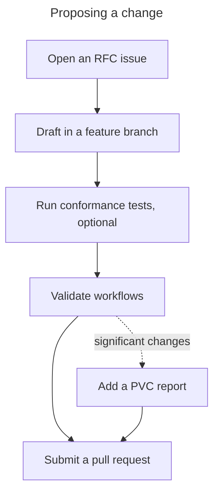
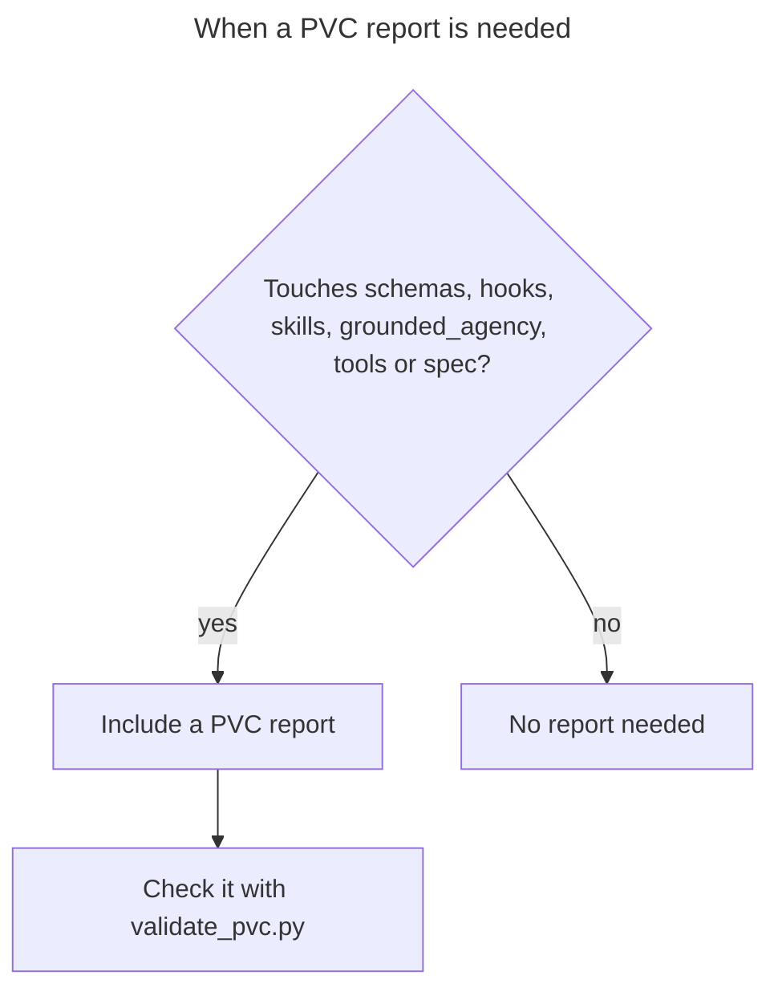

# Contributing to Agent Capability Standard

Thank you for your interest in contributing to the Agent Capability Standard.

## Governance

This project follows a formal RFC process for changes. See [`spec/GOVERNANCE.md`](./spec/GOVERNANCE.md) for:
- Versioning policy (SemVer)
- Compatibility rules
- Decision-making process
- How to propose changes via RFC

## How to Contribute

### Reporting Issues

- Use GitHub Issues for bug reports and feature requests
- Include clear reproduction steps for bugs
- Reference specific skills or schemas when applicable

### Proposing Changes

1. Open an RFC issue describing:
   - Motivation for the change
   - Alternative approaches considered
   - Backward compatibility analysis
   - Conformance test considerations (if applicable)

2. Draft implementation in a feature branch
3. Run conformance tests (optional local check):
   ```bash
   python scripts/run_conformance.py
   ```
4. Validate workflows:
   ```bash
   python tools/validate_workflows.py
   ```
5. Consider adding a PVC report for significant changes:
   - Reports live in `docs/reviews/pvc/`
   - Start from `skills/perspective-validation/pvc_report_template.yaml`
   - Validate locally with:
     ```bash
     python skills/perspective-validation/scripts/validate_pvc.py
     ```
6. Submit a pull request




### Adding Skills

New skills must:
- Follow the template in `templates/SKILL_TEMPLATE_ENHANCED.md`
- Include valid capability references from `schemas/capability_ontology.yaml`
- Define clear input/output contracts
- Include workflow references where applicable

### Documentation Site

The site at [acs.synapti.ai](https://acs.synapti.ai/) is built from the Markdown in this repository, and its build runs on every pull request.

- A new public `.md` file needs a row in `site/src/lib/routes.ts` (or an entry in its `EXCLUSIONS` list) in the same pull request. Without one the build fails with `<path>: public Markdown with no route`. These get a page automatically and need no row: a capability's `skills/<id>/SKILL.md`, `spec/RFC-NNNN-*.md`, `spec/STANDARD-v*.md` and a domain's `docs/domains/<domain>/README.md`. A composed skill's `SKILL.md` needs an entry in `COMPOSED_SKILLS` in `site/src/data/skills.ts`.
- A workflow id that a domain profile lists but no catalog defines must be listed in `site/src/data/proposed-workflows.ts`.
- Adding a capability also needs its two-letter symbol in `site/test/views.test.ts`.
- Do not add `.yml` or `.yaml` files under `site/`.

To check your change locally (Node version in `site/.nvmrc`):

```bash
cd site && npm ci && npm run check && npm test && npm run build
```

### Code Style

- YAML files: 2-space indentation
- Markdown files: CommonMark compatible
- Shell scripts: `shellcheck` compliant

## Perspective Validation Checklist (PVC)

When a change touches critical paths (`schemas/`, `hooks/`, `skills/`, `grounded_agency/`, `tools/`, `spec/`), include a **PVC report**:




- Guide: `skills/perspective-validation/CHECKLIST.md`
- Reports: `docs/reviews/pvc/`
- Template: `skills/perspective-validation/pvc_report_template.yaml`

PVC reports can be validated locally with `python skills/perspective-validation/scripts/validate_pvc.py`.

## License

By contributing, you agree that your contributions will be licensed under the Apache License 2.0.
