# Frequently Asked Questions

## Strategic Questions

### Is this worth adopting?

**Yes, if you experience any of these pain points:**

- [ ] Agent gives confident but wrong answers (no grounding)
- [ ] Debugging agent decisions takes hours (no audit trail)
- [ ] Workflow failures corrupt data without rollback (no checkpoints)
- [ ] Audit asks "why did the agent do X?" and you can't answer (no lineage)
- [ ] Multiple data sources give conflicting answers (no trust model)
- [ ] Integration between agent steps is brittle (no typed contracts)

Even one checked box means this standard can help. Three or more, and adoption is strongly recommended.

### How do I convince my team?

Lead with concrete problems this solves:

1. **Reference past incidents**: "Remember when [agent failure] happened? This standard would have prevented that."
2. **Connect to compliance**: "Audit asked for decision lineage—this provides it automatically."
3. **Quantify debug time**: "We spent X hours debugging that agent issue. With grounding and audit trails, it's traceable in minutes."
4. **Show the validator**: Run `python tools/validate_workflows.py` on an example—seeing errors caught statically is compelling.

### What's the adoption path?

Incremental adoption works. You don't need to adopt everything at once.

| Timeline | Action | Outcome |
|----------|--------|---------|
| **Week 1** | Run validator on existing workflows | Find hidden issues |
| **Week 2** | Add checkpoints to mutation-heavy workflows | Enable rollback |
| **Month 1** | Implement grounding for high-risk capabilities | Traceable decisions |
| **Quarter 1** | Achieve L2 conformance | Full type safety |
| **Quarter 2** | Implement trust model for multi-source workflows | Conflict resolution |

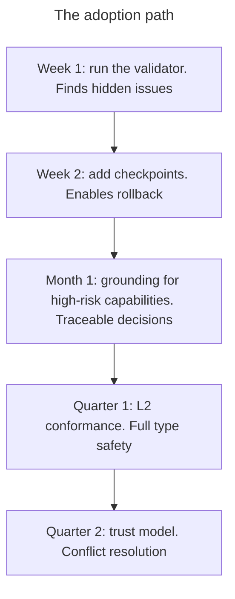

### What if we only need part of it?

The standard is modular. Common partial adoptions:

- **Checkpoints only**: Just add `checkpoint` before mutations. Immediate rollback capability.
- **Validation only**: Use the validator without changing runtime. Catch errors statically.
- **Audit only**: Add `audit` steps for compliance without other changes.
- **Full safety layer**: Checkpoints + verification + rollback for high-risk workflows.

Start where the pain is worst, then expand as you see value.

---

## Why weren't PERCEIVE/REMEMBER/COORDINATE layers expanded?

Issues #3, #4, and #5 proposed additional capabilities for these layers. After first-principles evaluation, all were rejected because they failed the criteria in `docs/methodology/FIRST_PRINCIPLES_REASSESSMENT.md`:

**Proposals that are workflow patterns:**
- `listen` = loop of `receive`
- `coordinate` = `decompose` + `delegate` + `synchronize` + `integrate`
- `compress` = `recall` + `integrate` + `transform` + `persist`

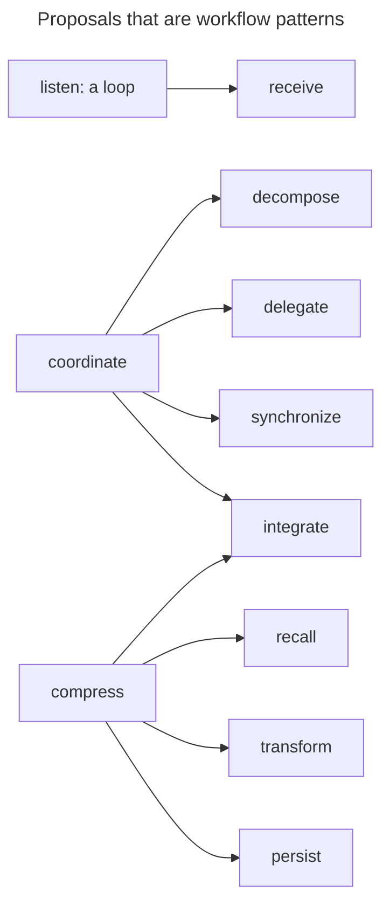

**Proposals that are parameter variations:**
- `sample` = `search` with `limit`
- `scan` = `search` with exhaustive query
- `broadcast` = `send` with multiple destinations

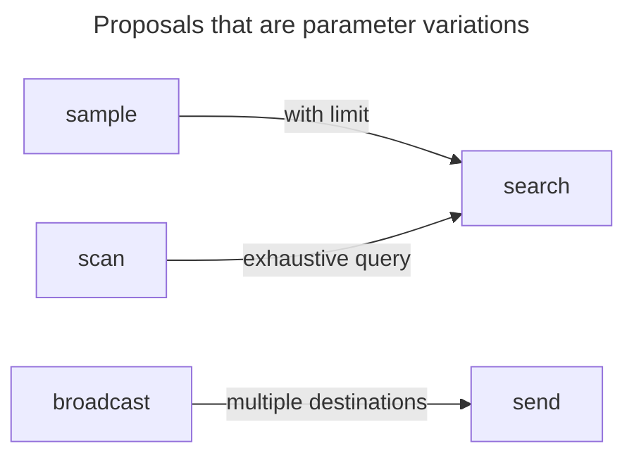

**Proposals covered by existing capabilities:**
- `observe` already exists
- `negotiate` covered by `synchronize`
- `handoff` covered by `delegate` with context
- `forget` covered by `persist(ttl: 0)` or `mutate(delete)`
- `index` and `associate` covered by MODEL layer capabilities

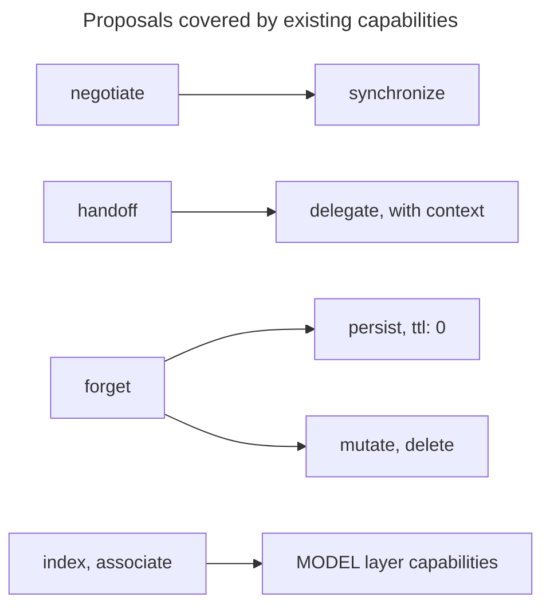

The 36-capability model represents genuinely **irreducible cognitive operations**. Workflow patterns belong in `schemas/workflow_catalog.yaml`, not as atomic capabilities.

---

## General

### What is the Agent Capability Standard?

A formal specification for building reliable AI agent systems. It defines:
- 36 atomic capabilities with typed I/O contracts across 9 cognitive layers
- A workflow DSL for composing capabilities with safety semantics
- Schemas for grounded world state and trust-aware conflict resolution
- Validation tools and conformance tests

### What is "Grounded Agency"?

Grounded Agency is the design philosophy behind the standard. It emphasizes that every agent action should be:
- **Grounded** — backed by evidence, not hallucination
- **Auditable** — with provenance and lineage
- **Safe** — mutations require checkpoints
- **Composable** — typed contracts between capabilities

### Why do we need this?

Most AI agent systems fail in production because:
- Composition is implicit (no contracts between capabilities)
- State is ungrounded (no provenance for claims)
- Conflict resolution is undefined (no trust model)
- Safety is retrofitted (no checkpoints or rollback)

This standard makes reliability structural, not optional.

### Who is this for?

- **Agent developers** building production systems
- **Platform engineers** designing agent frameworks
- **Researchers** studying agent architectures
- **Organizations** deploying AI agents in critical applications

---

## The 36 Capabilities

### Why exactly 36 capabilities?

The number 36 emerges from first-principles derivation:

1. **Foundation**: Cognitive architectures (BDI, ReAct, SOAR) provide the theoretical basis
2. **9 cognitive layers**: PERCEIVE, UNDERSTAND, REASON, MODEL, SYNTHESIZE, EXECUTE, VERIFY, REMEMBER, COORDINATE
3. **Domain parameterization**: Instead of 99 domain-specific skills (detect-anomaly, detect-entity), we use 36 atomic verbs with domain parameters (detect with domain: anomaly)
4. **Atomicity**: Each capability is truly irreducible and serves a single purpose

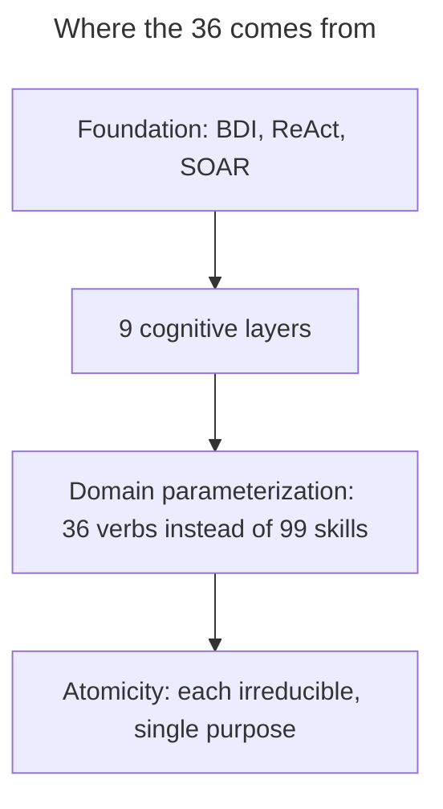

For the full derivation, see [docs/methodology/FIRST_PRINCIPLES_REASSESSMENT.md](methodology/FIRST_PRINCIPLES_REASSESSMENT.md).

### What happened to the 99 capabilities?

The original 99-capability model included many domain-specific variants. Through first-principles analysis, we discovered these could be unified:

| Old Model (99) | New Model (36) | Pattern |
|----------------|----------------|---------|
| detect-anomaly, detect-entity, detect-person | detect (domain: anomaly/entity/person) | Domain parameterization |
| estimate-risk, estimate-impact | measure (metric: risk/impact) | Metric parameterization |
| forecast-risk, forecast-time | predict (horizon: risk/time) | Horizon parameterization |

The archived 99-capability model is in `_archive/skills/` for reference.

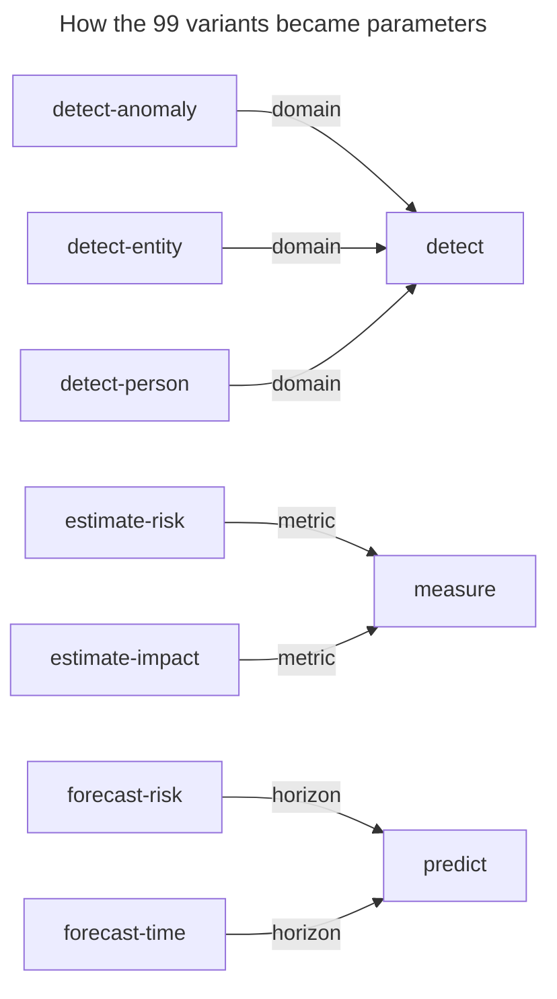

### Is 36 the final number?

The ontology is **stable but extensible**. A 37th capability may be added if:
- It cannot be expressed as a composition of existing capabilities
- It passes atomicity tests (irreducible, single purpose, typed contract)
- It's used in at least one reference workflow
- It fits clearly into exactly one layer

See [Extension Governance](methodology/EXTENSION_GOVERNANCE.md) for the RFC process.

### Can I add my own capabilities?

Yes, through the governance process:

1. Open a GitHub issue proposing the capability
2. Create an RFC if the issue gains support
3. Demonstrate the capability meets all criteria (non-composable, atomic, useful)
4. After review, capability may be accepted

For most use cases, **composing existing capabilities** or **parameterizing with domains** is preferred.

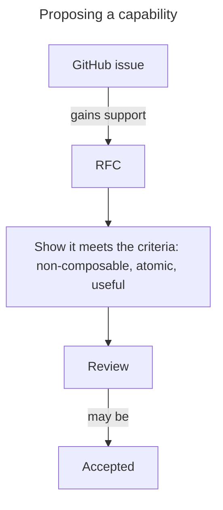

### How do domain parameters work?

Instead of many domain-specific capabilities, use the atomic capability with a domain parameter:

```yaml
# Old approach (99 capabilities)
- capability: detect-anomaly
  store_as: anomaly_out
  input_bindings:
    data: ${observe_out.observation}
    pattern: error_rate_spike

# New approach (36 capabilities)
- capability: detect
  domain: anomaly
  store_as: anomaly_out
  input_bindings:
    data: ${observe_out.observation}
    pattern: error_rate_spike
```

This keeps the ontology small while preserving expressiveness.

### Is this like the periodic table?

The analogy captures the design philosophy:

| Chemistry | Grounded Agency |
|-----------|-----------------|
| ~118 elements | 36 capabilities |
| Atoms are irreducible | Capabilities are atomic |
| Molecules are compositions | Workflows are compositions |
| Element groups (metals, gases) | Capability layers (9 cognitive layers) |

**What the analogy means**: Capabilities are composable primitives. The goal is better workflows (molecules), not more capabilities (atoms).

**What it doesn't mean**: We don't claim physical law derivation or that 35 is fixed forever.

---

## Technical

### How is this different from LangChain/AutoGPT/etc?

Those are frameworks for building agents. This is a *specification* for agent capabilities and their composition. Key differences:

| Aspect | Frameworks | This Standard |
|--------|------------|---------------|
| Focus | Implementation | Specification |
| Contracts | Implicit | Explicit I/O schemas |
| Safety | Optional | By construction |
| Validation | Runtime | Static + runtime |
| Provenance | Rare | Required |

The standard can be implemented *within* existing frameworks.

### What languages are supported?

The standard is language-agnostic. The reference validator is written in Rust (`core/`) and exposed to Python as `grounded_agency._core`, but the specification can be implemented in any language. The key artifacts are:
- JSON/YAML schemas
- Capability ontology
- Workflow definitions

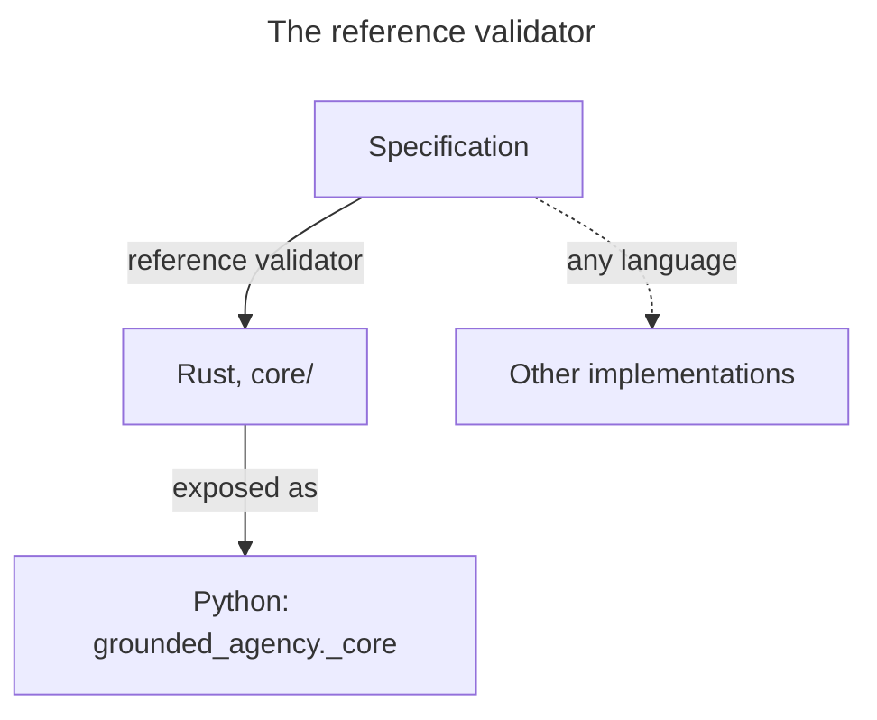

### How do I validate my workflows?

```bash
# Validate against the specification (--strict also fails on warnings)
python tools/validate_workflows.py --catalog path/to/your/workflow.yaml --strict

# Generate patch suggestions
python tools/validate_workflows.py --emit-patch
```

### What are the conformance levels?

| Level | What It Validates |
|-------|-------------------|
| L1 | Capability existence, prerequisites |
| L2 | Schema resolution, type inference |
| L3 | Binding types vs consumer contracts |
| L4 | Patch suggestions, coercion registry |

See [CONFORMANCE.md](../spec/CONFORMANCE.md) for details.

### How do bindings work?

Bindings reference outputs from earlier steps:

```yaml
- capability: observe
  store_as: observe_out
  input_bindings:
    target: logs/app.log

- capability: detect
  domain: anomaly
  input_bindings:
    data: ${observe_out.observation}  # References observe's output
    pattern: error_rate_spike
```

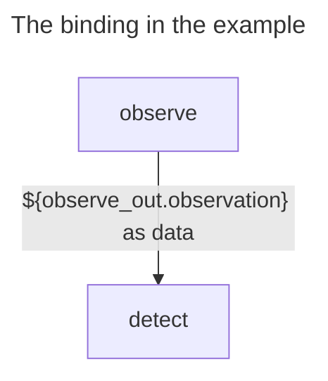

Typed bindings add explicit type annotations:
```yaml
observations: "${integrate_out.merged.observations: array<object>}"  # quote typed references
```

### What are gates?

Gates are conditional checks that can halt or redirect execution:

```yaml
gates:
  - when: ${checkpoint_out.checkpoint_id} == null
    action: stop
    message: "No checkpoint created. Do not mutate."
```

### How does rollback work?

1. Before any mutation, create a checkpoint
2. Execute the mutation
3. Verify the outcome
4. If verification fails, rollback to the checkpoint

The standard enforces this pattern: `mutate` requires `checkpoint`.

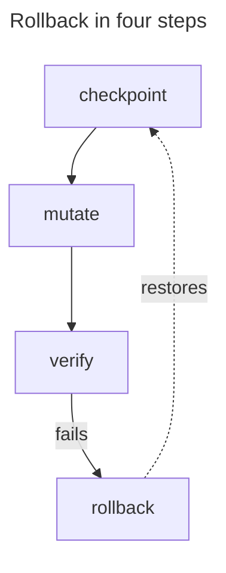

---

## Implementation

### Can I add my own capabilities?

Yes. Define a new capability in your ontology extension:

```json
{
  "id": "my-custom-capability",
  "layer": "UNDERSTAND",
  "description": "What it does...",
  "input_schema": { ... },
  "output_schema": { ... },
  "risk": "low",
  "mutation": false
}
```

Then create a corresponding skill in `skills/my-custom-capability/SKILL.md`.

### Can I create my own workflows?

Yes. Define a workflow in YAML:

```yaml
my_workflow:
  goal: What this workflow achieves
  risk: medium
  spec_version: "1.1"
  inputs:
    user_input:
      type: object
      properties:
        target:
          type: string
        limits:
          type: array
          items: {type: string}
  steps:
    - capability: observe
      purpose: First step
      store_as: observe_out
      input_bindings:
        target: ${user_input.target}
    - capability: plan
      purpose: Create a plan
      store_as: plan_out
      input_bindings:
        goal: Update ${user_input.target} within the limits
        context: ${observe_out.observation}
    - capability: constrain
      purpose: Check the plan against the limits before changing anything
      store_as: constrain_out
      input_bindings:
        target: ${plan_out}
        constraints: ${user_input.limits}
    - capability: checkpoint
      purpose: Save state
      store_as: checkpoint_out
      input_bindings:
        scope: ${user_input.target}
    - capability: mutate
      purpose: Execute changes
      store_as: result
      input_bindings:
        target: ${user_input.target}
        operation:
          apply: "${plan_out.steps: array<object>}"
```

`checkpoint` must run before `mutate` (error V102 otherwise); `constrain` is recommended before it (warning W601 otherwise).

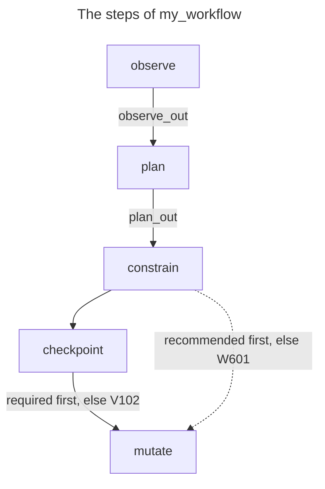

See [TUTORIAL.md](TUTORIAL.md) for a guided walkthrough.

### How do I extend the validator?

The validation rules live in the Rust core under `core/src/validate`; `tools/validate_workflows.py` is a thin CLI over it. You can:
- Add new validation rules (in `core/src/validate`, then rebuild with `pip install -e ".[dev]" -c constraints.txt`)
- Extend the coercion registry (`schemas/transforms/transform_coercion_registry.yaml`)
- Add custom patch suggestions

### Is there a runtime executor?

The standard focuses on validation and specification. Runtime execution depends on your agent framework. The validator ensures workflows are *valid*; execution is implementation-dependent.

---

## Safety

### Why is checkpoint required before mutation?

Checkpoints enable rollback if something goes wrong. Without checkpoints:
- Failures are permanent
- Partial execution leaves inconsistent state
- Recovery requires manual intervention

The standard makes this protection automatic.

### What about prompt injection?

The standard addresses this through:
- Typed contracts (schema validation)
- Grounded claims (evidence requirements)
- Audit trails (traceability)

However, prompt injection defense is primarily a runtime concern. The standard provides the structure; implementation provides the defense.

### How is trust calculated?

Trust scores combine:
- **Source authority**: Configured weights per source
- **Recency**: Time decay with configurable half-life
- **Field-specific authority**: Sources may be authoritative for specific fields

See `schemas/authority_trust_model.yaml` for configuration.

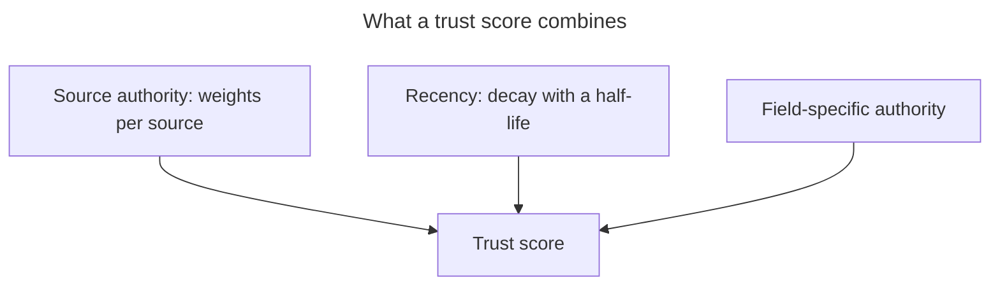

---

## Multimodal Support

### Does this work with images, audio, and video?

Yes. The standard includes modality-specific domain profiles and grounding requirements:

- **Vision**: Spatial grounding with bounding boxes and confidence scores
- **Audio**: Temporal grounding with timestamps and speaker diarization
- **Multimodal**: Cross-modal consistency checks and fusion strategies

See the [Modality Handling Guide](guides/MODALITY_HANDLING.md) for full details.

### How do modality profiles differ from regular domain profiles?

Modality profiles add source-type-specific trust weights and grounding requirements. For example, the vision profile requires spatial coordinates for all detections, while the audio profile requires temporal anchors.

---

## Adoption

### How do I get started?

1. Follow the [Quickstart Guide](QUICKSTART.md) (10 min)
2. Complete the [Tutorial](TUTORIAL.md) (30 min)
3. Read the [Specification](../spec/STANDARD-v1.1.0.md)

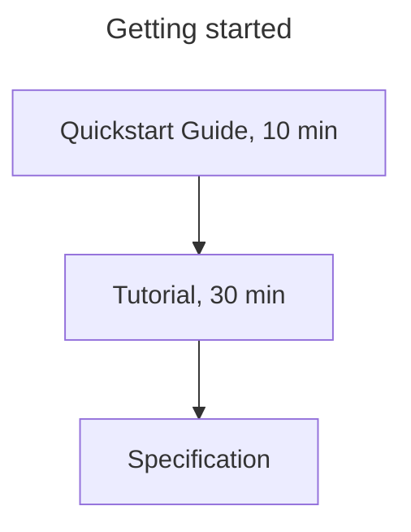

### Can I use this commercially?

Yes. The standard is Apache 2.0 licensed. You can use, modify, and distribute it in commercial products.

### How do I contribute?

1. Read [CONTRIBUTING.md](../CONTRIBUTING.md)
2. Follow the RFC process in [GOVERNANCE.md](../spec/GOVERNANCE.md)
3. Submit PRs for issues or enhancements

### Where can I get help?

- GitHub Issues: [Report bugs or ask questions](https://github.com/synaptiai/agent-capability-standard/issues)
- Discussions: [Join the conversation](https://github.com/synaptiai/agent-capability-standard/discussions)

---

## Comparison

### How does this relate to OpenAI function calling?

OpenAI function calling defines how to invoke tools. This standard defines:
- *What* capabilities exist (ontology)
- *How* they compose (workflow DSL)
- *What* contracts they satisfy (schemas)

Function calling is one way to *execute* capabilities; this standard defines the *specification*.

### How does this relate to MCP (Model Context Protocol)?

MCP defines how to connect tools to language models. This standard defines:
- Capability semantics and contracts
- Workflow composition and safety
- World state and trust models

They are complementary: MCP for connection, this standard for capability semantics.

### How does this relate to OASF (Open Agent Skill Framework)?

The standard provides an interoperability layer with OASF. Of the 36 capabilities, 23 are fully mapped to OASF skill codes, 7 are partially mapped, and 6 use synthetic GA-extension codes. See [OASF Coverage Report](integrations/oasf_coverage.md) for the full mapping.

### How does this relate to A2A (Agent-to-Agent protocol)?

A2A defines how agents communicate with each other (inter-agent transport). This standard defines what agents can *do* (intra-agent capability semantics). They are complementary:
- **A2A**: "How do agents talk to each other?"
- **Agent Capability Standard**: "What can each agent do, and how do capabilities compose safely?"

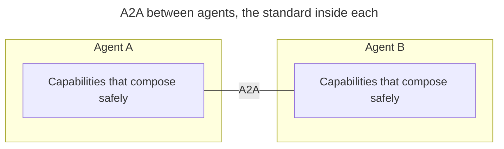

### What makes this different from other agent frameworks?

The key distinction is **spec vs. framework**:

| Aspect | Frameworks (LangChain, AutoGPT, CrewAI) | This Standard |
|--------|------------------------------------------|---------------|
| What it is | Implementation library | Specification |
| Contracts | Implicit (runtime discovery) | Explicit (typed I/O schemas) |
| Safety | Optional middleware | Structural (checkpoint required for mutation) |
| Validation | Runtime errors | Static analysis (4 conformance levels) |
| Provenance | Rarely tracked | Required (evidence anchors) |

The standard can be implemented *within* existing frameworks. It's not a replacement—it's a layer of reliability on top.

---

Still have questions? [Open an issue](https://github.com/synaptiai/agent-capability-standard/issues/new).
