# Workflow Patterns

**Document Status**: Reference
**Last Updated**: 2026-01-26
**Purpose**: Document how 36 atomic capabilities compose into reusable workflow patterns

---

## Overview

The 36 atomic capabilities are **primitives**. Real agent behaviors emerge by **composing** these primitives into workflow patterns. This document catalogs common patterns that can be implemented as Skills.

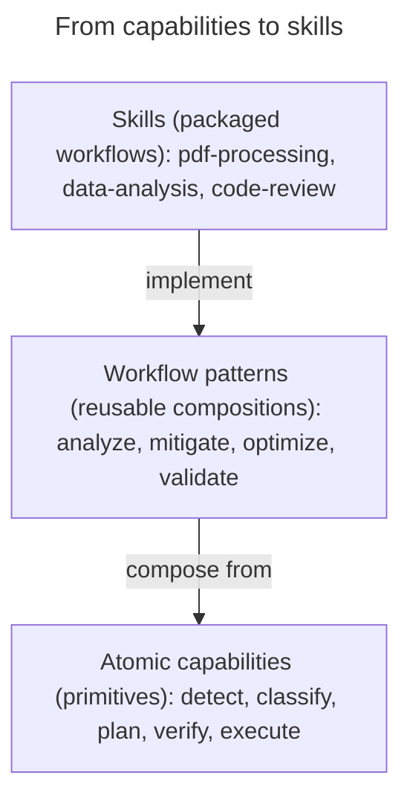

---

## Pattern Categories

| Category | Purpose | Example Patterns |
|----------|---------|------------------|
| **Analysis** | Understand data | analyze, profile, audit |
| **Planning** | Decide what to do | strategize, prioritize, schedule |
| **Execution** | Do the work | process, migrate, deploy |
| **Validation** | Ensure correctness | validate, test, review |
| **Optimization** | Make things better | optimize, refine, improve |
| **Coordination** | Work with others | orchestrate, negotiate, handoff |

---

## 1. Analysis Patterns

### 1.1 Analyze Pattern

**Purpose**: Comprehensive examination of a subject.

```yaml
analyze:
  description: Examine subject thoroughly and report findings
  capabilities:
    - retrieve       # Get the data
    - detect         # Find patterns
    - classify       # Categorize findings
    - measure        # Quantify metrics
    - compare        # Evaluate against baseline
    - explain        # Summarize findings

  flow:
    1. retrieve(target) → data
    2. detect(data, patterns) → occurrences
    3. classify(occurrences) → categories
    4. measure(data, metrics) → values
    5. compare(values, baseline) → assessment
    6. explain(assessment) → report
```

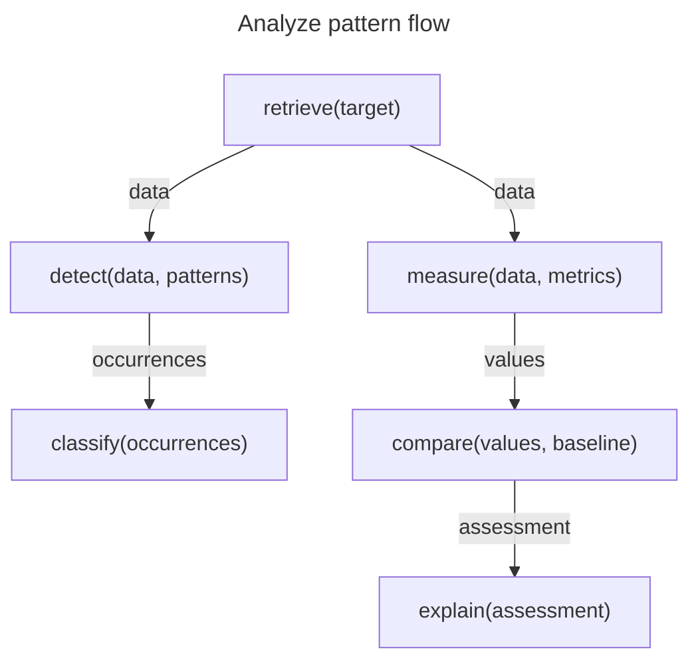

**Example uses**:
- Code analysis
- Data profiling
- Security audit
- Performance analysis

### 1.2 Diagnose Pattern

**Purpose**: Find root cause of a problem.

```yaml
diagnose:
  description: Identify root cause of observed issue
  capabilities:
    - observe        # See current state
    - detect         # Find anomalies
    - attribute      # Trace causation
    - explain        # Report findings

  flow:
    1. observe(system) → current_state
    2. detect(current_state, anomaly_patterns) → issues
    3. attribute(issues) → causes
    4. explain(causes) → diagnosis
```

### 1.3 Profile Pattern

**Purpose**: Build comprehensive picture of an entity.

```yaml
profile:
  description: Create detailed profile of subject
  capabilities:
    - retrieve       # Get data from multiple sources
    - integrate      # Merge data
    - classify       # Categorize attributes
    - state          # Create unified representation

  flow:
    1. retrieve(sources) → raw_data[]
    2. integrate(raw_data) → merged
    3. classify(merged, attributes) → categorized
    4. state(categorized) → profile
```

---

## 2. Planning Patterns

### 2.1 Strategize Pattern

**Purpose**: Create high-level plan for complex goal.

```yaml
strategize:
  description: Develop strategy to achieve goal
  capabilities:
    - observe        # Understand current state
    - predict        # Forecast outcomes
    - compare        # Evaluate options
    - decompose      # Break into phases
    - plan           # Create action plan

  flow:
    1. observe(environment) → current_state
    2. predict(scenarios) → outcomes[]
    3. compare(outcomes, criteria) → best_approach
    4. decompose(best_approach) → phases
    5. plan(phases) → strategy
```

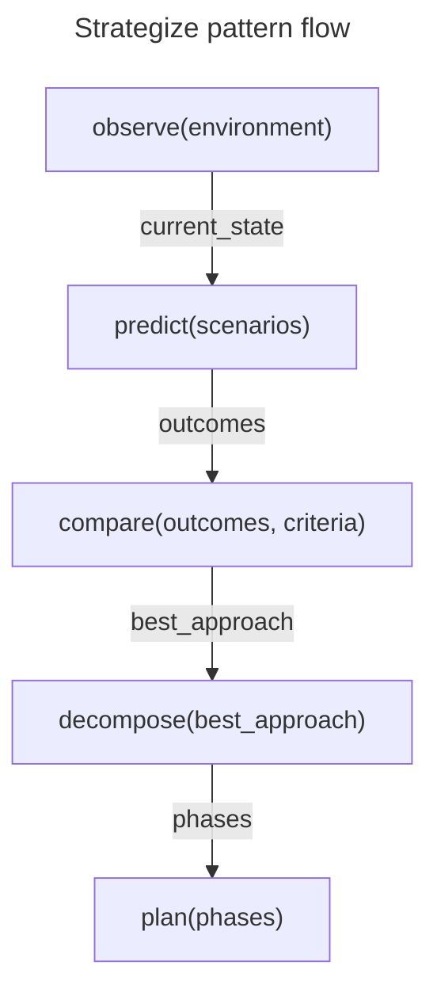

### 2.2 Prioritize Pattern

**Purpose**: Order items by importance.

```yaml
prioritize:
  description: Rank items by criteria
  capabilities:
    - retrieve       # Get items
    - measure        # Score each item
    - compare        # Rank by scores
    - explain        # Justify ranking

  flow:
    1. retrieve(items) → list
    2. measure(list, criteria) → scores
    3. compare(scores) → ranking
    4. explain(ranking) → rationale
```

### 2.3 Schedule Pattern

**Purpose**: Assign temporal ordering to tasks.

```yaml
schedule:
  description: Create timeline for tasks
  capabilities:
    - retrieve       # Get tasks
    - measure        # Estimate durations
    - detect         # Find dependencies
    - plan           # Create schedule
    - constrain      # Apply constraints

  flow:
    1. retrieve(tasks) → task_list
    2. measure(tasks, duration) → estimates
    3. detect(tasks, dependencies) → deps
    4. plan(tasks, estimates, deps) → draft_schedule
    5. constrain(draft_schedule, resources) → schedule
```

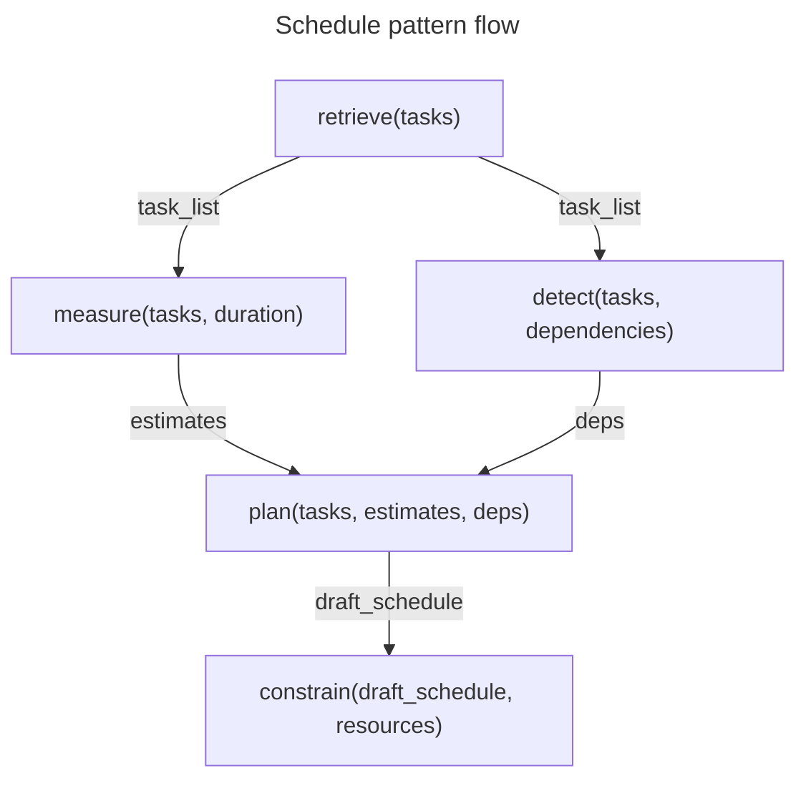

---

## 3. Execution Patterns

### 3.1 Process Pattern

**Purpose**: Transform input through defined steps.

```yaml
process:
  description: Transform data through pipeline
  capabilities:
    - retrieve       # Get input
    - transform      # Apply transformations
    - verify         # Check result
    - persist        # Save output

  flow:
    1. retrieve(input) → data
    2. checkpoint(data) → recovery_point
    3. transform(data, steps) → result
    4. verify(result, criteria) → valid?
    5. if valid: persist(result)
    6. else: rollback(recovery_point)
```

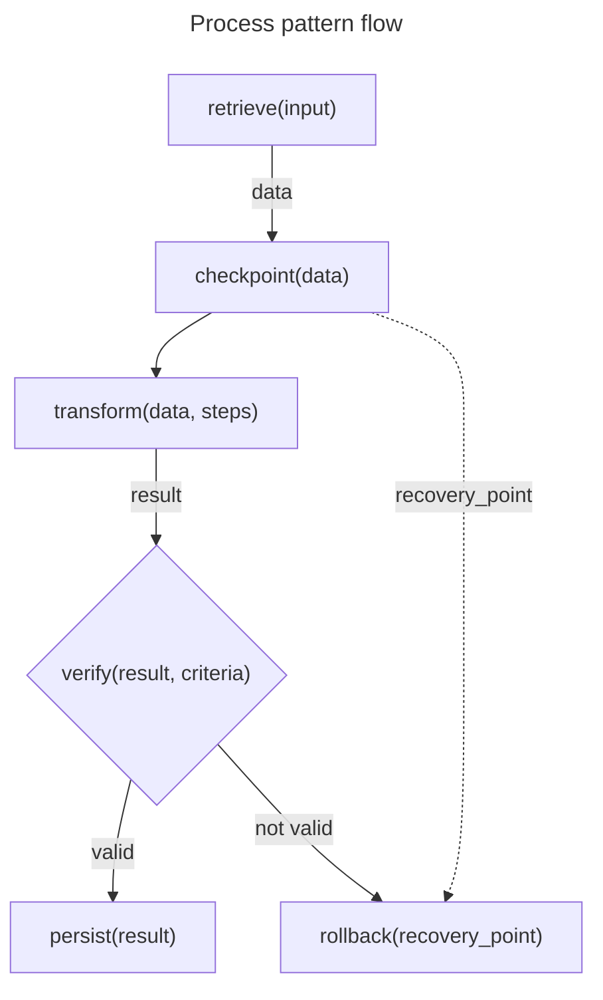


### 3.2 Migrate Pattern

**Purpose**: Move data/state from one system to another.

```yaml
migrate:
  description: Transfer data between systems
  capabilities:
    - retrieve       # Get source data
    - transform      # Convert format
    - verify         # Validate transformation
    - checkpoint     # Save recovery point
    - mutate         # Write to target
    - verify         # Confirm success

  flow:
    1. retrieve(source) → data
    2. transform(data, target_format) → converted
    3. verify(converted, schema) → valid?
    4. checkpoint(target_state) → recovery_point
    5. mutate(target, converted) → result
    6. verify(result, expectations) → success?
    7. if !success: rollback(recovery_point)
```

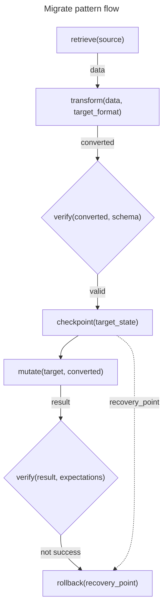

### 3.3 Execute-Verify-Retry Pattern

**Purpose**: Run operation with validation and retry.

```yaml
execute_verify_retry:
  description: Execute with validation loop
  capabilities:
    - checkpoint     # Save state
    - execute        # Run operation
    - verify         # Check result
    - rollback       # Restore on failure
    - explain        # Report outcome

  flow:
    loop max_attempts:
      1. checkpoint(state) → recovery
      2. execute(operation) → result
      3. verify(result, criteria) → valid?
      4. if valid: break with success
      5. rollback(recovery)
      6. plan(failure, adjustments) → retry_plan
    7. explain(outcome) → report
```

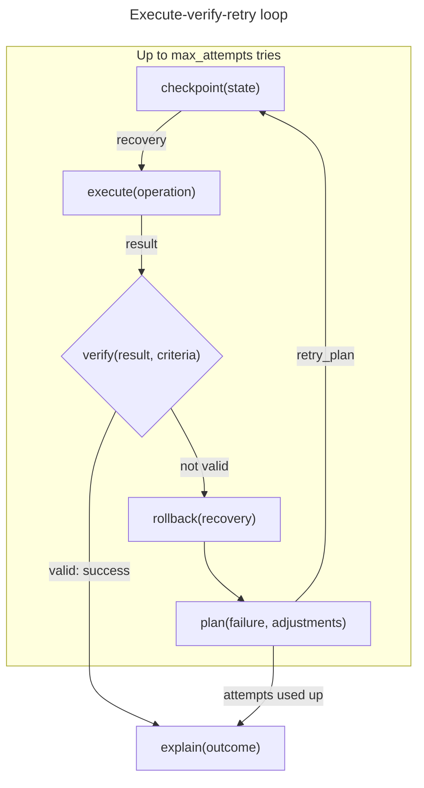


---

## 4. Validation Patterns

### 4.1 Validate Pattern

**Purpose**: Comprehensive validation against criteria.

```yaml
validate:
  description: Check subject meets all criteria
  capabilities:
    - retrieve       # Get subject
    - verify         # Check conditions
    - detect         # Find violations
    - explain        # Report results

  flow:
    1. retrieve(subject) → data
    2. verify(data, criteria) → results
    3. detect(results, violations) → issues
    4. explain(issues) → report
```

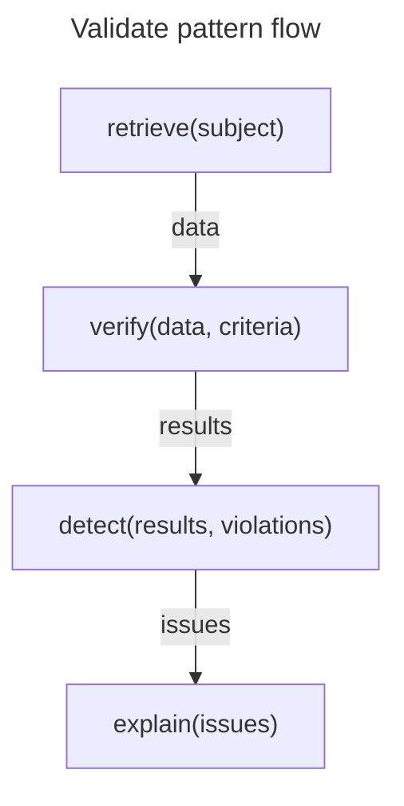

### 4.2 Test Pattern

**Purpose**: Execute tests and report results.

```yaml
test:
  description: Run tests against subject
  capabilities:
    - retrieve       # Get test cases
    - execute        # Run tests
    - compare        # Check against expected
    - measure        # Calculate metrics
    - generate       # Create report

  flow:
    1. retrieve(test_suite) → tests
    2. for each test:
       a. execute(test.code) → actual
       b. compare(actual, test.expected) → result
    3. measure(results, coverage) → metrics
    4. generate(results, metrics) → report
```

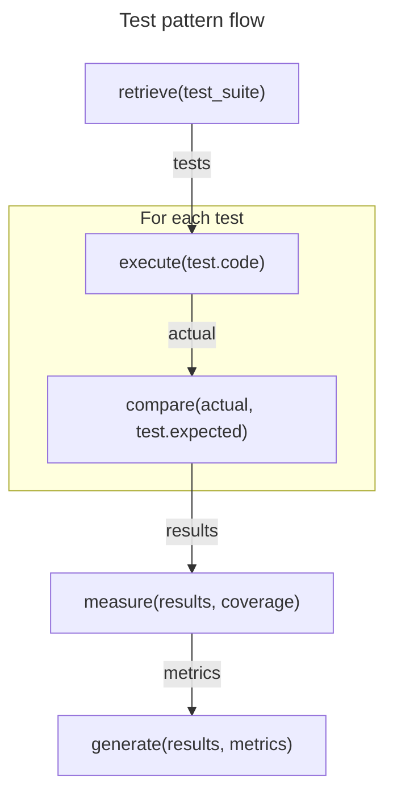

### 4.3 Review Pattern

**Purpose**: Human-in-the-loop validation.

```yaml
review:
  description: Present for review and incorporate feedback
  capabilities:
    - generate       # Create review artifact
    - send           # Present to reviewer
    - receive        # Get feedback
    - critique       # Analyze feedback
    - plan           # Plan changes

  flow:
    1. generate(subject, format) → artifact
    2. send(artifact, reviewer) → submitted
    3. receive(feedback) → comments
    4. critique(comments) → actionable
    5. plan(actionable) → changes
```

---

## 5. Optimization Patterns

### 5.1 Optimize Pattern

**Purpose**: Iteratively improve toward objective.

```yaml
optimize:
  description: Find best solution through iteration
  capabilities:
    - observe        # Current state
    - discover       # Find candidates
    - measure        # Evaluate each
    - compare        # Rank options
    - mutate         # Apply improvement
    - verify         # Confirm improvement

  flow:
    loop until_converged:
      1. observe(state) → current
      2. discover(current, possibilities) → candidates
      3. measure(candidates, objective) → scores
      4. compare(scores) → best
      5. if best > current:
         a. checkpoint(state)
         b. mutate(state, best) → new_state
         c. verify(new_state) → improved?
         d. if !improved: rollback()
```

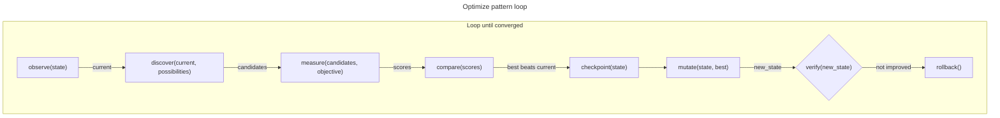

### 5.2 Refine Pattern

**Purpose**: Incrementally improve quality.

```yaml
refine:
  description: Iteratively improve artifact
  capabilities:
    - critique       # Find weaknesses
    - plan           # Plan improvements
    - transform      # Apply changes
    - verify         # Check improvement

  flow:
    loop until_satisfactory:
      1. critique(artifact) → issues
      2. if no issues: break
      3. plan(issues) → improvements
      4. transform(artifact, improvements) → refined
      5. verify(refined, criteria) → better?
      6. artifact = refined
```

### 5.3 Mitigate Pattern

**Purpose**: Reduce risk through intervention.

```yaml
mitigate:
  description: Identify and reduce risks
  capabilities:
    - detect         # Find risks
    - measure        # Quantify severity
    - compare        # Prioritize
    - plan           # Create mitigation
    - execute        # Apply mitigation
    - verify         # Confirm reduction

  flow:
    1. detect(subject, risk_patterns) → risks
    2. measure(risks, impact × probability) → scored
    3. compare(scored) → prioritized
    4. for high_priority_risks:
       a. plan(risk, mitigation_options) → action
       b. checkpoint(state)
       c. execute(action) → result
       d. verify(result, risk_reduced) → success?
       e. if !success: rollback()
```

---

## 6. Coordination Patterns

### 6.1 Orchestrate Pattern

**Purpose**: Coordinate multiple agents/workflows.

```yaml
orchestrate:
  description: Coordinate parallel work streams
  capabilities:
    - decompose      # Break into parts
    - delegate       # Assign to agents
    - synchronize    # Wait for completion
    - integrate      # Merge results

  flow:
    1. decompose(task) → subtasks
    2. for each subtask:
       delegate(subtask, agent) → task_id
    3. synchronize(task_ids) → results
    4. integrate(results) → final
```

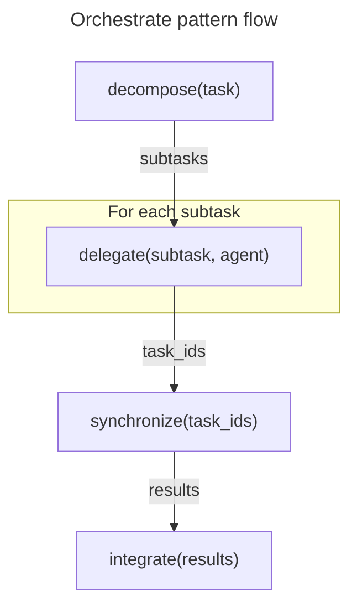

### 6.2 Handoff Pattern

**Purpose**: Transfer work between agents.

```yaml
handoff:
  description: Transfer context and work to another agent
  capabilities:
    - state          # Capture current state
    - generate       # Create handoff package
    - delegate       # Transfer to agent
    - receive        # Get acknowledgment

  flow:
    1. state(work_context) → snapshot
    2. generate(snapshot, handoff_format) → package
    3. delegate(package, target_agent) → task_id
    4. receive(acknowledgment) → confirmed
```

### 6.3 Consensus Pattern

**Purpose**: Achieve agreement among multiple parties.

```yaml
consensus:
  description: Reach agreement among agents
  capabilities:
    - generate       # Create proposal
    - send           # Distribute proposal
    - receive        # Collect votes
    - compare        # Evaluate consensus
    - synchronize    # Finalize agreement

  flow:
    1. generate(options) → proposal
    loop until_consensus:
      2. send(proposal, agents) → distributed
      3. receive(votes) → responses
      4. compare(responses) → agreement_level
      5. if agreement_level < threshold:
         generate(revised_proposal) → proposal
    6. synchronize(agents, final_proposal) → consensus
```

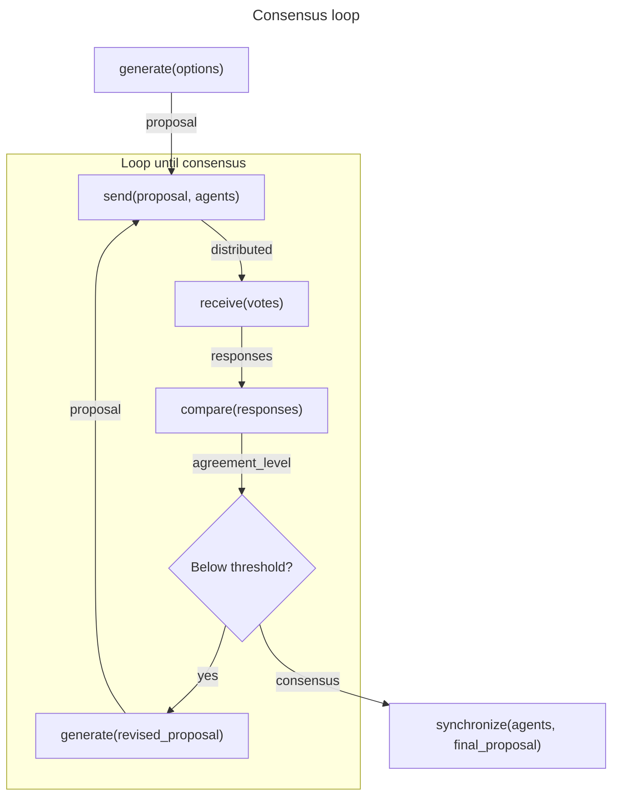


---

## 7. Compound Patterns

### 7.1 Research Pattern

**Purpose**: Investigate a topic and synthesize findings.

```yaml
research:
  description: Investigate topic and produce synthesis
  composes: [analyze, profile, explain]

  flow:
    1. search(topic) → sources
    2. analyze(sources) → findings
    3. profile(findings) → structured
    4. ground(structured, sources) → grounded
    5. explain(grounded) → synthesis
```

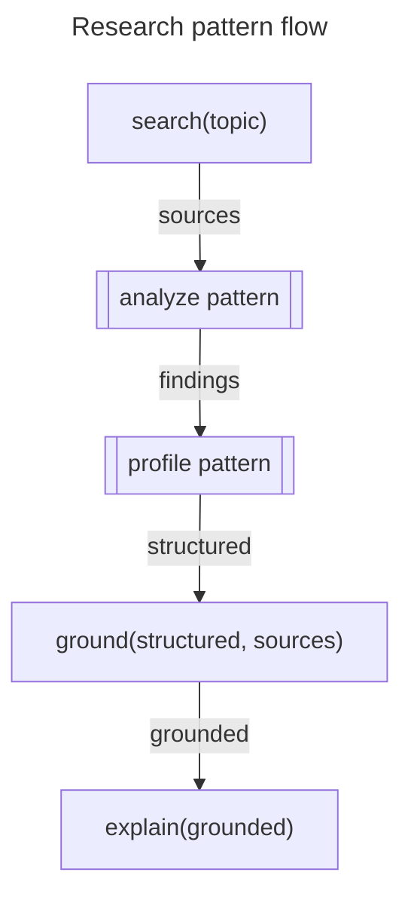

### 7.2 Build Pattern

**Purpose**: Create artifact through iterative development.

```yaml
build:
  description: Create artifact with validation
  composes: [plan, process, test, refine]

  flow:
    1. plan(requirements) → design
    2. decompose(design) → components
    3. for each component:
       a. generate(component_spec) → artifact
       b. test(artifact) → results
       c. if !passed: refine(artifact) → artifact
    4. integrate(artifacts) → product
    5. test(product) → final_results
```

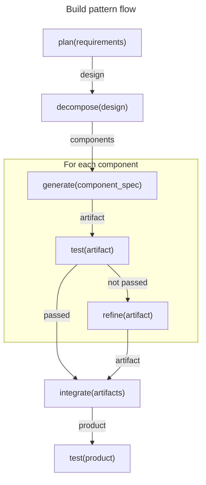

### 7.3 Monitor Pattern

**Purpose**: Continuous observation with alerting.

```yaml
monitor:
  description: Watch for conditions and respond
  composes: [observe, detect, mitigate]

  flow:
    loop continuously:
      1. observe(system) → state
      2. detect(state, alert_conditions) → alerts
      3. if alerts:
         a. classify(alerts) → severity
         b. if critical:
            mitigate(alerts) → response
         c. audit(alerts, response) → logged
      4. persist(state) → history
```

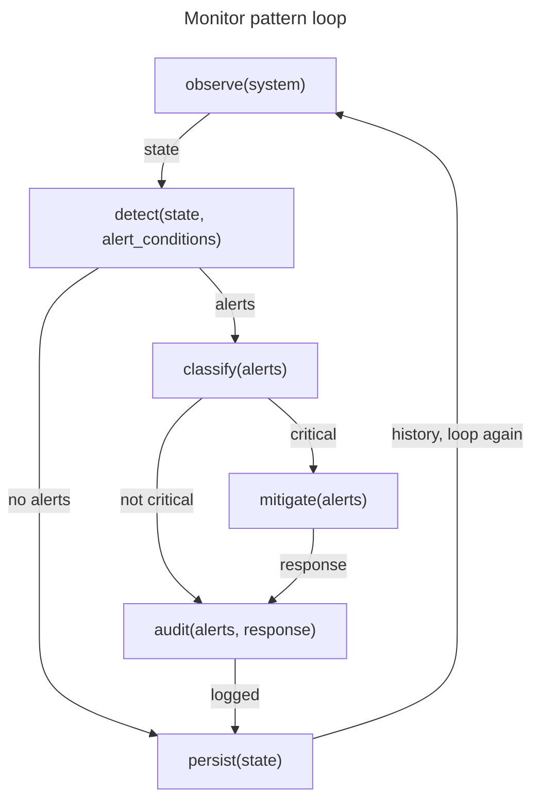

---

## Pattern Composition Rules

### 1. Capability Dependencies

Only `requires` edges force another capability to be present: every `mutate`, `send` and `rollback` step needs a `checkpoint` step running before it (V102). `precedes` edges only order capabilities that both appear in a workflow (V102 when the target has no source step before it); they never demand the source. `constrain` is a soft prerequisite of `execute`, `mutate` and `send`: a workflow without it still validates, with warning W601. A step in the same `parallel_group` does not count as running before another.

```
requires (presence and order, V102):
  checkpoint → mutate | send | rollback

precedes (order when both are present, V102), for example:
  checkpoint → mutate, send
  plan → execute, mutate
  constrain → execute, mutate, send, generate
  execute | mutate | send → verify → audit
  observe → detect → classify

soft_requires (one source first, else W601):
  constrain → execute | mutate | send
  observe | detect | predict | attribute | explain → ground

enables (informational):
  retrieve → detect
  decompose → delegate
```

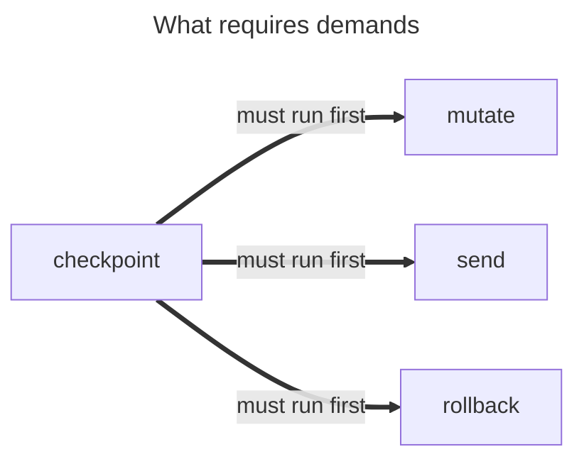

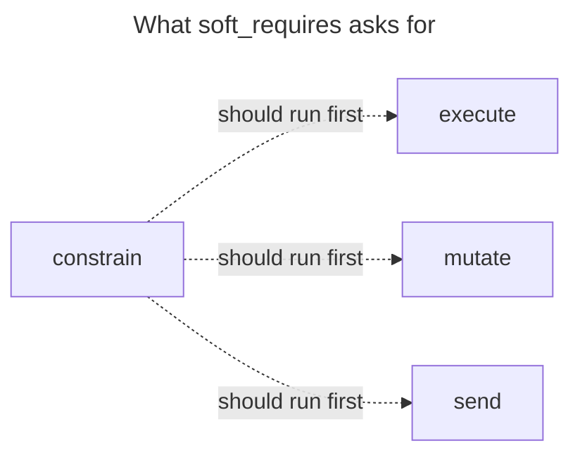


### 2. Safety Requirements

High-risk patterns must include safety capabilities:

| Pattern Risk | Required Capabilities |
|--------------|----------------------|
| Low | verify |
| Medium | checkpoint, verify |
| High | checkpoint, verify, rollback, audit |

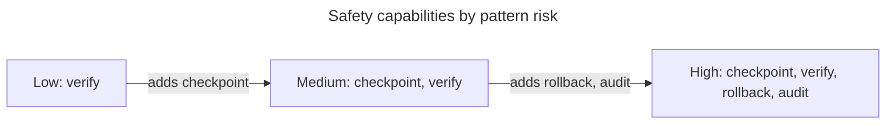

### 3. Evidence Requirements

All patterns should maintain evidence chain:

```
Every capability output includes:
  - evidence_anchors: array
  - confidence: number (0-1)

Pattern outputs should aggregate:
  - All evidence from component capabilities
  - Lowest confidence from chain
```

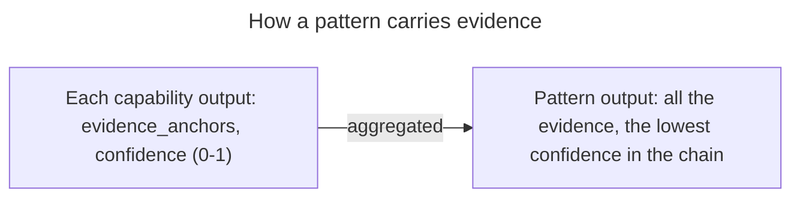

---

## Implementing Patterns as Skills

To implement a workflow pattern as a Claude Skill:

```yaml
# SKILL.md structure

---
name: pattern-name
description: What the pattern does and when to use it
---

# Pattern Name

## Quick Start

[Minimal example]

## Workflow

1. **Step 1**: [capability] - purpose
2. **Step 2**: [capability] - purpose
...

## Inputs

- `input_name`: description

## Outputs

- `output_name`: description

## Error Handling

- On failure at step N: [recovery action]

## Examples

[Concrete examples]
```

---

## Summary

| Layer | Patterns |
|-------|----------|
| Analysis | analyze, diagnose, profile |
| Planning | strategize, prioritize, schedule |
| Execution | process, migrate, execute-verify-retry |
| Validation | validate, test, review |
| Optimization | optimize, refine, mitigate |
| Coordination | orchestrate, handoff, consensus |
| Compound | research, build, monitor |

All patterns compose from the **36 atomic capabilities**. New patterns can be created by combining existing capabilities in new ways.

---

## References

- [capability_ontology.yaml](../schemas/capability_ontology.yaml) — The 36 atomic capabilities
- [FIRST_PRINCIPLES_REASSESSMENT.md](methodology/FIRST_PRINCIPLES_REASSESSMENT.md) — Derivation methodology
- [Claude Skills Overview](https://platform.claude.com/docs/en/agents-and-tools/agent-skills/overview)
