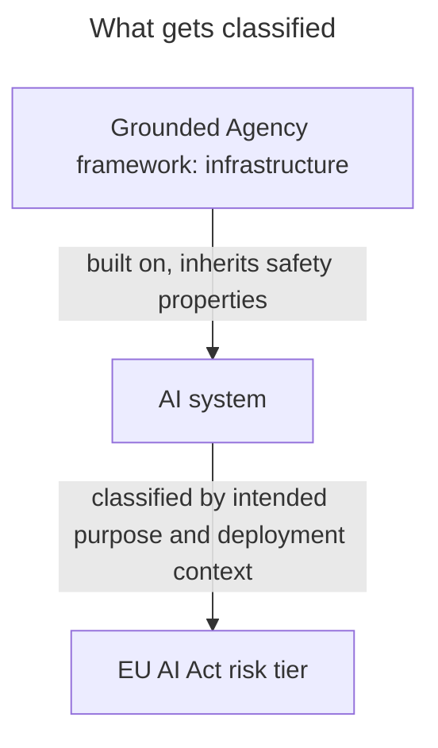
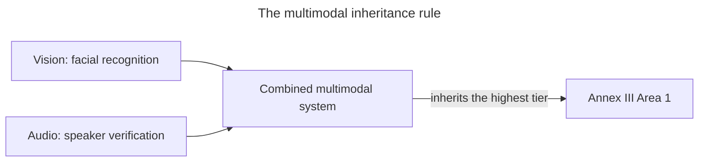

# Risk Classification — EU AI Act Article 6 (Classification Rules)

**Regulation:** EU AI Act (Regulation 2024/1689)
**Article:** 6 — Classification Rules for High-Risk AI Systems
**Framework:** Grounded Agency (Agent Capability Standard v2.0.0)
**Status:** Reference analysis — Maps framework domain profiles to EU AI Act risk categories

---

## 1. Purpose

This document classifies the Grounded Agency framework's 7 domain profiles against the EU AI Act's risk taxonomy. It establishes the foundation for conformity assessment by determining which regulatory obligations apply to each deployment context.

**Critical distinction:** The Grounded Agency framework is *infrastructure* — a capability ontology, safety model, and composition engine — not an AI system itself. AI systems *built on* this framework inherit its safety properties but are classified based on their *intended purpose* and *deployment context*, not the framework alone. This document assesses the framework's structural readiness for each risk tier.

## 2. EU AI Act Risk Taxonomy

The EU AI Act establishes four risk tiers:

| Tier | Definition | Regulatory Obligation | Reference |
|------|-----------|----------------------|-----------|
| **Unacceptable** | AI practices that pose clear threats to safety, livelihoods, or rights | Prohibited | Art. 5 |
| **High Risk** | AI systems listed in Annex III or used as safety components of products in Annex I | Full conformity assessment | Art. 6, 8-15 |
| **Limited Risk** | AI systems interacting with persons, generating content, or detecting emotions | Transparency obligations | Art. 50 |
| **Minimal Risk** | All other AI systems | Voluntary codes of practice | Art. 95 |

## 3. Framework-Level Assessment

### 3.1 Framework as General-Purpose AI Infrastructure

The Grounded Agency framework provides:

| Component | Function | Risk Relevance |
|-----------|----------|---------------|
| Capability ontology (36 capabilities) | Typed I/O contracts, risk metadata, edges | Defines structural safety envelope |
| Domain profiles (7 profiles) | Trust weights, risk thresholds, checkpoint policies | Records the settings a deployment intends; enforced where the deployment applies the profile (Section 4) |
| Workflow catalog (12 workflows) | Composable capability sequences | Enables auditable execution |
| Safety enforcement (hooks, validators) | Runtime checkpoint gates, audit logging | Provides compliance infrastructure |
| SDK integration (`grounded_agency/`) | Python adapter for Claude Agent SDK | Enables programmatic safety |

**Assessment:** The framework is *domain-agnostic infrastructure*. It does not constitute a high-risk AI system by itself. However, AI systems built on the framework may be classified as high-risk depending on intended purpose, and the framework must structurally support compliance for each risk tier.

### 3.2 Structural Compliance Readiness

| EU AI Act Requirement | Framework Implementation | Evidence |
|----------------------|--------------------------|----------|
| Risk management system (Art. 9) | Three-tier risk model with ontology-enforced controls | `schemas/capability_ontology.yaml` — `risk`, `mutation`, `requires_checkpoint` fields |
| Data governance (Art. 10) | EvidenceStore with provenance tracking | `grounded_agency/state/evidence_store.py` |
| Technical documentation (Art. 11) | Formal specification, derivation methodology | `spec/WHITEPAPER.md`, `docs/methodology/` |
| Record-keeping (Art. 12) | PostToolUse audit hook, audit log | `hooks/hooks.json`, `.claude/audit.log` |
| Transparency (Art. 13) | Typed contracts, evidence anchors, confidence scores | Output schemas in capability ontology |
| Human oversight (Art. 14) | `requires_approval` on `execute`, `mutate` and `send`, which the reference executor enforces; domain profiles set `block_autonomous` and `require_human`, which the reference executor, the validator and the Python adapter enforce where the profile is applied (Standard 1.2.0 §5.21) | `schemas/capability_ontology.yaml`, `schemas/profiles/*.yaml` |
| Accuracy, robustness, cybersecurity (Art. 15) | 6 validators, confidence thresholds, trust weights | `tools/validate_*.py`, evidence policies |

## 4. Domain Profile Classification Matrix

**Profile settings take effect where a profile is applied.** A domain profile takes effect where it is applied (Standard 1.2.0 §5.21): a host gives it to a run (the reference executor, `Run.start(profiles=…)` and `WorkflowRunner(profiles=…)`), a safety layer applies it to the calls it covers (the Python adapter, `GroundedAgentConfig(profiles=…)`, and the Standard Agents binding, `groundedTool({profiles})`), or the validator is given it (`tools/validate_workflows.py --profile`). Applied, `block_autonomous`, `require_human`, `require_review`, `auto_approve` and `checkpoint_policy` raise the flags of the steps and calls they name (a person approves each one that `require_human` or `block_autonomous` covers, and no standing mandate does); its grounding policy (`require_grounding`, with `required_anchor_types` as the anchor kinds that count, §5.20) fails a step or call whose output is not grounded (F505), and an output whose confidence is below `minimum_confidence` fails too (F504; the adapter checks the outputs of every MCP tool bound to a capability: a tool `create_grounded_mcp_server` serves checks its own result, and the PostToolUse hook checks another server's; Claude Code's own tools return no capability output, so these rules do not reach them, and a warning is logged once for each such tool a rule would cover); a profile only tightens, and one with an error is refused. A rule an implementation does not put in force refuses the profile instead of being dropped. Its destination policy (`allowed_destinations`, §4.4.2) is in force beside the host's own: the executor fails a `send` step it does not allow, and the adapter and the Standard Agents binding refuse such a `send` call (F504), before approval; no shipped profile sets one. The plugin hooks apply no profile, and a workflow's `profile` field applies nothing, so a deployment that relies on a profile setting applies the profile in its host or safety layer. Retention periods (`compliance`) remain declarations for the deployer's log storage. See [Status of Domain Profiles](../../domains/README.md#status-of-domain-profiles).

### 4.1 Classification Summary

| Domain Profile | EU AI Act Risk Tier | Annex III Area | Key Determinant | Conformity Route |
|---------------|--------------------|--------------|--------------------|------------------|
| **Healthcare** | High Risk | Area 5(a) — AI as medical device or safety component | Clinical decision support for patient monitoring | Annex VI (internal) or Annex VII (notified body) |
| **Manufacturing** | High Risk | Area 2(b) — Safety component of machinery | Safety-critical production monitoring, predictive maintenance | Annex VI (internal control) |
| **Personal Assistant** | Limited Risk | N/A — Art. 50 transparency | AI system interacting directly with natural persons | Art. 50 transparency obligations |
| **Data Analysis** | Context-dependent | Varies by deployment | Risk depends on whether output informs high-risk decisions | Determined per deployment |
| **Vision** | Context-dependent | Potentially Area 1 (biometric) | If used for biometric identification → High Risk | Determined per deployment; conservative assessment |
| **Audio** | Context-dependent | Potentially Area 1 (biometric) | If used for speaker identification → High Risk | Determined per deployment; conservative assessment |
| **Multimodal** | Context-dependent | Potentially Area 1 (biometric) | Inherits highest risk from component modalities | Determined per deployment; conservative assessment |

### 4.2 Detailed Profile Assessments

#### Healthcare (High Risk — Annex III Area 5a)

**Classification Basis:** Art. 6(2) and Annex III, Area 5(a) — "AI systems intended to be used as a safety component in the management and operation of [...] healthcare" and AI systems qualifying as medical devices under Regulation (EU) 2017/745.

**Profile Characteristics (declared in the profile):**
- `auto_approve: none` — No autonomous clinical actions permitted
- `require_review: low` — All actions require clinical review
- `require_human: low` — Near-total human oversight
- `block_autonomous: [mutate, send, execute, delegate]` — Most capable actions blocked
- `minimum_confidence: 0.90` — Highest confidence threshold
- `compliance.hipaa: required` — Existing regulatory awareness

**Framework Readiness:** The healthcare profile declares more than EU AI Act Art. 14 (human oversight) asks for: its `block_autonomous` list names `mutate`, `send`, `execute` and `delegate`, its `require_human: low` covers every risk level, and its evidence policy requires grounding for `detect`, `predict`, `classify`, `plan` and `compare`, with `human_note` (a clinician's verification) among the anchor kinds it accepts. Applied (Standard 1.2.0 §5.21), the person requirements are enforced: a person approves each such step or call, and no standing mandate does. Its grounding policy is checked too: an output of a capability it lists that is not grounded with an anchor of an accepted kind, or marked inferred, fails (F505); the validator applies its flags.

**Gaps:** Post-market monitoring plan (addressed in EUAIA-PMM-001), formal declaration of conformity.

#### Manufacturing (High Risk — Annex III Area 2b)

**Classification Basis:** Art. 6(2) and Annex III, Area 2(b) — "AI intended to be used as a safety component in the management and operation of [...] machinery."

**Profile Characteristics (declared in the profile):**
- `auto_approve: low` — Only low-risk actions auto-approved
- `require_review: medium` — Medium-risk requires human review
- `require_human: high` — High-risk requires human execution
- `block_autonomous: [mutate, send]` — State changes and communications blocked
- `minimum_confidence: 0.85` — High confidence threshold
- Checkpoint policy `execute: always` and `mutate: always` (1.0.0's `before_actuator_command` and `before_process_change`) — Safety-critical gating

**Framework Readiness:** The manufacturing profile requires a checkpoint before every `execute` (an actuator command) and `mutate` (`checkpoint_policy`), and lists `mutate` and `send` under `block_autonomous`. Applied (Standard 1.2.0 §5.21), these raise the steps' and calls' flags: the validator reports a raised checkpoint with no `checkpoint` step before it (F501), the reference executor takes a checkpoint before each such step, and a person approves each `mutate` and `send`. Its grounding policy is checked too (F505); the validator applies its flags. Without the profile, the ontology's flags cover part of it: `mutate` and `send` require a checkpoint and approval. The validator rejects a workflow without a `checkpoint` step before them, the reference executor runs them only with a valid checkpoint and an approval decision, and the plugin hook blocks a gated tool call (Write, Edit, MultiEdit, NotebookEdit, a Bash command that is not read-only, and any tool it does not know, MCP tools included) without a checkpoint marker, and asks a person to approve it (blocking it where no person is asked). This aligns with Art. 9 (risk management) and Art. 14 (human oversight).

**Gaps:** Sector-specific safety standards (Machinery Regulation 2023/1230 harmonization), post-market monitoring plan.

#### Personal Assistant (Limited Risk — Art. 50)

**Classification Basis:** Art. 50 — AI systems designed to interact directly with natural persons. Not listed in Annex III; no safety-critical function.

**Profile Characteristics (declared in the profile):**
- `auto_approve: low` — Basic autonomy for low-risk tasks
- `require_review: medium` — User confirmation for medium actions
- `block_autonomous: [send, mutate]` — External actions blocked
- `minimum_confidence: 0.75` — Moderate confidence threshold

**Regulatory Obligations:**
1. Transparency: Users must be informed they are interacting with an AI system (Art. 50(1))
2. Content marking: AI-generated content must be disclosed if applicable (Art. 50(2))

**Framework Readiness:** The typed contract model (evidence anchors, confidence scores) provides structural transparency. The `inquire` capability enables human escalation.

#### Data Analysis (Context-Dependent)

**Classification Basis:** Not inherently listed in Annex III. Risk classification depends on what decisions the analysis informs.

| Deployment Context | Risk Tier | Annex III Area | Rationale |
|-------------------|-----------|----------------|-----------|
| Business intelligence dashboards | Minimal Risk | N/A | No safety or rights impact |
| Credit scoring / financial decisions | High Risk | Area 5(b) | Creditworthiness assessment |
| Employment analytics | High Risk | Area 4(a) | Recruitment and HR decisions |
| Scientific research analysis | Minimal Risk | N/A | No direct decision impact |
| Regulatory reporting | Limited Risk | N/A | Transparency obligations |

**Framework Readiness:** The data analysis profile lists `data_lineage` as a required evidence anchor type, supporting Art. 10 (data governance) traceability requirements. Nothing shipped checks an output's anchors against a profile; a host has to.

#### Vision (Context-Dependent — Potentially High Risk)

**Classification Basis:** Depends on application. If used for real-time biometric identification in publicly accessible spaces → Annex III Area 1 (potentially prohibited under Art. 5(1)(h) or high-risk).

| Deployment Context | Risk Tier | Annex III Area | Rationale |
|-------------------|-----------|----------------|-----------|
| Industrial quality inspection | High Risk | Area 2(b) | Safety component of machinery |
| Medical imaging analysis | High Risk | Area 5(a) | Medical device component |
| Biometric identification | High Risk or Prohibited | Area 1 | Biometric categorisation |
| Content moderation | Limited Risk | N/A | Content detection with transparency |
| Satellite imagery analysis | Minimal Risk | N/A | No rights or safety impact |

**Conservative Assessment:** Any vision system capable of processing human biometric data should be assessed as *potentially high-risk* until deployment context confirms otherwise. The profile's `block_autonomous: [mutate, send]` and its checkpoint policy (`persist: always`, 1.0.0's `before_classification_output`; `mutate: always`; `"*": medium_risk`) are the safety baseline a host or safety layer enforces when it applies the profile (Standard 1.2.0 §5.21), its grounding policy included.

#### Audio (Context-Dependent — Potentially High Risk)

**Classification Basis:** Depends on application. Speaker identification capabilities implicate Annex III Area 1 (biometric categorisation).

| Deployment Context | Risk Tier | Annex III Area | Rationale |
|-------------------|-----------|----------------|-----------|
| Medical audio analysis | High Risk | Area 5(a) | Diagnostic support |
| Speaker identification/verification | High Risk | Area 1 | Biometric identification |
| Emotion recognition | High Risk | Area 1(c) | Emotion recognition system |
| Environmental sound monitoring | Minimal Risk | N/A | No rights impact |
| Speech-to-text transcription | Limited Risk | N/A | Transparency obligations |

**Conservative Assessment:** Profile 1.0.0 listed a `before_speaker_identification: always` checkpoint label, reflecting awareness of the biometric sensitivity; identifying a speaker (`classify`) changes no state, so the 2.0.0 profile keys no checkpoint to it, and a deployment that needs a person to approve speaker identification lists `classify` in `block_autonomous`, or adds a `classify: always` checkpoint rule, in the profile it applies. Emotion recognition use cases are explicitly high-risk under Art. 6(2) and may be prohibited in certain contexts (Art. 5(1)(f) — workplace and education).

#### Multimodal (Context-Dependent — Inherits Highest Component Risk)

**Classification Basis:** Risk classification inherits the *highest* risk tier from component modalities and deployment context.

**Risk Inheritance Rule:** If a multimodal system combines vision (potentially biometric) with audio (potentially speaker identification), the combined system inherits the highest applicable risk tier. Example: a video analysis system with facial recognition + speaker verification is classified under Annex III Area 1.

**Framework Readiness:** The multimodal profile requires grounding for `detect`, `classify`, `predict`, `plan`, `generate` and `transform` (1.0.0's `source_modality` and `target_modality` were labels, not anchor kinds; its anchor kinds are `file`, `log`, `sensor` and those of its sources), so a host that checks grounding can trace each cross-modal output to its evidence. The `minimum_confidence: 0.75` threshold is the lowest among all profiles, reflecting the inherent uncertainty in cross-modal transformations.

## 5. Three-Tier Risk Model Mapping

The framework's internal risk model maps to EU AI Act requirements:

| Framework Risk Tier | Capabilities (Count) | EU AI Act Mapping | Art. 9 Controls |
|--------------------|---------------------|-------------------|-----------------|
| **Low** (29 capabilities) | retrieve, search, observe, receive, detect, classify, measure, predict, compare, discover, plan, decompose, critique, explain, state, transition, attribute, ground, simulate, generate, transform, integrate, verify, checkpoint, constrain, audit, persist, recall, inquire | Minimal or Limited Risk baseline | Evidence grounding, confidence thresholds, trust decay |
| **Medium** (5 capabilities) | execute, rollback, delegate, synchronize, invoke | Limited to High Risk | Approval gate on `execute`, audit logging; domain blocking (`block_autonomous`) where a host or safety layer applies the profile |
| **High** (2 capabilities) | mutate, send | High Risk (when in Annex III context) | Mandatory checkpoint, dual approval, PreToolUse hook gate, full provenance chain; domain blocking (`block_autonomous`) where a host or safety layer applies the profile |

**Note:** This mapping shows structural alignment, not equivalence. A low-risk *capability* in a high-risk *deployment* still carries the deployment's regulatory obligations.

## 6. Annex III Area Analysis

### 6.1 Areas Directly Relevant to Framework Profiles

| Annex III Area | Description | Relevant Profiles | Profile Settings (declared) |
|---------------|-------------|-------------------|-------------------|
| **Area 1** — Biometrics | Biometric identification, categorisation, emotion recognition | vision, audio, multimodal | `block_autonomous`, checkpoint before identification, evidence grounding |
| **Area 2(b)** — Machinery safety | AI as safety component of machinery products | manufacturing | `checkpoint_policy` `execute: always`, `mutate: always` |
| **Area 4** — Employment | Recruitment, HR analytics, task allocation | data_analysis (context) | Evidence anchors with `data_lineage`, human review gates |
| **Area 5(a)** — Healthcare | Medical devices, clinical decision support | healthcare | `block_autonomous: [mutate, send, execute, delegate]`, `require_grounding` with `human_note` among its anchor kinds |
| **Area 5(b)** — Financial | Credit scoring, risk assessment | data_analysis (context) | `data_lineage` evidence, `require_review: medium` |

### 6.2 Areas Not Currently Addressed

| Annex III Area | Description | Notes |
|---------------|-------------|-------|
| **Area 3** — Education | AI for determining access to education, evaluating learning | No education domain profile exists; would require new profile |
| **Area 6** — Law enforcement | Predictive policing, evidence evaluation | No law enforcement profile; significant additional controls needed |
| **Area 7** — Migration/border | Lie detection, visa assessment | Not applicable to current profiles |
| **Area 8** — Justice/democracy | Judicial decision support, election influence | Not applicable to current profiles |

## 7. Compliance Obligations Summary by Profile

| Profile | Art. 9 Risk Mgmt | Art. 10 Data Gov | Art. 11 Tech Docs | Art. 12 Records | Art. 13 Transparency | Art. 14 Human Oversight | Art. 15 Accuracy |
|---------|:-:|:-:|:-:|:-:|:-:|:-:|:-:|
| Healthcare | Required | Required | Required | Required | Required | Required | Required |
| Manufacturing | Required | Required | Required | Required | Required | Required | Required |
| Personal Assistant | N/A | N/A | N/A | N/A | Required (Art. 50) | N/A | N/A |
| Data Analysis | Per deployment | Per deployment | Per deployment | Per deployment | Per deployment | Per deployment | Per deployment |
| Vision | Conservative: Required | Conservative: Required | Conservative: Required | Conservative: Required | Required | Conservative: Required | Conservative: Required |
| Audio | Conservative: Required | Conservative: Required | Conservative: Required | Conservative: Required | Required | Conservative: Required | Conservative: Required |
| Multimodal | Conservative: Required | Conservative: Required | Conservative: Required | Conservative: Required | Required | Conservative: Required | Conservative: Required |

**Conservative approach for vision/audio/multimodal:** Given the potential for biometric use cases, these profiles are assessed conservatively as requiring full high-risk compliance until deployment context confirms a lower risk tier.

---

## Document Control

| Field | Value |
|-------|-------|
| Document ID | EUAIA-CLS-001 |
| Version | 1.0 |
| Effective Date | [YYYY-MM-DD] |
| Next Review Date | [YYYY-MM-DD] |
| Approved By | [Name, Title] |
| Classification Owner | [Name, Title] |

---

*This risk classification maps the Grounded Agency framework's 7 domain profiles to EU AI Act (Regulation 2024/1689) risk categories. The framework is infrastructure, not an AI system — final risk classification depends on deployment context. All bracketed fields should be adapted to organizational context. Domain profile data is current as of framework v2.0.0. For conformity assessment routes, see EUAIA-NTB-001. For post-market monitoring requirements, see EUAIA-PMM-001.*
