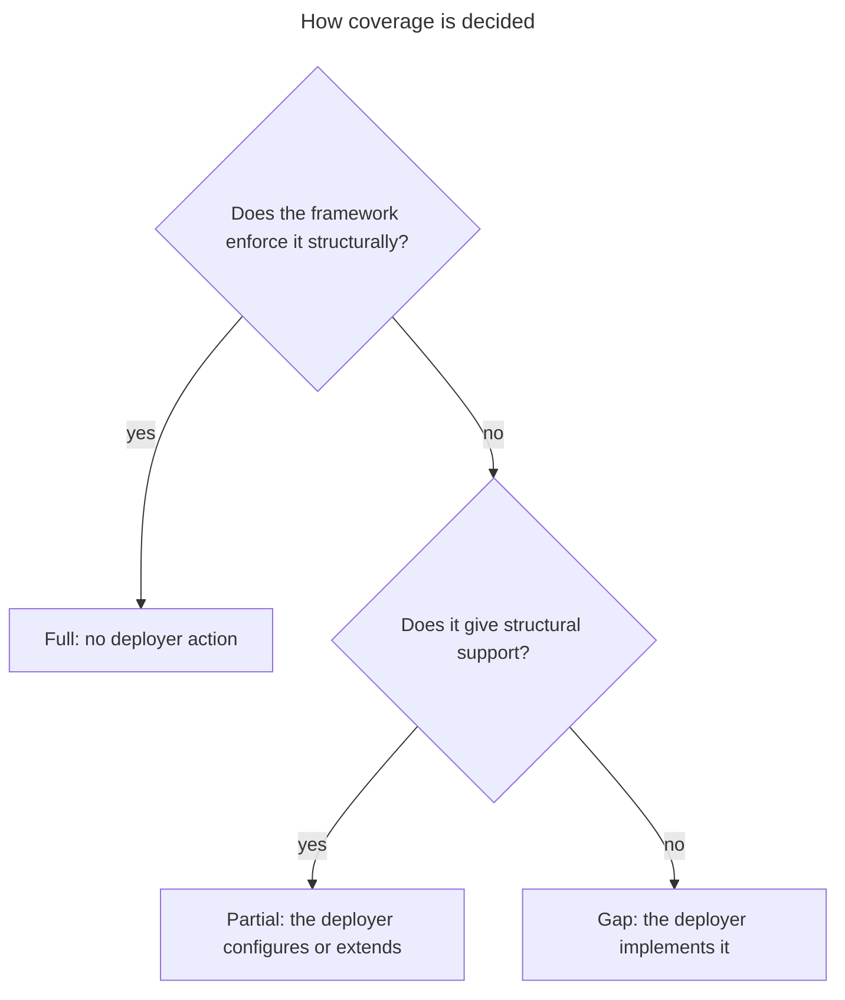

# NIST AI RMF 1.0 Profile — Grounded Agency Framework

**Framework:** NIST AI Risk Management Framework (AI RMF 1.0), January 2023
**Profile Type:** Current/Target Profile for AI Agent Infrastructure
**Subject Framework:** Grounded Agency (Agent Capability Standard v2.0.0)
**Status:** Reference analysis — Maps framework capabilities to all four NIST core functions
**Document ID:** NIST-RMF-001

---

## 1. Purpose and Scope

This document provides a NIST AI RMF 1.0 profile that maps the Grounded Agency framework's 36 atomic capabilities, 9 cognitive layers, 7 domain profiles, and safety model to all four core NIST functions: **Govern**, **Map**, **Measure**, and **Manage**.

**Key distinction:** The Grounded Agency framework is *infrastructure* — a capability ontology, safety model, and composition engine — not a deployed AI system. This profile assesses the framework's structural support for each NIST function. AI systems *built on* this framework inherit its safety properties but require deployer-specific profile customization for their operational context.

### 1.1 Scope

This profile covers:

- All 4 NIST AI RMF core functions and their 19 categories
- Tier assessment (Partial → Risk Informed → Repeatable → Adaptive) for each function
- Evidence mapping from NIST sub-categories to framework components
- Maturity roadmap from current profile to target profile
- Cross-references to ISO 42001 and EU AI Act compliance suites

### 1.2 Intended Audience

| Audience | Use |
|----------|-----|
| Framework deployers | Customize this profile for specific AI system deployments |
| Compliance officers | Verify NIST AI RMF alignment and identify gaps |
| Auditors and assessors | Cross-reference NIST requirements to framework evidence |
| Risk managers | Assess residual risk and plan remediation |

---

## 2. Framework Overview

### 2.1 NIST AI RMF Structure

The NIST AI RMF 1.0 organizes AI risk management into four core functions:

| Function | Purpose | Categories |
|----------|---------|------------|
| **GOVERN** | Establish and maintain organizational AI risk governance | GV-1 through GV-6 |
| **MAP** | Identify and characterize AI system context and risks | MP-1 through MP-5 |
| **MEASURE** | Analyze, assess, and track AI risks | ME-1 through ME-4 |
| **MANAGE** | Prioritize and act on AI risks | MG-1 through MG-4 |

### 2.2 Grounded Agency Framework

The Grounded Agency framework provides 36 atomic capabilities across 9 cognitive layers, composed through typed contracts with structural safety enforcement:

| Component | Count | Risk Relevance |
|-----------|-------|---------------|
| Atomic capabilities | 36 | Typed I/O contracts, risk metadata, dependency edges |
| Cognitive layers | 9 | PERCEIVE → UNDERSTAND → REASON → MODEL → SYNTHESIZE → EXECUTE → VERIFY → REMEMBER → COORDINATE |
| Domain profiles | 7 | Trust weights, risk thresholds, checkpoint rules, compliance configuration, enforced where a profile is applied (Standard 1.2.0 §5.21) |
| Workflow patterns | 12 | Composable capability sequences with safety gates |
| Edge types | 7 | `requires`, `soft_requires`, `enables`, `precedes`, `conflicts_with`, `alternative_to`, `specializes` |

**Domain profiles are applied.** A domain profile takes effect where it is applied (Standard 1.2.0 §5.21): a host gives it to a run (the reference executor, `Run.start(profiles=…)` and `WorkflowRunner(profiles=…)`), a safety layer applies it to the calls it covers (the Python adapter, `GroundedAgentConfig(profiles=…)`, and the Standard Agents binding, `groundedTool({profiles})`), or the validator is given it (`tools/validate_workflows.py --profile`). Applied, `block_autonomous`, `require_human`, `require_review`, `auto_approve` and `checkpoint_policy` raise the flags of the steps and calls they name (a person approves each one that `require_human` or `block_autonomous` covers, and no standing mandate does); its grounding policy (`require_grounding`, with `required_anchor_types` as the anchor kinds that count, §5.20) fails a step or call whose output is not grounded (F505), and an output whose confidence is below `minimum_confidence` fails too (F504; the adapter checks the outputs of every MCP tool bound to a capability: a tool `create_grounded_mcp_server` serves checks its own result, and the PostToolUse hook checks another server's; Claude Code's own tools return no capability output, so these rules do not reach them, and a warning is logged once for each such tool a rule would cover); a profile only tightens, and one with an error is refused. A rule an implementation does not put in force refuses the profile instead of being dropped. Its destination policy (`allowed_destinations`, §4.4.2) is in force beside the host's own: the executor fails a `send` step it does not allow, and the adapter and the Standard Agents binding refuse such a `send` call (F504), before approval; no shipped profile sets one. The plugin hooks apply no profile, and a workflow's `profile` field applies nothing, so a deployment that relies on a profile setting applies the profile in its host or safety layer. Retention periods (`compliance`) remain declarations for the deployer's log storage. See [Status of Domain Profiles](../../domains/README.md#status-of-domain-profiles).

### 2.3 Risk Classification

| Risk Level | Count | Capabilities | Safety Properties |
|------------|-------|-------------|-------------------|
| **Low** | 29 | retrieve, search, observe, receive, detect, classify, measure, predict, compare, discover, plan, decompose, critique, explain, state, transition, attribute, ground, simulate, generate, transform, integrate, verify, checkpoint, constrain, audit, persist, recall, inquire | `mutation: false`, no special restrictions |
| **Medium** | 5 | execute, rollback, delegate, synchronize, invoke | `requires_approval: true` for some, human review recommended |
| **High** | 2 | mutate, send | `mutation: true`, `requires_checkpoint: true`, `requires_approval: true` |

---

## 3. Profile Methodology

### 3.1 Tier Assessment Criteria

NIST AI RMF defines four organizational tiers for AI risk management maturity:

| Tier | Name | Characteristics |
|------|------|----------------|
| **Tier 1** | Partial | Ad hoc, reactive, limited awareness of AI risks. Risk management is not formalized. |
| **Tier 2** | Risk Informed | Risk-aware practices exist but may not be organization-wide. Policies exist but implementation varies. |
| **Tier 3** | Repeatable | Organization-wide policies implemented consistently. Risk management is formalized and documented. |
| **Tier 4** | Adaptive | Continuous improvement based on lessons learned. Automated monitoring, predictive risk indicators, organizational agility. |

### 3.2 Assessment Approach

Each NIST category is assessed using:

1. **Framework implementation** — What structural features address this category
2. **Evidence files** — Specific file paths demonstrating implementation
3. **Coverage level** — Full, Partial, or Gap
4. **Infrastructure vs. deployer distinction** — Whether the framework provides structural support or requires deployer implementation

### 3.3 Coverage Definitions

| Coverage | Definition |
|----------|-----------|
| **Full** | Framework structurally enforces the requirement; no deployer action needed |
| **Partial** | Framework provides structural support; deployer must configure or extend |
| **Gap** | Framework does not address this requirement; deployer must implement independently |

A row that cites a domain profile setting is rated on the setting being defined, documented and enforced where the profile is applied. A workflow does not select a profile, and the plugin hooks apply none (Section 2.2), so applying the profile in a host or safety layer is deployer action even where the row is rated Full; the reference executor, the Python adapter and the Standard Agents binding apply every shipped profile, its grounding policy included.



---

## 4. GOVERN Function

**Purpose:** Cultivate and implement a culture of AI risk management within organizations that design, develop, deploy, evaluate, and use AI systems.

### 4.1 GV-1: Policies, Processes, Procedures, and Practices

**NIST Description:** Policies, processes, procedures, and practices across the organization related to the mapping, measuring, and managing of AI risks are in place, transparent, and implemented effectively.

| Sub-Category | Framework Implementation | Evidence | Coverage |
|-------------|--------------------------|----------|----------|
| **GV-1.1** — Legal and regulatory requirements identified | EU AI Act conformity suite, ISO 42001 compliance suite, regulatory compliance analysis | `docs/compliance/eu-ai-act/`, `docs/compliance/iso42001/`, `analysis/10-regulatory-compliance.md` | Full |
| **GV-1.2** — Trustworthy AI characteristics integrated | Grounded Agency principles: grounded, auditable, safe, composable | `spec/WHITEPAPER.md` (principles section), `docs/GROUNDED_AGENCY.md` | Full |
| **GV-1.3** — Risk tolerances determined | Domain profiles set `minimum_confidence`, `block_autonomous` and `require_human` per deployment context, enforced where a host or safety layer applies the profile (Standard 1.2.0 §5.21) | `schemas/profiles/*.yaml`, `schemas/profiles/profile_schema.yaml` | Full |
| **GV-1.4** — Risk management process established | Three-tier risk model structurally embedded in ontology; risk treatment plan documents controls per tier | `schemas/capability_ontology.yaml` (risk fields), `docs/compliance/iso42001/risk_treatment_plan.md` | Full |
| **GV-1.5** — Processes for ongoing monitoring | EvidenceStore tracks tool executions; audit hooks log every tool call that runs; management review process defined | `grounded_agency/state/evidence_store.py`, `hooks/hooks.json`, `docs/compliance/iso42001/management_review.md` | Full |
| **GV-1.6** — Mechanisms for inventory and documentation | Capability ontology serves as formal inventory; technical documentation covers all Annex IV elements | `schemas/capability_ontology.yaml`, `docs/compliance/eu-ai-act/annex_iv_technical_documentation.md` | Full |
| **GV-1.7** — Processes for decommissioning | Decommissioning procedure: stop the system from acting, preserve and verify the audit log, its key and the checkpoint records, keep a way back, then retain and dispose; the framework retires its own capabilities, workflows and profiles through its deprecation policy | `docs/compliance/nist-ai-rmf/decommissioning_procedure.md` | Full |

### 4.2 GV-2: Accountability Structures

**NIST Description:** Accountability structures are in place so that the appropriate teams and individuals are empowered, responsible, and trained for mapping, measuring, and managing AI risks.

| Sub-Category | Framework Implementation | Evidence | Coverage |
|-------------|--------------------------|----------|----------|
| **GV-2.1** — Roles and responsibilities defined | Competency framework defines 6 roles with proficiency levels; RACI-style accountability documented | `docs/compliance/iso42001/competency_framework.md` | Full |
| **GV-2.2** — Training and awareness programs | Training tracks defined per role; awareness, intermediate, advanced, expert proficiency levels | `docs/compliance/iso42001/competency_framework.md` (§4–5) | Full |
| **GV-2.3** — Senior leadership oversight | Management review process with quarterly cadence; top management participation required | `docs/compliance/iso42001/management_review.md` | Full |

### 4.3 GV-3: Workforce Diversity, Equity, Inclusion, and Accessibility

**NIST Description:** Workforce diversity, equity, inclusion, and accessibility processes are prioritized in the mapping, measuring, and managing of AI risks.

| Category | Framework Implementation | Coverage |
|----------|--------------------------|----------|
| **GV-3** | Stakeholder analysis identifies affected parties; domain profiles parameterize per deployment context. Framework does not prescribe organizational workforce policies. | Partial — Deployer must implement organizational DEIA policies |

### 4.4 GV-4: Organizational Culture

**NIST Description:** Organizational teams are committed to a culture that considers and communicates AI risk.

| Category | Framework Implementation | Coverage |
|----------|--------------------------|----------|
| **GV-4** | AI policy template establishes organizational commitment; competency framework ensures knowledge distribution; nonconformity procedure encourages reporting. Evidence: `docs/compliance/iso42001/ai_policy_template.md`, `docs/compliance/iso42001/nonconformity_procedure.md` | Partial — Framework provides templates; deployer must foster organizational culture |

### 4.5 GV-5: Stakeholder Engagement

**NIST Description:** Ongoing stakeholder engagement is planned, and mechanisms for stakeholders to provide feedback are established.

| Category | Framework Implementation | Coverage |
|----------|--------------------------|----------|
| **GV-5** | Stakeholder analysis identifies 6 stakeholder categories with communication channels and frequency. `inquire` capability enables human escalation at runtime. Evidence: `docs/compliance/iso42001/stakeholder_analysis.md`, `skills/inquire/SKILL.md` | Partial — Framework provides structure; deployer must implement engagement processes |

### 4.6 GV-6: Policies and Procedures for Third-Party AI

**NIST Description:** Policies and procedures are in place to address AI risks and benefits arising from third-party software and data.

| Category | Framework Implementation | Coverage |
|----------|--------------------------|----------|
| **GV-6** | Trust model defines source weights for external data (`hardware_sensor: 0.95`, `system_of_record: 0.92`, down to `human_note: 0.55`). `invoke` capability handles external API calls with typed contracts; a tool with no binding is treated as `mutate`. The third-party risk procedure tiers each component by the capability it is used through and assesses it before use. Evidence: `schemas/authority_trust_model.yaml`, `docs/compliance/nist-ai-rmf/third_party_risk_procedure.md` | Full |

> **GOVERN Function — Tier Assessment**
>
> | Criterion | Assessment |
> |-----------|-----------|
> | **Current Tier** | **Tier 2 — Risk Informed** |
> | **Target Tier** | Tier 3 — Repeatable |
> | **Justification** | Domain profiles, risk treatment plan, competency framework, decommissioning and third-party risk procedures, and compliance documentation provide risk-informed governance. GV-3 (DEIA) is the gap that prevents Tier 3 classification. Organizational adoption depends on deployer commitment. |
> | **Key gaps** | DEIA policies (GV-3) |

---

## 5. MAP Function

**Purpose:** Establish context to frame AI risks, identify AI system risks, and characterize the potential benefits and costs of AI systems.

### 5.1 MP-1: Context Establishment

**NIST Description:** Context is established and understood.

| Sub-Category | Framework Implementation | Evidence | Coverage |
|-------------|--------------------------|----------|----------|
| **MP-1.1** — Intended purpose documented | Every capability has formal input/output contracts with typed schemas; workflow catalog documents composition patterns | `schemas/capability_ontology.yaml` (all 36 capability definitions), `schemas/workflow_catalog.yaml` | Full |
| **MP-1.2** — Interdependencies mapped | 7 edge types (requires, soft_requires, enables, precedes, conflicts_with, alternative_to, specializes) explicitly map capability dependencies | `schemas/capability_ontology.yaml` (edges section), `spec/EDGE_TYPES.md` | Full |
| **MP-1.3** — Deployment context characterized | 7 domain profiles define operational context: trust weights, risk thresholds, compliance requirements, evidence policies | `schemas/profiles/healthcare.yaml`, `schemas/profiles/manufacturing.yaml`, `schemas/profiles/data_analysis.yaml`, `schemas/profiles/personal_assistant.yaml`, `schemas/profiles/vision.yaml`, `schemas/profiles/audio.yaml`, `schemas/profiles/multimodal.yaml` | Full |
| **MP-1.4** — Assumptions documented | First-principles derivation methodology documents design assumptions; whitepaper states core principles | `docs/methodology/FIRST_PRINCIPLES_REASSESSMENT.md`, `spec/WHITEPAPER.md` | Full |
| **MP-1.5** — User interactions characterized | `inquire` capability for human escalation; `require_human` threshold and `block_autonomous` lists declared in profiles | `schemas/profiles/profile_schema.yaml`, `skills/inquire/SKILL.md` | Full |

### 5.2 MP-2: AI System Categorization

**NIST Description:** Categorization of the AI system is performed.

| Sub-Category | Framework Implementation | Evidence | Coverage |
|-------------|--------------------------|----------|----------|
| **MP-2.1** — AI system categorized by risk | Three-tier risk model (low/medium/high) embedded in ontology; EU AI Act risk classification maps profiles to 4 regulatory tiers | `schemas/capability_ontology.yaml` (risk field), `docs/compliance/eu-ai-act/risk_classification.md` | Full |
| **MP-2.2** — Risk levels communicated | Risk metadata exposed in capability definitions; domain profiles set explicit thresholds; risk classification document provides transparent categorization | `schemas/capability_ontology.yaml`, `schemas/profiles/*.yaml` | Full |
| **MP-2.3** — System characteristics documented | Typed I/O contracts for all 36 capabilities; output schemas include `confidence`, `evidence_anchors`, `provenance` fields | `schemas/capability_ontology.yaml` (input_schema, output_schema for each capability) | Full |

### 5.3 MP-3: AI Capabilities, Targeted Usage, Goals, and Expected Benefits

**NIST Description:** AI capabilities, targeted usage, goals, and expected benefits and costs compared with appropriate benchmarks are understood.

| Category | Framework Implementation | Evidence | Coverage |
|----------|--------------------------|----------|----------|
| **MP-3** | 36 capabilities with formal descriptions, I/O contracts, and risk metadata. Domain parameterization (`domain: anomaly`, `domain: entity`) enables targeted usage. Workflow catalog defines 12 reusable composition patterns. | `schemas/capability_ontology.yaml`, `schemas/workflow_catalog.yaml`, `docs/FAQ.md` | Full |

### 5.4 MP-4: Risks and Impacts

**NIST Description:** Risks and impacts related to AI systems are assessed.

| Category | Framework Implementation | Evidence | Coverage |
|----------|--------------------------|----------|----------|
| **MP-4** | Risk treatment plan covers risk identification, analysis, evaluation per ISO 42001. STRIDE threat model in security scan. `conflicts_with` edges identify incompatible operations. | `docs/compliance/iso42001/risk_treatment_plan.md`, `analysis/04-security-scan-findings.md` (§7), `schemas/capability_ontology.yaml` (conflicts_with edges) | Full |

### 5.5 MP-5: Impact Assessment

**NIST Description:** Impacts to individuals, groups, communities, and organizations are characterized.

| Category | Framework Implementation | Evidence | Coverage |
|----------|--------------------------|----------|----------|
| **MP-5** | Stakeholder analysis identifies 6 categories of affected parties. Risk classification distinguishes high-risk from low-risk deployments. No formal impact assessment methodology for specific populations. | `docs/compliance/iso42001/stakeholder_analysis.md`, `docs/compliance/eu-ai-act/risk_classification.md` | Partial — Impact assessment methodology for specific populations is a gap |

> **MAP Function — Tier Assessment**
>
> | Criterion | Assessment |
> |-----------|-----------|
> | **Current Tier** | **Tier 3 — Repeatable** |
> | **Target Tier** | Tier 4 — Adaptive |
> | **Justification** | Strong structural foundation: typed capability contracts, 7 domain profiles with trust weights, 3-tier risk classification, 7 edge types for dependency mapping, comprehensive risk treatment plan. Context establishment (MP-1) and categorization (MP-2) are formalized and repeatable. MP-5 (impact assessment) gap prevents Tier 4. |
> | **Key gaps** | Formal impact assessment methodology for specific populations (MP-5); adaptive context updates from operational data |

---

## 6. MEASURE Function

**Purpose:** Employ quantitative and qualitative methods to analyze, assess, and track AI risks.

### 6.1 ME-1: Methods and Metrics

**NIST Description:** Appropriate methods and metrics are identified and applied.

| Sub-Category | Framework Implementation | Evidence | Coverage |
|-------------|--------------------------|----------|----------|
| **ME-1.1** — Measurement approaches identified | Confidence scores required on all capability outputs; evidence anchors link claims to sources; 6 structural validators | `schemas/capability_ontology.yaml` (output schemas with `confidence` field), `tools/validate_*.py` | Full |
| **ME-1.2** — Metrics selected for trustworthiness | Per-domain `minimum_confidence` thresholds set in profiles (healthcare: 0.90, manufacturing: 0.85, data analysis: 0.80), which the reference executor applies to every output where the profile is applied (F504, Standard 1.2.0 §5.21); trust weights per source type | `schemas/profiles/*.yaml`, `schemas/authority_trust_model.yaml` | Full |
| **ME-1.3** — Metrics documented and communicated | Output schemas formally define metric structure; evidence policies specify grounding requirements per domain | `schemas/capability_ontology.yaml` (output_schema), `schemas/profiles/profile_schema.yaml` (evidence_policy) | Full |

### 6.2 ME-2: AI Systems Evaluation

**NIST Description:** AI systems are evaluated for trustworthy characteristics.

| Sub-Category | Framework Implementation | Evidence | Coverage |
|-------------|--------------------------|----------|----------|
| **ME-2.1** — Evaluation conducted | Conformance test suite validates structural properties; 6 validators check ontology, workflows, profiles, skill refs, transform refs, YAML sync | `scripts/run_conformance.py`, `tools/validate_ontology.py`, `tools/validate_workflows.py`, `tools/validate_profiles.py`, `tools/validate_skill_refs.py`, `tools/validate_transform_refs.py`, `tools/validate_yaml_util_sync.py` | Full |
| **ME-2.2** — Evaluation results documented | EvidenceStore captures tool executions as evidence anchors; checkpoint tracker records state transitions; audit log records every tool call that runs | `grounded_agency/state/evidence_store.py`, `grounded_agency/state/checkpoint_tracker.py`, `.claude/audit.log` | Partial — Evidence is captured structurally but aggregated reporting/dashboards are a gap |
| **ME-2.3** — Continuous monitoring implemented | EvidenceStore tracks executions; temporal decay model degrades trust over time (`half_life: P10D`); audit hooks capture every tool call that runs, in real time | `grounded_agency/state/evidence_store.py`, `schemas/authority_trust_model.yaml` (decay_model), `hooks/hooks.json` | Partial — Real-time alerting and dashboard visualization are gaps |

### 6.3 ME-3: Trustworthy AI Actor Competency

**NIST Description:** Mechanisms for tracking identified AI risks over time are in place.

| Category | Framework Implementation | Evidence | Coverage |
|----------|--------------------------|----------|----------|
| **ME-3** | Competency framework defines roles and proficiency levels (Awareness → Intermediate → Advanced → Expert). Training tracks per role with assessment methods. | `docs/compliance/iso42001/competency_framework.md` | Full |

### 6.4 ME-4: External Inputs and Feedback

**NIST Description:** Feedback about efficacy of measurement is collected and assessed.

| Category | Framework Implementation | Evidence | Coverage |
|----------|--------------------------|----------|----------|
| **ME-4** | `inquire` capability enables runtime escalation to humans. Stakeholder analysis defines communication channels. Management review process collects measurement feedback quarterly. No automated external feedback collection mechanism. | `skills/inquire/SKILL.md`, `docs/compliance/iso42001/stakeholder_analysis.md`, `docs/compliance/iso42001/management_review.md` | Partial — Structural support exists; automated feedback collection is a gap |

> **MEASURE Function — Tier Assessment**
>
> | Criterion | Assessment |
> |-----------|-----------|
> | **Current Tier** | **Tier 2 — Risk Informed** |
> | **Target Tier** | Tier 3 — Repeatable |
> | **Justification** | Confidence scores and evidence anchors are structurally enforced on all outputs. Six validators provide repeatable structural evaluation. Temporal decay model tracks information freshness. However, real-time monitoring dashboards, aggregated reporting, alerting infrastructure, and automated external feedback collection are gaps. These prevent consistent, organization-wide measurement. |
> | **Key gaps** | Real-time monitoring dashboard (ME-2.3), aggregated evaluation reporting (ME-2.2), automated feedback collection (ME-4) |

---

## 7. MANAGE Function

**Purpose:** Allocate resources, and plan, implement, communicate, and monitor risk response strategies.

### 7.1 MG-1: Risk Prioritization and Response

**NIST Description:** AI risks based on assessments and other analytical output from the MAP and MEASURE functions are prioritized, responded to, and managed.

| Sub-Category | Framework Implementation | Evidence | Coverage |
|-------------|--------------------------|----------|----------|
| **MG-1.1** — Risk response plans developed | Checkpoint-before-mutation enforcement for all high-risk capabilities; rollback capability for state recovery; `requires_approval` on `execute`, `mutate` and `send`, which the reference executor enforces; `block_autonomous` lists in domain profiles name the capabilities a domain does not want run unsupervised: a person approves each such step or call where a host or safety layer applies the profile (Standard 1.2.0 §5.21) | `hooks/hooks.json` (PreToolUse checkpoint gate), `skills/rollback/SKILL.md`, `schemas/profiles/*.yaml` (block_autonomous) | Full |
| **MG-1.2** — Residual risk documented | Risk treatment plan documents residual risk per tier; nonconformity procedure tracks unresolved findings | `docs/compliance/iso42001/risk_treatment_plan.md`, `docs/compliance/iso42001/nonconformity_procedure.md` | Full |
| **MG-1.3** — Risk response prioritized | Three-tier risk model assigns priority structurally — high-risk capabilities (mutate, send) get mandatory checkpoints and approval; of the medium-risk capabilities, `execute` gets approval and `rollback` needs a checkpoint before it, and a workflow step can raise either flag on the others; low-risk are unrestricted | `schemas/capability_ontology.yaml` (risk, requires_checkpoint, requires_approval fields) | Full |
| **MG-1.4** — Risk response monitored | Audit hooks log every tool call that runs; EvidenceStore tracks execution state; management review evaluates nonconformities quarterly. No automated incident detection. | `hooks/hooks.json`, `grounded_agency/state/evidence_store.py`, `docs/compliance/iso42001/management_review.md` | Partial — Automated incident detection is a gap |

### 7.2 MG-2: Strategies for Minimizing Negative Impacts

**NIST Description:** Strategies to maximize AI benefits and minimize negative impacts are planned, prepared, implemented, documented, and informed by input from relevant AI actors.

| Sub-Category | Framework Implementation | Evidence | Coverage |
|-------------|--------------------------|----------|----------|
| **MG-2.1** — Response plans documented | Post-market monitoring plan defines escalation procedures and incident response; nonconformity procedure defines detection → containment → correction → verification workflow | `docs/compliance/eu-ai-act/post_market_monitoring.md`, `docs/compliance/iso42001/nonconformity_procedure.md` | Full |
| **MG-2.2** — Response plans tested | Recovery loop limits (`max_loops`) prevent infinite retry; rollback restores prior checkpoints; `constrain` capability enforces operational bounds. Conformance test suite validates structural properties. A tabletop exercise template plays an approved Write that must be undone, with its expected codes, records and recovery commands, and a test plays its steps against the plugin's hooks. | `schemas/capability_ontology.yaml` (max_loops), `skills/rollback/SKILL.md`, `skills/constrain/SKILL.md`, `scripts/run_conformance.py`, `docs/compliance/nist-ai-rmf/tabletop_exercise_template.md`, `tests/test_tabletop_exercise.py` | Full |
| **MG-2.3** — Incident documentation maintained | Audit log records every tool call that runs, with a timestamp; ProvenanceRecord chains track claim lineage; world state versioning preserves history with parent links | `.claude/audit.log`, `schemas/world_state_schema.yaml` (provenance), `grounded_agency/state/evidence_store.py` | Full |

### 7.3 MG-3: Third-Party Risk Management

**NIST Description:** AI risks and benefits from third-party resources are regularly monitored, and risk treatment is applied and documented.

| Category | Framework Implementation | Evidence | Coverage |
|----------|--------------------------|----------|----------|
| **MG-3** | Trust model assigns weights to external sources; `invoke` capability uses typed contracts for external API calls; temporal decay degrades trust in stale third-party data. The third-party risk procedure sets a monitoring cadence per tier and names the signals in the records (failed calls, refusals for confidence, grounding or destination, version changes in `recorded_by`). | `schemas/authority_trust_model.yaml`, `skills/invoke/SKILL.md`, `schemas/capability_ontology.yaml` (invoke capability), `docs/compliance/nist-ai-rmf/third_party_risk_procedure.md` | Full |

### 7.4 MG-4: Risk Treatment Documentation and Monitoring

**NIST Description:** Risk treatments, including response and recovery, and communication plans for identified and measured AI risks are documented and monitored regularly.

| Category | Framework Implementation | Evidence | Coverage |
|----------|--------------------------|----------|----------|
| **MG-4** | Risk treatment plan is comprehensive (per ISO 42001 Clause 6). Management review process monitors quarterly. Post-market monitoring plan defines KPIs and escalation. Internal audit checklist validates controls. | `docs/compliance/iso42001/risk_treatment_plan.md`, `docs/compliance/iso42001/management_review.md`, `docs/compliance/eu-ai-act/post_market_monitoring.md`, `docs/compliance/iso42001/internal_audit_checklist.md` | Full |

> **MANAGE Function — Tier Assessment**
>
> | Criterion | Assessment |
> |-----------|-----------|
> | **Current Tier** | **Tier 3 — Repeatable** |
> | **Target Tier** | Tier 4 — Adaptive |
> | **Justification** | Strong structural enforcement: checkpoint-before-mutation is mandatory, rollback is available for state recovery, three-tier risk model assigns response priority, audit hooks provide comprehensive logging, and nonconformity procedure defines corrective action workflow. Risk treatment and documentation (MG-1.2, MG-2.1, MG-2.3, MG-4), tested response plans (MG-2.2) and third-party monitoring (MG-3) are formalized and repeatable. The automated incident detection gap (MG-1.4) prevents Tier 4. |
> | **Key gaps** | Automated incident detection (MG-1.4) |

---

## 8. Tier Assessment Summary

### 8.1 Consolidated Assessment

| Function | Current Tier | Target Tier | Gap Count | Key Strengths |
|----------|-------------|-------------|-----------|---------------|
| **GOVERN** | Tier 2 — Risk Informed | Tier 3 — Repeatable | 1 | Domain profiles, risk treatment plan, competency framework, decommissioning and third-party procedures, compliance suites |
| **MAP** | Tier 3 — Repeatable | Tier 4 — Adaptive | 1 | Typed contracts, 7 domain profiles, 3-tier risk model, 7 edge types |
| **MEASURE** | Tier 2 — Risk Informed | Tier 3 — Repeatable | 3 | Confidence scores, evidence anchors, temporal decay, 6 validators |
| **MANAGE** | Tier 3 — Repeatable | Tier 4 — Adaptive | 1 | Checkpoint enforcement, rollback, audit hooks, nonconformity procedure, tested tabletop exercise |

### 8.2 Overall Maturity

**Weighted assessment:** Tier 2.5 (between Risk Informed and Repeatable)

The framework is strongest in MAP and MANAGE functions, where typed contracts and structural safety enforcement provide repeatable, formalized risk management. GOVERN reaches Tier 3 when the AI policy template has its DEIA section (G-02). MEASURE reaches Tier 3 with aggregated reporting from the audit log and the EvidenceStore (G-05); its real-time dashboard (G-06) and feedback collection (G-07) belong to the deployer.

### 8.3 Gap Inventory

The framework is infrastructure (Section 1), so a gap is closed in this repository when the framework can own it, and is the deployer's when only a running deployment can close it.

| ID | Gap | Function | Category | Status | Delivered by, or owner and reason |
|----|-----|----------|----------|--------|-----------------------------------|
| G-01 | AI system decommissioning procedure | GOVERN | GV-1.7 | Closed | [Decommissioning procedure](decommissioning_procedure.md) (NIST-DCM-001) |
| G-02 | DEIA policies for AI risk management | GOVERN | GV-3 | Planned | This repository: a DEIA section in the AI policy template that the deployer fills in ([#159](https://github.com/synaptiai/agent-capability-standard/issues/159)). The deployer writes and applies the policy, since workforce policy belongs to the organization |
| G-03 | Third-party AI vendor assessment | GOVERN | GV-6 | Closed | [Third-party AI risk procedure](third_party_risk_procedure.md) (NIST-TPR-001), sections 3 and 4 |
| G-04 | Population-specific impact assessment | MAP | MP-5 | Planned | This repository: an impact assessment methodology as a template ([#159](https://github.com/synaptiai/agent-capability-standard/issues/159)). The deployer assesses its own populations, since they depend on the deployment |
| G-05 | Aggregated evaluation reporting | MEASURE | ME-2.2 | Planned | This repository: reports built from the audit log and the EvidenceStore ([#80](https://github.com/synaptiai/agent-capability-standard/issues/80)). A dashboard that shows them is the deployer's, since only a running deployment has the data |
| G-06 | Real-time monitoring dashboard | MEASURE | ME-2.3 | Deployer | The deployer, which runs the system and its alerting; the reports of [#80](https://github.com/synaptiai/agent-capability-standard/issues/80) are its input |
| G-07 | Automated external feedback collection | MEASURE | ME-4 | Deployer | The deployer, since the feedback channels belong to the deployment's stakeholders; the framework provides `inquire` and the stakeholder analysis |
| G-08 | Automated incident detection | MANAGE | MG-1.4 | Planned | This repository: anomaly rules on the audit records ([#165](https://github.com/synaptiai/agent-capability-standard/issues/165)) and an invariant monitor on the audit log ([#172](https://github.com/synaptiai/agent-capability-standard/issues/172)). MG-1.4 is re-assessed when they land |
| G-09 | Tabletop exercises and scenario testing | MANAGE | MG-2.2 | Closed | [Tabletop exercise template](tabletop_exercise_template.md) (NIST-TTX-001), whose steps `tests/test_tabletop_exercise.py` plays |
| G-10 | Third-party risk monitoring procedure | MANAGE | MG-3 | Closed | [Third-party AI risk procedure](third_party_risk_procedure.md) (NIST-TPR-001), sections 5 and 6 |

---

## 9. Maturity Roadmap

### 9.1 Current Profile Summary

The Grounded Agency framework currently provides:

- **Structural safety enforcement** — Checkpoint-before-mutation, typed contracts, risk metadata
- **Domain-parameterized risk management** — 7 profiles with trust weights and compliance configuration
- **Comprehensive documentation** — EU AI Act and ISO 42001 compliance suites, and the NIST decommissioning, third-party risk and tabletop exercise documents
- **Auditability infrastructure** — Evidence anchors, audit hooks, provenance tracking

### 9.2 Target Profile

The target profile achieves:

- **GOVERN Tier 3** — Organization-wide policies, with the DEIA section of the AI policy template
- **MAP Tier 4** — Formal impact assessment, and context that adapts from operational data
- **MEASURE Tier 3** — Aggregated reporting from the audit log and the EvidenceStore, which the deployer's dashboard shows
- **MANAGE Tier 4** — Automated incident detection from the audit records

### 9.3 Gap Remediation Roadmap

Planned in this repository:

| Action | Closes Gap | Target Tier Impact | Deliverable | Issue |
|--------|-----------|-------------------|-------------|-------|
| Add a DEIA section to the AI policy template | G-02 (GV-3) | GOVERN → Tier 3 | A section of `docs/compliance/iso42001/ai_policy_template.md` the deployer fills in | [#159](https://github.com/synaptiai/agent-capability-standard/issues/159) |
| Write an impact assessment methodology | G-04 (MP-5) | MAP → closer to Tier 4 | A template the deployer fills in | [#159](https://github.com/synaptiai/agent-capability-standard/issues/159) |
| Report from the audit log and the EvidenceStore | G-05 (ME-2.2) | MEASURE → Tier 3 | Lineage, checkpoint coverage and conformance reports | [#80](https://github.com/synaptiai/agent-capability-standard/issues/80) |
| Detect incidents from the audit records | G-08 (MG-1.4) | MANAGE → Tier 4 | Anomaly rules and an invariant monitor | [#165](https://github.com/synaptiai/agent-capability-standard/issues/165), [#172](https://github.com/synaptiai/agent-capability-standard/issues/172) |
| Map each domain profile to NIST sub-categories | — (traceability) | Cross-cutting | A NIST mapping under each profile's informative `compliance` member, which `tools/validate_profiles.py` accepts | [#159](https://github.com/synaptiai/agent-capability-standard/issues/159) |
| Add NIST function metrics to the management review inputs | — (integration) | GOVERN + MEASURE | Updated `docs/compliance/iso42001/management_review.md` | [#159](https://github.com/synaptiai/agent-capability-standard/issues/159) |
| Tune domain profiles from operational data | — (advanced) | MAP → Tier 4 | Trust calibration from the records | [#78](https://github.com/synaptiai/agent-capability-standard/issues/78) |

Owned outside this repository:

| Item | Owner | Reason |
|------|-------|--------|
| Real-time monitoring dashboard and alerting (G-06) | The deployer | Only a running deployment has the live data; the reports of [#80](https://github.com/synaptiai/agent-capability-standard/issues/80) are its input |
| Automated external feedback collection (G-07) | The deployer | The feedback channels belong to the deployment's stakeholders |
| Predictive risk indicators from confidence trends | The deployer | The trends come from a deployment's operational EvidenceStore data |

### 9.4 Roadmap Visualization

```
Current State                   Target State
─────────────                   ────────────
GOVERN:  Tier 2 ──G-02───────→  Tier 3
MAP:     Tier 3 ──G-04, #78──→  Tier 4
MEASURE: Tier 2 ──G-05───────→  Tier 3
MANAGE:  Tier 3 ──G-08───────→  Tier 4
```

---

## 10. Cross-Reference Matrix

### 10.1 NIST AI RMF → Framework Components

| NIST Function | Primary Framework Components | Key Files |
|--------------|------------------------------|-----------|
| GOVERN | Domain profiles, competency framework, AI policy, management review | `schemas/profiles/*.yaml`, `docs/compliance/iso42001/` |
| MAP | Capability ontology, edge types, risk classification, domain profiles | `schemas/capability_ontology.yaml`, `spec/EDGE_TYPES.md`, `docs/compliance/eu-ai-act/risk_classification.md` |
| MEASURE | EvidenceStore, confidence scores, validators, trust model | `grounded_agency/state/evidence_store.py`, `tools/validate_*.py`, `schemas/authority_trust_model.yaml` |
| MANAGE | CheckpointTracker, rollback, audit hooks, nonconformity procedure | `grounded_agency/state/checkpoint_tracker.py`, `hooks/hooks.json`, `docs/compliance/iso42001/nonconformity_procedure.md` |

### 10.2 NIST AI RMF → ISO 42001 Suite

| NIST Category | ISO 42001 Document | Doc ID |
|--------------|-------------------|--------|
| GV-1 (Policies) | AI Policy Template | AIMS-POL-001 |
| GV-1 (Risk management) | Risk Treatment Plan | AIMS-RSK-001 |
| GV-2 (Accountability) | Competency Framework | AIMS-CMP-001 |
| GV-2 (Oversight) | Management Review | AIMS-MGR-001 |
| GV-5 (Stakeholders) | Stakeholder Analysis | AIMS-STK-001 |
| MP-2 (Categorization), MP-4 (Risks) | Risk Treatment Plan | AIMS-RSK-001 |
| ME-2 (Evaluation) | Internal Audit Checklist | AIMS-AUD-001 |
| MG-1 (Risk response) | Nonconformity Procedure | AIMS-NCR-001 |
| MG-4 (Monitoring) | Management Review | AIMS-MGR-001 |

### 10.3 NIST AI RMF → EU AI Act Suite

| NIST Category | EU AI Act Document | Doc ID |
|--------------|-------------------|--------|
| GV-1.1 (Legal requirements) | All EU AI Act documents | EUAIA-*-001 |
| MP-2 (Categorization) | Risk Classification | EUAIA-CLS-001 |
| ME-2 (Evaluation) | Quality Management System | EUAIA-QMS-001 |
| MG-1 (Risk response) | Post-Market Monitoring | EUAIA-PMM-001 |
| MG-2 (Minimize impact) | Post-Market Monitoring | EUAIA-PMM-001 |
| MG-4 (Documentation) | Annex IV Technical Documentation | EUAIA-TEC-001 |
| — (Conformity assessment) | Notified Body Assessment | EUAIA-NTB-001 |

### 10.4 NIST AI RMF → Regulatory Compliance Analysis

This profile expands on the NIST AI RMF mapping in `analysis/10-regulatory-compliance.md`:

| Analysis Section | Profile Section | Relationship |
|-----------------|----------------|-------------|
| §1.2 (NIST AI RMF overview) | §2.1 (Framework overview) | Profile provides detailed sub-category mapping |
| §4 (Trust model) | §5.1 MP-1, §6.1 ME-1 | Trust weights map to MAP context and MEASURE metrics |
| §7.4 (NIST profile development) | This document | Profile fulfills §7.4 recommended actions |
| Appendix A (NIST rows) | §4–7 (all functions) | Profile provides sub-category evidence for each function |

---

## Appendix A: Evidence Inventory

This appendix provides a consolidated inventory of all framework files cited as evidence throughout this profile.

### A.1 Schemas and Ontology

| File | Evidence For | NIST Categories |
|------|-------------|----------------|
| `schemas/capability_ontology.yaml` | 36 capability definitions, risk metadata, typed I/O contracts, edge types | MP-1, MP-2, MP-3, MP-4, ME-1, MG-1 |
| `schemas/workflow_catalog.yaml` | 12 workflow composition patterns | MP-1, MP-3 |
| `schemas/profiles/healthcare.yaml` | Healthcare domain profile (minimum_confidence: 0.90) | GV-1, MP-1, ME-1 |
| `schemas/profiles/manufacturing.yaml` | Manufacturing domain profile (minimum_confidence: 0.85) | GV-1, MP-1, ME-1 |
| `schemas/profiles/data_analysis.yaml` | Data analysis domain profile (minimum_confidence: 0.80) | GV-1, MP-1, ME-1 |
| `schemas/profiles/personal_assistant.yaml` | Personal assistant domain profile | GV-1, MP-1 |
| `schemas/profiles/vision.yaml` | Vision modality profile | MP-1 |
| `schemas/profiles/audio.yaml` | Audio modality profile | MP-1 |
| `schemas/profiles/multimodal.yaml` | Multimodal profile | MP-1 |
| `schemas/profiles/profile_schema.yaml` | Profile schema definition (block_autonomous, require_human, evidence_policy) | GV-1, MP-1, MG-1 |
| `schemas/authority_trust_model.yaml` | Trust weights, temporal decay model | MP-1, ME-1, ME-2, MG-3 |
| `schemas/world_state_schema.yaml` | World state versioning, provenance records | MG-2 |

### A.2 SDK Components

| File | Evidence For | NIST Categories |
|------|-------------|----------------|
| `grounded_agency/state/evidence_store.py` | Evidence anchor capture, tool execution tracking | ME-1, ME-2, MG-1 |
| `grounded_agency/state/checkpoint_tracker.py` | Checkpoint lifecycle, state preservation | MG-1, MG-2 |

### A.3 Safety Enforcement

| File | Evidence For | NIST Categories |
|------|-------------|----------------|
| `hooks/hooks.json` | PreToolUse checkpoint gate, PostToolUse audit logging | GV-1, ME-2, MG-1 |
| `.claude/audit.log` | Persistent audit trail of tool calls | ME-2, MG-2 |

### A.4 Validation Tools

| File | Evidence For | NIST Categories |
|------|-------------|----------------|
| `tools/validate_ontology.py` | Ontology graph validation (orphans, cycles, symmetry) | ME-2 |
| `tools/validate_workflows.py` | Workflow validation against ontology | ME-2 |
| `tools/validate_profiles.py` | Domain profile schema validation | ME-2 |
| `tools/validate_skill_refs.py` | Skill file reference validation | ME-2 |
| `tools/validate_transform_refs.py` | Transform mapping reference validation | ME-2 |
| `tools/validate_yaml_util_sync.py` | YAML utility sync validation | ME-2 |
| `scripts/run_conformance.py` | Conformance test suite | ME-2 |
| `tests/test_tabletop_exercise.py` | Plays the tabletop exercise's steps against the plugin's hooks | MG-2 |

### A.5 Compliance Documentation

| File | Evidence For | NIST Categories |
|------|-------------|----------------|
| `docs/compliance/eu-ai-act/risk_classification.md` | EU AI Act risk classification (EUAIA-CLS-001) | GV-1, MP-2 |
| `docs/compliance/eu-ai-act/quality_management_system.md` | QMS mapping to Art. 17 (EUAIA-QMS-001) | GV-1, ME-2 |
| `docs/compliance/eu-ai-act/post_market_monitoring.md` | Post-market monitoring plan (EUAIA-PMM-001) | MG-2, MG-4 |
| `docs/compliance/eu-ai-act/annex_iv_technical_documentation.md` | Technical documentation (EUAIA-TEC-001) | GV-1, MG-4 |
| `docs/compliance/eu-ai-act/notified_body_assessment.md` | Conformity assessment route (EUAIA-NTB-001) | GV-1 |
| `docs/compliance/iso42001/risk_treatment_plan.md` | Risk treatment controls (AIMS-RSK-001) | GV-1, MP-4, MG-1 |
| `docs/compliance/iso42001/competency_framework.md` | Roles and proficiency levels (AIMS-CMP-001) | GV-2, ME-3 |
| `docs/compliance/iso42001/management_review.md` | Management review process (AIMS-MGR-001) | GV-2, MG-4 |
| `docs/compliance/iso42001/nonconformity_procedure.md` | NCR workflow (AIMS-NCR-001) | MG-1, MG-2 |
| `docs/compliance/iso42001/ai_policy_template.md` | AI policy template (AIMS-POL-001) | GV-1, GV-4 |
| `docs/compliance/iso42001/stakeholder_analysis.md` | Stakeholder identification (AIMS-STK-001) | GV-5, MP-5, ME-4 |
| `docs/compliance/iso42001/internal_audit_checklist.md` | Internal audit programme (AIMS-AUD-001) | ME-2, MG-4 |
| `docs/compliance/nist-ai-rmf/decommissioning_procedure.md` | Decommissioning procedure (NIST-DCM-001) | GV-1 |
| `docs/compliance/nist-ai-rmf/third_party_risk_procedure.md` | Third-party AI risk procedure (NIST-TPR-001) | GV-6, MG-3 |
| `docs/compliance/nist-ai-rmf/tabletop_exercise_template.md` | Tabletop exercise template (NIST-TTX-001) | MG-2 |

### A.6 Specification and Methodology

| File | Evidence For | NIST Categories |
|------|-------------|----------------|
| `spec/WHITEPAPER.md` | Core principles, derivation methodology | GV-1, MP-1 |
| `spec/EDGE_TYPES.md` | Edge type definitions for capability relationships | MP-1, MP-4 |
| `spec/SECURITY.md` | Security specification | MP-4 |
| `docs/methodology/FIRST_PRINCIPLES_REASSESSMENT.md` | First-principles derivation methodology | MP-1 |
| `docs/GROUNDED_AGENCY.md` | Grounded Agency philosophy and principles | GV-1 |
| `analysis/10-regulatory-compliance.md` | Regulatory compliance analysis | GV-1, cross-cutting |
| `analysis/04-security-scan-findings.md` | STRIDE threat model, security assessment | MP-4 |

### A.7 Skills

| File | Evidence For | NIST Categories |
|------|-------------|----------------|
| `skills/inquire/SKILL.md` | Human escalation capability | GV-5, ME-4, MG-1 |
| `skills/rollback/SKILL.md` | State recovery capability | MG-1, MG-2 |
| `skills/constrain/SKILL.md` | Operational bounds enforcement | MG-2 |
| `skills/invoke/SKILL.md` | External API integration with typed contracts | GV-6, MG-3 |
| `skills/explain/SKILL.md` | Transparency and explainability | GV-1 |
| `skills/critique/SKILL.md` | Self-assessment capability | GV-1, ME-1 |

---

## Document Control

| Field | Value |
|-------|-------|
| **Document ID** | NIST-RMF-001 |
| **Title** | NIST AI RMF 1.0 Profile — Grounded Agency Framework |
| **Version** | 1.1 |
| **Date** | [YYYY-MM-DD] |
| **Author** | [Name, Title] |
| **Reviewer** | [Name, Title] |
| **Approved by** | [Name, Title] |
| **Classification** | Internal |
| **Review cycle** | Annual, or upon significant framework changes |

### Version History

| Version | Date | Changes |
|---------|------|---------|
| 1.0 | [YYYY-MM-DD] | Initial release — All 4 NIST AI RMF functions, 19 categories, tier assessments, maturity roadmap |
| 1.1 | 2026-11-27 | G-01, G-03, G-09 and G-10 closed by the decommissioning procedure, the third-party AI risk procedure and the tabletop exercise template; every other gap names its owner |

### Review Triggers

This document should be reviewed when:

- The capability ontology changes (new capabilities, modified risk classifications)
- Domain profiles are added or modified
- New compliance documentation is produced
- NIST AI RMF is updated or supplemented (e.g., NIST AI 600-1 Generative AI Profile)
- Organizational context changes significantly

---

*This profile was produced as part of the Agent Capability Standard documentation suite. It reflects the framework state as of version 2.0.0 (January 2026). The NIST AI RMF is a living framework; this profile should be reviewed and updated as the framework evolves.*
