# Modality Handling via Domain Parameters

**Version:** 1.1.0
**Date:** 2026-11-15
**Status:** Guide

---

## Overview

This guide explains how the Grounded Agency Capability Ontology handles different modalities -- text, image, audio, video, and multi-modal inputs -- through **domain parameters** on atomic capabilities rather than creating separate modality-specific capabilities. This design keeps the ontology minimal (36 atomic capabilities) while supporting the full range of modality-aware agent tasks.

---

## 1. Modality as Domain Parameter

### 1.1 Design Philosophy

Traditional AI capability frameworks treat each modality as a separate skill category. The Open Agentic Schema Framework (OASF), for example, devotes distinct categories to Natural Language Processing (Category 1), Computer Vision (Category 2), Audio (Category 3), and Multi-modal (Category 7). This leads to taxonomic explosion: object detection, image segmentation, scene classification, and image generation all become independent top-level skills.

Grounded Agency takes a different approach. We observe that **the cognitive operation is the same regardless of modality**. Detecting a pattern in text, detecting an object in an image, and detecting an anomaly in an audio stream all perform the same fundamental operation: find occurrences of a pattern in data. What changes is the *domain*, not the *verb*.

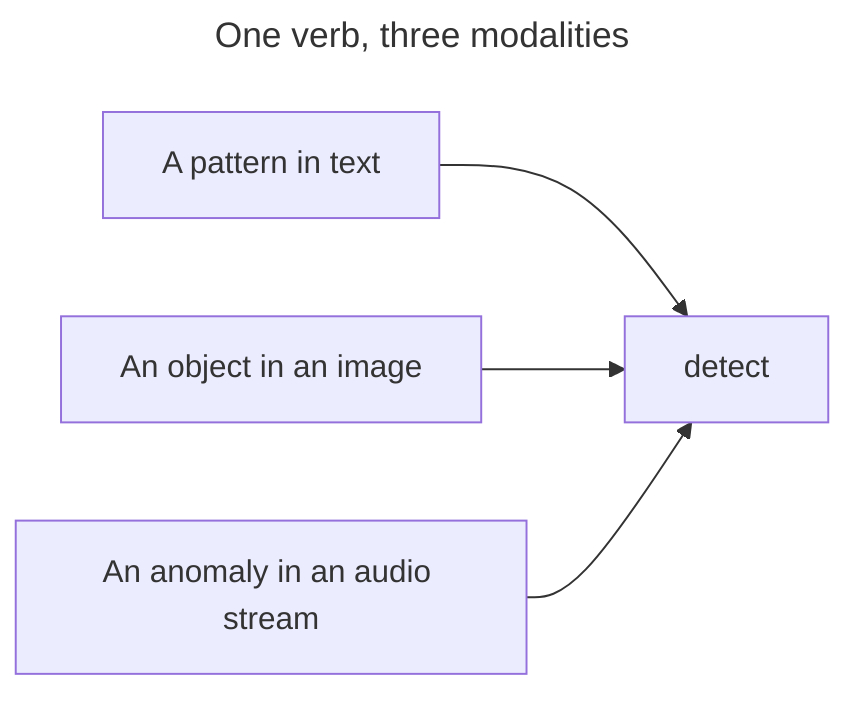

This insight drives our domain parameterization model:

```
capability(domain: modality) instead of capability-modality
```

Concrete examples:

| Modality-Specific (Avoided) | Domain-Parameterized (Preferred) |
|---|---|
| `detect-object` | `detect` with `domain: image.object` |
| `classify-audio` | `classify` with `domain: audio.genre` |
| `generate-image` | `generate` with `domain: image` |
| `transcribe-speech` | `transform` with `source_format: audio.speech`, `target_format: text.transcript` |

Note that `transform` uses its native `source_format`/`target_format` input parameters rather than the `domain` step field, since the modality is inherent to the transformation definition itself.

**A note on the `domain` parameter:** `domain` is a step field of the workflow DSL, defined in [STANDARD-v1.1.0 §5.2](../../spec/STANDARD-v1.1.0.md#52-step-definition) as a string, the "Domain parameter for the capability". It is written on the step, beside `capability`, not among the capability's inputs: the capability ontology declares no `domain` input and no list of domain values. The validator checks that the value is a string (S303 otherwise) and nothing more. The reference executor hands it to the host on the `InvokeCapability` action ([Running workflows](RUNNING_WORKFLOWS.md#actions-and-responses)), and the host chooses the processing pipeline that serves it. The values used in this guide (`image.object`, `audio.genre` and the like) are this guide's convention; the Standard defines none. Workflow authors use `domain` to specialize generic capabilities (e.g., `detect` with `domain: image.object` vs `domain: audio.event`) without requiring separate ontology entries per modality.

**Cross-reference:** Domain profiles (e.g., `schemas/profiles/vision.yaml`) use profile-level domain names (e.g., `domain: vision`) that differ from the capability-level domain parameters used in this guide (e.g., `domain: image.object`). Profile domain names identify the agent specialization; capability domain parameters specify the processing pipeline.

### 1.2 Benefits

1. **Ontology stability.** Adding support for a new modality (e.g., 3D point clouds, haptic data) requires zero changes to the capability ontology. The existing 36 capabilities already cover it.

2. **Consistent safety model.** Every modality invocation inherits the same safety properties: evidence anchors, confidence scores, checkpoint requirements for mutations, and audit trails. There is no risk of a new modality bypassing safety because it was added outside the core framework.

3. **Composability preserved.** Workflow patterns composed from atomic capabilities work across modalities. A workflow that runs `detect -> classify -> explain` functions identically whether the input is text, an image, or a video frame -- only the domain parameter changes.

4. **Reduced cognitive load.** Developers learn 36 capabilities once, then apply them to any modality. There is no need to discover and memorize separate APIs for each modality.

### 1.3 Handling Unsupported Modalities

A host that has no processing pipeline for a step's `domain` cannot run the step. Today it says so in the one way the host protocol offers: it answers the `InvokeCapability` action with an `Error`, whose only members are `code` and `message` ([Running workflows](RUNNING_WORKFLOWS.md#actions-and-responses)). The step then fails with R402 (`EXECUTION_FAILED`, [STANDARD-v1.1.0 §9.5](../../spec/STANDARD-v1.1.0.md#95-runtime-errors)), and its `retry` and failure modes apply as for any failed step:

```yaml
kind: Error
code: R402
message: "No processing pipeline available for domain 'haptic.pressure'"
```

The Standard defines no code, field or reason for an unsupported domain, and this guide defines none either. The reference executor reads any code a host reports for a capability call, other than R401, as R402, so a host that answered with a code of its own, such as `unsupported_domain`, would still fail the step with R402. The reason is whatever the host writes in `message`, which is free text. A failure mode can match the code (`on_error: R402`) but cannot tell an unsupported domain from any other failed execution.

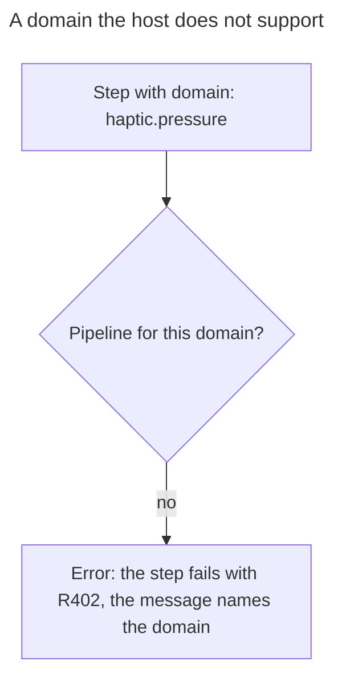

The gap is found when the step runs, not when the workflow is validated: the validator does not know which domains a host serves.

### 1.4 When Modality Matters

Domain parameters do not erase modality -- they parameterize it. The modality affects:

- **Input encoding.** An image domain expects a pixel buffer or URI reference; a text domain expects a string or document reference.
- **Evidence anchors.** Image evidence uses bounding boxes and pixel coordinates; audio evidence uses time segments; text evidence uses character offsets or line numbers. See [Section 4](#4-evidence-grounding-for-modalities) for details.
- **Tool selection.** The runtime maps `detect` with `domain: image.object` to a vision model or API, while `detect` with `domain: text.entity` maps to an NER model. This mapping is an implementation concern, not an ontology concern.
- **Confidence calibration.** Different modalities have different uncertainty profiles. Image classification confidence may be calibrated differently from text classification confidence.

---

## 2. Capability-Modality Matrix

The following matrix shows how key capabilities operate across modalities. Each cell describes the domain parameter value and what the capability does in that modality.

### 2.1 UNDERSTAND Layer Capabilities

| Capability | Text | Image | Audio | Video | Multi-Modal |
|---|---|---|---|---|---|
| **detect** | `domain: text.entity`, `domain: text.pattern`, `domain: text.anomaly` -- Find named entities, regex patterns, or anomalous passages | `domain: image.object`, `domain: image.face`, `domain: image.anomaly` -- Find objects, faces, or visual anomalies via bounding boxes | `domain: audio.event`, `domain: audio.speech`, `domain: audio.anomaly` -- Detect sound events, speech segments, or audio anomalies via time ranges | `domain: video.object`, `domain: video.scene_change`, `domain: video.action` -- Track objects, detect scene transitions, or identify actions across frames | `domain: multimodal.alignment`, `domain: multimodal.inconsistency` -- Detect alignment or inconsistency between modalities |
| **classify** | `domain: text.sentiment`, `domain: text.topic`, `domain: text.intent` -- Assign sentiment, topic, or intent labels to text | `domain: image.scene`, `domain: image.content`, `domain: image.style` -- Classify scenes, content categories, or artistic styles | `domain: audio.genre`, `domain: audio.speaker`, `domain: audio.emotion` -- Classify audio genre, speaker identity, or emotional tone | `domain: video.genre`, `domain: video.activity`, `domain: video.quality` -- Classify video genre, depicted activity, or production quality | `domain: multimodal.category` -- Classify based on combined signals from multiple modalities |
| **measure** | `domain: text.readability`, `domain: text.similarity`, `domain: text.length` -- Quantify readability score, semantic similarity, or document length | `domain: image.resolution`, `domain: image.quality`, `domain: image.similarity` -- Measure resolution, perceptual quality (SSIM, LPIPS), or visual similarity | `domain: audio.loudness`, `domain: audio.snr`, `domain: audio.duration` -- Measure loudness (LUFS), signal-to-noise ratio, or segment duration | `domain: video.fps`, `domain: video.bitrate`, `domain: video.stability` -- Measure frame rate, encoding bitrate, or camera stability | `domain: multimodal.coherence` -- Measure cross-modal coherence (e.g., audio-visual sync score) |
| **predict** | `domain: text.completion`, `domain: text.next_event` -- Predict likely text continuation or next event in a log stream | `domain: image.depth`, `domain: image.segmentation_mask` -- Predict depth maps or segmentation masks from images | `domain: audio.next_segment`, `domain: audio.speaker_turn` -- Predict upcoming audio content or next speaker turn | `domain: video.trajectory`, `domain: video.next_frame` -- Predict object trajectories or synthesize next frames | `domain: multimodal.outcome` -- Predict outcomes using combined text, image, and audio signals |

The remaining UNDERSTAND capabilities (`compare` and `discover`) are typically modality-agnostic and are not shown in this matrix. They operate on abstract data comparisons and pattern discovery regardless of the input modality.

### 2.2 SYNTHESIZE Layer Capabilities

| Capability | Text | Image | Audio | Video | Multi-Modal |
|---|---|---|---|---|---|
| **generate** | `domain: text`, `format: markdown` or `format: code` -- Generate prose, documentation, or source code | `domain: image`, `format: png` or `format: svg` -- Generate images from text prompts or specifications | `domain: audio`, `format: wav` or `format: mp3` -- Generate speech, music, or sound effects | `domain: video`, `format: mp4` -- Generate video clips from descriptions or scripts | `domain: multimodal`, `format: presentation` -- Generate presentations combining text, images, and audio |
| **transform** | `source_format: text.markdown`, `target_format: text.html` -- Convert between text formats, summarize, or translate | `source_format: image.png`, `target_format: image.svg` -- Convert image formats, resize, apply style transfer | `source_format: audio.speech`, `target_format: text.transcript` (transcription) or `source_format: text`, `target_format: audio.speech` (TTS) | `source_format: video.mp4`, `target_format: video.gif` -- Convert formats, extract frames, change resolution | `source_format: text`, `target_format: image` (text-to-image) or `source_format: image`, `target_format: text` (captioning) |

The `integrate` capability merges outputs from multiple sources regardless of modality. See Appendix B, Step 7 for a multi-modal integration example.

### 2.3 PERCEIVE Layer Capabilities

| Capability | Text | Image | Audio | Video | Multi-Modal |
|---|---|---|---|---|---|
| **retrieve** | `format: text` -- Fetch documents, articles, or code by URI or path | `format: image` -- Fetch images by URI, asset ID, or path | `format: audio` -- Fetch audio files by URI, track ID, or path | `format: video` -- Fetch video files by URI, stream ID, or path | `format: mixed` -- Fetch resources containing multiple modalities |
| **search** | `scope: text` -- Search text corpora, databases, or code repositories | `scope: image` -- Search image databases by visual similarity or tags | `scope: audio` -- Search audio libraries by content, metadata, or fingerprint | `scope: video` -- Search video archives by content, transcript, or visual features | `scope: multimodal` -- Search across modalities using cross-modal embeddings |

The `observe` and `receive` capabilities accept any data type and do not use modality-specific format or scope parameters. They are modality-agnostic by design.

### 2.4 Summary Count

- **6 capabilities** are most commonly parameterized by modality: `detect`, `classify`, `measure`, `predict`, `generate`, `transform`
- **2 additional capabilities** support modality through format/scope parameters: `retrieve`, `search`
- **28 remaining capabilities** are modality-agnostic (e.g., `plan`, `checkpoint`, `verify`, `audit` operate on any data type)

---

## 3. Examples

### 3.1 Text Modality Examples

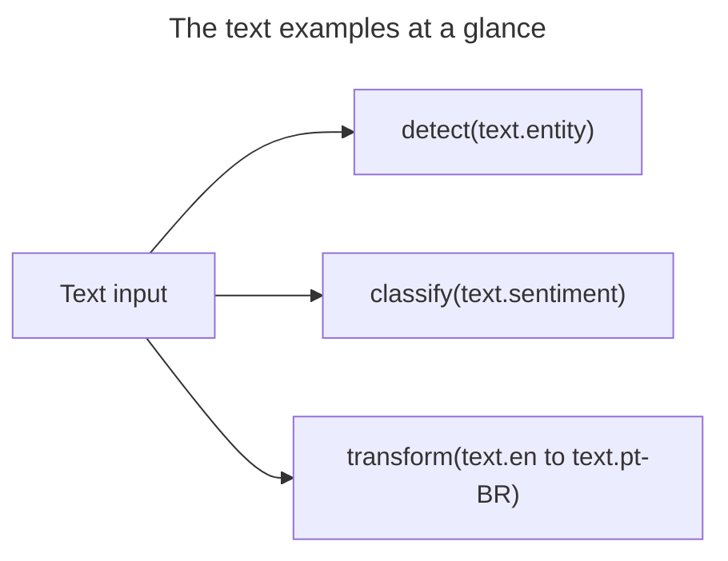

**Example 1: Named Entity Recognition**

```yaml
- capability: detect
  domain: text.entity
  purpose: Extract named entities from the document.
  store_as: entity_out
  input_bindings:
    data: ${retrieve_out.data}
    pattern: "PERSON | ORGANIZATION | LOCATION | DATE"
    threshold: 0.8
```

Output:
```yaml
detected: true
matches:
  - text: "Anthropic"
    label: ORGANIZATION
    span: [42, 51]
  - text: "January 2026"
    label: DATE
    span: [120, 132]
evidence_anchors:
  - ref: "document:report.pdf:page:3:char:42-51"
    kind: file
  - ref: "document:report.pdf:page:3:char:120-132"
    kind: file
confidence: 0.92
```

**Example 2: Sentiment Classification**

```yaml
- capability: classify
  domain: text.sentiment
  purpose: Determine the sentiment of customer feedback.
  store_as: sentiment_out
  input_bindings:
    item: ${retrieve_out.data}
    taxonomy: ["positive", "negative", "neutral", "mixed"]
    multi_label: false
```

Output:
```yaml
labels: ["negative"]
probabilities:
  positive: 0.05
  negative: 0.88
  neutral: 0.04
  mixed: 0.03
evidence_anchors:
  - ref: "document:feedback.txt:line:3-7"
    kind: file
    excerpt: "The response time was unacceptable and..."
confidence: 0.88
```

**Example 3: Text-to-Text Translation**

```yaml
- capability: transform
  purpose: Translate the user manual from English to Portuguese.
  store_as: translation_out
  input_bindings:
    input: ${retrieve_out.data}
    source_format: "text.en"
    target_format: "text.pt-BR"
    options:
      preserve_formatting: true
      domain: "technical"
```

### 3.2 Image Modality Examples

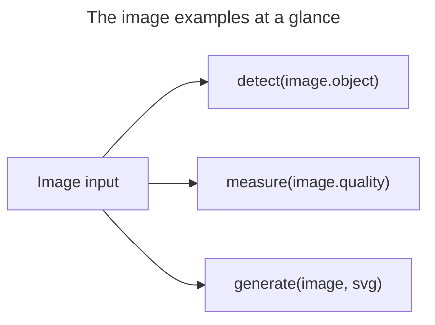

**Example 1: Object Detection in Images**

```yaml
- capability: detect
  domain: image.object
  purpose: Detect all vehicles in the surveillance frame.
  store_as: vehicle_out
  input_bindings:
    data: ${retrieve_out.data}
    pattern: "vehicle"
    threshold: 0.7
```

Output:
```yaml
detected: true
matches:
  - label: "car"
    bounding_box: { x: 120, y: 340, width: 200, height: 150 }
    confidence: 0.95
  - label: "truck"
    bounding_box: { x: 450, y: 280, width: 300, height: 220 }
    confidence: 0.89
locations:
  - region: { x: 120, y: 340, width: 200, height: 150 }
  - region: { x: 450, y: 280, width: 300, height: 220 }
evidence_anchors:
  - ref: "image:frame_20260129_143022.jpg:bbox:120,340,200,150"
    kind: file
  - ref: "image:frame_20260129_143022.jpg:bbox:450,280,300,220"
    kind: file
confidence: 0.92
```

**Example 2: Image Quality Measurement**

```yaml
- capability: measure
  domain: image.quality
  purpose: Assess the perceptual quality of the uploaded photograph.
  store_as: quality_out
  input_bindings:
    target: ${retrieve_out.data}
    metric: "perceptual_quality"
    unit: "SSIM"
```

Output:
```yaml
value: 0.87
uncertainty:
  lower: 0.85
  upper: 0.89
unit: "SSIM"
evidence_anchors:
  - ref: "image:upload_001.jpg:full_frame"
    kind: file
    excerpt: "SSIM computed against reference at 1920x1080"
confidence: 0.95
```

**Example 3: Image Generation**

```yaml
- capability: generate
  domain: image
  purpose: Create an architectural diagram of the system.
  store_as: diagram_out
  input_bindings:
    specification:
      description: "Microservices architecture with API gateway, three services, and a shared database"
      style: "technical diagram"
    format: "svg"
    constraints:
      max_resolution: "4096x4096"
      color_palette: "monochrome"
```

### 3.3 Audio Modality Examples

**Example 1: Speech Detection and Transcription**

```yaml
# Step 1: Detect speech segments in the audio file
- capability: detect
  domain: audio.speech
  purpose: Identify speech segments in the meeting recording.
  store_as: speech_segments_out
  input_bindings:
    data: ${retrieve_out.data}
    pattern: "human_speech"
    threshold: 0.6

# Step 2: Transform speech to text
- capability: transform
  purpose: Transcribe detected speech segments to text.
  store_as: transcript_out
  input_bindings:
    input: ${speech_segments_out.matches}
    source_format: "audio.speech"
    target_format: "text.transcript"
    options:
      language: "en"
      speaker_diarization: true
```

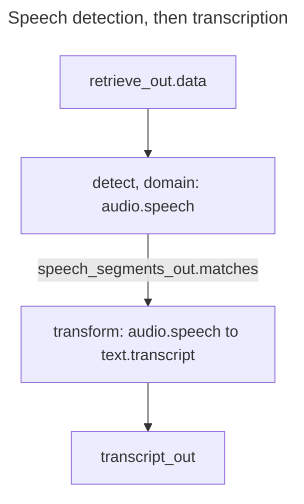

Output for detect step:
```yaml
detected: true
matches:
  - speaker_id: "speaker_1"
    time_range: { start: "00:00:02.300", end: "00:00:15.800" }
    confidence: 0.94
  - speaker_id: "speaker_2"
    time_range: { start: "00:00:16.100", end: "00:00:28.500" }
    confidence: 0.91
locations:
  - segment: { start_ms: 2300, end_ms: 15800 }
  - segment: { start_ms: 16100, end_ms: 28500 }
evidence_anchors:
  - ref: "audio:meeting_2026-01-29.wav:segment:2300-15800"
    kind: file
  - ref: "audio:meeting_2026-01-29.wav:segment:16100-28500"
    kind: file
confidence: 0.92
```

**Example 2: Audio Classification**

```yaml
- capability: classify
  domain: audio.emotion
  purpose: Classify the emotional tone in the customer service call.
  store_as: emotion_out
  input_bindings:
    item: ${retrieve_out.data}
    taxonomy: ["calm", "frustrated", "angry", "satisfied", "confused"]
    multi_label: true
```

**Example 3: Audio Anomaly Detection**

```yaml
- capability: detect
  domain: audio.anomaly
  purpose: Detect unusual sounds in the factory floor recording.
  store_as: anomaly_out
  input_bindings:
    data: ${retrieve_out.data}
    pattern: "mechanical_anomaly"
    threshold: 0.75
```

Output:
```yaml
detected: true
matches:
  - label: "bearing_grinding"
    time_range: { start: "00:12:33.400", end: "00:12:35.100" }
    severity: "high"
evidence_anchors:
  - ref: "audio:factory_line3_20260129.wav:segment:753400-755100"
    kind: file
    excerpt: "1700ms segment with frequency peak at 3.2kHz consistent with bearing wear"
confidence: 0.84
```

### 3.4 Video Modality Examples

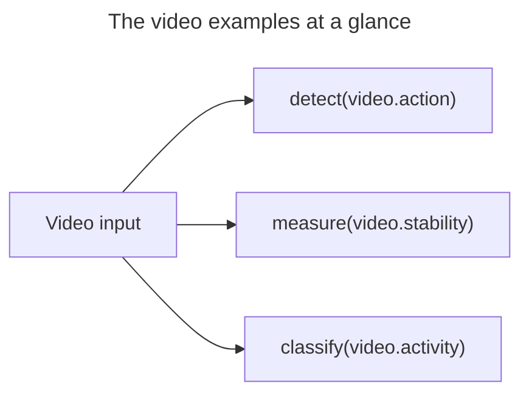

**Example 1: Action Detection in Video**

```yaml
- capability: detect
  domain: video.action
  purpose: Detect safety violations in the warehouse footage.
  store_as: violation_out
  input_bindings:
    data: ${retrieve_out.data}
    pattern: "safety_violation"
    threshold: 0.8
```

Output:
```yaml
detected: true
matches:
  - label: "no_hard_hat"
    frame_range: { start_frame: 1200, end_frame: 1450 }
    time_range: { start: "00:00:40.000", end: "00:00:48.333" }
    bounding_box: { x: 300, y: 150, width: 80, height: 120 }
    confidence: 0.91
evidence_anchors:
  - ref: "video:warehouse_cam2.mp4:frames:1200-1450:bbox:300,150,80,120"
    kind: file
    excerpt: "Person without hard hat detected in Zone B, frames 1200-1450"
confidence: 0.91
```

**Example 2: Video Quality Measurement**

```yaml
- capability: measure
  domain: video.stability
  purpose: Measure camera stability of the drone footage.
  store_as: stability_out
  input_bindings:
    target: ${retrieve_out.data}
    metric: "optical_flow_variance"
    unit: "pixels_per_frame"
```

**Example 3: Video Scene Classification**

```yaml
- capability: classify
  domain: video.activity
  purpose: Classify the activity depicted in each video segment.
  store_as: activity_out
  input_bindings:
    item: ${retrieve_out.data}
    taxonomy: ["manufacturing", "assembly", "inspection", "maintenance", "idle"]
    multi_label: false
```

### 3.5 Multi-Modal Examples

**Example 1: Cross-Modal Consistency Check**

```yaml
# A workflow that checks whether a product listing's text description
# matches its accompanying images.
- capability: detect
  domain: multimodal.inconsistency
  purpose: Detect mismatches between product text and images.
  store_as: mismatch_out
  input_bindings:
    data:
      text: ${retrieve_text_out.data}
      images: ${retrieve_images_out.data}
    pattern: "text_image_inconsistency"
    threshold: 0.7
```

Output:
```yaml
detected: true
matches:
  - inconsistency: "Text says 'blue exterior' but image shows red car"
    text_span: { start: 45, end: 60 }
    image_region: { ref: "image:product_001.jpg:bbox:100,200,400,300" }
    severity: "high"
evidence_anchors:
  - ref: "document:listing.txt:char:45-60"
    kind: file
    excerpt: "features a sleek blue exterior"
  - ref: "image:product_001.jpg:bbox:100,200,400,300"
    kind: file
    excerpt: "Dominant color in region: RGB(180, 30, 25) -- red"
confidence: 0.89
```

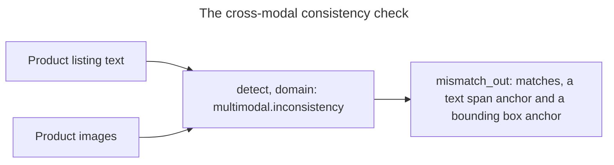

**Example 2: Multi-Modal Search**

```yaml
- capability: search
  scope: multimodal
  purpose: Find all assets matching the concept 'solar panel installation'.
  store_as: search_out
  input_bindings:
    query:
      text: "solar panel installation on residential rooftop"
      visual_reference: ${reference_image_out.data}
    scope: asset_library
    limit: 20
```

**Example 3: Cross-Modal Transformation**

```yaml
# Generate an image caption, then use it to produce audio narration
- capability: transform
  purpose: Generate a descriptive caption for the image.
  store_as: caption_out
  input_bindings:
    input: ${retrieve_out.data}
    source_format: "image.jpg"
    target_format: "text.caption"
    options:
      detail_level: "comprehensive"
      max_length: 200

- capability: generate
  domain: audio
  purpose: Create audio narration from the caption.
  store_as: narration_out
  input_bindings:
    specification: ${caption_out.output}
    format: "wav"
    constraints:
      voice: "neutral"
      speed: 1.0
```

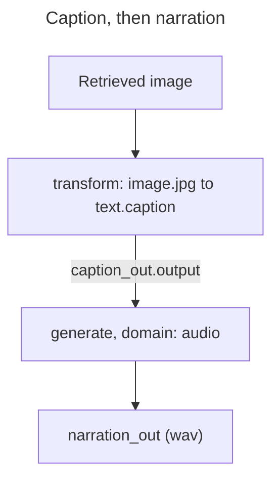

---

## 4. Evidence Grounding for Modalities

Every capability output carries `evidence_anchors` -- references that ground the output in verifiable sources. The capability ontology declares the field as an array and gives its items no schema. The canonical schemas of [STANDARD-v1.1.0 §6.1](../../spec/STANDARD-v1.1.0.md#61-required-schema-files) do define an anchor: the `Anchor` type of `schemas/event_schema.yaml` is an object with `ref` and `kind`, and optionally `excerpt` and `timestamp`. The Standard does not say that the items of `evidence_anchors` are `Anchor` objects ([§6.2](../../spec/STANDARD-v1.1.0.md#62-observation-requirements) keeps a capability's `evidence_anchors` apart from an event's `anchors`). This guide writes its anchors in the `Anchor` form, so that every `kind` it uses is one a canonical schema defines.

`kind` says what sort of source an anchor points to. Where in the source the evidence lies depends on the modality, and goes in `ref`.

### 4.1 Evidence Anchor Types by Modality

The reference forms below are this guide's convention for `ref`; the Standard defines none. Their names are labels for the forms, not values of `kind`.

| Modality | Reference Form | `ref` Format | Description |
|---|---|---|---|
| **Text** | text span | `document:<path>:line:<N>` or `document:<path>:char:<start>-<end>` | Character offset or line reference within a text document |
| **Image** | bounding box | `image:<path>:bbox:<x>,<y>,<w>,<h>` | Rectangular region in pixel coordinates |
| **Image** | image reference | `image:<path>:full_frame` | Reference to the entire image |
| **Image** | pixel mask | `image:<path>:mask:<mask_id>` | Binary or probability mask over image pixels |
| **Audio** | time segment | `audio:<path>:segment:<start_ms>-<end_ms>` | Time range in milliseconds within an audio file |
| **Audio** | frequency band | `audio:<path>:freq:<low_hz>-<high_hz>:time:<start_ms>-<end_ms>` | Spectrogram region defined by frequency and time |
| **Video** | video region | `video:<path>:frames:<start>-<end>:bbox:<x>,<y>,<w>,<h>` | Spatio-temporal region: frame range and bounding box |
| **Video** | frame reference | `video:<path>:frame:<N>` | Reference to a single video frame |
| **Video** | temporal segment | `video:<path>:time:<start>-<end>` | Time range within a video file |
| **Multi-Modal** | no form of its own | One anchor per contributing modality, each in its modality's form | The anchors sit side by side in `evidence_anchors` |

Every format above points into a stored file, so the `kind` of these anchors is `file`. An anchor whose source is of another sort takes the kind of that source (`url`, `sensor`, `tool`, `log`, `api` or `human_note`) and the same position in `ref`.

A domain profile's `evidence_policy.required_anchor_types` lists anchor kinds (`file`, `url`, `sensor`, …), never a form: a kind outside `Anchor.kind` refuses the profile (S303, Standard 1.2.0 §5.21.2). Profiles 1.0.0 listed forms and labels there (`bounding_box`, `time_segment`, `image_reference`); version 2.0.0 maps each to its kind, `file` for the formats above ([Status of Domain Profiles](../domains/README.md#status-of-domain-profiles)).

### 4.2 Anchor Schema

The anchors in this guide follow the `Anchor` type of `schemas/event_schema.yaml`, regardless of modality:

```yaml
Anchor:
  type: object
  required: [ref, kind]
  properties:
    ref:
      type: string
    kind:
      type: string
      enum:
        - file
        - url
        - tool
        - log
        - sensor
        - human_note
        - api
    timestamp:
      type: string
      nullable: true
    excerpt:
      type: string
      nullable: true
```

`schemas/world_state_schema.yaml` defines an `Anchor` with the same members and six of the seven kinds: it has no `api`. Neither schema has a member for nested anchors, so a claim that rests on several modalities lists one anchor for each.

### 4.3 Grounding Rules by Modality

**Text grounding rules:**
- Entity references MUST include character offsets or line numbers.
- Classification evidence MUST include the excerpt that supports the label assignment.
- When text is too long to excerpt, provide a document hash and section reference.

**Image grounding rules:**
- Object detections MUST include bounding box coordinates `(x, y, width, height)` in pixel space.
- Full-image classifications MAY use `full_frame` references but SHOULD note the dominant region that influenced the decision.
- Segmentation results MUST reference a mask identifier.

**Audio grounding rules:**
- Speech detections MUST include time segment boundaries in milliseconds.
- Audio classifications SHOULD include the time range analyzed.
- Frequency-domain detections (e.g., anomalous harmonics) SHOULD include both time and frequency bounds.

**Video grounding rules:**
- Object detections MUST include both the frame range and the bounding box within those frames.
- Scene-level classifications MUST include the temporal segment (frame range or time range).
- Action detections SHOULD include representative keyframe references.

**Multi-modal grounding rules:**
- Cross-modal claims MUST include anchors from each contributing modality.
- The `Anchor` type has no nesting: the anchors of the contributing modalities are listed side by side in `evidence_anchors`.
- When modalities disagree, ALL modality-specific evidence MUST be included, not just the one that supports the conclusion.

### 4.4 Example: Grounded Multi-Modal Evidence

A claim that a product listing is inconsistent requires evidence from both text and image:

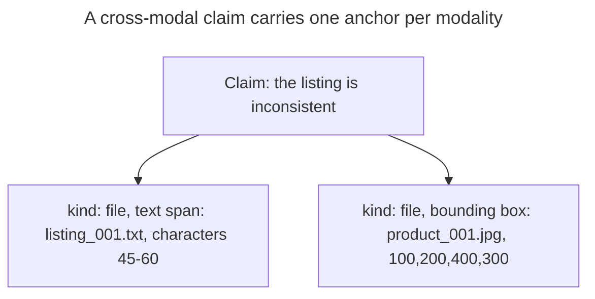

```yaml
evidence_anchors:
  - ref: "document:listing_001.txt:char:45-60"
    kind: file
    excerpt: "features a sleek blue exterior"
  - ref: "image:product_001.jpg:bbox:100,200,400,300"
    kind: file
    excerpt: "Vehicle body region with dominant RGB(180,30,25)"
```

---

## 5. OASF Compatibility

The Open Agentic Schema Framework (OASF) by Cisco/Outshift organizes AI agent skills into 15 categories. Three of these categories are modality-specific and map directly to Grounded Agency's domain-parameterized capabilities.

### 5.1 Mapping to OASF Categories

| OASF Category | ID | OASF Approach | Grounded Agency Approach |
|---|---|---|---|
| **Computer Vision** | 2 | Dedicated skill category with subcategories for object detection, image segmentation, image classification, OCR, etc. | `detect(domain: image.*)`, `classify(domain: image.*)`, `measure(domain: image.*)`, `predict(domain: image.*)`, `generate(domain: image)`, `transform(source_format: image.*, ...)` |
| **Audio** | 3 | Dedicated skill category with subcategories for audio classification, speech recognition, text-to-speech, etc. | `detect(domain: audio.*)`, `classify(domain: audio.*)`, `measure(domain: audio.*)`, `predict(domain: audio.*)`, `generate(domain: audio)`, `transform(source_format: audio.*, ...)` |
| **Multi-modal** | 7 | Dedicated skill category for cross-modality tasks like image-to-text, text-to-image, visual question answering | `detect(domain: multimodal.*)`, `classify(domain: multimodal.*)`, `measure(domain: multimodal.*)`, `predict(domain: multimodal.*)`, `generate(domain: multimodal.*)`, `transform(source_format: <modality_A>, target_format: <modality_B>)`, `search(scope: multimodal)` |

### 5.2 OASF Skill Equivalences

Selected OASF skills and their Grounded Agency equivalents:

| OASF Skill | OASF Category | Grounded Agency Equivalent |
|---|---|---|
| Object Detection | Computer Vision [2] | `detect` with `domain: image.object` |
| Image Segmentation | Computer Vision [2] | `detect` with `domain: image.segment` + `predict` with `domain: image.segmentation_mask` |
| Image Classification | Computer Vision [2] | `classify` with `domain: image.scene` or `domain: image.content` |
| OCR | Computer Vision [2] | `transform` with `source_format: image`, `target_format: text.ocr` |
| Depth Estimation | Computer Vision [2] | `predict` with `domain: image.depth` |
| Image Generation | Computer Vision [2] | `generate` with `domain: image` |
| Audio Classification | Audio [3] | `classify` with `domain: audio.genre` or `domain: audio.speaker` |
| Speech Recognition | Audio [3] | `transform` with `source_format: audio.speech`, `target_format: text.transcript` |
| Text-to-Speech | Audio [3] | `generate` with `domain: audio` or `transform` with `source_format: text`, `target_format: audio.speech` |
| Image Captioning | Multi-modal [7] | `transform` with `source_format: image`, `target_format: text.caption` |
| Text-to-Image | Multi-modal [7] | `generate` with `domain: image` or `transform` with `source_format: text.prompt`, `target_format: image` |
| Visual QA | Multi-modal [7] | Workflow: `detect(domain: image.*) -> ground -> generate(domain: text)` |
| Image-to-3D | Multi-modal [7] | Workflow: `detect(domain: image.*) -> transform -> generate(domain: 3d)` |

These workflow patterns will be formally defined in the workflow catalog. See the catalog for currently available patterns.

### 5.3 Key Differences

1. **Taxonomy vs. parameterization.** OASF lists modality skills as separate entries in a flat catalog. Grounded Agency parameterizes the same atomic capabilities, reducing the number of concepts to learn while maintaining the same expressiveness.

2. **Safety integration.** OASF modality skills do not carry built-in safety properties. In Grounded Agency, every modality invocation inherits evidence anchors, confidence scores, and (where applicable) checkpoint requirements. An `image.object` detection returns grounded bounding boxes and confidence just as a `text.entity` detection returns grounded character spans and confidence.

3. **Evidence grounding.** OASF does not define how to anchor evidence for non-text modalities. This guide gives modality-specific reference forms for evidence anchors (see [Section 4](#4-evidence-grounding-for-modalities)) that provide verifiable references into the source data regardless of modality.

### 5.4 Reference

For more information on OASF:
- OASF Skill Categories: [https://schema.oasf.outshift.com/skill_categories](https://schema.oasf.outshift.com/skill_categories) (as of OASF v0.8.0, January 2026)
- Full comparison: [docs/research/analysis/OASF_comparison.md](../research/analysis/OASF_comparison.md)

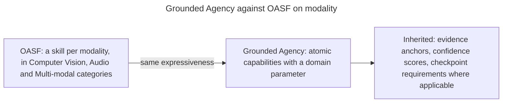

---

## Appendix A: Domain Parameter Naming Conventions

Domain parameters follow a hierarchical dot notation:

```
<modality>.<specialization>
```

Examples:
- `text.entity` -- named entity detection in text
- `image.object` -- object detection in images
- `audio.speech` -- speech detection in audio
- `video.action` -- action recognition in video
- `multimodal.alignment` -- cross-modal alignment checking
- `3d.mesh` -- 3D mesh operations
- `3d.point_cloud` -- 3D point cloud operations

When no specialization is needed, the modality alone suffices:
- `image` -- general image domain (e.g., for `generate`)
- `audio` -- general audio domain
- `text` -- general text domain

### Naming Rules

1. Use lowercase for all domain parameter values.
2. Use dot notation for hierarchy (e.g., `image.object`, not `image-object` or `image/object`).
3. Keep specializations to two levels maximum (e.g., `audio.speech` not `audio.speech.en.formal`). Use the `options` field for deeper configuration.
4. Use the capability's native parameters for non-domain concerns. For example, use `threshold` for detection sensitivity, not `domain: image.object.high_sensitivity`.

## Appendix B: Complete Workflow -- Multi-Modal Content Moderation

This appendix demonstrates a full workflow that uses domain parameters across multiple modalities.

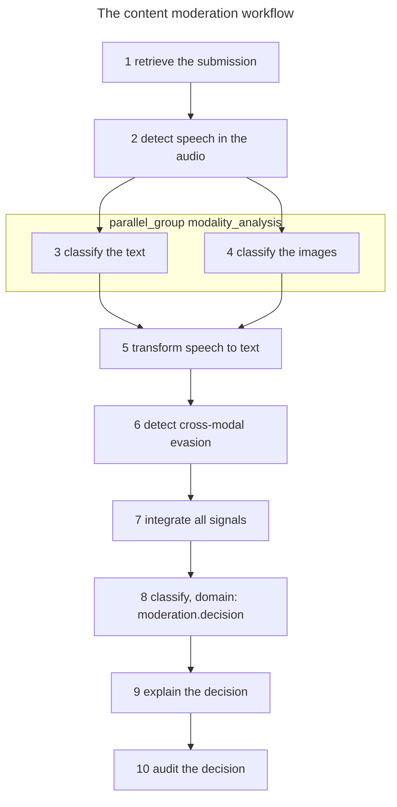

```yaml
# Standard version: 1.1.0
content_moderation:
  goal: Analyze user-submitted content across text, image, and audio for policy violations.
  risk: medium

  steps:
    # 1. Retrieve the submitted content
    - capability: retrieve
      purpose: Fetch the user submission containing text, images, and audio.
      store_as: content_out
      input_bindings:
        target: ${submission.id}

    # 2. Analyze audio content
    # The ontology orders detect before classify (`detect precedes classify`),
    # so detection runs first rather than in the same parallel group as the
    # classify steps: steps of one group run concurrently.
    - capability: detect
      domain: audio.speech
      purpose: Detect speech in audio for transcription and analysis.
      store_as: audio_detection_out
      input_bindings:
        data: "${content_out.data.audio: object}"
        pattern: "human_speech"

    # 3. Analyze text content
    - capability: classify
      domain: text.toxicity
      purpose: Classify text for toxic or harmful content.
      store_as: text_moderation_out
      input_bindings:
        item: "${content_out.data.text: string}"
        taxonomy: ["safe", "mild", "moderate", "severe"]
      parallel_group: modality_analysis

    # 4. Analyze image content
    - capability: classify
      domain: image.content
      purpose: Classify images for policy-violating content.
      store_as: image_moderation_out
      input_bindings:
        item: "${content_out.data.images: array<object>}"
        taxonomy: ["safe", "suggestive", "explicit", "violent"]
      parallel_group: modality_analysis
      join: all_complete

    # 5. Transcribe any detected speech
    - capability: transform
      purpose: Transcribe detected speech to text for policy review.
      store_as: transcript_out
      input_bindings:
        input: "${audio_detection_out.matches: array<object>}"
        source_format: "audio.speech"
        target_format: "text.transcript"

    # 6. Check cross-modal consistency
    - capability: detect
      domain: multimodal.inconsistency
      purpose: Detect attempts to evade moderation via cross-modal tricks.
      store_as: evasion_out
      input_bindings:
        data:
          text: "${content_out.data.text: string}"
          images: "${content_out.data.images: array<object>}"
          audio_transcript: ${transcript_out.output}
        pattern: "cross_modal_evasion"

    # 7. Integrate all moderation signals
    - capability: integrate
      purpose: Merge moderation results from all modalities.
      store_as: integrated_out
      input_bindings:
        sources:
          - ${text_moderation_out}
          - ${image_moderation_out}
          - ${evasion_out}
        strategy: "most_restrictive"
        conflict_resolution: "escalate"

    # 8. Make final moderation decision
    - capability: classify
      domain: moderation.decision  # domain here specializes the task, not the modality
      purpose: Produce final moderation verdict from integrated signals.
      store_as: verdict_out
      input_bindings:
        item: ${integrated_out.merged}
        taxonomy: ["approve", "flag_for_review", "reject"]

    # 9. Explain the decision
    - capability: explain
      purpose: Generate human-readable explanation of the moderation decision.
      store_as: explanation_out
      input_bindings:
        conclusion: ${verdict_out}
        audience: "content_moderator"
        depth: "detailed"

    # 10. Audit the decision
    # Note: audit writes to the audit log (mutation: true in ontology) but does
    # not require a checkpoint — the mutation is append-only and non-destructive.
    - capability: audit
      purpose: Record the moderation decision with full evidence trail.
      store_as: audit_out
      input_bindings:
        event:
          action: "content_moderation"
          verdict: "${verdict_out.labels: array<string>}"
          explanation: ${explanation_out.explanation}
        context:
          content_id: ${submission.id}
          all_signals: ${integrated_out}

  success:
    - All modalities analyzed
    - Cross-modal evasion checked
    - Moderation verdict produced with explanation
    - Decision audited with full evidence trail

  inputs:
    submission:
      type: object
      required: true
      properties:
        id:
          type: string
```

---

*For the full capability ontology, see [schemas/capability_ontology.yaml](../../schemas/capability_ontology.yaml).*
*For workflow composition patterns, see [docs/WORKFLOW_PATTERNS.md](../WORKFLOW_PATTERNS.md).*
*For the tutorial on building workflows, see [docs/TUTORIAL.md](../TUTORIAL.md).*
