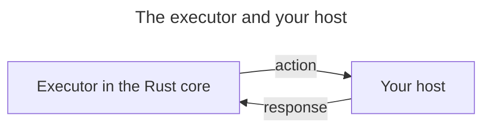
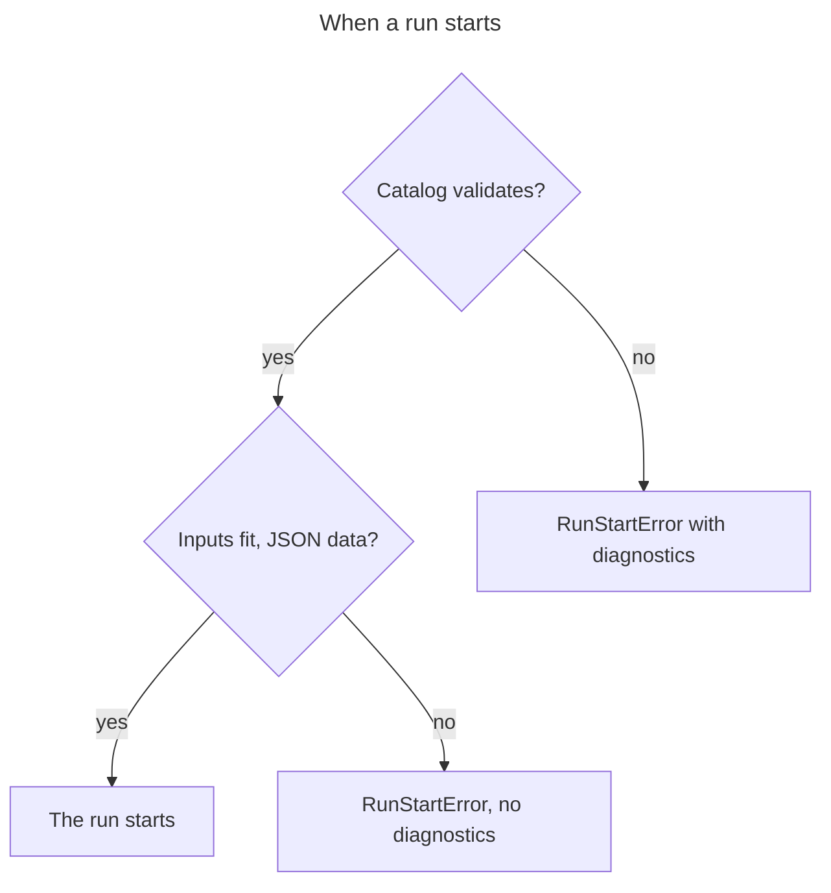
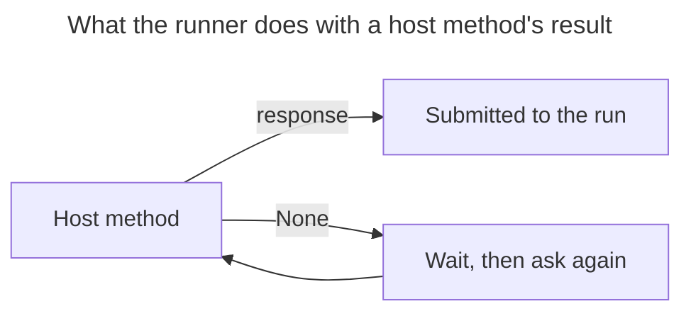
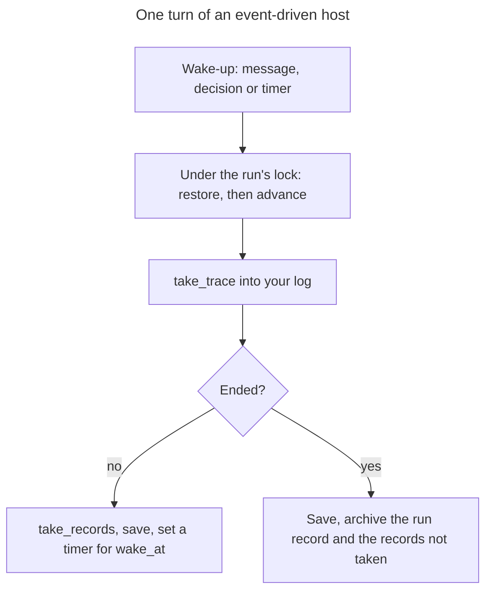
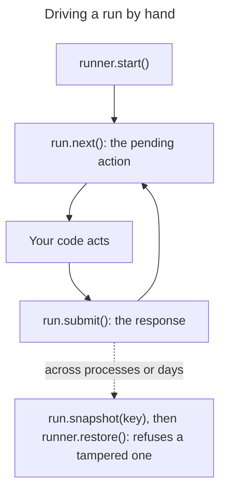
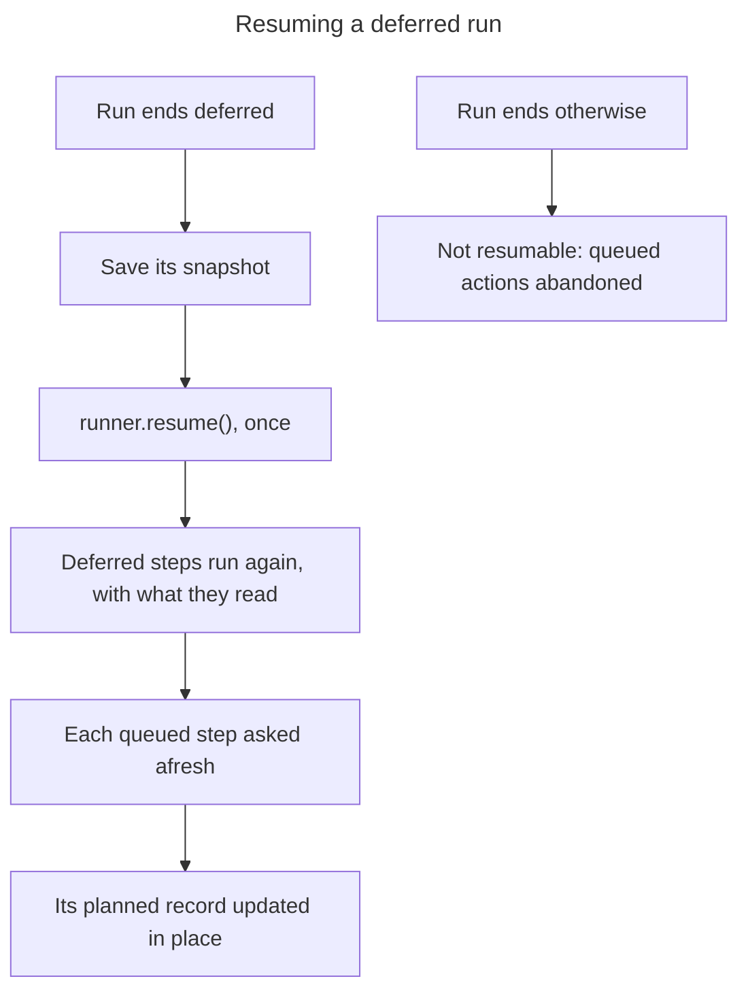
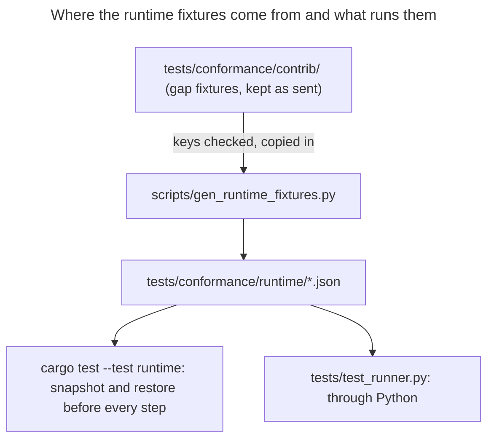

# Running Workflows

The reference executor runs a validated workflow step by step and enforces
the standard's runtime rules: conditions and gates, checkpoints before
mutations, approvals, waits, retries, failure modes, recovery loops,
escalation and review quorums. It lives in the Rust core, next to the
validator, and Python drives it through
`grounded_agency.workflows.WorkflowRunner`.

The executor does no I/O. It tells your code what to do next (an
*action*); your code does it and reports back (a *response*). Time only
enters through the timestamps you pass. So the same catalog, inputs,
responses and times always produce the same actions, the same trace and
the same snapshot, and a run can be saved and resumed anywhere.



The contract is [STANDARD-v1.2.0 §5](../../spec/STANDARD-v1.2.0.md#5-workflow-dsl)
and the host protocol of
[§5.19](../../spec/STANDARD-v1.2.0.md#519-host-protocol), whose actions and
responses `schemas/host_protocol.schema.json` defines (and
`grounded_agency.workflows.protocol` types for Python).
The executor's source is in `core/src/exec/`, and Python reaches it as
`grounded_agency._core.Run`.

## Quick start

```python
from grounded_agency.workflows import Host, WorkflowEngine, WorkflowRunner

engine = WorkflowEngine("schemas/capability_ontology.yaml")
engine.load_catalog("my_catalog.yaml")


class MyHost(Host):
    def invoke_capability(self, action):
        # action["capability"], action["inputs"], action["step"], ...
        value = my_tools[action["capability"]](**action["inputs"])
        return {"kind": "Output", "value": value}

    def request_approval(self, action):
        # Show action["shown"] to a person; bind the answer to its digest.
        ok = ask_a_person(action["shown"])
        return {
            "kind": "Decision",
            "decision_id": new_id(),
            "decision": "approved" if ok else "rejected",
            "approvers": ["alice"],
            "digest": action["digest"],
        }


result = WorkflowRunner(engine).run("my_workflow", {"topic": "x"}, MyHost())
if result.ok:
    print(result.outputs)
else:
    print(result.code, result.message)   # e.g. F502 approval was rejected
```

A run starts only if the catalog validates. Otherwise `RunStartError` is
raised, with the error diagnostics in `.diagnostics`. Warnings do not block
a run. Inputs or an `actor_identity` that do not fit the workflow, or are not
JSON data, also raise `RunStartError` (with no diagnostics).



## Actions and responses

| Action | Your host | Respond with |
|--------|-----------|--------------|
| `InvokeCapability` | runs `capability` with `inputs`, for the step's `domain` when it declares one (null otherwise; select the implementation for it with `select_implementation`, [§5.2.4](../../spec/STANDARD-v1.2.0.md#524-domain-parameter); a waiting `delegate` that delegates again names the delegation it replaces in `replaces`); `idempotency_key` (`<run_id>:<n>`) is the same for every attempt of one pass of the step: perform the effect at most once per key ([§4.4.2](../../spec/STANDARD-v1.2.0.md#442-transmissions)) | `{"kind": "Output", "value": {...}}`, optionally with `"evidence_seen": [ref, ...]` (the refs of the evidence the output's producer had for this answer; leave it out when you do not know the request, [Evidence and grounding](#evidence-and-grounding)), or `{"kind": "Error", "code": "R401"/"R402", "message": ..., "reason": ...}` (any other code is read as R402; `reason` is optional, below; neither holds a secret, and the runner redacts the message) |
| `CreateCheckpoint` | takes a checkpoint before `step` | `{"kind": "Checkpoint", "checkpoint_id": ...}` |
| `Rollback` | restores `checkpoint_id` | `{"kind": "RolledBack"}` only when everything the checkpoint captured is restored, optionally with `"not_covered": [{"item", "reason"}, ...]` (changes it never covered: `transmitted`, `delegated`, `outside_scope`, [§4.4.1](../../spec/STANDARD-v1.2.0.md#441-checkpoints-and-rollback)); otherwise an `Error` (the run fails F503) |
| `RequestApproval` | asks `approver` about `shown`, in `mode`: `in_session`, whoever attends the run, in its session; `out_of_band`, a separate channel whose approvers need not attend the run (keep the run's snapshot while you wait). `queued_action_id` names the queued action a resumed run is asking about, on every such request ([Resuming a deferred run](#resuming-a-deferred-run)) | `{"kind": "Decision", "decision_id", "decision", "approvers", "digest"}`; `decision` is `approved`, `rejected` or `unavailable`; with `identity@1`, optionally `approver_identities` (each an `agent_identity`, one per principal; `approvers` then empty or their principals) |
| `RecheckSource` | re-reads `source` now | `{"kind": "Current", "value": ...}` |
| `AwaitEvent` | waits for a matching event until `deadline` (a waiting delegate whose host attested who took it names that principal as `delegate_principal`: only its results count) | `{"kind": "Event", "event": {...}, "principal": ..., "identity": {...}}` (the authenticated party that delivered it, §5.15, and its `agent_identity`, §5.17; both optional, and a `principal` beside an `identity` must be the identity's), `{"kind": "LivenessLost"}` (R406), or `{"kind": "Error", "code": "R401"/"R402"/"R406", "message": ...}` (any other code is read as R402) |
| `Sleep` | waits until `until` (retry backoff, or a step's `delay`) | — (the runner calls `tick`) |
| `Completed` / `Failed` | — | the run is over (`Completed` carries `ended` when a gate ended it; `Failed` carries the `reason` the failure came with, and, for a cancelled run, `checkpoint_id`) |

`Host` has a method for each, plus `now_ms()` and `sleep_until()` (wall
clock by default). A method may return `None` when there is nothing yet
(no event, no decision): the runner waits `poll_interval_ms` (or until the
action's deadline) and asks again. An exception from `invoke_capability`
fails that step (R402); the step's retries and failure modes then apply.
`NotImplementedError` instead stops the runner, since the host cannot run
that capability at all. Give `Host` a `CheckpointTracker` and checkpoints
are recorded in it.



Values you hand the run must be I-JSON: integers within ±2^53 and at most
100 levels deep. Anything else is refused, so that snapshots and approval
digests represent every value exactly.

Every action carries `run_id`, `id` and `frame`: the run, the action's
number in it (a restored run asks for its pending action again with the
same `id`), and the workflows of the nested runs, root first. A
capability's output must be an object with the fields its ontology
contract requires, or the step fails (R402). A response member the protocol
does not define is ignored, as in 1.1, and your host ignores an action
member it does not know: later versions may add members to both.

When your host gets the output as a string (a model's reply, a sub-prompt's
result, a tool's text), decode it by
[Standard 1.2.0 §5.18.9](../../spec/STANDARD-v1.2.0.md#5189-text-only-results)
before you answer: it must be the I-JSON text of the object and nothing else.
`grounded_agency.decode_capability_output(capability, text, registry)` does
this and raises `CapabilityOutputError` (R402) otherwise; answer the action
with an error then.

An `Error` may say why, with a `reason`
([§5.19.7](../../spec/STANDARD-v1.2.0.md#5197-error-reasons)):
`unsupported_capability` (you do not perform the capability),
`unsupported_domain` (not for the step's `domain`), `not_recorded` (a record
that was required was not written), the other tokens §5.19.7 lists, or a
vendor reason `x-...`. The code still decides what happens (an
`unsupported_domain` R402 is retried like any R402); the reason travels to
the step's trace event, to the run's `Failed` action and `RunResult.reason`,
and to the step's record as `reason_code`. A `reason` outside that grammar
is ignored and noted in the trace as `reason_ignored`. Raise
`HostCannotServe(reason, message)` from `invoke_capability` or `await_event`
and the runner answers the action with that `Error`.

The executor computes some members of the actions it issues: `deadline` is
the time the attempt's action was issued plus the step's `timeout`;
`expires_at` the time of the approval request plus `expires`; `Sleep.until`
the time an attempt failed plus the backoff, or the time a step reached its
`delay` plus the delay. `Completed.outputs` is the root workflow's stores,
and the executor composes the outputs of the steps it runs itself: waits,
`invoke` steps and quorums
([§5.19.1](../../spec/STANDARD-v1.2.0.md#5191-actions-and-responses)).

What your host transmits to perform an approval request, a recheck, a wait
or the run's end, such as the prompt it sends an approver or the result it
returns to whoever started the run, is protocol traffic, not a `send` step
([§5.19.6](../../spec/STANDARD-v1.2.0.md#5196-protocol-traffic)), provided
it carries only the action's values: send the approver the `shown` values,
the digest and the expiry, never other stores or inputs of the run.

## What the executor enforces

- **Destination policies.** With a policy in force (the host's
  `destinations=` at start, or an applied profile's `allowed_destinations`),
  a `send` step whose destination a policy does not allow, or is not a
  string, fails with F504 (`destination_not_allowed`) once its inputs are
  resolved, before anyone is asked to approve it and before a checkpoint is
  used; a failure mode can match it with `on_error: F504`
  ([§4.4.2](../../spec/STANDARD-v1.2.0.md#442-transmissions)).
- **Memory scope echo.** A `persist` or `recall` step of a 1.2 workflow
  that binds `scope` fails with R402 (`unsupported_scope`, retried as any
  R402) unless the output's `scope` equals it; in a 1.0 or 1.1 workflow
  `scope` is W616 and passed on unchecked
  ([§4.5](../../spec/STANDARD-v1.2.0.md#45-memory)).
- **Steps that report.** A `rollback` step completes whatever its
  `restored` says, and a `persist` step whatever its `stored` says: check
  them with an after-gate (§12.5, Checked Rollback). W624 reports a 1.2
  rollback step nothing checks.
- **Grounding.** Under a grounding policy (a workflow's `grounding`, with
  `grounding@1`, or one the host gives when the run starts), each host
  `Output` of a required capability is checked after the fields its
  contract requires and before the after-gates: an `acs:` citation must be
  of kind `record` and covered by a reference the step binds, an anchor
  must be in `evidence_seen` when the host gives it, and an output with no
  anchor that counts must be marked inferred; otherwise the step fails with
  F505, which is not retried
  ([§5.20](../../spec/STANDARD-v1.2.0.md#520-grounding)). The trace gets a
  `grounding` event for each output that passes.
- **Conditions and gates.** A false condition skips the step, unless
  `skip_if_false: false`, which makes it R403. Gate actions: `stop` → R403,
  `skip` → skip the step, `rollback` → roll back, then R403, `warn` → a trace
  event, `end` → the run ends successfully, no later step runs, and
  `RunResult.ended` says at which step and why (an after-gate `end` yields
  to a failure mode that fires; an `end` whose expression errors does not
  fire). An expression that errors (R405) is fail-safe: a gate fires, a
  condition is false, and a failure mode does not fire.

  ```mermaid
  ---
  title: What each gate action does
  ---
  flowchart LR
    accDescr: A gate that fires with stop fails the step with R403, skip skips the step, rollback rolls back and then fails with R403, warn adds a trace event, and end ends the run successfully.
    gate[A gate fires] --> r403["stop: R403"]
    gate --> skip["skip: the step is skipped"]
    gate --> rb["rollback: roll back, then R403"]
    gate --> trace["warn: a trace event"]
    gate --> ended["end: the run ends successfully"]
  ```
- **Checkpoints.** One checkpoint authorises one step that requires one,
  and is used only once the step is approved and about to run
  ([§5.2.2](../../spec/STANDARD-v1.2.0.md#522-checkpoint-use) states the
  rule). The newest valid one is used: once the latest is used, an earlier
  valid one is used before a new one is asked for. When none is valid, the
  executor asks for a new one (`CreateCheckpoint`). A completed wait
  invalidates earlier checkpoints.
- **Approvals.** Every step that requires approval asks for it, unless it
  is deferred. The
  decision must match the digest of what was shown, have enough distinct
  approvers, arrive before `expires`, and not be reused. A run that is
  unattended asks only a standing mandate; when there is none, or it
  answers `unavailable`, the run follows `approval.when_unattended`:
  `fail` (F502, the default), `skip`, or `defer_to_queue`. A deferral
  holds back the step and every later step that depends on it (reads its
  output, may act on the world, or comes after it in the ontology), runs
  the steps that only read, reason or record, and ends the run `deferred`.
  A step with `after_deferral: run` is deferred only if it reads a deferred
  step's output.
  In an attended run
  `unavailable` is F502. The default `Host` holds no mandates: it answers
  `unavailable` for one. `recheck` re-reads a source before acting, then
  asks again (showing what changed), replans or stops if it changed.
  A step with no `approval` field is asked of a person, in session, shown
  its resolved inputs, with no expiry; a partial field takes the default of
  each member it leaves out, and `expires` runs from the request. What is
  shown is an array: the `shows` values in order (null for a reference that
  resolves to nothing), or `[inputs]` without `shows`, plus a `recheck`
  object when asked again; the digest is the SHA-256 of its RFC 8785 text in
  lowercase hexadecimal, and a decision's digest is accepted in any case.
  An integer, a number written without a fraction or an exponent, may not
  exceed 2^53 in magnitude.
  With `identity@1`, a decision that attests its approvers
  (`approver_identities`) is counted by principal, and an identity counts
  only if it meets the request: kind `human` for a human approver, the
  requested `role`; the record lists the approvers that counted and their
  identities, and a refused decision's `reason` names the others. In a
  workflow that declares `spec_version: "1.2"`, the approver may also
  require `sender_check` and `accept_trust_classes`, and a decision without
  identities then counts no one. A run that ends `deferred` can be resumed:
  see [Resuming a deferred run](#resuming-a-deferred-run).
  Every approval leaves an action record, with a `reason` when the action
  did not go ahead. A step that uses, directly or through other steps, an
  item from one of the `always_ask_trust_classes` of `identity@1` (or with
  no trust class) is asked of a person (`approver.kind: human`,
  `always_ask: true`) even when its approval names a standing mandate, and
  its records carry `always_ask: true`; unattended, it follows
  `when_unattended`. An `identity@1` input that resolves to anything but a
  list of known values fails its step (R402). A step with `identity@1`
  inputs that does not wait is your host's to filter: put the sender's
  `sender_identity` on each item you return, since an item without one
  counts as always-ask when `always_ask_trust_classes` is bound.

  ```mermaid
  ---
  title: Approval in an unattended run
  ---
  flowchart TB
    accDescr: An unattended run asks only a standing mandate; when there is none, or it answers unavailable, the run follows when_unattended, which fails with F502 by default, skips the step, or defers it to a queue.
    ask[Step requires approval, run unattended] --> mandate{"Standing mandate approves?"}
    mandate -->|approved| run[Step runs]
    mandate -->|"none, or unavailable"| wu["when_unattended: fail (F502, default), skip, or defer_to_queue"]
  ```
- **Delays.** A step with `delay` (`wait@1`) sleeps that long after its
  condition and before-gates, before its approval and execution; when it wakes,
  earlier checkpoints no longer count, as after a wait.
- **Waits.** `AwaitEvent` has a deadline from the step's `timeout`. An
  `accept_from` that resolves to anything but a non-empty list of strings,
  or a `correlate` value that resolves to null, fails the step (R402) before
  it waits. Events
  that don't match (`event_type`, `source_kind`, `correlate`,
  `accept_from`, `sender_check`, `accept_trust_classes`) are dropped and
  the wait goes on. A lapse is R401;
  `LivenessLost` (or an `Error` with code R406) is R406, unless it comes
  after the deadline, which is R401.
- **Parallel groups.** The members of a `parallel_group` are not ordered
  relative to each other; the executor, with one action pending at a time,
  runs them one after another in list order, and a step after the group
  runs once every member has finished
  ([§5.2.3](../../spec/STANDARD-v1.2.0.md#523-parallel-groups)). `join` has
  one defined value, `all_complete`; any other, or a `join` without a group,
  is W618 and ignored. A member that reads a group mate's store is W619:
  another executor may run the mate after it. F504 for a `conflicts_with`
  pair in one group is a static check: it says nothing about two runs, or a
  run and a delegate, at once
  ([§4.3](../../spec/STANDARD-v1.2.0.md#43-edge-types-and-dependency-semantics)).
- **Delegation targets.** In a 1.2 workflow that declares `agents`, the
  executor refuses, before approval or a checkpoint and without retrying, a
  computed agent that is not listed, a target whose manifest it was not
  given, and a task the agent's manifest does not accept (R402); it raises
  the step's flags to the target's maxima. In any 1.2 workflow, an accepted
  `read_only` delegation the host does not attest fails, not retried, and a
  continuation (`continues`) attested fresh or returning the `task_id` it
  continues fails (R402)
  ([§5.15.2](../../spec/STANDARD-v1.2.0.md#5152-delegation-targets),
  [§5.15.3](../../spec/STANDARD-v1.2.0.md#5153-continuing-a-delegation)).
- **Catalog sets.** An `invoke` target resolves over the catalog and the
  other catalogs it was started with: a qualified id `<catalog id>/<name>`
  names another catalog's exported workflow, and a bare name always the
  invoker's own catalog's; a computed target that resolves to nothing, or to
  an unexported workflow, is refused (R402)
  ([§5.1.1](../../spec/STANDARD-v1.2.0.md#511-catalog-manifests-and-qualified-names)).
- **Retries, deadlines.** `retry.max` (at most 1000) extra attempts for
  R401/R402/R406, with `none`, `linear` (1 s × n) or `exponential`
  (1 s × 2^(n−1)) backoff, as
  [§5.2](../../spec/STANDARD-v1.2.0.md#52-step-definition) states. A result after the step's deadline is R401. A
  step the executor itself refuses (an invocation whose inputs do not fit
  the workflow) is not retried: another attempt would be refused the same
  way. Times are milliseconds since the epoch, capped at the end of year
  9999.
- **Failure modes and recovery.** The first failure mode that matches the
  step's error code (`on_error`) or whose `when` is true applies. Its
  `action` runs first: `rollback` sends `Rollback`, `pause_and_checkpoint`
  sends `CreateCheckpoint`. Then it can loop back with injected
  `${_recovery.*}` context (up to `max_loops`, then `on_exhausted` or
  R404); when a loop runs a waiting `delegate` again (it is the target,
  or comes after it), that delegation names the one it replaces in
  `replaces`; a loop that runs an `invoke` again starts a new child run,
  whose delegations replace none of the old run's. It can also escalate to a handler (the run ends `escalated`), or end the run
  with the step's code — R402 when `when` fired on a step that did not fail
  ([STANDARD §5.12](../../spec/STANDARD-v1.2.0.md#512-recovery-and-escalation)).

  ```mermaid
  ---
  title: When a failure mode applies
  ---
  flowchart TB
    accDescr: The first failure mode that matches the error code or whose when is true applies; its action runs first, then it loops back with recovery context up to max_loops, escalates to a handler, or ends the run with the step's code.
    fm["First matching failure mode: on_error code or when true"] --> act["Its action first: rollback or pause_and_checkpoint"]
    act -->|"loop back, up to max_loops"| loop["Earlier step, with _recovery context"]
    act -->|escalate| handler["Handler; run ends escalated"]
    act -->|end| code["Run ends with the step's code"]
    loop -->|"loops run out"| ex["on_exhausted, or R404"]
  ```
- **Invocations.** An `invoke` step runs its workflow as a nested run, at
  most four deep, with `input_bindings.input` as its inputs; inputs the
  workflow does not declare, or a missing required one, fail the step
  (R402). The validator catches this before the run when `input` is
  literal. Any step whose resolved inputs are not I-JSON (nested deeper
  than the core's limit, say) fails with R402 rather than reaching the
  host.
- **Quorums.** A `constrain` step with a `quorum` counts the verdicts
  itself: one per reviewer whose delegate step ran, pinned to `pinned_to`,
  using the vocabulary, from fresh-context reviewers when required, and,
  with `require_distinct_identities`, one per attested principal. Model
  families count only as the host attests them. Any
  blocking verdict, too few passes, too few full-sweep passes (`min_full`)
  or uncovered model families fail the step with F504.

Start a run with `actor_identity=` (an `agent_identity`, such as
`AgentDescriptor.identity()` of a registered agent) to say who runs it:
every action record then carries it as `actor_identity`, and `actor` is its
`kind`.

A run keeps its actor: restore it with `actor_identity=` and the executor
refuses another principal. When another agent takes over the conversation
(a handoff), cancel the run if it has not ended, and start a new one under
the new agent's identity; a run that ended `deferred` may instead be
resumed under it.

`RunResult` gives the `outcome` (`completed`, `escalated`, `deferred`,
`replan_required`) or the failure `code` (and its `reason`), `ended` when a
gate ended the run early, plus the outputs, the action records (see
[Records](#records)), the run record, the deferrals (`deferred`: each
deferred step, why, and the `action_id` of its queued action), the
`run_id` and the trace (every decision the executor took, see
[The trace](#the-trace)).

### Records

The executor writes world-state `ActionRecord`s, the audit records of
[§6.4](../../spec/STANDARD-v1.2.0.md#64-audit-records). In the default record
mode, `approvals`, it records each step that requires approval, as 1.1 did.
Start a run with `records="actions"` and it records every step that runs,
once per pass (a retry is the same pass; a recovery loop starts another):
`executed` when the step has its output, `failed` when it fails after it
started (its first checkpoint, call or wait was issued) or its checkpoint
cannot be taken (F501), and `cancelled` when the run is cancelled after it
started; plus a record of each checkpoint a failure mode takes and each
`Rollback`, with `capability` `checkpoint` or `rollback`. Every record
carries `run_id`, `frame`, `step`, `capability`, the step's `purpose` as
`intent`, the `checkpoint_id` the step used or took, `code` and
`reason_code` when it failed or was refused, and, in its `approval`, the
host's `decision_id`.

An `audit` step that binds `require_record: true` fails (R402, reason
`not_recorded`) when its output's `recorded` is not `true`, and retries
apply; without it the step completes and a later gate may read `recorded`.
The executor reads `require_record` only in a workflow that targets 1.2 or
later: below 1.2 it passes the input on, as 1.1 did, and the validator
reports W616.

Every run also has a **run record**
([§5.19.8](../../spec/STANDARD-v1.2.0.md#5198-the-runs-record)), an
`ActionRecord` derived from how it ended, so that a run that failed or was
cancelled before any step wrote a record still leaves one: `action_id` and
`run_id` the run's `run_id`, `intent` `run <workflow>`, `status`
`executed`, `planned` (ended `deferred`), `cancelled` or `failed`, the
`code`, `reason_code` and `checkpoint_id` of a failure, and in `details` how
it ended and how many records it wrote. `RunResult.run_record` holds it
(`run.run_record()` on a run you drive yourself). Every host keeps it, with
the run's records, where it keeps its audit records:
`WorkflowRunner(archive=...)` hands every ended run's result to your
archive before `run`, `drive`, `advance` or `cancel` returns, and raises
`RunArchiveError` (with the live run, so you can archive again) when the
archive fails.

### Evidence and grounding

`WorkflowRunner(engine, evidence_store=store)` records the evidence anchors
(STANDARD v1.2 §6.5) of each host `Output` the core kept, with the run's
`run_id` and the step's `frame`, `step` and `capability`: the runner reads
what the submit added (`run.trace(since=run.trace_seq)`), and records the
anchors only when the step's next event is `step_completed`. An output
refused (R402, F505), to be retried, or a waiting delegation's acceptance
records nothing; items that are not evidence anchors (bare strings, the
deprecated form) are skipped and logged. A store that raises never stops
the run: the failure is logged and counted. `EvidenceStore` keeps records in
memory (durability `memory`, bounded); `JsonlEvidenceStore(path)` appends
them to a file (`durable`), so evidence outlives the process (§6.6).

`run(..., grounding=GroundingPolicy(require={"retrieve"}, kinds={"file"}))`
(one policy or a list) applies grounding policies to the run and its nested
runs; each is checked against the ontology when it is made, so a misspelt
capability is a `ValueError` naming V101. `WorkflowRunner(...,
redactor=Redactor([...]))` registers the host's secrets: the runner redacts
the message of every `Error` it submits (§6.7).

## Hosting runs

This part is the host's side of
[§5.19](../../spec/STANDARD-v1.2.0.md#519-host-protocol): what a host that
keeps runs across turns must do, how a run is cancelled, when to wake it,
and how runs start from triggers.

### Host obligations

A host that saves runs and continues them later
([§5.19.4](../../spec/STANDARD-v1.2.0.md#5194-saving-and-continuing-a-run)):

- **One writer.** Only one party at a time submits to, ticks, cancels or
  resumes a run, and only from its latest state: take a lock per run key
  around a turn. Never continue two copies of one saved state.
- **Save before acting.** Save the state after every operation that changed
  it (start, submit, a tick that changed it, cancel, resume) and before you
  perform the action it left pending. `drive`, `advance`, `run`, `resume`
  and `cancel` take `save=` (and `key=`) and do that; after `start`, and
  after `resume` or `cancel` without `save=`, you save yourself.
- **At least once.** A restored run asks for its pending action again, with
  the same `run_id` and `id`, though you may already have performed it.
  Make what you do idempotent under that delivery key: keep the response you
  gave for each key and give it again.

  ```python
  performed: dict[tuple[str, int], dict] = load_performed()

  class Idempotent(MyHost):
      def invoke_capability(self, action):
          key = (action["run_id"], action["id"])
          if key not in performed:
              performed[key] = super().invoke_capability(action)
              save_performed(performed)
          return performed[key]
  ```
- **A fresh `run_id`.** The `run_id` keys the run's records, its run record
  and these delivery keys ([§5.19.2](../../spec/STANDARD-v1.2.0.md#5192-run-operations)):
  two runs under one id would share keys. The runner's default is a random
  one, and it refuses a `run_id` it has already started; a restored run
  keeps its own. Across restarts and processes, uniqueness is yours: pass
  `WorkflowRunner(..., run_ids=store)`, a set-like store you persist and
  prune as you drop runs' records and keys (the default, in memory, grows by
  one per run).
- **Interrupted turns.** When your process stops between performing an
  action and submitting the answer, the run is unchanged: restore the latest
  state on the next turn and go on as above, or cancel the run.
- **Integrity.** The digest saved with a state shows it was not corrupted,
  not who wrote it: anyone who can change the state can recompute it. Where
  any party other than the run's writer can change stored states, snapshot
  and restore with a `key` (HMAC-SHA-256), and keep the key from them.

While your host waits on an action, the runner asks your method again each
poll interval while it returns `None`. When the run times the action out
(or is cancelled), the runner calls `Host.withdraw(action, why)`: stop
performing it, since an answer would be refused.

### Cancelling a run

```python
result = runner.cancel(run, "operator stop", host=host)
result.cancelled        # True: Failed with R408
result.checkpoint_id    # the latest checkpoint the run knew of, if any
```

Cancelling ends the run at once with `Failed` R408
([§5.19.5](../../spec/STANDARD-v1.2.0.md#5195-cancelling-a-run)). No retry,
failure mode, recovery loop, handler or rollback runs: the executor does not
roll back, and a host that wants the effects undone restores
`checkpoint_id` itself. Approved and queued records become `cancelled`; in
record mode `actions`, so does a new record of every step, in every nested
run, that had started (a step waiting out a retry's backoff, a waiting
`delegate` whose delegation was sent), but not one still waiting for its
approval or its delay. A run that ended `deferred` can be cancelled too; its
queued actions will then never be carried out. An `Error` you answer to stop
a run is a failure of the step instead, and its retries and recovery apply.

### Time and wake-ups

The executor has no clock: it acts only when you submit, tick, cancel or
resume ([§5.19.3](../../spec/STANDARD-v1.2.0.md#5193-time)). A `Sleep` ends
at a tick at or after its `until`; an action with a `deadline` or
`expires_at` times out at a tick after it, and an answer submitted at the
deadline is in time. `run.wake_at()` gives the earliest time a tick changes
the run (the `until`, or the deadline plus 1 ms), or `None`; `run.tick(t)`
returns whether it changed the run. Liveness is yours to watch: answer
`LivenessLost` once the source has missed `failure_threshold` heartbeats or
probes; it is never a wake-up time.

### An event-driven host

A host that runs one turn per event (a queue worker, a serverless handler,
a Standard Agents thread) uses `runner.advance(run, host, save=...)`: it
ticks the run, performs every action the host can answer now, and returns a
`Turn` with the `result` when the run ended, else the `pending` action and
its `wake_at`.

```python
with lock(run_key):
    run = runner.restore(load(run_key), key=KEY, actor_identity=actor)
    turn = runner.advance(run, host, save=lambda s: store(run_key, s), key=KEY)
    log.extend(run.take_trace())                # events carry seq: a repeat shows
    if turn.result is None:
        audit_store.extend(run.take_records())  # settled records, kept by you
    store(run_key, run.snapshot(KEY))
    if turn.result is not None:
        archive(turn.result)  # the run record and the records not taken before
    elif turn.wake_at is not None:
        set_timer(run_key, turn.wake_at)
```

`actor` is the identity the run was started for: a restore that names it
refuses the run of any other principal, so a turn cannot continue a run for
someone else (§5.17). Leave it out only for a run started without one.

Treat an inbound message, an approval decision and a timer alike: each is a
reason to run a turn. An ended run's `turn.result.action_records` are the
records not taken out in earlier turns, so archive them with the run record
rather than take them again: taking an ended run's records would give you
the same records twice. When auditing, check what you took against
`run.taken_sha256`: the state keeps, for records and for trace events, a
SHA-256 chain head over everything taken, so a signed state still vouches
for them.



`drive` is a loop of such turns that sleeps between them until the run's
wake-up time or the next poll.

### Snapshot size

A snapshot holds a fixed part (about 0.5 kB), each stored step's output and
the inputs it ran with, the action records (about 0.3 kB each, 0.6 kB with an
approval), the trace (about 0.15 kB an event, three to six a step) and the
pending action. Measured at the end of each of the 351 runtime fixtures, a
snapshot is 1.2 kB to 35 kB (median 2.8 kB), of which the trace is about
42% (47% of all their bytes together); the terminal action no longer stores
copies of the records and outputs (in 1.1 that copy was a median 13%, up to
26%, of a finished run's state). With the trace and settled records taken
out, the same states are 1.0 kB to 12 kB (median 1.5 kB). For a store with a size cap, take the trace every turn,
take the records into your audit store, and keep large values out of stores
by passing references to them.

### Triggers

The executor never reads a workflow's triggers: the host evaluates them
([§5.10.2](../../spec/STANDARD-v1.2.0.md#5102-evaluating-triggers)).
`runner.start(workflow, trigger=i)` starts a run from trigger `i`, with its
attendance (an `attendance` that differs is refused); for an event trigger
pass `event=` (a canonical event): it must match, it is given as the input
`delivers_to` names, and an `event_id` that already started a run of the
trigger is refused, so a redelivered event starts nothing. Those ids are
kept in memory unless you pass `WorkflowRunner(..., event_seen=factory)`,
where `factory(workflow, index)` returns a set-like store you persist: with
it, a redelivery after a restart starts nothing either. Apply your sender
policy before you start the run (the runner does not see the sender).
`grounded_agency.workflows.triggers` holds the rest: `next_fire(schedule,
after_ms)` (fire times in the schedule's time zone, RFC 5545 for clock
changes, `every` counted from the Unix epoch), `OverlapGate` (the `skip`,
`buffer_one` and `allow_all` decisions, with `missed` fire times and
`resumed` runs), `EventGate` (event acceptance, with a pluggable store of
seen ids for deduplication across restarts) and `trigger_attendance` (an
`invoke` trigger's run always has its invoker's attendance).

### Hosts for checkpoints, rollback, memory and sends

`Host` performs `checkpoint`, `rollback`, `persist` and `recall` steps, and
answers the executor's `Rollback`, when it is given the stores for them; a
subclass calls `super().invoke_capability(action)` for those capabilities:

```python
from grounded_agency import (
    CheckpointTracker, FileSnapshotStore, IdempotencyLog, MemoryStore,
)
from grounded_agency.workflows import Host

snapshots = FileSnapshotStore("/srv/work", "/srv/state/snapshots")
host = Host(
    CheckpointTracker(".checkpoints", snapshots=snapshots),
    memory=MemoryStore("/srv/state/memory.json"),
    idempotency=IdempotencyLog("/srv/state/keys.jsonl"),
    protected_paths=["/srv/work/runs"],   # where you save runs, if under the root
)
```

- **Checkpoints** ([§4.4.1](../../spec/STANDARD-v1.2.0.md#441-checkpoints-and-rollback)).
  `FileSnapshotStore` copies the files under its root that a checkpoint's
  scope names (root-relative patterns, or paths: a directory names
  everything under it; by SHA-256, with a manifest and a digest;
  directories 0700, copies 0600), excludes secret-bearing file names by
  default, and never captures, overwrites or removes `.claude/` or
  `.audit/` (the plugin's audit logs), its own store, the tracker's state
  and marker, or any path registered with `Host(protected_paths=...)` or
  `Host.protect` (the memory and key files are registered for you, and the
  runner registers its `evidence_store` file): a rollback changes the world
  back, not the record of it. A `rollback` step's output reports
  `restored`, `unrestored` (`not_captured` for an item its `scope` names
  that the checkpoint did not capture, a pattern that names no captured
  file included), `changes_reverted` and `verification` (over everything
  the checkpoint captured, so a partial rollback matches only when the
  rest is unchanged); the executor's `Rollback` gets
  `RolledBack` only on a full restore, with this run's transmissions as
  `not_covered` (a send whose outcome is unknown among them, with `detail`
  `outcome unknown`), and F503 otherwise.
- **Memory** ([§4.5](../../spec/STANDARD-v1.2.0.md#45-memory)).
  `MemoryStore` keeps entries by scope (`run` is the `run_id`, which every
  nested run shares; `session` is the host's `session_id`; `user` and
  `project` the host's), with `ttl`, limits and the statement a host makes
  (`statement()`); data or a key holding a credential is refused
  (`secret_in_data`), and a value is stored and recalled as a copy. A
  `persist` step with no `key` gets one derived from the pass's
  `idempotency_key`, so a retry or a re-delivery replaces its entry. The
  runner ends a run's `run` scope when the run ends, unless it ended
  `deferred`, in the host's memory and in `WorkflowRunner(memory=...)`:
  pass the store there, so that `cancel` without a host ends a deferred
  run's entries too. It passes `tests/conformance/memory/store.json`.
- **Sends** ([§4.4.2](../../spec/STANDARD-v1.2.0.md#442-transmissions)).
  Call `self.send_once(action, effect)` from your `send` implementation:
  with an `IdempotencyLog`, an attempt whose key already transmitted gets
  that output again, one whose earlier attempt may have transmitted gets
  `outcome_unknown`, and a key reused with other inputs gets
  `key_conflict`. A host that saves runs keeps its keys as long:
  `run`, `advance` and `drive` with `save=` refuse a log without a path.
  Keep `run_id`s unique (the runner refuses one it has used).
- **Destination policies.** `WorkflowRunner.start(..., destinations=[[...]])`
  (and `run`) puts the host's policies in force beside the applied
  profiles'.

## Applying domain profiles

A host applies domain profiles (Standard 1.2.0 §5.21) to every run it
starts: `WorkflowRunner(engine, profiles=[...])`, each a loaded profile or
the path of a profile file. They are checked when the runner is built
(`ProfileError` on an error: a misspelled capability id, or a misspelled
member of `risk_thresholds` or `evidence_policy`, both closed mappings, is
an error, not an ignored setting) and again when a run starts, cover the
steps of nested runs, and are saved with the run's snapshot. An unknown
top-level member is W604 and ignored (§5.21.2): `AppliedProfiles` logs it
at WARNING with the member meant (`did you mean 'checkpoint_policy'?`) and
keeps it in `warnings`. A workflow's `profile` field applies nothing. A
profile's destination policy (`allowed_destinations`, §4.4.2) joins the
policies in force: a `send` step it does not allow fails F504
(`destination_not_allowed`) before approval; no shipped profile sets one.
What changes in a run under a profile:

- **Approvals.** A step whose effective risk `require_review` covers, or
  that is above `auto_approve`, needs approval, as a step whose
  `requires_approval` is true does.
- **A person, for the step itself.** A step `require_human` or
  `block_autonomous` covers is asked of a person: the request names a
  `human` approver with `always_ask: true` and no `mandate_ref`, whatever
  its `approver` declares, and no standing mandate covers it; an unattended
  run does not ask, and `when_unattended` applies. The requirement marks no
  data, so a step that reads its output is asked by its own rules. The
  trace records `person_required` (with the `profiles` that require it),
  and the step's action records carry `person_required: true`.
- **Checkpoints.** A step `checkpoint_policy` covers needs a checkpoint
  before it, as one whose `requires_checkpoint` is true does; a
  `checkpoint` step is exempt.
- **Grounding.** `evidence_policy.require_grounding` is a grounding policy
  (§5.20) whose kinds are `required_anchor_types`: it is checked as one the
  host gives at start (`grounding=`), in every frame, and an output of a
  capability it lists that is neither grounded nor marked inferred fails
  the step with F505.
- **Confidence.** With `minimum_confidence`, an output whose `confidence`
  is below it fails the step with F504, reason `below_minimum_confidence`,
  and one whose `confidence` is not a number from 0 to 1 with F504, reason
  `invalid_confidence`; a failure mode's `on_error: [F504]` matches both.
  The grounding check comes first.

`tools/validate_workflows.py --profile <path>` validates a catalog as a run
under the profile would be checked (F501, W606, W608). `AppliedProfiles`
(`grounded_agency.profiles`) answers a profile's effective flags and rules
through the core.

## The trace

The trace is the executor's own record of a run: one event for each
decision it took, in order. `RunResult.trace` holds it after a run and
`run.trace()` at any point during one; `run.trace(since=n)` gives the
events whose `seq` is at least `n`, and `run.trace_seq` is the `seq` the
next event gets. It is part of the run's state, so a
snapshot carries it and a restored run continues it.

This section is informative, and the trace is not an audit record
([STANDARD §6.4](../../spec/STANDARD-v1.2.0.md#64-audit-records)): the
action records and the run record are. The Standard mentions a trace twice, for a
`warn` gate ([§5.6](../../spec/STANDARD-v1.2.0.md#56-gate-semantics)) and
for an expression error
([§5.8.2](../../spec/STANDARD-v1.2.0.md#582-evaluation)), and gives it no
form. The fields and kinds below are those of the reference executor
(`core/src/exec/`), and another executor may record a run differently.
They are executor trace kinds, not the event types of
[§5.13](../../spec/STANDARD-v1.2.0.md#513-waiting-for-events): an
`event_type` names an event a step waits for (`approval.granted`), and a
trace kind names something the executor did (`approval_requested`).

The executor delivers the trace to nobody. A host that wants to announce
what happened, for example that an approval is pending, reads the trace,
or the action it was handed, and relays it by its own means.

### Trace event fields

Every trace event is an object with these six fields:

| Field | Type | Meaning |
|-------|------|---------|
| `seq` | integer | Position of the event in the trace, from 0; it goes on after the host takes the trace out of the run's state (`take_trace`) |
| `at` | integer | The run's clock when the event was recorded: the latest time the host passed, in milliseconds since the epoch |
| `kind` | string | One of the kinds below |
| `frame` | array of strings | The workflows of the nested runs, root first, as on an action |
| `step` | integer or null | Index of the step in its workflow, from 0; null on `run_started`, `run_resumed` and `run_finished`, on `checkpoints_invalidated` when a resumption invalidates them, and on `run_cancelled` of a run that had ended (deferred) |
| `detail` | object | Members that depend on the kind; an empty object for a kind that has none |

### Trace kinds

The table lists every kind the reference executor records, with the
members of its `detail`.

| Kind | Recorded when | `detail` |
|------|---------------|----------|
| `run_started` | The run starts | `workflow` |
| `step_started` | A step begins, before its condition is evaluated; again each time a loop runs the step | `capability` |
| `step_skipped` | The step does not run: its condition is false, a gate skipped it, or it needed approval and `when_unattended: skip` applied | `reason` |
| `step_deferred` | The step is deferred (§5.14) | `reason` |
| `step_completed` | The step has its output, before its after-gates are evaluated | none |
| `step_failed` | The step fails with a code, after its retries and before its failure modes; `reason` is the failure's reason token (§5.19.7), the host's or one the executor raises itself (`below_minimum_confidence`, say), `reason_ignored` a `reason` the host gave that is not one | `code`, `message`, `reason`, `reason_ignored` |
| `expression_error` | A condition, a gate's `when` or a failure mode's `when` did not evaluate (R405) | `site`, `code`, `message` |
| `gate_fired` | A gate fires, whatever its action | `gate`, `action`, `message` |
| `run_ended` | A gate with `action: end` ends the run, or the nested run it fired in | `message` |
| `delay_started` | A step's `delay` begins | `until` |
| `delay_finished` | The delay is over | none |
| `always_ask` | A step that requires approval uses an item from an always-ask trust class (§5.17), so a person is asked | none |
| `person_required` | A step that requires approval is one an applied domain profile requires a person for (§5.21.3), so a person is asked; recorded once per step, and it marks no data | `profiles` |
| `approval_requested` | A `RequestApproval` action is issued | `digest` |
| `approval_decided` | A decision arrives; `valid` is true only when it lets the step go ahead | `decision_id`, `decision`, `valid` |
| `approval_unattended` | The run is unattended and no standing mandate covers the step, so `when_unattended` applies | `when_unattended`, `reason` |
| `approval_expired` | No decision arrived before the request expired | none |
| `recheck` | The source named by `approval.recheck` was read again after approval | `changed` |
| `checkpoint_created` | A checkpoint is recorded: the host answered `CreateCheckpoint`, or a `checkpoint` step completed | `checkpoint_id` |
| `checkpoint_consumed` | A step that requires a checkpoint uses the latest valid one | `checkpoint_id` |
| `checkpoints_invalidated` | A completed wait or delay, or a resumption, ends the validity of earlier checkpoints | `checkpoint_ids` |
| `rolled_back` | The host answered a `Rollback` that a gate or a failure mode asked for (`RolledBack`: everything the checkpoint captured is restored) | `not_covered`, when the host listed changes the checkpoint never covered (STANDARD §4.4.1) |
| `event_dropped` | A wait receives an event that does not match; recorded once per reason for each wait | `reason` |
| `event_received` | A wait receives its matching event; `dropped` counts the dropped events by reason | `event_type`, `dropped` |
| `delegated` | A waiting `delegate` has delegated and now waits for the result; `principal` is present when the host attested who took the delegation (`identity@1`) | `task_id`, `principal` |
| `invoke_started` | An `invoke` step starts a nested run | `workflow` |
| `invoke_returned` | The nested run is over; `result` is its outcome or its failure code | `workflow`, `result`, `ended` |
| `quorum` | A `constrain` step with a `quorum` counted the verdicts | `tally` |
| `grounding` | A host's output passed every grounding policy that requires the step's capability (§5.20), before `step_completed`: `status` is `grounded` or `inferred`; `counted` (the anchors that count), `legacy` (the items that are not evidence anchors) and `unattested` (the anchors whose availability is not established) are those of the last policy checked; `policies` is how many applied. An output that fails one is `step_failed` with F505 | `status`, `counted`, `legacy`, `unattested`, `policies` |
| `retry` | An attempt failed and the step will be tried again; `attempt` is the attempt that failed, from 1; `reason` and `reason_ignored` as for `step_failed` | `code`, `message`, `attempt`, `backoff_ms`, `reason`, `reason_ignored` |
| `failure_mode_fired` | A failure mode applies | `failure_mode`, `action` |
| `loop` | A failure mode loops back; `to` is the index of the step it goes to and `loop` the count for this failure mode, from 1 | `failure_mode`, `to`, `loop` |
| `recovery_exhausted` | A failure mode has no loops left | `failure_mode`, `loops` |
| `escalated` | The run goes to a handler step; `cause` is the code that led there | `handler`, `cause` |
| `run_finished` | The run ends with an outcome; `cause` is the code that led to an escalation, null without one, and absent when the run ends `replan_required` | `outcome`, `cause` |
| `run_failed` | The run ends with a failure code, and the reason it came with, if any | `code`, `message`, `reason` |
| `run_cancelled` | The host cancels the run (§5.19.5); `reason` is the host's words | `reason` |
| `run_resumed` | A host resumes a run that ended `deferred` (§5.14.1); `actor` and `previous_actor` are principals or null | `attendance`, `actor`, `previous_actor` |
| `invoke_resumed` | A resumed run continues the nested run of a deferred `invoke` step | `workflow` |

`gate`, `failure_mode` and `handler` are indexes, from 0, into the step's
`gates`, the step's `failure_modes` and the workflow's `steps`.
`event_dropped.reason` names the first check the event failed:
`event_type`, `source_kind`, `correlate.<key>`, `accept_from`,
`delegate_identity`, `sender_check` or `accept_trust_classes`.

A runtime fixture names the kinds its run must record in `trace_kinds`
(see [Conformance](#conformance)). `tests/test_trace_kinds_doc.py` compares
this section with the kinds the executor's source passes to its trace, with
the kinds the fixtures name, and with the events the fixtures' runs record.

## Driving a run yourself

`WorkflowRunner.start()` returns the underlying `_core.Run` without
driving it. Use it to run actions asynchronously, across processes, or
across days:

```python
run = runner.start("my_workflow", inputs, run_id="run-42")
action = run.next()                  # same action until it is answered
run.submit(action["id"], response, now_ms)
run.tick(now_ms)                     # True when it ended a Sleep or timed an action out
run.wake_at()                        # when a tick next changes the run, or None
run.cancel("operator stop", now_ms)  # Failed R408, no recovery
run.take_trace(); run.take_records() # shed what the host keeps (§5.19.4)

engine.load_library("library.yaml")  # another catalog of the set (§5.1.1)
engine.load_agents("agents/")        # agent manifests (§5.15.1)
snapshot = run.snapshot(key=b"secret")       # canonical JSON + SHA-256 + HMAC
run = runner.restore(snapshot, key=b"secret")  # refuses tampered snapshots
result = runner.drive(run, host)
```

To start a run on the core directly, `_core.Run.start` needs `header`, a
required keyword: the version the catalog file's `# Standard version:`
header declares, or `None` for a catalog without one (Standard 1.2.0
§11.5). `WorkflowRunner` supplies it: the engine writes each loaded file's
header into its workflows as their `spec_version`, which takes precedence,
so the runner passes `header=None`.

A snapshot only restores against the catalog (and ontology) it was taken
from, and a signed snapshot only with its key; `restore` raises
`RunStartError` for a state that is not well formed or a snapshot that fails
its HMAC check. A response that does not answer the pending action is
refused, and the run is left unchanged. Under `drive`, a refused answer to
an `InvokeCapability` fails that step (R402), as a host exception does; a
refused answer to any other action raises `HostResponseError`, carrying the
`.action` and the host's `.response`, with the run still waiting on that
action. If a run needs more than `max_actions` answers in one `drive`, or a
host returns `None` (nothing yet) for one action more than `max_polls`
times (default 100,000, about 28 hours at the default 1 s
`poll_interval_ms`; each action has its own count),
`RunIncomplete` is raised with the live run in `.run`, so you can snapshot
it or drive it on. `HostResponseError` is a `RunIncomplete`.



### Resuming a deferred run

A run that ends `deferred` (`result.resumable`) has queued actions: steps
that waited for an approval nobody could give at the time, and the steps
that depend on them. Keep its snapshot with your queue entries, and resume
it when the approvers can be asked
([STANDARD §5.14.1](../../spec/STANDARD-v1.2.0.md#5141-resuming-a-deferred-run)):

```python
run = runner.start("nightly_sweep", inputs, attendance="unattended")
result = runner.drive(run, host)
if result.resumable:
    store(result.run_id, run.snapshot(key=b"secret"))  # with the queue entries
# ... later, when the approvers can be asked, once per saved state:
save = lambda s: store(run_id, s)         # the resumed state replaces it
run = runner.resume(load(run_id), key=b"secret", attendance="attended",
                    actor_identity=operator_identity, save=save)
result = runner.drive(run, host, save=save, key=b"secret")
```

The resumed run is the same run, with the same `run_id`, records and
trace. What runs again, in step order:

- the deferred steps, each from its beginning (condition, gates, inputs,
  approval, checkpoint);
- a step that ran ahead of them and that one of them reads, so a `verify`
  after the `mutate` reads the world after the change;
- a `checkpoint` step whose id a queued mutation binds, for a fresh restore
  point.

Every other step keeps its output. A nested run that ended deferred
continues where it stopped, and a deferred handler runs last. Checkpoints
taken before the resumption authorise nothing after it, so the host is
asked for new ones. A queued step is asked afresh, of a person when the
resumption is attended, even where its approver is a standing mandate, and
the request names its queued action in `queued_action_id`; the `planned`
record of that action is updated in place, under the same `action_id`, so
the queue entry you hold closes on it. A request asked again after a
recheck, or in a retry of the step, names the same action, and its decision
lands on the same record; once the action is carried out, a loop back to
the step asks for a new one. A record the resumption decides or supersedes
takes the time and the actor of then. A recovery loop during the resumption
runs again only the steps from its target to the step that looped, and the
resumption then goes on: a step that ran ahead, such as an
`after_deferral: run` delegation, is not repeated, and a deferred handler
keeps its nested run.

Resume a saved state once: each resumption could carry out the same queued
action. A run that failed, escalated or needs a replan cannot be resumed:
its `planned` records are abandoned, so close your queue entries for them,
and start a new run if the work is still wanted. A state saved by an
executor before this release cannot be resumed (it did not keep the nested
runs of deferred `invoke` steps or which steps ran ahead): `resume` refuses
it; cancel the run and start a new one.



## Conformance

`tests/conformance/runtime/*.json` are scripted runs. Each one has a
catalog, inputs, a script of expected actions and responses, and the
expected end and trace (`trace_kinds`: kinds the run's trace must contain,
from [Trace kinds](#trace-kinds)). They are generated by
`scripts/gen_runtime_fixtures.py`: edit them there and regenerate (CI runs
it with `--check`). `cargo test --test runtime` runs them, replaying
each one with a snapshot and restore before every step, and
`tests/test_runner.py` runs them through Python. The `orchestrator_*`
fixtures run the workflows an adopter ported to the candidate
(`tests/fixtures/pass_orchestrator_port.workflow_catalog.yaml`, kept as
contributed): nested invocations, gate
`end`s, a `delay`, steps that run after a deferral, waits, approvals with rechecks, a quorum
that loops, an escalation and unattended deferral, end to end. Fixtures
an adopter wrote themselves (`gap*`) are the exception: edit them in
`tests/conformance/contrib/`, where they are kept as sent; the generator
checks their keys and copies them in. A script entry
`{"resume": {"attendance", "at", "actor_identity"}}` (each member optional)
saves the run, restores it and resumes it, and a response may write
`"{{digest_upper}}"` for the pending action's digest in uppercase, beside
`"{{digest}}"`.




A fixture may give `catalogs` (the other catalogs of its catalog set, each
with its `header`) and `agents` (agent manifests); the harnesses (Rust,
Python and the TypeScript package's WebAssembly replay) start and restore
the run with them. Validator fixtures may give the same keys in
`tests/fixtures/EXPECTATIONS.json`, and `expected_locations`: each a `code`
and the `path` (§9.8) it must be reported at, or, for a finding with no
`path` (one about a version header), the `catalog`, `workflow` and `field`
it must carry.

The runtime fixtures are normative for an executor of class EX
([STANDARD §10.5](../../spec/STANDARD-v1.2.0.md#105-executor-conformance)),
except their `trace_kinds`. A fixture's format is
`tests/conformance/runtime/schema/fixture.schema.json`; besides `expect` and
`respond` entries and `resume`, a script holds `{"tick": T, "changed": C}`
(the tick must change the run exactly when `C`), `{"wake_at": W}` and
`{"cancel": {"reason", "at"}}`, and a fixture may state its `records` mode
and the `run_record` its end must give. Matching is by subset; under class EX
text the executor composes (a `message` other than a gate's, the `reason` of
a record or a deferral, a quorum's violation texts) is not compared. Both
replays (snapshot and restore before every entry, and taking the trace and
records before every entry, checked against the state's chain heads) must
give the same actions, and every harness checks at every tick that it
changed the run exactly when it reached the wake-up time. The trigger vectors
of `tests/conformance/triggers/` (`scripts/gen_trigger_vectors.py`) are
normative for §5.10.2.

A host that computes an approval digest itself, to check a decision before
it submits it or to record what a person approved, tests that computation
against `tests/conformance/approval/digests.json`, which is normative
([STANDARD §10.3](../../spec/STANDARD-v1.2.0.md#103-conformance-testing)).
Each vector has a `kind`: a `step` vector is one `RequestApproval` of the
reference executor (the step's `approval` field, its resolved `inputs` where
it declares no `shows`, and the `shown` values), and a `tool_call` vector the
approval of a tool call; each gives the canonical JSON (RFC 8785) of `shown`
and the `digest`. The file is described under
[Test suite requirements](../../spec/CONFORMANCE.md#test-suite-requirements),
and the trust vectors beside it (`tests/conformance/trust/`) under
[Informative vectors](../../spec/CONFORMANCE.md#informative-vectors).
