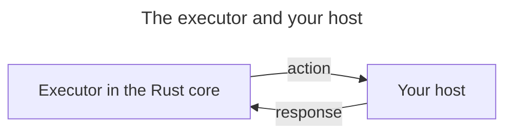
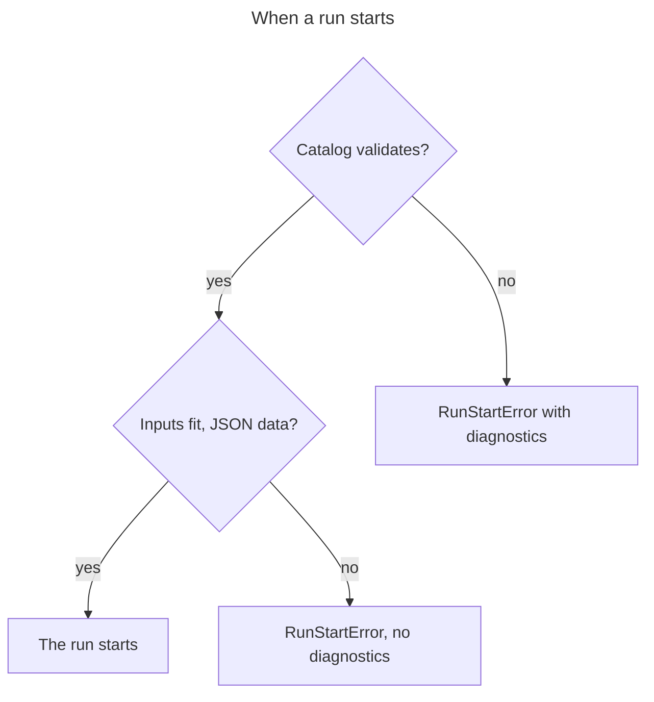
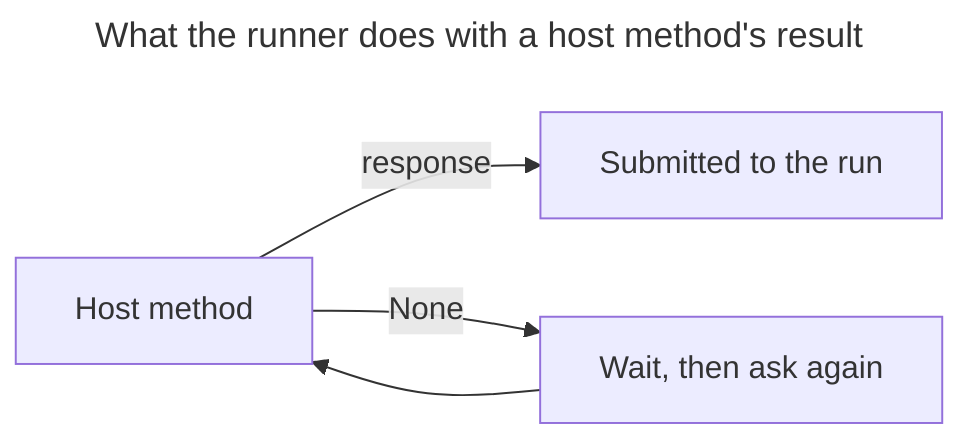
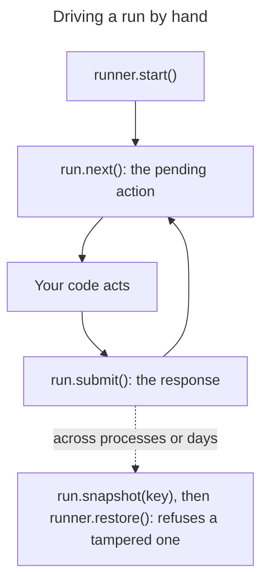
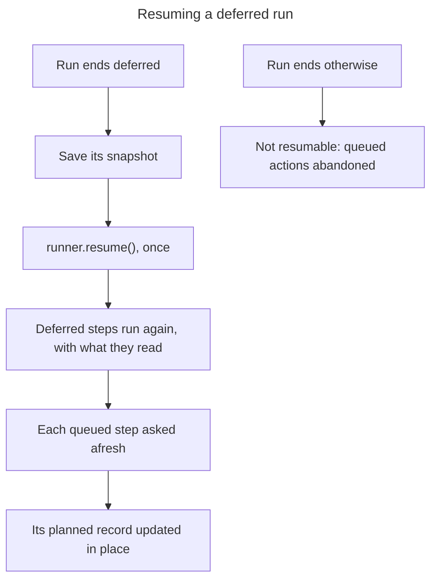
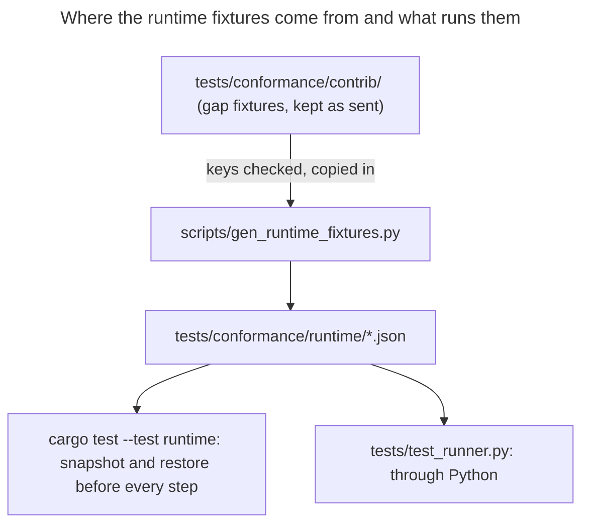

# Running Workflows

The reference executor runs a validated workflow step by step and enforces
the standard's runtime rules: conditions and gates, checkpoints before
mutations, approvals, waits, retries, failure modes, recovery loops,
escalation and review quorums. It lives in the Rust core, next to the
validator, and Python drives it through
`grounded_agency.workflows.WorkflowRunner`.

The executor does no I/O. It tells your code what to do next (an
*action*); your code does it and reports back (a *response*). Time only
enters through the timestamps you pass. So the same catalog, inputs,
responses and times always produce the same actions, the same trace and
the same snapshot, and a run can be saved and resumed anywhere.



The contract is [STANDARD-v1.1.0 §5](../../spec/STANDARD-v1.1.0.md#5-workflow-dsl).
The executor's source is in `core/src/exec/`, and Python reaches it as
`grounded_agency._core.Run`.

## Quick start

```python
from grounded_agency.workflows import Host, WorkflowEngine, WorkflowRunner

engine = WorkflowEngine("schemas/capability_ontology.yaml")
engine.load_catalog("my_catalog.yaml")


class MyHost(Host):
    def invoke_capability(self, action):
        # action["capability"], action["inputs"], action["step"], ...
        value = my_tools[action["capability"]](**action["inputs"])
        return {"kind": "Output", "value": value}

    def request_approval(self, action):
        # Show action["shown"] to a person; bind the answer to its digest.
        ok = ask_a_person(action["shown"])
        return {
            "kind": "Decision",
            "decision_id": new_id(),
            "decision": "approved" if ok else "rejected",
            "approvers": ["alice"],
            "digest": action["digest"],
        }


result = WorkflowRunner(engine).run("my_workflow", {"topic": "x"}, MyHost())
if result.ok:
    print(result.outputs)
else:
    print(result.code, result.message)   # e.g. F502 approval was rejected
```

A run starts only if the catalog validates. Otherwise `RunStartError` is
raised, with the error diagnostics in `.diagnostics`. Warnings do not block
a run. Inputs or an `actor_identity` that do not fit the workflow, or are not
JSON data, also raise `RunStartError` (with no diagnostics).



## Actions and responses

| Action | Your host | Respond with |
|--------|-----------|--------------|
| `InvokeCapability` | runs `capability` with `inputs`, for the step's `domain` when it declares one (null otherwise; a waiting `delegate` that delegates again names the delegation it replaces in `replaces`) | `{"kind": "Output", "value": {...}}`, or `{"kind": "Error", "code": "R401"/"R402", "message": ...}` (any other code is read as R402) |
| `CreateCheckpoint` | takes a checkpoint before `step` | `{"kind": "Checkpoint", "checkpoint_id": ...}` |
| `Rollback` | restores `checkpoint_id` | `{"kind": "RolledBack"}` |
| `RequestApproval` | asks `approver` about `shown`, in `mode`: `in_session`, whoever attends the run, in its session; `out_of_band`, a separate channel whose approvers need not attend the run (keep the run's snapshot while you wait). `queued_action_id` names the queued action a resumed run is asking about, on every such request ([Resuming a deferred run](#resuming-a-deferred-run)) | `{"kind": "Decision", "decision_id", "decision", "approvers", "digest"}`; `decision` is `approved`, `rejected` or `unavailable`; with `identity@1`, optionally `approver_identities` (each an `agent_identity`, one per principal; `approvers` then empty or their principals) |
| `RecheckSource` | re-reads `source` now | `{"kind": "Current", "value": ...}` |
| `AwaitEvent` | waits for a matching event until `deadline` (a waiting delegate whose host attested who took it names that principal as `delegate_principal`: only its results count) | `{"kind": "Event", "event": {...}, "principal": ..., "identity": {...}}` (the authenticated party that delivered it, §5.15, and its `agent_identity`, §5.17; both optional, and a `principal` beside an `identity` must be the identity's), `{"kind": "LivenessLost"}` (R406), or `{"kind": "Error", "code": "R401"/"R402"/"R406", "message": ...}` (any other code is read as R402) |
| `Sleep` | waits until `until` (retry backoff, or a step's `delay`) | — (the runner calls `tick`) |
| `Completed` / `Failed` | — | the run is over (`Completed` carries `ended` when a gate ended it) |

`Host` has a method for each, plus `now_ms()` and `sleep_until()` (wall
clock by default). A method may return `None` when there is nothing yet
(no event, no decision): the runner waits `poll_interval_ms` (or until the
action's deadline) and asks again. An exception from `invoke_capability`
fails that step (R402); the step's retries and failure modes then apply.
`NotImplementedError` instead stops the runner, since the host cannot run
that capability at all. Give `Host` a `CheckpointTracker` and checkpoints
are recorded in it.



Values you hand the run must be I-JSON: integers within ±2^53 and at most
100 levels deep. Anything else is refused, so that snapshots and approval
digests represent every value exactly.

Every action carries `id` and `frame`: the workflows of the nested runs,
root first. A capability's output must be an object with the fields its
ontology contract requires, or the step fails (R402).

## What the executor enforces

- **Conditions and gates.** A false condition skips the step, unless
  `skip_if_false: false`, which makes it R403. Gate actions: `stop` → R403,
  `skip` → skip the step, `rollback` → roll back, then R403, `warn` → a trace
  event, `end` → the run ends successfully, no later step runs, and
  `RunResult.ended` says at which step and why (an after-gate `end` yields
  to a failure mode that fires; an `end` whose expression errors does not
  fire). An expression that errors (R405) is fail-safe: a gate fires, a
  condition is false, and a failure mode does not fire.

  ```mermaid
  ---
  title: What each gate action does
  ---
  flowchart LR
    accDescr: A gate that fires with stop fails the step with R403, skip skips the step, rollback rolls back and then fails with R403, warn adds a trace event, and end ends the run successfully.
    gate[A gate fires] --> r403["stop: R403"]
    gate --> skip["skip: the step is skipped"]
    gate --> rb["rollback: roll back, then R403"]
    gate --> trace["warn: a trace event"]
    gate --> ended["end: the run ends successfully"]
  ```
- **Checkpoints.** One checkpoint authorises one step that requires one,
  and is used only once the step is approved and about to run. When none
  is valid, the executor asks for a new one (`CreateCheckpoint`). A
  completed wait invalidates earlier checkpoints.
- **Approvals.** Every step that requires approval asks for it, unless it
  is deferred. The
  decision must match the digest of what was shown, have enough distinct
  approvers, arrive before `expires`, and not be reused. A run that is
  unattended asks only a standing mandate; when there is none, or it
  answers `unavailable`, the run follows `approval.when_unattended`:
  `fail` (F502, the default), `skip`, or `defer_to_queue`. A deferral
  holds back the step and every later step that depends on it (reads its
  output, may act on the world, or comes after it in the ontology), runs
  the steps that only read, reason or record, and ends the run `deferred`.
  A step with `after_deferral: run` is deferred only if it reads a deferred
  step's output.
  In an attended run
  `unavailable` is F502. The default `Host` holds no mandates: it answers
  `unavailable` for one. `recheck` re-reads a source before acting, then
  asks again (showing what changed), replans or stops if it changed.
  A step with no `approval` field is asked of a person, in session, shown
  its resolved inputs, with no expiry; a partial field takes the default of
  each member it leaves out, and `expires` runs from the request. What is
  shown is an array: the `shows` values in order (null for a reference that
  resolves to nothing), or `[inputs]` without `shows`, plus a `recheck`
  object when asked again; the digest is the SHA-256 of its RFC 8785 text in
  lowercase hexadecimal, and a decision's digest is accepted in any case.
  An integer, a number written without a fraction or an exponent, may not
  exceed 2^53 in magnitude.
  With `identity@1`, a decision that attests its approvers
  (`approver_identities`) is counted by principal, and an identity counts
  only if it meets the request: kind `human` for a human approver, the
  requested `role`; the record lists the approvers that counted and their
  identities, and a refused decision's `reason` names the others. In a
  workflow that declares `spec_version: "1.2"`, the approver may also
  require `sender_check` and `accept_trust_classes`, and a decision without
  identities then counts no one. A run that ends `deferred` can be resumed:
  see [Resuming a deferred run](#resuming-a-deferred-run).
  Every approval leaves an action record, with a `reason` when the action
  did not go ahead. A step that uses, directly or through other steps, an
  item from one of the `always_ask_trust_classes` of `identity@1` (or with
  no trust class) is asked of a person (`approver.kind: human`,
  `always_ask: true`) even when its approval names a standing mandate, and
  its records carry `always_ask: true`; unattended, it follows
  `when_unattended`. An `identity@1` input that resolves to anything but a
  list of known values fails its step (R402). A step with `identity@1`
  inputs that does not wait is your host's to filter: put the sender's
  `sender_identity` on each item you return, since an item without one
  counts as always-ask when `always_ask_trust_classes` is bound.

  ```mermaid
  ---
  title: Approval in an unattended run
  ---
  flowchart TB
    accDescr: An unattended run asks only a standing mandate; when there is none, or it answers unavailable, the run follows when_unattended, which fails with F502 by default, skips the step, or defers it to a queue.
    ask[Step requires approval, run unattended] --> mandate{"Standing mandate approves?"}
    mandate -->|approved| run[Step runs]
    mandate -->|"none, or unavailable"| wu["when_unattended: fail (F502, default), skip, or defer_to_queue"]
  ```
- **Delays.** A step with `delay` (`wait@1`) sleeps that long after its
  condition and before-gates, before its approval and execution; when it wakes,
  earlier checkpoints no longer count, as after a wait.
- **Waits.** `AwaitEvent` has a deadline from the step's `timeout`. An
  `accept_from` that resolves to anything but a non-empty list of strings,
  or a `correlate` value that resolves to null, fails the step (R402) before
  it waits. Events
  that don't match (`event_type`, `source_kind`, `correlate`,
  `accept_from`, `sender_check`, `accept_trust_classes`) are dropped and
  the wait goes on. A lapse is R401;
  `LivenessLost` (or an `Error` with code R406) is R406, unless it comes
  after the deadline, which is R401.
- **Retries, deadlines.** `retry.max` (at most 1000) extra attempts for
  R401/R402/R406, with `none`, `linear` (1 s × n) or `exponential`
  (1 s × 2^(n−1)) backoff. A result after the step's deadline is R401. A
  step the executor itself refuses (an invocation whose inputs do not fit
  the workflow) is not retried: another attempt would be refused the same
  way. Times are milliseconds since the epoch, capped at the end of year
  9999.
- **Failure modes and recovery.** The first failure mode that matches the
  step's error code (`on_error`) or whose `when` is true applies. Its
  `action` runs first: `rollback` sends `Rollback`, `pause_and_checkpoint`
  sends `CreateCheckpoint`. Then it can loop back with injected
  `${_recovery.*}` context (up to `max_loops`, then `on_exhausted` or
  R404); when a loop runs a waiting `delegate` again (it is the target,
  or comes after it), that delegation names the one it replaces in
  `replaces`; a loop that runs an `invoke` again starts a new child run,
  whose delegations replace none of the old run's. It can also escalate to a handler (the run ends `escalated`), or end the run
  with the step's code — R402 when `when` fired on a step that did not fail
  ([STANDARD §5.12](../../spec/STANDARD-v1.1.0.md#512-recovery-and-escalation)).

  ```mermaid
  ---
  title: When a failure mode applies
  ---
  flowchart TB
    accDescr: The first failure mode that matches the error code or whose when is true applies; its action runs first, then it loops back with recovery context up to max_loops, escalates to a handler, or ends the run with the step's code.
    fm["First matching failure mode: on_error code or when true"] --> act["Its action first: rollback or pause_and_checkpoint"]
    act -->|"loop back, up to max_loops"| loop["Earlier step, with _recovery context"]
    act -->|escalate| handler["Handler; run ends escalated"]
    act -->|end| code["Run ends with the step's code"]
    loop -->|"loops run out"| ex["on_exhausted, or R404"]
  ```
- **Invocations.** An `invoke` step runs its workflow as a nested run, at
  most four deep, with `input_bindings.input` as its inputs; inputs the
  workflow does not declare, or a missing required one, fail the step
  (R402). The validator catches this before the run when `input` is
  literal. Any step whose resolved inputs are not I-JSON (nested deeper
  than the core's limit, say) fails with R402 rather than reaching the
  host.
- **Quorums.** A `constrain` step with a `quorum` counts the verdicts
  itself: one per reviewer whose delegate step ran, pinned to `pinned_to`,
  using the vocabulary, from fresh-context reviewers when required, and,
  with `require_distinct_identities`, one per attested principal. Model
  families count only as the host attests them. Any
  blocking verdict, too few passes, too few full-sweep passes (`min_full`)
  or uncovered model families fail the step with F504.

Start a run with `actor_identity=` (an `agent_identity`, such as
`AgentDescriptor.identity()` of a registered agent) to say who runs it:
every action record then carries it as `actor_identity`, and `actor` is its
`kind`.

A run keeps its actor: restore it with `actor_identity=` and the executor
refuses another principal. When another agent takes over the conversation
(a handoff), cancel the run if it has not ended, and start a new one under
the new agent's identity; a run that ended `deferred` may instead be
resumed under it.

`RunResult` gives the `outcome` (`completed`, `escalated`, `deferred`,
`replan_required`) or the failure `code`, `ended` when a gate ended the
run early, plus the outputs, the action
records (world state `ActionRecord`s for every step that required
approval), the deferrals (`deferred`: each deferred step, why, and the
`action_id` of its queued action) and the trace (every decision the
executor took, see [The trace](#the-trace)).

## The trace

The trace is the executor's own record of a run: one event for each
decision it took, in order. `RunResult.trace` holds it after a run and
`run.trace()` at any point during one. It is part of the run's state, so a
snapshot carries it and a restored run continues it.

This section is informative. The Standard mentions a trace twice, for a
`warn` gate ([§5.6](../../spec/STANDARD-v1.1.0.md#56-gate-semantics)) and
for an expression error
([§5.8.2](../../spec/STANDARD-v1.1.0.md#582-evaluation)), and gives it no
form. The fields and kinds below are those of the reference executor
(`core/src/exec/`), and another executor may record a run differently.
They are executor trace kinds, not the event types of
[§5.13](../../spec/STANDARD-v1.1.0.md#513-waiting-for-events): an
`event_type` names an event a step waits for (`approval.granted`), and a
trace kind names something the executor did (`approval_requested`).

The executor delivers the trace to nobody. A host that wants to announce
what happened, for example that an approval is pending, reads the trace,
or the action it was handed, and relays it by its own means.

### Trace event fields

Every trace event is an object with these six fields:

| Field | Type | Meaning |
|-------|------|---------|
| `seq` | integer | Position of the event in the trace, from 0 |
| `at` | integer | The run's clock when the event was recorded: the latest time the host passed, in milliseconds since the epoch |
| `kind` | string | One of the kinds below |
| `frame` | array of strings | The workflows of the nested runs, root first, as on an action |
| `step` | integer or null | Index of the step in its workflow, from 0; null on `run_started`, `run_resumed` and `run_finished`, and on `checkpoints_invalidated` when a resumption invalidates them |
| `detail` | object | Members that depend on the kind; an empty object for a kind that has none |

### Trace kinds

The table lists every kind the reference executor records, with the
members of its `detail`.

| Kind | Recorded when | `detail` |
|------|---------------|----------|
| `run_started` | The run starts | `workflow` |
| `step_started` | A step begins, before its condition is evaluated; again each time a loop runs the step | `capability` |
| `step_skipped` | The step does not run: its condition is false, a gate skipped it, or it needed approval and `when_unattended: skip` applied | `reason` |
| `step_deferred` | The step is deferred (§5.14) | `reason` |
| `step_completed` | The step has its output, before its after-gates are evaluated | none |
| `step_failed` | The step fails with a code, after its retries and before its failure modes | `code`, `message` |
| `expression_error` | A condition, a gate's `when` or a failure mode's `when` did not evaluate (R405) | `site`, `code`, `message` |
| `gate_fired` | A gate fires, whatever its action | `gate`, `action`, `message` |
| `run_ended` | A gate with `action: end` ends the run, or the nested run it fired in | `message` |
| `delay_started` | A step's `delay` begins | `until` |
| `delay_finished` | The delay is over | none |
| `always_ask` | A step that requires approval uses an item from an always-ask trust class (§5.17), so a person is asked | none |
| `approval_requested` | A `RequestApproval` action is issued | `digest` |
| `approval_decided` | A decision arrives; `valid` is true only when it lets the step go ahead | `decision_id`, `decision`, `valid` |
| `approval_unattended` | The run is unattended and no standing mandate covers the step, so `when_unattended` applies | `when_unattended`, `reason` |
| `approval_expired` | No decision arrived before the request expired | none |
| `recheck` | The source named by `approval.recheck` was read again after approval | `changed` |
| `checkpoint_created` | A checkpoint is recorded: the host answered `CreateCheckpoint`, or a `checkpoint` step completed | `checkpoint_id` |
| `checkpoint_consumed` | A step that requires a checkpoint uses the latest valid one | `checkpoint_id` |
| `checkpoints_invalidated` | A completed wait or delay, or a resumption, ends the validity of earlier checkpoints | `checkpoint_ids` |
| `rolled_back` | The host answered a `Rollback` that a gate or a failure mode asked for | none |
| `event_dropped` | A wait receives an event that does not match; recorded once per reason for each wait | `reason` |
| `event_received` | A wait receives its matching event; `dropped` counts the dropped events by reason | `event_type`, `dropped` |
| `delegated` | A waiting `delegate` has delegated and now waits for the result; `principal` is present when the host attested who took the delegation (`identity@1`) | `task_id`, `principal` |
| `invoke_started` | An `invoke` step starts a nested run | `workflow` |
| `invoke_returned` | The nested run is over; `result` is its outcome or its failure code | `workflow`, `result`, `ended` |
| `quorum` | A `constrain` step with a `quorum` counted the verdicts | `tally` |
| `retry` | An attempt failed and the step will be tried again; `attempt` is the attempt that failed, from 1 | `code`, `message`, `attempt`, `backoff_ms` |
| `failure_mode_fired` | A failure mode applies | `failure_mode`, `action` |
| `loop` | A failure mode loops back; `to` is the index of the step it goes to and `loop` the count for this failure mode, from 1 | `failure_mode`, `to`, `loop` |
| `recovery_exhausted` | A failure mode has no loops left | `failure_mode`, `loops` |
| `escalated` | The run goes to a handler step; `cause` is the code that led there | `handler`, `cause` |
| `run_finished` | The run ends with an outcome; `cause` is the code that led to an escalation, null without one, and absent when the run ends `replan_required` | `outcome`, `cause` |
| `run_failed` | The run ends with a failure code | `code`, `message` |
| `run_resumed` | A host resumes a run that ended `deferred` (§5.14.1); `actor` and `previous_actor` are principals or null | `attendance`, `actor`, `previous_actor` |
| `invoke_resumed` | A resumed run continues the nested run of a deferred `invoke` step | `workflow` |

`gate`, `failure_mode` and `handler` are indexes, from 0, into the step's
`gates`, the step's `failure_modes` and the workflow's `steps`.
`event_dropped.reason` names the first check the event failed:
`event_type`, `source_kind`, `correlate.<key>`, `accept_from`,
`delegate_identity`, `sender_check` or `accept_trust_classes`.

A runtime fixture names the kinds its run must record in `trace_kinds`
(see [Conformance](#conformance)). `tests/test_trace_kinds_doc.py` compares
this section with the kinds the executor's source passes to its trace, with
the kinds the fixtures name, and with the events the fixtures' runs record.

## Driving a run yourself

`WorkflowRunner.start()` returns the underlying `_core.Run` without
driving it. Use it to run actions asynchronously, across processes, or
across days:

```python
run = runner.start("my_workflow", inputs, run_id="run-42")
action = run.next()                  # same action until it is answered
run.submit(action["id"], response, now_ms)
run.tick(now_ms)                     # ends a due Sleep, times out a late action

snapshot = run.snapshot(key=b"secret")       # canonical JSON + SHA-256 + HMAC
run = runner.restore(snapshot, key=b"secret")  # refuses tampered snapshots
result = runner.drive(run, host)
```

A snapshot only restores against the catalog (and ontology) it was taken
from, and a signed snapshot only with its key; `restore` raises
`RunStartError` for a state that is not well formed or a snapshot that fails
its HMAC check. A response that does not answer the pending action is
refused, and the run is left unchanged. Under `drive`, a refused answer to
an `InvokeCapability` fails that step (R402), as a host exception does; a
refused answer to any other action raises `HostResponseError`, carrying the
`.action` and the host's `.response`, with the run still waiting on that
action. If a run needs more than `max_actions` answers in one `drive`, or a
host returns `None` (nothing yet) for one action more than `max_polls`
times (default 100,000, about 28 hours at the default 1 s
`poll_interval_ms`; each action has its own count),
`RunIncomplete` is raised with the live run in `.run`, so you can snapshot
it or drive it on. `HostResponseError` is a `RunIncomplete`.



### Resuming a deferred run

A run that ends `deferred` (`result.resumable`) has queued actions: steps
that waited for an approval nobody could give at the time, and the steps
that depend on them. Keep its snapshot with your queue entries, and resume
it when the approvers can be asked
([STANDARD §5.14.1](../../spec/STANDARD-v1.2.0.md#5141-resuming-a-deferred-run)):

```python
run = runner.start("nightly_sweep", inputs, attendance="unattended")
result = runner.drive(run, host)
if result.resumable:
    saved = run.snapshot(key=b"secret")   # keep it with the queue entries
# ... later, when the approvers can be asked, once per saved state:
run = runner.resume(saved, key=b"secret", attendance="attended",
                    actor_identity=operator_identity)
result = runner.drive(run, host)
```

The resumed run is the same run, with the same `run_id`, records and
trace. What runs again, in step order:

- the deferred steps, each from its beginning (condition, gates, inputs,
  approval, checkpoint);
- a step that ran ahead of them and that one of them reads, so a `verify`
  after the `mutate` reads the world after the change;
- a `checkpoint` step whose id a queued mutation binds, for a fresh restore
  point.

Every other step keeps its output. A nested run that ended deferred
continues where it stopped, and a deferred handler runs last. Checkpoints
taken before the resumption authorise nothing after it, so the host is
asked for new ones. A queued step is asked afresh, of a person when the
resumption is attended, even where its approver is a standing mandate, and
the request names its queued action in `queued_action_id`; the `planned`
record of that action is updated in place, under the same `action_id`, so
the queue entry you hold closes on it. A request asked again after a
recheck, or in a retry of the step, names the same action, and its decision
lands on the same record. A recovery loop during the resumption runs again
only the steps from its target to the step that looped, and the resumption
then goes on: a step that ran ahead, such as an `after_deferral: run`
delegation, is not repeated.

Resume a saved state once: each resumption could carry out the same queued
action. A run that failed, escalated or needs a replan cannot be resumed:
its `planned` records are abandoned, so close your queue entries for them,
and start a new run if the work is still wanted. A state saved by an
executor before this release cannot be resumed (it did not keep the nested
runs of deferred `invoke` steps or which steps ran ahead): `resume` refuses
it; cancel the run and start a new one.



## Conformance

`tests/conformance/runtime/*.json` are scripted runs. Each one has a
catalog, inputs, a script of expected actions and responses, and the
expected end and trace (`trace_kinds`: kinds the run's trace must contain,
from [Trace kinds](#trace-kinds)). They are generated by
`scripts/gen_runtime_fixtures.py`: edit them there and regenerate (CI runs
it with `--check`). `cargo test --test runtime` runs them, replaying
each one with a snapshot and restore before every step, and
`tests/test_runner.py` runs them through Python. The `orchestrator_*`
fixtures run the workflows an adopter ported to the candidate
(`tests/fixtures/pass_orchestrator_port.workflow_catalog.yaml`, kept as
contributed): nested invocations, gate
`end`s, a `delay`, steps that run after a deferral, waits, approvals with rechecks, a quorum
that loops, an escalation and unattended deferral, end to end. Fixtures
an adopter wrote themselves (`gap*`) are the exception: edit them in
`tests/conformance/contrib/`, where they are kept as sent; the generator
checks their keys and copies them in. A script entry
`{"resume": {"attendance", "at", "actor_identity"}}` (each member optional)
saves the run, restores it and resumes it, and a response may write
`"{{digest_upper}}"` for the pending action's digest in uppercase, beside
`"{{digest}}"`.




A host that computes an approval digest itself, to check a decision before
it submits it or to record what a person approved, tests that computation
against `tests/conformance/approval/digests.json`, which is normative
([STANDARD §10.3](../../spec/STANDARD-v1.2.0.md#103-conformance-testing)).
Each vector has a `kind`: a `step` vector is one `RequestApproval` of the
reference executor (the step's `approval` field, its resolved `inputs` where
it declares no `shows`, and the `shown` values), and a `tool_call` vector the
approval of a tool call; each gives the canonical JSON (RFC 8785) of `shown`
and the `digest`. The file is described under
[Test suite requirements](../../spec/CONFORMANCE.md#test-suite-requirements),
and the trust vectors beside it (`tests/conformance/trust/`) under
[Informative vectors](../../spec/CONFORMANCE.md#informative-vectors).
