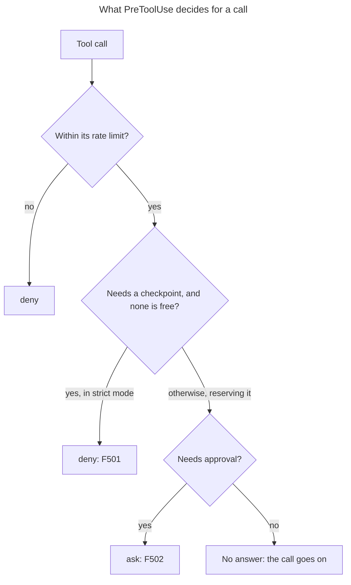
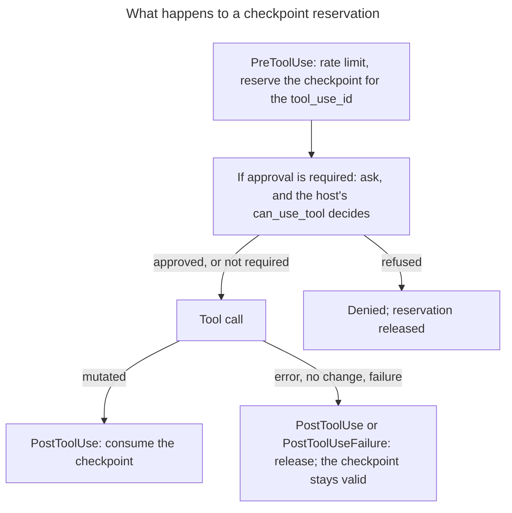
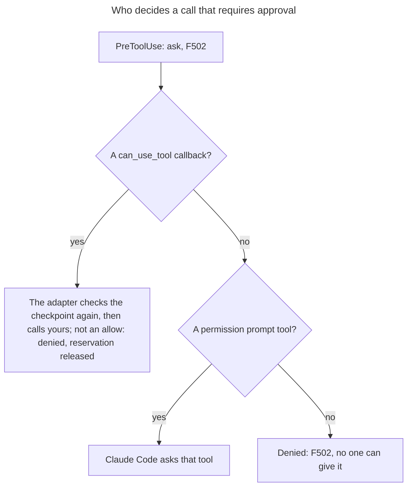
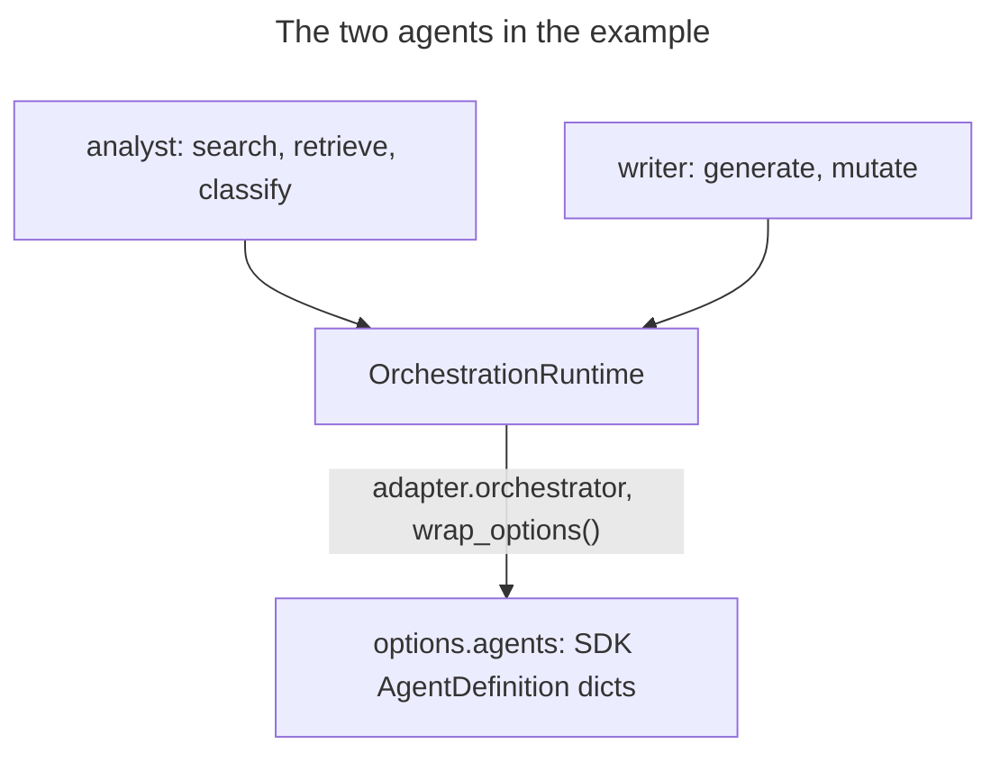

# Claude Agent SDK Integration

This guide explains how to integrate the Grounded Agency capability standard with the Claude Agent SDK, enabling SDK-based agents to operate with evidence-grounded decisions, checkpoint-before-mutation safety, approval of the calls that require it, and audit trails.

The adapter is a safety layer for tool calls that a model chooses freely, outside a workflow. It classifies each call as an ontology capability and acts on that capability's effective safety flags ([STANDARD-v1.1.0 §5.2.1](../../spec/STANDARD-v1.1.0.md#521-safety-flags)): a call whose `requires_checkpoint` is true needs a checkpoint (refused with F501 otherwise), and a call whose `requires_approval` is true is put to the host's permission flow (F502).

## Quick Start

```python
from claude_agent_sdk import ClaudeAgentOptions, PermissionResultAllow, PermissionResultDeny
from grounded_agency import grounded_query, GroundedAgentAdapter, GroundedAgentConfig

# 1. Create adapter with configuration
adapter = GroundedAgentAdapter(
    GroundedAgentConfig(
        strict_mode=True,           # Block mutations without checkpoint
        max_budget_usd=1.00,        # Cap spending at $1
    )
)

# 2. Create checkpoint before mutations
adapter.create_checkpoint(
    scope=["src/*.py"],
    reason="Before refactoring"
)

# 3. Decide the calls that require approval (mutate, send, execute).
#    show_and_ask stands for your own prompt; context.decision_reason
#    holds the adapter's reason, which begins "F502 APPROVAL_REQUIRED:".
async def decide(tool_name, tool_input, context):
    if await show_and_ask(tool_name, tool_input, context.decision_reason):
        return PermissionResultAllow(updated_input=tool_input)
    return PermissionResultDeny(message="Not approved")

# 4. Use grounded_query(), a drop-in replacement for query()
async for msg in grounded_query(
    "Refactor the authentication module",
    options=ClaudeAgentOptions(can_use_tool=decide),
    adapter=adapter,
):
    print(msg)

# 5. Check cost after completion
print(f"Total cost: ${adapter.cost_summary.total_usd:.4f}")
print(f"Evidence: {adapter.get_evidence()}")
```

Without a `can_use_tool` callback no one can approve a call, so every call that requires approval is denied. See [Approval](#approval).

### Using GroundedClient

For long-lived sessions where you send multiple queries:

```python
from grounded_agency import GroundedClient, GroundedAgentAdapter, GroundedAgentConfig

adapter = GroundedAgentAdapter(GroundedAgentConfig(strict_mode=True))
adapter.create_checkpoint(["*"], "Before changes")

options = ClaudeAgentOptions(can_use_tool=decide)  # see Quick Start
async with GroundedClient(adapter, options=options) as client:
    await client.query("Refactor the authentication module")
    async for msg in client.receive_response():
        print(msg)

print(f"Cost: ${adapter.cost_summary.total_usd:.4f}")
```

### Using wrap_options() (Low-level)

For direct SDK usage without the `grounded_query()` wrapper:

```python
from claude_agent_sdk import ClaudeSDKClient, ClaudeAgentOptions
from grounded_agency import GroundedAgentAdapter, GroundedAgentConfig

adapter = GroundedAgentAdapter(GroundedAgentConfig(strict_mode=True))
adapter.create_checkpoint(["src/*.py"], "Before refactoring")

base_options = ClaudeAgentOptions(
    allowed_tools=["Read", "Write", "Edit", "Bash"],
    permission_mode="acceptEdits",
    can_use_tool=decide,  # see Quick Start
)
options = adapter.wrap_options(base_options)

# The adapter's PreToolUse hook applies the rate limit, the checkpoint rule
# and the approval rule to every tool call, including the tools listed in
# allowed_tools. wrap_options() keeps your can_use_tool callback: the
# adapter's own callback calls it after its checkpoint check.

async with ClaudeSDKClient(options) as client:
    await client.query("Refactor the authentication module")
    async for msg in client.receive_response():
        print(msg)
```

## Architecture

```
┌─────────────────────────────────────────────────────────────────┐
│                    GroundedAgentAdapter                          │
├─────────────────────────────────────────────────────────────────┤
│  ┌───────────────┐  ┌────────────────┐  ┌────────────────────┐  │
│  │CapabilityReg- │  │ToolCapability- │  │ Permission         │  │
│  │istry          │  │Mapper          │  │ Callback           │  │
│  │               │  │                │  │                    │  │
│  │ Loads ontol-  │  │ Maps SDK tools │  │ Checkpoint check,  │  │
│  │ ogy YAML      │  │ to capabilities│  │ then host decides  │  │
│  └───────────────┘  └────────────────┘  └────────────────────┘  │
│                                                                  │
│  ┌───────────────┐  ┌────────────────┐  ┌────────────────────┐  │
│  │Checkpoint-    │  │EvidenceStore   │  │ ToolUse Hooks      │  │
│  │Tracker        │  │                │  │                    │  │
│  │               │  │ Evidence       │  │ Pre: block or ask  │  │
│  │ Checkpoint    │  │ anchors        │  │ Post: consume,audit│  │
│  │ lifecycle,    │  │ storage        │  │ PostToolUseFailure:│  │
│  │ reservations  │  │                │  │   release          │  │
│  └───────────────┘  └────────────────┘  └────────────────────┘  │
│                                                                  │
│  ┌───────────────┐  ┌────────────────┐                          │
│  │CostSummary    │  │Orchestration-  │                          │
│  │               │  │Runtime         │                          │
│  │ Tracks USD    │  │ (optional)     │                          │
│  │ cost and      │  │                │                          │
│  │ per-model     │  │ Exports agents │                          │
│  │ breakdown     │  │ to SDK format  │                          │
│  └───────────────┘  └────────────────┘                          │
└─────────────────────────────────────────────────────────────────┘
                              │
              ┌───────────────┼───────────────┐
              ▼               ▼               ▼
   ┌──────────────┐  ┌──────────────┐  ┌──────────────┐
   │grounded_     │  │GroundedClient│  │wrap_options() │
   │query()       │  │              │  │ (low-level)   │
   └──────┬───────┘  └──────┬───────┘  └──────┬───────┘
          │                 │                 │
          └─────────────────┼─────────────────┘
                            ▼
               ┌────────────────────────┐
               │   Claude Agent SDK     │
               │   query() / Client     │
               └────────────────────────┘
```

## Tool-to-Capability Mapping

The adapter's `ToolCapabilityMapper` maps each tool call to an ontology capability. The mapping's flags (`risk`, `mutation`, `requires_checkpoint`, `requires_approval`) are the capability's flags in `schemas/capability_ontology.yaml`; the mapper holds only the tool-to-capability table:

| SDK Tool | Capability | Risk | Requires Checkpoint | Requires Approval |
|----------|-----------|------|---------------------|-------------------|
| Read | retrieve | low | No | No |
| Glob | search | low | No | No |
| Grep | search | low | No | No |
| LS | observe | low | No | No |
| WebFetch | retrieve | low | No | No |
| WebSearch | search | low | No | No |
| **Write** | **mutate** | **high** | **Yes** | **Yes** |
| **Edit** | **mutate** | **high** | **Yes** | **Yes** |
| **MultiEdit** | **mutate** | **high** | **Yes** | **Yes** |
| **NotebookEdit** | **mutate** | **high** | **Yes** | **Yes** |
| Task, Agent | delegate | medium | No | No |
| Skill | invoke | medium | No | No |
| AskUser, AskUserQuestion | inquire | low | No | No |
| TodoRead, TaskList, TaskGet | recall | low | No | No |
| TodoWrite, TaskCreate, TaskUpdate | persist | low | No | No |
| ToolSearch | search | low | No | No |
| BashOutput, TaskOutput, ListMcpResourcesTool | observe | low | No | No |
| ReadMcpResourceTool | retrieve | low | No | No |
| ExitPlanMode | inquire | low | No | No |
| **any other tool** | **mutate (assumed)** | **high** | **Yes** | **Yes** |

Claude Code tools that run a command or stop a process (`Monitor`, `KillShell`, `TaskStop`) are not in the table on purpose: they keep the strictest mapping below.

### Unclassified Tools

A tool that is neither in this table nor registered (see [MCP Tool Mapping](#mcp-tool-mapping)) has no classification. The mapper returns `UNCLASSIFIED_TOOL` for it, the strictest case: a high-risk mutation that requires a checkpoint and approval. The adapter uses the same constant when classification raises. Nothing tells the mapper that an unknown tool only reads, so it does not assume so.

In strict mode this means that a built-in or MCP tool the table does not list is denied until a checkpoint exists, and is then put to the permission flow. To give such a tool its real classification, register it:

```python
adapter.mapper.register_mcp_tool("mcp__wiki__get_page", capability_id="retrieve")
```

### Bash Command Classification

Bash commands are analyzed to determine their capability. A command counts as read-only only when it is on the mapper's allow-list; every other command is declared a high-risk mutation that needs a checkpoint, whatever its capability.

The command line is read with the shell's quoting rules and split into simple commands at `&&`, `||`, `;`, `|` and `&`; it is read-only only when every one of them is, so `ls | sh` and `ls & rm x` are mutations while `cat f | grep "a|b"` is not. A line is a mutation when it redirects output to anything but `/dev/null`, opens a subshell or a here-document, has an unbalanced quote, or uses command substitution, `${...}`, `eval` or `source`. An allow-listed command given an option that writes is a mutation too: `find -delete` or `-exec`, `sort -o`, `uniq IN OUT`, `git diff --output`, `git branch NAME`, `git remote set-url`. `sed`, `awk` and `env` are not on the allow-list, since they can write a file or run another command whatever else they do. The allow-list matches a command's exact name, so `LS` or `/bin/ls` is not `ls`.

| Pattern | Capability | Risk | Checkpoint | Approval |
|---------|-----------|------|------------|----------|
| `ls`, `cat`, `head`, `pwd` | observe | low | No | No |
| `git status`, `git log` | observe | low | No | No |
| `rm`, `mv`, `chmod` | mutate | high | Yes | Yes |
| `sed`, `awk`, `env`, `git push` | mutate | high | Yes | Yes |
| `curl -X POST`, `ssh` | send | high | Yes | Yes |
| `python -c`, `node -e` | execute | high | Yes | Yes |
| any other command | mutate | high | Yes | Yes |

### MCP Tool Mapping

MCP tools are dynamically registered via `create_grounded_mcp_server()`, which reads each tool's `metadata` and calls `ToolCapabilityMapper.register_mcp_tool()`:

```python
from claude_agent_sdk import tool
from grounded_agency import GroundedAgentAdapter, create_grounded_mcp_server

@tool("deploy_service", "Deploy a service to production.", {"service_name": str})
async def deploy_service(args):
    return {"content": [{"type": "text", "text": f"Deployed {args['service_name']}"}]}

deploy_service.metadata = {
    "capability_id": "execute",
    "risk": "high",
}

adapter = GroundedAgentAdapter()
server = create_grounded_mcp_server(
    name="deploy-tools",
    version="1.0.0",
    tools=[deploy_service],
    adapter=adapter,
)
# mcp__deploy-tools__deploy_service now requires a checkpoint (declared:
# risk high) and approval (ontology: execute)
```

`metadata` may hold `capability_id` (default `execute`), `risk`, `mutation`, `requires_checkpoint`, `requires_approval` and `domain`. A registration follows the rules the Standard states for a workflow step:

- **The capability must exist.** A `capability_id` the ontology does not define raises `ValueError` with `V101 UNKNOWN_CAPABILITY`, and nothing is registered. So does a `risk` that is not `low`, `medium` or `high`, or a flag that is not a boolean.
- **Flags are effective flags** ([§5.2.1](../../spec/STANDARD-v1.1.0.md#521-safety-flags)): the stricter of the declaration and the ontology. Booleans are OR-ed and `risk` is the higher level. A flag the declaration omits is the ontology's; as before, a declared `risk` of `high` also makes `mutation` and `requires_checkpoint` true unless they are declared.
- **A weaker declaration has no effect.** `capability_id="mutate"` with `risk="low"` is still high-risk and still needs a checkpoint. Each such flag is logged and kept in `adapter.mapper.warnings` as a W602 (`SAFETY_FLAG_DOWNGRADE`) diagnostic whose `location` holds `tool`, `capability` and `field`. The one exception is the Standard's: `mutation: false` on a capability the ontology marks `mutation_overridable` (`audit`).

```python
mapping = adapter.mapper.register_mcp_tool(
    "mcp__db__insert", capability_id="mutate", risk="low"
)
assert mapping.risk == "high" and mapping.requires_checkpoint
for w in adapter.mapper.warnings:
    print(w.code_str, w.name, w.location, w.message)
# W602 SAFETY_FLAG_DOWNGRADE {'tool': 'mcp__db__insert', 'capability': 'mutate',
# 'field': 'risk'} ontology declares risk=high but the tool declares risk=low;
# the ontology value applies
```

A tool with no `metadata` is registered as `execute`, which requires approval.

## Checkpoint Lifecycle

Checkpoints are the core safety mechanism. They must exist before mutations:

```
                        ┌──────────────────┐
                        │  Create          │
                        │  Checkpoint      │
                        └────────┬─────────┘
                                 │
                                 ▼
                   ┌─────────────────────────┐
            ┌──────│  Checkpoint Valid       │──────┐
            │      │  (not expired/consumed) │      │
            │      └─────────────────────────┘      │
            │                                       │
            ▼                                       ▼
  ┌─────────────────┐                   ┌─────────────────┐
  │  Reserve for    │  reserved by      │  Mutation       │
  │  this call      │──another in-─────▶│  BLOCKED        │
  │  (tool_use_id)  │  flight call      │                 │
  └────────┬────────┘                   └─────────────────┘
           │
           ▼
  ┌─────────────────┐
  │  Approval       │  not approved, or
  │  (if required)  │──no one to ask────▶ BLOCKED, reservation released
  └────────┬────────┘
           │
           ▼
  ┌─────────────────┐
  │  Mutation       │
  │  ALLOWED        │
  └────────┬────────┘
           │
           ├──── error, interrupt or no change ──▶ Release reservation
           │                                       (checkpoint stays valid
           ▼                                        for a retry)
  ┌─────────────────┐
  │  Consume        │
  │  Checkpoint     │
  └────────┬────────┘
           │
           ▼
  ┌─────────────────┐
  │  Next mutation  │
  │  needs new      │
  │  checkpoint     │
  └─────────────────┘
```

### Creating Checkpoints

```python
# Method 1: Direct API
checkpoint_id = adapter.create_checkpoint(
    scope=["src/*.py", "tests/*.py"],
    reason="Before refactoring authentication"
)

# Method 2: Via CheckpointTracker
checkpoint_id = adapter.checkpoint_tracker.create_checkpoint(
    scope=["*"],
    reason="Full backup before changes",
    expiry_minutes=60,
    metadata={"task": "issue-123"}
)

# Method 3: Autonomous (Claude invokes checkpoint skill)
# Claude: "I'll create a checkpoint before editing"
# [Invokes Skill tool with skill="checkpoint"]
# skill_tracker hook updates CheckpointTracker
```

### Consuming Checkpoints

After a successful mutation, consume the checkpoint:

```python
# Mutations complete successfully
adapter.consume_checkpoint()

# Now subsequent mutations need a new checkpoint
assert not adapter.has_valid_checkpoint()
```

## PreToolUse Hook Enforcement

The adapter injects PreToolUse, PostToolUse, PostToolUseFailure, Stop and SubagentStop hooks. PreToolUse runs for every tool call, including pre-approved ones that never reach `can_use_tool`, and applies three rules in order:



- **PreToolUse**:
  1. *Rate limit.* A call over its risk level's limit is denied, in strict and non-strict mode alike.
  2. *Checkpoint (F501).* A call whose mapping requires a checkpoint (Write, Edit, Bash with destructive commands, an unclassified tool) reserves the active checkpoint, keyed by its `tool_use_id` (`CheckpointTracker.validate_and_reserve`). When there is no valid checkpoint, or another in-flight call holds the reservation, strict mode denies the call and non-strict mode logs a warning.
  3. *Approval (F502).* With `approval="ask"` (the default), a call whose mapping requires approval and that the first two rules did not deny is answered `"ask"`; see [Approval](#approval). A call whose mapping requires no approval, such as Read or a read-only Bash command, is not asked about. `strict_mode` does not switch this rule off.

  For a pre-approved tool this hook is the only check that runs, so it does not let errors through: a tool the mapper does not know or cannot classify is treated as a high-risk mutation that requires approval, an error in the rate check denies the call in both modes, and any other error denies it in strict mode and is logged in non-strict mode.
- **PostToolUse**: Collects evidence anchors. After a successful mutation it consumes the checkpoint the call reserved; if the tool reported an error, or the checkpoint-gated tool does not mutate, it releases the reservation instead and the checkpoint stays valid.
- **PostToolUseFailure**: Releases the reservation of a call that failed or was interrupted, so the checkpoint can cover a retry.
- **Stop / SubagentStop**: Release a reservation still held by a call of the session (and agent) that just finished: a call the adapter reserved for that never ran and never reached the adapter's permission callback, because another PreToolUse hook (yours, or one from a settings file) denied it or Claude Code denied the adapter's `"ask"` itself (in `dontAsk` mode). Nothing else ends such a reservation. Other sessions sharing the adapter, and background subagents still running, keep theirs.

A reservation that is never consumed or released lapses after `checkpoint_reservation_seconds` (default 600).



This provides defense-in-depth alongside the `can_use_tool` permission callback:

```python
# Both enforcement layers are active:
# 1. PreToolUse hook applies the rate limit, reserves the checkpoint before
#    the tool runs, and answers "ask" for a call that requires approval
# 2. can_use_tool callback repeats the reservation for the same tool_use_id
#    (idempotent), then calls the host's can_use_tool callback
# 3. PostToolUse hook collects evidence and consumes (or releases) the reservation
# 4. PostToolUseFailure hook releases the reservation of a failed or interrupted call
```

### Refusal Reasons

A hook's reason and a permission result's message are text, and they are the only channel to the model and to the host. So that a client can tell which rule refused a call without parsing prose, a reason for a rule the Standard has a code for opens with the diagnostic's code and name ([STANDARD-v1.1.0 §9.6](../../spec/STANDARD-v1.1.0.md#96-safety-errors)):

| Rule | Decision | Reason begins |
|------|----------|---------------|
| No valid checkpoint, or it is reserved by another call | `deny` | `F501 CHECKPOINT_REQUIRED:` |
| The call requires approval | `ask` | `F502 APPROVAL_REQUIRED:` |
| The call requires approval and there is no `can_use_tool` callback | deny (permission callback) | `F502 APPROVAL_REQUIRED:` |
| Rate limit; a failure of the hook itself | `deny` | no code: the Standard defines none for these |

## Approval

The ontology sets `requires_approval: true` on `execute`, `mutate` and `send`, and a registration can add it to any tool. [§5.14](../../spec/STANDARD-v1.1.0.md#514-approval) defines approval for a workflow step. For a tool call the adapter does not decide: it hands the call to the host's permission flow, once per call, after the checkpoint rule is satisfied.

The adapter obtains one decision per call from the host. It does not implement the rest of §5.14, which is written for workflow steps: it computes no digest of what was shown, counts no approvers, applies no expiry, and writes no action record. Whether the person saw the input that then ran depends on your callback; a callback that rewrites `updated_input` is responsible for what it rewrites to, since the adapter classified the input the model sent. A workflow that needs §5.14 in full runs on the [reference executor](../guides/RUNNING_WORKFLOWS.md).

### Who Decides



The adapter installs no callback beside a permission prompt tool, because the SDK refuses the two together. It then never hears that the tool refused a call, so it does not reserve the checkpoint for a call it asks about: the hook checks that a checkpoint is free, and the PostToolUse hook takes it and uses it up once the call has run. Two such calls approved and run at the same time could share one checkpoint. With neither, the call is denied because §5.14 treats an approval no one could decide as a refusal.

Your callback is also called for the calls Claude Code asks about on its own account, whether or not their capability requires approval. `wrap_options()` used to replace a `can_use_tool` callback on the base options; it now chains to it.

To run without the approval rule, for example where an allow-list and a sandbox already bound what the agent can do:

```python
adapter = GroundedAgentAdapter(GroundedAgentConfig(approval="off"))
```

With `approval="off"` the hook answers nothing for a call that satisfies the checkpoint rule, and with no host callback the adapter's callback allows it: the behaviour before the approval rule existed.

### What the Hook Returns

```python
{"hookSpecificOutput": {
    "hookEventName": "PreToolUse",
    "permissionDecision": "ask",
    "permissionDecisionReason":
        "F502 APPROVAL_REQUIRED: Write (capability 'mutate') requires approval. "
        "It runs only if this call is approved.",
}}
```

This rests on the SDK's hook contract (version 0.2.182, `PreToolUseHookSpecificOutput`) and the Claude Code documentation:

- `permissionDecision` is one of `"allow"`, `"deny"`, `"ask"` and `"defer"`. When several hooks answer, `deny` takes priority over `defer`, then `ask`, then `allow` ([Agent SDK hooks](https://code.claude.com/docs/en/agent-sdk/hooks)).
- `"ask"` forces a prompt ([Permissions](https://code.claude.com/docs/en/permissions)). In an SDK session the prompt is the `can_use_tool` callback, and `ToolPermissionContext.decision_reason` holds the hook's reason.
- With no one to answer, the call is denied: "In a `-p` run with no host, these requests are denied either way", and the model reads the reason in the tool result ([Headless mode](https://code.claude.com/docs/en/headless), [Hooks reference](https://code.claude.com/docs/en/hooks)). In `dontAsk` mode Claude Code denies every call that would prompt, without calling the callback.
- The documentation does not say whether `bypassPermissions` mode puts a hook's `"ask"` to the callback or approves the call, so this guide makes no claim that the approval rule holds in that mode.

The tests in `tests/test_tool_call_approval.py` call the hook and the callback directly; what Claude Code does with an `"ask"` rests on the documentation cited above.

## Structured Output

Use `output_format` to get structured JSON responses:

```python
adapter = GroundedAgentAdapter(
    GroundedAgentConfig(
        output_format={
            "type": "object",
            "properties": {
                "summary": {"type": "string"},
                "changes": {"type": "array", "items": {"type": "string"}},
                "risk_level": {"type": "string", "enum": ["low", "medium", "high"]},
            },
            "required": ["summary", "changes", "risk_level"],
        }
    )
)

# Structured output is auto-injected into SDK options
options = adapter.wrap_options(base_options)
```

## Budget Enforcement

Set a maximum cost budget:

```python
adapter = GroundedAgentAdapter(
    GroundedAgentConfig(
        max_budget_usd=5.00,  # Cap at $5
        model="sonnet",       # Default model
        max_turns=20,         # Limit turns
    )
)

async for msg in grounded_query("Complex task", adapter=adapter):
    print(msg)

# Check actual cost
print(f"Total: ${adapter.cost_summary.total_usd:.4f}")
print(f"By model: {adapter.cost_summary.by_model}")
print(f"Turns: {adapter.cost_summary.turn_count}")
```

## Evidence Anchors

Evidence anchors track provenance for grounded decisions:

```python
# Access collected evidence
recent = adapter.get_evidence(10)
# ['tool:Read:abc123', 'tool:Grep:def456', 'file:src/main.py']

# Get evidence by type
mutations = adapter.evidence_store.get_mutations()
tool_outputs = adapter.evidence_store.get_tool_outputs()

# Get evidence for a capability
retrieve_evidence = adapter.evidence_store.get_for_capability("retrieve")
```

### Evidence Format

```
tool:Read:tool_use_id_123      # Tool output evidence
file:src/main.py               # File reference
command:20240115143022         # Bash command execution
mutation:config.yaml           # State mutation
```

### What an Anchor Keeps

A tool-output anchor's metadata holds the tool name and whether there was a response. A command anchor holds the exit code. A file anchor holds the path. An anchor for an unclassified tool is associated with no capability.

The tool's input, and a Bash command's text, are not kept: an input can hold a credential (a token in a command or a header), and anchors are stored and exported (`EvidenceStore.to_list()`). To keep them, opt in:

```python
adapter = GroundedAgentAdapter(GroundedAgentConfig(evidence_include_tool_input=True))
```

The same switch exists where anchors are built directly: `EvidenceAnchor.from_tool_output(..., include_tool_input=True)`, `create_evidence_collector(store, mapper, include_tool_input=True)` and `DiscoveryPipeline(..., evidence_include_tool_input=True)`, which then keeps the task description. `EvidenceAnchor.from_command(None, exit_code)` records a command without its text. The adapter does not redact: with the switch on, inputs are stored as given, except that in a metadata object over 1 KB the largest values are replaced with `[truncated]`.

## Multi-Agent Coordination

Bridge the orchestration runtime to SDK subagents. The example registers two agents and exports them:



```python
from grounded_agency import (
    GroundedAgentAdapter,
    GroundedAgentConfig,
    OrchestrationRuntime,
    OrchestrationConfig,
)

# Set up orchestration
adapter = GroundedAgentAdapter(GroundedAgentConfig())
runtime = OrchestrationRuntime(
    capability_registry=adapter.registry,
    evidence_store=adapter.evidence_store,
)

# Register agents with capabilities
runtime.register_agent(
    "analyst",
    capabilities={"search", "retrieve", "classify"},
    metadata={
        "description": "Research and analysis agent",
        "model": "sonnet",
        "allowed_tools": ["Read", "Grep", "WebSearch"],
    },
)
runtime.register_agent(
    "writer",
    capabilities={"generate", "mutate"},
    metadata={
        "description": "Content generation agent",
        "model": "sonnet",
        "allowed_tools": ["Read", "Write", "Edit"],
    },
)

# Bridge to SDK format
adapter.orchestrator = runtime
options = adapter.wrap_options(base_options)
# options.agents now contains SDK-compatible AgentDefinition dicts
```

## Configuration Options

```python
@dataclass
class GroundedAgentConfig:
    # Path to capability ontology
    ontology_path: str = "schemas/capability_ontology.yaml"

    # If True, block mutations without checkpoint
    # If False, log warning but allow
    strict_mode: bool = True

    # Audit log location
    audit_log_path: str = ".claude/audit.log"

    # Checkpoint storage directory
    checkpoint_dir: str = ".checkpoints"

    # Default checkpoint expiry (minutes)
    expiry_minutes: int = 30

    # SDK features
    output_format: dict | None = None   # JSON schema for structured output
    max_budget_usd: float | None = None # Cost budget cap
    model: str | None = None            # Default model
    max_turns: int | None = None        # Turn limit

    # How long a tool call holds the checkpoint it reserved if it never
    # reports back (None: the tracker default, 600 seconds)
    checkpoint_reservation_seconds: float | None = None

    # "ask": a call whose mapping requires approval is put to the host's
    # permission flow (F502), and denied where there is none.
    # "off": the adapter asks for no approval.
    approval: Literal["ask", "off"] = "ask"

    # Keep tool inputs, and Bash command text, in evidence anchors.
    # Off by default: inputs can hold credentials.
    evidence_include_tool_input: bool = False
```

Any other value of `approval` raises `ValueError`.

## Using with Capability Skills

The Grounded Agency skills (in `skills/`) can be invoked by Claude:

```python
# Configure SDK to load skills from project
options = adapter.wrap_options(
    ClaudeAgentOptions(
        cwd=Path("/path/to/agent-capability-standard"),
        setting_sources=["project"],  # Loads skills
        allowed_tools=["Read"],
    )
)

# Now Claude can autonomously invoke skills:
# "Create a checkpoint before modifying the config"
# Claude invokes: Skill(skill="checkpoint", scope=["config/*"])
```

### Skill → Checkpoint Flow

```
User: "Make a backup before editing the config"
          ↓
Claude: Invokes Skill(skill="checkpoint")
          ↓
Checkpoint skill executes (git stash, file backup)
          ↓
skill_tracker hook detects invocation
          ↓
CheckpointTracker.create_checkpoint() called
          ↓
User: "Now update config with new settings"
          ↓
Claude: Invokes Write tool
          ↓
PreToolUse hook checks → Checkpoint exists, reserved → ASK (F502)
          ↓
Permission callback checks → Checkpoint valid → your can_use_tool decides → ALLOWED
          ↓
Evidence collector captures output
```

## Running Workflows

The adapter guards tool calls an agent makes freely. To run a catalog
workflow step by step instead — with its gates, checkpoints, approvals,
waits, recovery and quorums enforced — use
`grounded_agency.workflows.WorkflowRunner` with a `Host` whose
`invoke_capability` calls your tools. Pass the adapter's
`CheckpointTracker` to the host to record the run's checkpoints in it. See
[Running Workflows](../guides/RUNNING_WORKFLOWS.md).

## Validation

After implementation, validate the integration:

```bash
# Run unit tests
pytest tests/test_sdk_integration.py -v
pytest tests/test_grounded_query.py -v
pytest tests/test_structured_output.py -v
pytest tests/test_pretooluse_hooks.py -v
pytest tests/test_tool_call_approval.py -v
pytest tests/test_mcp_integration.py -v

# Run examples
python examples/grounded_agent_demo.py
python examples/grounded_query_demo.py
python examples/structured_output_demo.py
python examples/mcp_tools_demo.py
python examples/subagent_bridge_demo.py

# Verify ontology is valid
python tools/validate_workflows.py
```

## Troubleshooting

### F501 CHECKPOINT_REQUIRED

The adapter is blocking a call because its mapping requires a checkpoint and no valid one exists, or another in-flight call holds it. The reason names the tool and its capability: `F501 CHECKPOINT_REQUIRED: Write (capability 'mutate') requires checkpoint. ...`.

```python
# Solution 1: Create checkpoint before mutation
adapter.create_checkpoint(["*"], "Before changes")

# Solution 2: Use non-strict mode (not recommended)
adapter = GroundedAgentAdapter(GroundedAgentConfig(strict_mode=False))
```

If the reason says the tool `has no capability mapping`, the tool is unclassified and was given the strictest flags. Register it with its real capability (see [Unclassified Tools](#unclassified-tools)).

### F502 APPROVAL_REQUIRED

The call's mapping requires approval. If every such call is denied with `no one can give it`, the options passed to `wrap_options()`, `grounded_query()` or `GroundedClient` have no `can_use_tool` callback.

```python
# Solution 1: Pass a callback that decides (see Quick Start)
options = ClaudeAgentOptions(can_use_tool=decide)

# Solution 2: Switch the approval rule off
adapter = GroundedAgentAdapter(GroundedAgentConfig(approval="off"))
```

### A Registered Tool Is Stricter Than Declared

A declaration weaker than the ontology has no effect. `adapter.mapper.warnings` lists each one as W602.

### Checkpoint Expired

Checkpoints expire after `expiry_minutes` (default: 30).

```python
# Check checkpoint status
checkpoint = adapter.checkpoint_tracker.get_active_checkpoint()
if checkpoint:
    print(f"Expires at: {checkpoint.expires_at}")
    print(f"Still valid: {checkpoint.is_valid()}")
```

### SDK Types Not Found

If `claude_agent_sdk` isn't installed, the adapter falls back to dict-based types.
`grounded_query()` and `GroundedClient` require the SDK.

```bash
pip install claude-agent-sdk
```

## API Reference

### grounded_query()

```python
async def grounded_query(
    prompt: str,
    *,
    options: ClaudeAgentOptions | None = None,
    config: GroundedAgentConfig | None = None,
    adapter: GroundedAgentAdapter | None = None,
) -> AsyncIterator[AssistantMessage | ResultMessage | SystemMessage]:
    """Drop-in replacement for query() with grounded safety."""
```

### GroundedClient

```python
class GroundedClient:
    def __init__(
        self,
        adapter: GroundedAgentAdapter | None = None,
        config: GroundedAgentConfig | None = None,
        options: ClaudeAgentOptions | None = None,
    ) -> None: ...

    async def __aenter__(self) -> GroundedClient: ...
    async def __aexit__(self, *args) -> None: ...
    async def query(self, prompt: str) -> None: ...
    async def receive_response(self) -> AsyncIterator[Any]: ...
```

### GroundedAgentAdapter

```python
class GroundedAgentAdapter:
    config: GroundedAgentConfig
    orchestrator: OrchestrationRuntime | None
    registry: CapabilityRegistry
    mapper: ToolCapabilityMapper
    checkpoint_tracker: CheckpointTracker
    evidence_store: EvidenceStore
    cost_summary: CostSummary

    def wrap_options(self, base: ClaudeAgentOptions) -> ClaudeAgentOptions: ...
    def create_checkpoint(self, scope: list[str], reason: str) -> str: ...
    def consume_checkpoint(self) -> str | None: ...
    def has_valid_checkpoint(self) -> bool: ...
    def get_evidence(self, n: int = 10) -> list[str]: ...
    def get_mutations(self) -> list[EvidenceAnchor]: ...
```

### CostSummary

```python
@dataclass
class CostSummary:
    total_usd: float = 0.0
    by_model: dict[str, float] = field(default_factory=dict)
    turn_count: int = 0
```

### create_grounded_mcp_server()

```python
def create_grounded_mcp_server(
    *,
    name: str,
    version: str,
    tools: list,
    adapter: GroundedAgentAdapter,
) -> Any:
    """Create MCP server with capability-aware tool mappings.

    Raises ValueError (V101 UNKNOWN_CAPABILITY) for a tool whose metadata
    names a capability the ontology does not define; no server is created.
    """
```

### ToolCapabilityMapper

```python
@dataclass(frozen=True)
class ToolMapping:
    capability_id: str
    risk: str                  # "low", "medium" or "high"
    mutation: bool
    requires_checkpoint: bool
    requires_approval: bool
    domain: str | None = None

UNCLASSIFIED_TOOL: ToolMapping  # mutate, high, every flag true

class ToolCapabilityMapper:
    # A CapabilityRegistry, a raw ontology dict, or None for the packaged ontology
    def __init__(self, ontology: CapabilityRegistry | dict | None = None) -> None: ...

    # Stores and returns the effective mapping. ValueError for an unknown
    # capability (V101), a risk that is not a level, or a flag that is not a bool.
    def register_mcp_tool(
        self,
        tool_name: str,
        capability_id: str = "execute",
        risk: str | None = None,
        mutation: bool | None = None,
        requires_checkpoint: bool | None = None,
        requires_approval: bool | None = None,
        domain: str | None = None,
    ) -> ToolMapping: ...

    # W602 diagnostics for declarations that had no effect
    warnings: list[ValidationError]

    # UNCLASSIFIED_TOOL for a tool that is neither built in nor registered
    def map_tool(self, tool_name: str, tool_input: dict) -> ToolMapping: ...
    def requires_checkpoint(self, tool_name: str, tool_input: dict) -> bool: ...
    def requires_approval(self, tool_name: str, tool_input: dict) -> bool: ...
```

### CheckpointTracker

```python
class CheckpointTracker:
    DEFAULT_RESERVATION_SECONDS: float = 600.0

    def __init__(
        self,
        checkpoint_dir: str | Path = ".checkpoints",
        max_history: int | None = None,
        marker_dir: str | Path | None = None,
        reservation_seconds: float | None = None,  # None: 600
    ) -> None: ...

    def create_checkpoint(
        self,
        scope: list[str],
        reason: str,
        expiry_minutes: int | None = None,
        metadata: dict[str, Any] | None = None,
    ) -> str: ...

    def has_valid_checkpoint(self) -> bool: ...

    # Atomically check the active checkpoint and reserve it for one mutation.
    # (True, id): reserved for holder (idempotent for the same holder)
    # (False, id): valid, but reserved by another holder
    # (False, None): no valid checkpoint
    def validate_and_reserve(self, holder: str | None = None) -> tuple[bool, str | None]: ...

    # End a reservation without consuming the checkpoint; True if one was released
    def release_reservation(self, holder: str | None = None) -> bool: ...

    # With holder: consume only the checkpoint that holder reserved
    def consume_checkpoint(self, holder: str | None = None) -> str | None: ...
    def get_active_checkpoint_id(self) -> str | None: ...
    def get_checkpoint_by_id(self, checkpoint_id: str) -> Checkpoint | None: ...
```

### EvidenceStore

```python
class EvidenceStore:
    def add_anchor(self, anchor: EvidenceAnchor, capability_id: str | None = None): ...
    def get_recent(self, n: int = 10) -> list[str]: ...
    def get_by_kind(self, kind: str) -> list[EvidenceAnchor]: ...
    def get_for_capability(self, capability_id: str) -> list[EvidenceAnchor]: ...
    def get_mutations(self) -> list[EvidenceAnchor]: ...
```

## OASF Interoperability

The `grounded_agency.adapters.oasf` module provides bidirectional mapping between
OASF skill codes and Grounded Agency capabilities. See
[schemas/interop/oasf_mapping.yaml](../../schemas/interop/oasf_mapping.yaml) for the
mapping data and the [OASF comparison doc](../research/analysis/OASF_comparison.md) for
design rationale.
