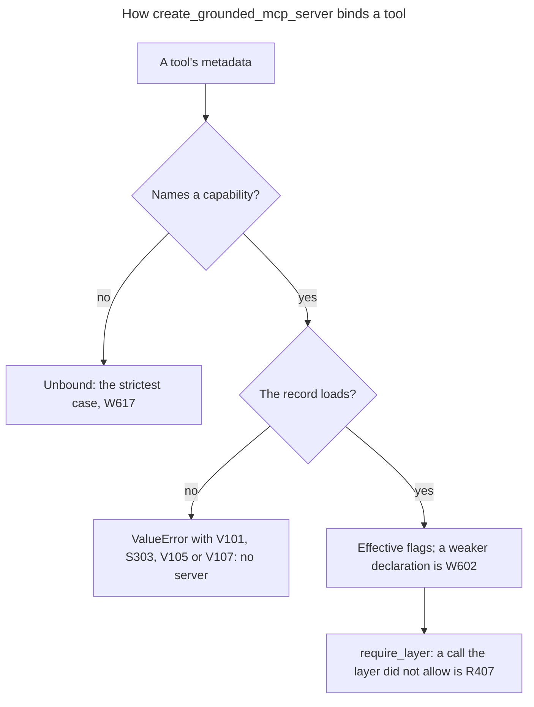
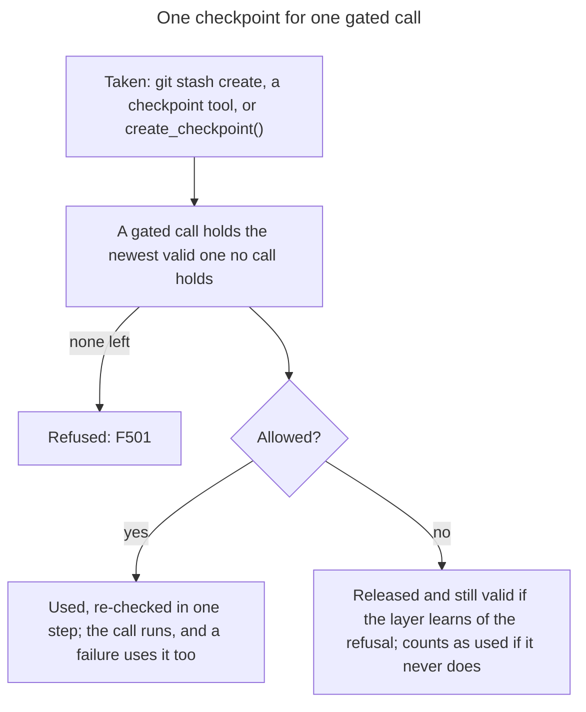
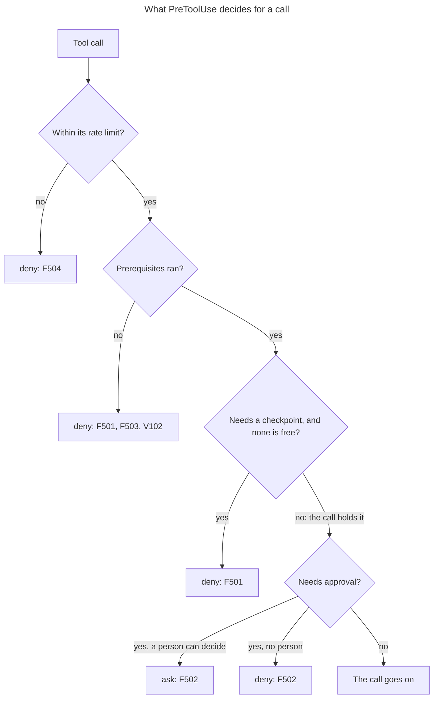
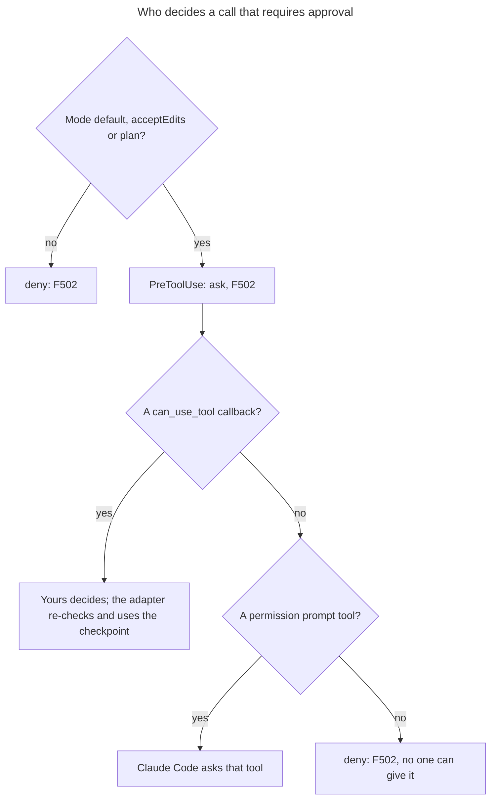
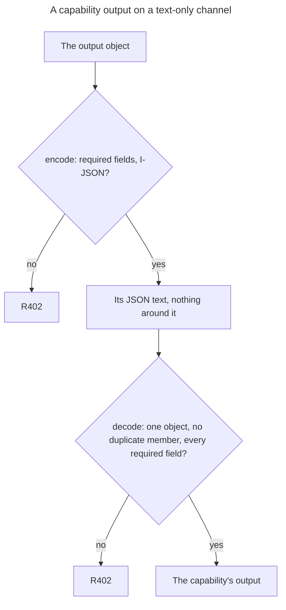
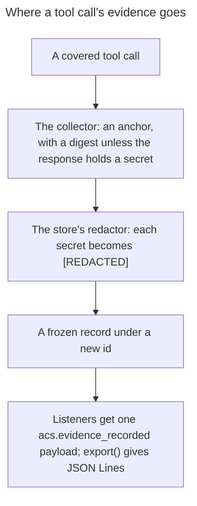
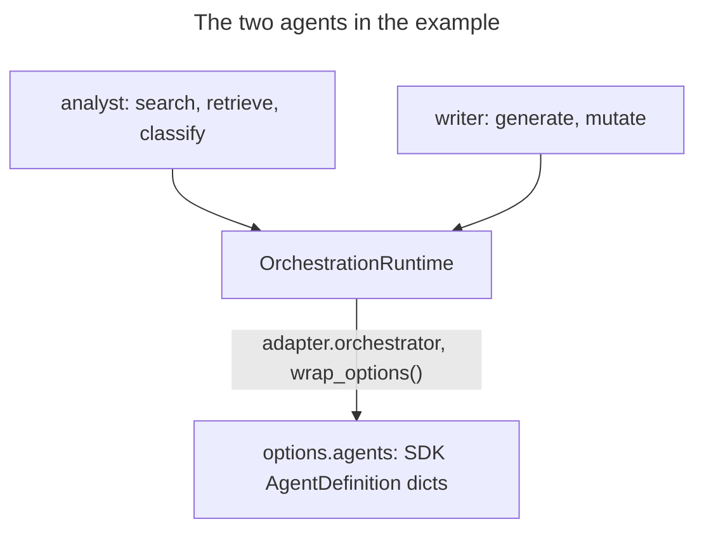

# Claude Agent SDK Integration

This guide explains how to integrate the Grounded Agency capability standard with the Claude Agent SDK, enabling SDK-based agents to operate with evidence-grounded decisions, checkpoint-before-mutation safety, approval of the calls that require it, and audit trails.

The adapter is a safety layer for tool calls that a model chooses freely, outside a workflow ([STANDARD-v1.2.0 §5.18](../../spec/STANDARD-v1.2.0.md#518-tool-calling-hosts); it claims class SL, as [Conformance](#conformance-class-sl) says). It classifies each call as the ontology capabilities it performs and acts on their effective safety flags ([§5.2.1](../../spec/STANDARD-v1.2.0.md#521-safety-flags)): a call whose `requires_checkpoint` is true uses up one valid checkpoint (refused with F501 otherwise), and a call whose `requires_approval` is true is put to a person through the host's permission flow (F502).

## Quick Start

```python
from claude_agent_sdk import ClaudeAgentOptions, PermissionResultAllow, PermissionResultDeny
from grounded_agency import grounded_query, GroundedAgentAdapter, GroundedAgentConfig

# 1. Create adapter with configuration
adapter = GroundedAgentAdapter(
    GroundedAgentConfig(
        strict_mode=True,           # Block mutations without checkpoint
        max_budget_usd=1.00,        # Cap spending at $1
    )
)

# 2. Create checkpoint before mutations
adapter.create_checkpoint(
    scope=["src/*.py"],
    reason="Before refactoring"
)

# 3. Decide the calls that require approval (mutate, send, execute).
#    show_and_ask stands for your own prompt; context.decision_reason
#    holds the adapter's reason, which begins "F502 APPROVAL_REQUIRED:".
async def decide(tool_name, tool_input, context):
    if await show_and_ask(tool_name, tool_input, context.decision_reason):
        return PermissionResultAllow(updated_input=tool_input)
    return PermissionResultDeny(message="Not approved")

# 4. Use grounded_query(), a drop-in replacement for query()
async for msg in grounded_query(
    "Refactor the authentication module",
    options=ClaudeAgentOptions(can_use_tool=decide),
    adapter=adapter,
):
    print(msg)

# 5. Check cost after completion
print(f"Total cost: ${adapter.cost_summary.total_usd:.4f}")
print(f"Evidence: {adapter.get_evidence()}")
```

Without a `can_use_tool` callback no one can approve a call, so every call that requires approval is denied. See [Approval](#approval).

### Using GroundedClient

For long-lived sessions where you send multiple queries:

```python
from grounded_agency import GroundedClient, GroundedAgentAdapter, GroundedAgentConfig

adapter = GroundedAgentAdapter(GroundedAgentConfig(strict_mode=True))
adapter.create_checkpoint(["*"], "Before changes")

options = ClaudeAgentOptions(can_use_tool=decide)  # see Quick Start
async with GroundedClient(adapter, options=options) as client:
    await client.query("Refactor the authentication module")
    async for msg in client.receive_response():
        print(msg)

print(f"Cost: ${adapter.cost_summary.total_usd:.4f}")
```

### Using wrap_options() (Low-level)

For direct SDK usage without the `grounded_query()` wrapper:

```python
from claude_agent_sdk import ClaudeSDKClient, ClaudeAgentOptions
from grounded_agency import GroundedAgentAdapter, GroundedAgentConfig

adapter = GroundedAgentAdapter(GroundedAgentConfig(strict_mode=True))
adapter.create_checkpoint(["src/*.py"], "Before refactoring")

base_options = ClaudeAgentOptions(
    allowed_tools=["Read", "Write", "Edit", "Bash"],
    permission_mode="acceptEdits",
    can_use_tool=decide,  # see Quick Start
)
options = adapter.wrap_options(base_options)

# The adapter's PreToolUse hook applies the rate limit, the checkpoint rule
# and the approval rule to every tool call, including the tools listed in
# allowed_tools. wrap_options() keeps your can_use_tool callback: the
# adapter's own callback calls it after its checkpoint check.

async with ClaudeSDKClient(options) as client:
    await client.query("Refactor the authentication module")
    async for msg in client.receive_response():
        print(msg)
```

## Architecture

```
┌─────────────────────────────────────────────────────────────────┐
│                    GroundedAgentAdapter                          │
├─────────────────────────────────────────────────────────────────┤
│  ┌───────────────┐  ┌────────────────┐  ┌────────────────────┐  │
│  │CapabilityReg- │  │ToolCapability- │  │ Permission         │  │
│  │istry          │  │Mapper          │  │ Callback           │  │
│  │               │  │                │  │                    │  │
│  │ Loads ontol-  │  │ Maps SDK tools │  │ Checkpoint check,  │  │
│  │ ogy YAML      │  │ to capabilities│  │ then host decides  │  │
│  └───────────────┘  └────────────────┘  └────────────────────┘  │
│                                                                  │
│  ┌───────────────┐  ┌────────────────┐  ┌────────────────────┐  │
│  │Checkpoint-    │  │EvidenceStore   │  │ ToolUse Hooks      │  │
│  │Tracker        │  │                │  │                    │  │
│  │               │  │ Evidence       │  │ Pre: block or ask  │  │
│  │ Checkpoint    │  │ anchors        │  │ Post: use, record  │  │
│  │ lifecycle,    │  │ storage        │  │ PostToolUseFailure:│  │
│  │ holds         │  │                │  │   use; Stop: end   │  │
│  └───────────────┘  └────────────────┘  └────────────────────┘  │
│                                                                  │
│  ┌───────────────┐  ┌────────────────┐                          │
│  │CostSummary    │  │Orchestration-  │                          │
│  │               │  │Runtime         │                          │
│  │ Tracks USD    │  │ (optional)     │                          │
│  │ cost and      │  │                │                          │
│  │ per-model     │  │ Exports agents │                          │
│  │ breakdown     │  │ to SDK format  │                          │
│  └───────────────┘  └────────────────┘                          │
└─────────────────────────────────────────────────────────────────┘
                              │
              ┌───────────────┼───────────────┐
              ▼               ▼               ▼
   ┌──────────────┐  ┌──────────────┐  ┌──────────────┐
   │grounded_     │  │GroundedClient│  │wrap_options() │
   │query()       │  │              │  │ (low-level)   │
   └──────┬───────┘  └──────┬───────┘  └──────┬───────┘
          │                 │                 │
          └─────────────────┼─────────────────┘
                            ▼
               ┌────────────────────────┐
               │   Claude Agent SDK     │
               │   query() / Client     │
               └────────────────────────┘
```

## Tool-to-Capability Mapping

The adapter is a safety layer on a tool-calling host ([Standard 1.2.0 §5.18](../../spec/STANDARD-v1.2.0.md#518-tool-calling-hosts)). Its `ToolCapabilityMapper` maps each tool call to the capabilities it performs. A tool is bound by a **tool binding record** ([§5.18.1](../../spec/STANDARD-v1.2.0.md#5181-tool-bindings), `schemas/interop/tool_binding.schema.json`); the mapper binds Claude Code's own tools by the table below, whose flags (`risk`, `mutation`, `requires_checkpoint`, `requires_approval`) are the capabilities' flags in `schemas/capability_ontology.yaml`:

| SDK Tool | Capability | Risk | Requires Checkpoint | Requires Approval |
|----------|-----------|------|---------------------|-------------------|
| Read | retrieve | low | No | No |
| Glob | search | low | No | No |
| Grep | search | low | No | No |
| LS | observe | low | No | No |
| WebFetch | retrieve | low | No | No |
| WebSearch | search | low | No | No |
| **Write** | **mutate** | **high** | **Yes** | **Yes** |
| **Edit** | **mutate** | **high** | **Yes** | **Yes** |
| **MultiEdit** | **mutate** | **high** | **Yes** | **Yes** |
| **NotebookEdit** | **mutate** | **high** | **Yes** | **Yes** |
| Task, Agent | delegate | medium | No | No |
| Skill | invoke | medium | No | No |
| AskUser, AskUserQuestion | inquire | low | No | No |
| TodoRead, TaskList, TaskGet | recall | low | No | No |
| TodoWrite, TaskCreate, TaskUpdate | persist | low | No | No |
| ToolSearch | search | low | No | No |
| BashOutput, TaskOutput, ListMcpResourcesTool | observe | low | No | No |
| ReadMcpResourceTool | retrieve | low | No | No |
| ExitPlanMode | inquire | low | No | No |
| **any other tool** | **unbound** | **high** | **Yes** | **Yes** |

`Skill` is `invoke` whatever the skill: loading a skill's instructions saves and restores nothing. The state-saving or restoring call the skill leads to is classified on its own, so `Skill(checkpoint)` takes no checkpoint; the skill's `git stash create` does ([§5.18.6](../../spec/STANDARD-v1.2.0.md#5186-checkpoints-for-calls)). Claude Code tools that run a command or stop a process (`Monitor`, `KillShell`, `TaskStop`) are not in the table on purpose: they are unbound.

Each mapping carries the capabilities the call performs (`capabilities`, primary first) and its **prerequisites**, the `from` capabilities of the `requires` edges into them: `checkpoint` for `mutate`, `send` and `rollback`.

### Unbound Tools

A tool that is neither in this table nor bound by a record (see [MCP Tool Mapping](#mcp-tool-mapping)) is **unbound** ([§5.18.2](../../spec/STANDARD-v1.2.0.md#5182-unbound-tools)). The mapper returns `UNCLASSIFIED_TOOL` for it, the strictest case: high risk, a mutation, a checkpoint and approval. The adapter uses the same constant when classification raises. Nothing tells the mapper that an unknown tool only reads, so it does not assume so.

In strict mode this means that a built-in or MCP tool the table does not list is refused until a checkpoint exists, and is then put to the permission flow. To give such a tool its real classification, bind it:

```python
adapter.mapper.register_mcp_tool("mcp__wiki__get_page", capability_id="retrieve")
```

A tool registered with no capability is unbound too, and is reported as W617 (`UNBOUND_TOOL`) in `adapter.mapper.warnings`. `grounded_agency.check_offered()` checks the tools a host offers against the loaded bindings: W617 for an unbound one, V111 for a binding whose `tool` is not the offered name, V102 for a tool that needs a capability no offered tool performs, and F506 for a host action tied to a tool that can be refused.

### Bash Command Classification

Bash commands are classified by what they do ([§5.18.3](../../spec/STANDARD-v1.2.0.md#5183-classification)). A command counts as read-only only when it is on the mapper's allow-list; every other command is a high-risk mutation that needs a checkpoint and approval, whatever its capability.

The command line is read with the shell's quoting rules and split into simple commands at `&&`, `||`, `;`, `|` and `&`. A line is a mutation when it redirects output to anything but `/dev/null`, opens a subshell or a here-document, has an unbalanced quote, or uses command substitution, `${...}`, `eval` or `source`. An allow-listed command given an option that writes is a mutation too: `find -delete` or `-exec`, `sort -o`, `uniq IN OUT`, `git diff --output`, `git branch NAME`, `git remote set-url`, `file -C`. `sed`, `awk` and `env` are not on the allow-list, since they can write a file or run another command whatever else they do. The allow-list matches a command's exact name, so `LS` or `/bin/ls` is not `ls`.

**`git stash`**, only when the line is exactly one simple command with no option that writes: `git stash create` takes a checkpoint, `git stash list` and `git stash show` only read, and `git stash pop <commit>` and `git stash apply <commit>` are `rollback` when `<commit>` is the full id of a commit a checkpoint of this adapter's scope recorded (the commit `git stash create` printed, kept as the checkpoint's `metadata["commit"]`). git applies any merge commit as if it were a stash, so any other revision, an abbreviated id, an option, and a bare `pop` or `apply` (which read `refs/stash`, where `git stash create` writes nothing) are a gated mutation. Any other form (`store`, `push`, `drop`, none) is a gated mutation, as is `git -C dir stash ...`.

**A line of several commands** takes the strictest flags and every prerequisite of all the commands that are not read-only, with their capabilities in order: `curl -X POST u -d x; rm f` is `send` and `mutate`. So `git stash pop && rm -rf x` is a gated `mutate`, never a `rollback`.

| Pattern | Capability | Risk | Checkpoint | Approval |
|---------|-----------|------|------------|----------|
| `ls`, `cat`, `head`, `pwd` | observe | low | No | No |
| `git status`, `git log`, `git rev-parse`, `git ls-files` | observe | low | No | No |
| `git stash create` | checkpoint | low | No | No |
| `git stash pop <commit>`, `git stash apply <commit>`, a commit a checkpoint recorded | rollback | medium | No (one taken earlier) | No |
| `git stash pop`, `git stash apply` of anything else | mutate | high | Yes | Yes |
| `rm`, `mv`, `chmod` | mutate | high | Yes | Yes |
| `sed`, `awk`, `env`, `git push` | mutate | high | Yes | Yes |
| `curl -X POST`, `ssh` | send | high | Yes | Yes |
| `python -c`, `node -e` | execute | high | Yes | Yes |
| any other command | mutate | high | Yes | Yes |

### MCP Tool Mapping

MCP tools are bound by `create_grounded_mcp_server()`. Each tool's `metadata` is a carrier of the tool binding record: it holds the record's members except `tool` and `ontology`, which the factory supplies (`mcp__<server>__<tool>` and the adapter's ontology version). The server's tools are loaded as one set, so `invokes` among them resolve.

```python
import json

from claude_agent_sdk import tool
from grounded_agency import GroundedAgentAdapter, create_grounded_mcp_server

@tool("deploy_service", "Deploy a service to production.", {"service_name": str})
async def deploy_service(args):
    # The execute output (the output contract, below).
    output = {"result": {"deployed": args["service_name"]}, "evidence_anchors": []}
    return {"content": [{"type": "text", "text": json.dumps(output)}]}

deploy_service.metadata = {
    "capability": "execute",
    "flags": {"risk": "high", "requires_checkpoint": True},
}

adapter = GroundedAgentAdapter()
server = create_grounded_mcp_server(
    name="deploy-tools",
    version="1.0.0",
    tools=[deploy_service],
    adapter=adapter,
)
# mcp__deploy-tools__deploy_service now requires a checkpoint (declared) and
# approval (ontology: execute); it refuses to run unless the adapter's layer
# allowed the call (require_layer)
```



`metadata` may hold `capability`, `domain`, `flags` (`risk`, `mutation`, `requires_checkpoint`, `requires_approval`), `additional_capabilities`, `classifier`, `invokes`, `approval` (`min_approvers`, `role`, `expires`), `control` and `destination`; the flat legacy keys `capability_id`, `risk`, `mutation`, `requires_checkpoint` and `requires_approval` are still accepted (a `capability` and a `capability_id` that disagree raise `ValueError` with S303). A registration follows the Standard's rules ([§5.18.1](../../spec/STANDARD-v1.2.0.md#5181-tool-bindings)):

- **A binding that does not load is refused.** A capability the ontology does not define (V101), a member of the wrong type (S303), an `invokes` name that does not resolve (V107) or a cycle (V105) raises `ValueError` whose message opens with each code and name, and no server is created.
- **Flags are effective flags** ([§5.2.1](../../spec/STANDARD-v1.2.0.md#521-safety-flags)): the stricter of the declaration and the ontology flags of every capability named and of every binding invoked. A declared `risk` of `high` also makes `mutation` and `requires_checkpoint` true unless they are declared.
- **A weaker declaration has no effect.** `capability="mutate"` with `flags={"risk": "low"}` is still high-risk and still needs a checkpoint. Each such flag is kept in `adapter.mapper.warnings` as a W602 (`SAFETY_FLAG_DOWNGRADE`) diagnostic whose `location` holds `tool`, `capability` and `field`. The one exception is `mutation: false` on a capability the ontology marks `mutation_overridable` (`audit`), when no other capability is named.
- **A tool with no capability is unbound** ([§5.18.2](../../spec/STANDARD-v1.2.0.md#5182-unbound-tools)): the strictest case, reported as W617. It used to be registered as `execute`.

```python
mapping = adapter.mapper.register_mcp_tool(
    "mcp__db__insert", capability_id="mutate", risk="low"
)
assert mapping.risk == "high" and mapping.requires_checkpoint
for w in adapter.mapper.warnings:
    print(w.code_str, w.name, w.location, w.message)
# W602 SAFETY_FLAG_DOWNGRADE {'tool': 'mcp__db__insert', 'capability': 'mutate',
# 'field': 'risk'} tool 'mcp__db__insert': the ontology declares risk=high but
# the tool declares risk=low; the ontology value applies
```

**`require_layer`** (default `True`): each tool of the server refuses to run, with `R407 SAFETY_CHECK_FAILED`, unless the adapter's layer allowed this exact call (its tool name and arguments), so a session whose options were not wrapped with `wrap_options()` cannot run it ([§5.18.8](../../spec/STANDARD-v1.2.0.md#5188-refusals-records-and-failure)). `require_layer=False` restores the earlier behaviour and is outside class SL.

**The output contract** ([§5.18.10](../../spec/STANDARD-v1.2.0.md#51810-capability-checks)): a tool with a capability returns that capability's output as the I-JSON text of the output object, its one text content item ([§5.18.9](../../spec/STANDARD-v1.2.0.md#5189-text-only-results)). The SDK's server passes a result's `content` and `is_error` to the session and drops every other member, `structuredContent` included, so the text is what the model reads and what the adapter checks; a tool may still return `structuredContent` beside the text, and it is not read. A result that carries no output in its text, or whose output fails the contract (a missing field, an `evidence_anchors` that is not an array, a required `confidence` outside 0 to 1, a value that is not I-JSON), fails the call that ran with `R402 EXECUTION_FAILED`: the call's record is `failed` with R402 and the call's id, and it used its checkpoint and its decision. An error result (`is_error`) is passed on. `GroundedAgentConfig(check_outputs=False)` passes results on unchecked and reads outputs for grounding as before 1.2.0, and is outside class SL.

## Checkpoint Lifecycle

Checkpoints are the core safety mechanism ([§5.18.6](../../spec/STANDARD-v1.2.0.md#5186-checkpoints-for-calls)). One checkpoint authorises one call whose effective `requires_checkpoint` is true:



- **Which one.** The most recently taken of the valid checkpoints no other call holds, the active one or one in history (the reference executor's rule): once the latest is used, an earlier valid one authorises the next call.
- **When it is used up.** When the call is allowed to start: at the permission callback's allow, re-checked in one atomic step (`CheckpointTracker.consume_if_valid`), or, for a call that ran without passing the callback (a tool in `allowed_tools`, a call that needs no approval, a permission prompt tool's decision), at PostToolUse. A call that started uses it whatever its outcome: PostToolUseFailure uses it too, since a failed call may have changed something.
- **Holds.** A call holds its checkpoint from PreToolUse until it is allowed or refused. A hold the adapter cannot resolve (it lapses with its checkpoint, or after `checkpoint_reservation_seconds`; it is found on reload; the turn ends with the call unreported) counts as used.
- **Validity.** A checkpoint authorises nothing after an execution boundary, the Stop of any session the adapter serves (one adapter is one layer scope; serve sessions that must not share boundaries with separate adapters), or after its maximum age, `expiry_minutes`, at most 30.
- **Prerequisites.** A `mutate`, `send` or `rollback` call needs a checkpoint taken in the scope, since the adapter started (F501; F503 for a `rollback` call, which uses none and can restore an expired or used checkpoint). Any other missing prerequisite is V102.
- **None valid.** The adapter refuses with F501 and does not take a checkpoint on the call's behalf: it cannot know what the call will change. The model takes one with a state-saving call.

### Creating Checkpoints

```python
# Method 1: Direct API (the host's own checkpoint operation)
checkpoint_id = adapter.create_checkpoint(
    scope=["src/*.py", "tests/*.py"],
    reason="Before refactoring authentication"
)

# Method 2: Via CheckpointTracker. The adapter's maximum age,
# expiry_minutes, bounds it whatever expiry_minutes it is given here.
checkpoint_id = adapter.checkpoint_tracker.create_checkpoint(
    scope=["*"],
    reason="Full backup before changes",
    expiry_minutes=30,
    metadata={"task": "issue-123"}
)

# Method 3: Autonomous. Claude invokes the checkpoint skill, whose
# instructions have it run one Bash call, git stash create "checkpoint:<id>".
# The Skill call takes no checkpoint; the checkpoint recorder (a PostToolUse
# hook for every tool) records one when git stash create succeeds, with the
# commit it printed, or HEAD for a clean tree, as the restore point.
```

### Consuming Checkpoints

The adapter uses a checkpoint up for each gated call. The host API still consumes the active checkpoint directly:

```python
adapter.consume_checkpoint()

# Now subsequent mutations need a new checkpoint
assert not adapter.has_valid_checkpoint()
```

## PreToolUse Hook Enforcement

The adapter injects PreToolUse, PostToolUse, PostToolUseFailure, Stop and SubagentStop hooks. PreToolUse runs for every tool call, including pre-approved ones that never reach `can_use_tool`, and applies the rules of §5.18 in this order:



- **PreToolUse**:
  1. *Control-only.* A tool bound `control: true` is allowed and recorded; no check applies to it.
  2. *Rate limit (F504).* A call over its risk level's limit is refused, in strict and non-strict mode alike; a failure of the limiter is R407.
  3. *Prerequisites.* A checkpoint never taken in the scope is F501 (F503 for a `rollback` call); any other missing prerequisite V102.
  4. *Checkpoint (F501).* A call whose mapping requires a checkpoint holds the newest valid one no other call holds, under its `tool_use_id` (a call with none is R407).
  5. *Approval (F502).* With `approval="ask"` (the default), a call whose mapping requires approval is answered `"ask"`, in the permission modes that put it to a person; see [Approval](#approval). Each refusal here releases the hold step 4 took.

  For a pre-approved tool this hook is the only check that runs, so it does not let errors through: a tool the mapper does not know or cannot classify is unbound, and any other error refuses the call with R407 in strict mode and is logged in non-strict mode.
- **PostToolUse**: Collects evidence anchors; the checkpoint recorder takes a checkpoint for a successful state-saving call; a call that still holds a checkpoint uses it, whatever its outcome; a call that succeeded counts its capabilities as run, for later prerequisites.
- **PostToolUseFailure**: A failed or interrupted call uses the checkpoint it held.
- **Stop**: The end of a turn is an execution boundary. Holds of the stopping session's calls count as used, and every checkpoint the adapter holds stops authorising anything.
- **SubagentStop**: Holds of the finished subagent's calls count as used; not a boundary.

Every call the layer allows or refuses is recorded in `adapter.call_records` (the tool, its capability, the decision, the digest of its shown value, the approvers, the checkpoint it used, the permission mode), each with `recorded_by`: the layer's name, version and `config_sha256`, a digest of its settings (the rate limits included) and bindings ([§5.18.8](../../spec/STANDARD-v1.2.0.md#5188-refusals-records-and-failure)). Each refusal is also a §9.8 diagnostic in `adapter.diagnostics`, whose `location` holds `tool`, `capability` (absent for an unbound tool) and `call`. `adapter.export_action_records(scope)` gives the call records still kept as audit records ([§6.4](../../spec/STANDARD-v1.2.0.md#64-audit-records)), with `scope`, the layer scope you name, as their `run_id`: a refusal is `rejected` with its code, a call allowed with no outcome yet `approved` (with `approval.mode: in_session` and the shown digest when the host's prompt approved it), one put to the prompt `planned`, a call that ran `executed` or `failed` (`failed` with F505 when a grounding policy refused its output); the layer's own members (`decision`, `permission_mode`, `diagnostic`) are kept under `details`.

### Refusal Reasons

A hook's reason and a permission result's message are text, and they are the only channel to the model and to the host. Each refusal is the diagnostic's text form ([§5.18.8](../../spec/STANDARD-v1.2.0.md#5188-refusals-records-and-failure)): the code, the name, a colon and the message.

| Rule | Decision | Reason begins | Also with `strict_mode=False` |
|------|----------|---------------|-------------------------------|
| No valid checkpoint, it is held by another call, or none was taken in the scope | `deny` | `F501 CHECKPOINT_REQUIRED:` | No: logged |
| A `rollback` call with no checkpoint taken in the scope | `deny` | `F503 ROLLBACK_FAILED:` | No: logged |
| A prerequisite other than a checkpoint has not run | `deny` | `V102 MISSING_PREREQUISITE:` | No: logged |
| The call requires approval | `ask` | `F502 APPROVAL_REQUIRED:` | Yes |
| No person can decide (the mode, no callback, more approvers or a role than a prompt can give, the host refused) | `deny` | `F502 APPROVAL_REQUIRED:` | Yes |
| Rate limit | `deny` | `F504 CONSTRAINT_VIOLATED:` | Yes |
| A failure of the layer itself, a gated call with no `tool_use_id`, an MCP tool reached without a decision | `deny` or the tool's error | `R407 SAFETY_CHECK_FAILED:` | Partial: a failed rate check and an MCP tool with `require_layer` still refuse |

`strict_mode=False` is outside class SL.

## Approval

The ontology sets `requires_approval: true` on `execute`, `mutate` and `send`, a binding can add it to any tool, and an unbound tool has it. [§5.18.7](../../spec/STANDARD-v1.2.0.md#5187-approval-for-calls) defines approval for a call. The adapter obtains it from a person through Claude Code's permission prompt: a prompt that shows the tool and the arguments, and decides that call alone, is a valid one-approver `in_session` decision.

- **The digest is recorded.** The adapter records with each decision the §5.14 digest of the shown value, `[{"action": <tool>, "capability": <capability, or null when unbound>, "args": <the arguments>}]` (`_core.approval_digest`). Arguments that are not I-JSON are refused with F502: an integer beyond ±2^53, or a float that canonical JSON writes as one (1.8e16), a lone surrogate, a value that is not JSON.
- **One decision per call.** Each gated call goes to the prompt; an identical later call asks again.
- **What a prompt cannot give** is refused with F502: a binding whose `approval.min_approvers` is above 1, or that names an `approval.role`.
- **Changed arguments.** When your callback allows with an `updated_input` other than the input, the adapter classifies the new arguments again and refuses the call if they need approval (F502: the decision was on other arguments), or a checkpoint or prerequisite the call does not hold (F501, F503, V102).

### Who Decides



The adapter relies on a prompt only in the Claude Code permission modes that put it to a person: `default`, `acceptEdits` and `plan` (`grounded_agency.adapter.PROMPTING_PERMISSION_MODES`, not configurable). The mode is read from the hook input, else from the wrapped options' `permission_mode`. In `bypassPermissions` the documentation does not say that a hook's `"ask"` reaches the callback, in `auto` a classifier can answer the prompt, and `dontAsk` denies the call anyway, so in those modes, and in any mode the adapter does not know, a call that requires approval is refused with F502: it could otherwise run on a decision no person made. To run such a session, set `approval="off"`, which is outside class SL.

The adapter installs no callback beside a permission prompt tool, because the SDK refuses the two together. PreToolUse still holds the call's checkpoint. A call the prompt tool refuses is never reported to the adapter, so its checkpoint is lost: it counts as used when its hold lapses or the turn ends, and the next gated call needs a new checkpoint. With neither a callback nor a prompt tool, the call is refused, because no one can decide it.

Your callback is also called for the calls Claude Code asks about on its own account, whether or not their capability requires approval. When it refuses a call that requires approval, the adapter's answer is `F502 APPROVAL_REQUIRED: <tool> was not approved: <your message>`.

To run without the approval rule, for example where an allow-list and a sandbox already bound what the agent can do:

```python
adapter = GroundedAgentAdapter(GroundedAgentConfig(approval="off"))
```

### What the Hook Returns

```python
{"hookSpecificOutput": {
    "hookEventName": "PreToolUse",
    "permissionDecision": "ask",
    "permissionDecisionReason":
        "F502 APPROVAL_REQUIRED: Write (capability 'mutate') requires approval. "
        "It runs only if this call is approved.",
}}
```

This rests on the SDK's hook contract (version 0.2.182, `PreToolUseHookSpecificOutput`) and the Claude Code documentation:

- `permissionDecision` is one of `"allow"`, `"deny"`, `"ask"` and `"defer"`. When several hooks answer, `deny` takes priority over `defer`, then `ask`, then `allow` ([Agent SDK hooks](https://code.claude.com/docs/en/agent-sdk/hooks)).
- `"ask"` forces a prompt ([Permissions](https://code.claude.com/docs/en/permissions)). In an SDK session the prompt is the `can_use_tool` callback, and `ToolPermissionContext.decision_reason` holds the hook's reason.
- With no one to answer, the call is denied: "In a `-p` run with no host, these requests are denied either way", and the model reads the reason in the tool result ([Headless mode](https://code.claude.com/docs/en/headless), [Hooks reference](https://code.claude.com/docs/en/hooks)). In `dontAsk` mode Claude Code denies every call that would prompt, without calling the callback.
- The documentation does not say whether `bypassPermissions` mode puts a hook's `"ask"` to the callback or approves the call; that is why the adapter refuses a call that requires approval in that mode.

The tests in `tests/test_tool_call_approval.py` and `tests/test_permission_modes.py` call the hook and the callback directly; what Claude Code does with an `"ask"` rests on the documentation cited above.

## Text-Only Outputs

Where a host carries a capability output as a string (a tool's result, a sub-prompt's or a model's reply), it travels as the I-JSON text of the output object, nothing around it, with every field the capability's contract requires, an `evidence_anchors` array where present, and a `confidence` from 0 to 1 where the contract requires one; otherwise it is refused with R402 ([§5.18.9](../../spec/STANDARD-v1.2.0.md#5189-text-only-results)). The package has both sides:



```python
from grounded_agency import (
    CapabilityOutputError,
    decode_capability_output,
    encode_capability_output,
)

text = encode_capability_output("observe", {"observation": 3, "evidence_anchors": [], "confidence": 0.9})
try:
    output = decode_capability_output("observe", model_reply)
except CapabilityOutputError as e:
    print(e.error.code_str, e)  # R402 EXECUTION_FAILED: the 'observe' output ...
```

## Conformance (class SL)

The adapter claims the safety-layer class SL ([§10.4](../../spec/STANDARD-v1.2.0.md#104-safety-layer-conformance)). Its conformance statement is `tests/conformance/calls/statements/grounded_agency_adapter.json`: it covers every call Claude Code reports to the PreToolUse hook of wrapped options, including tools in `allowed_tools`; its scope is the adapter instance; its boundary is the Stop of any session it serves; its checkpoint maximum age is `expiry_minutes`; it obtains approval by prompt in the modes named above, one approver per call and no role; it makes a check and its use atomic with the tracker's lock; it names its host gaps; and it applies every check of §5.18.10. The output-contract row applies to the results it receives as capability outputs, those of the tools `create_grounded_mcp_server` serves, in the form the session reads them (R402); Claude Code's own tools and other MCP servers' tools return results in their own forms, which carry no capability output, and the statement names those calls (`calls_without_output`). It passes every binding fixture and the call-sequence fixtures whose needs it supports (`tests/test_binding_fixtures.py`, `tests/test_call_fixtures.py`); the ones that need recorded decisions from several approvers, or nested calls, are skipped. `strict_mode=False`, `approval="off"` and `check_outputs=False` are outside the class.

## Structured Output

Use `output_format` to get structured JSON responses:

```python
adapter = GroundedAgentAdapter(
    GroundedAgentConfig(
        output_format={
            "type": "object",
            "properties": {
                "summary": {"type": "string"},
                "changes": {"type": "array", "items": {"type": "string"}},
                "risk_level": {"type": "string", "enum": ["low", "medium", "high"]},
            },
            "required": ["summary", "changes", "risk_level"],
        }
    )
)

# Structured output is auto-injected into SDK options
options = adapter.wrap_options(base_options)
```

## Budget Enforcement

Set a maximum cost budget:

```python
adapter = GroundedAgentAdapter(
    GroundedAgentConfig(
        max_budget_usd=5.00,  # Cap at $5
        model="sonnet",       # Default model
        max_turns=20,         # Limit turns
    )
)

async for msg in grounded_query("Complex task", adapter=adapter):
    print(msg)

# Check actual cost
print(f"Total: ${adapter.cost_summary.total_usd:.4f}")
print(f"By model: {adapter.cost_summary.by_model}")
print(f"Turns: {adapter.cost_summary.turn_count}")
```

## Evidence Anchors

Evidence anchors track provenance for grounded decisions. Each is an
evidence anchor of STANDARD v1.2 §6.5: a `ref`, a `kind` (`file`, `url`,
`tool`, `log`, `sensor`, `human_note`, `api`, `record`, or a vendor kind
`x-...`) and optional `timestamp`, `excerpt` and `digest`
(`sha256:` and 64 hex digits of what was read).

```python
# Access collected evidence
recent = adapter.get_evidence(10)
# ['tool:Read:abc123', 'command:abc123', 'file:src/main.py']

# Get evidence by ref
mutations = adapter.evidence_store.get_mutations()
tool_outputs = adapter.evidence_store.get_tool_outputs()

# The anchors a capability's output cites, as §6.5 objects
anchors = adapter.evidence_store.evidence_anchors_for("retrieve")
# [{'ref': 'tool:Read:abc123', 'kind': 'tool', 'timestamp': '...', 'digest': 'sha256:...'}, ...]

# Records with their context (§6.6), and the JSON Lines export
records = adapter.evidence_store.records(capability="retrieve")
lines = list(adapter.evidence_store.export())
```

### Evidence Format

| Ref | Kind | What it records |
|-----|------|-----------------|
| `tool:Read:tool_use_id_123` | `tool` | A tool call's result, with the response's `digest` |
| `command:tool_use_id_123` | `tool` | A Bash command's execution (its exit code) |
| `file:src/main.py` | `file` | A file a call read or wrote |
| `mutation:config.yaml` | `record` | A state mutation the agent made |
| `checkpoint:<id>` | `record` | A checkpoint `create_checkpoint` took |
| `delegation:<task>`, `sync:`, `orchestration:`, `invoke:`, `inquire:` | `record` | Coordination actions |

An output that reports an action is grounded by the record of that action
(§3.1): `EvidenceAnchor.from_checkpoint(id)` and `from_mutation(target, op)`
make those anchors, and `create_checkpoint` records one for capability
`checkpoint`. The SDK's kinds before Standard 1.2 (`tool_output`,
`command`, `mutation`, `coordination`) are deprecated: given to
`EvidenceAnchor`, they are mapped (`tool`, `tool`, `record`, `record`) with a
`DeprecationWarning`, and a query by one (`get_by_kind("command")`) returns
what it returned before, by ref prefix, with the warning.
`get_for_capability_output()` still returns bare refs, the deprecated form,
and warns; use `evidence_anchors_for()`.

### What an Anchor Keeps

A tool-output anchor's metadata holds the tool name and whether there was a response. A command anchor holds the exit code. A file anchor holds the path. An anchor for an unclassified tool is associated with no capability.

The tool's input, and a Bash command's text, are not kept: an input can hold a credential (a token in a command or a header), and anchors are stored and exported (`EvidenceStore.to_list()`). To keep them, opt in:

```python
adapter = GroundedAgentAdapter(GroundedAgentConfig(evidence_include_tool_input=True))
```

The same switch exists where anchors are built directly: `EvidenceAnchor.from_tool_output(..., include_tool_input=True)`, `create_evidence_collector(store, mapper, include_tool_input=True)` and `DiscoveryPipeline(..., evidence_include_tool_input=True)`, which then keeps the task description. `EvidenceAnchor.from_command(None, exit_code)` records a command without its text. With the switch on, inputs are kept redacted, and in a metadata object over 1 KB the largest values are replaced with `[truncated]`.

Evidence capture is best-effort by default
([STANDARD v1.2 §6.4](../../spec/STANDARD-v1.2.0.md#64-audit-records)): an
anchor that cannot be stored is logged as a warning, and the call goes on. A
host that requires the capture builds the hook with
`create_evidence_collector(store, mapper, required=True)`: a call whose
evidence was not recorded is then reported to the model in the hook's result
(`R402 EXECUTION_FAILED: the call ran, but its evidence was not recorded
(not_recorded): ...`), logged at error level and handed to the store's
`record_capture_failure(tool_use_id, error)` when it has one. Either way no
capture fails silently.

## Evidence Stores, Secrets and Grounding

What happens to a call's evidence, from the hook to the store's readers:



### Evidence Stores

Every store implements `EvidenceStoreProtocol` (§6.6): `append` and
`append_many` (with `capability`, `run_id`, `frame`, `step`, `tool`,
`call_id`), `get(record_id)`, `records(capability=, kind=, run_id=)` in
append order, `export()` (one `EvidenceRecord` per JSON Lines line),
`info()` (durability, whether it is bounded, the count, the records it
removed), `subscribe(listener)` and `record_capture_failure()`.

- `EvidenceStore` keeps records in memory (durability `memory`, bounded by
  `max_anchors`, priority eviction). It keeps a frozen copy of each anchor:
  what a getter returns cannot be changed (`FrozenInstanceError`, a
  read-only metadata mapping), and changing your anchor after adding it
  changes nothing the store holds. Record ids (`ev-<n>`) are never reused,
  not even after `clear()`; evicted and cleared records count in
  `info().removed`.
- `JsonlEvidenceStore(path)` appends each record to a file (durability
  `durable`, unbounded, created with mode 0600; one writer per file). On
  open it truncates a last line that has no newline, an append that never
  completed, and reports the bytes as `x-torn_tail_bytes`; the next ids
  continue the file's.

Give the adapter a store with `GroundedAgentConfig(evidence_store=...)`. A
listener `subscribe`d to a store receives one `acs.evidence_recorded`
payload per append (§6.6: record ids, each anchor's `ref`, `kind` and
`digest`, never an excerpt), called after the append, outside the store's
lock; a listener that raises is logged and does not reach the others.

### Secrets

No secret enters an anchor or a record (STANDARD v1.2 §6.7). Every store
passes each anchor through its `Redactor` (registered values, then default
patterns for authorization headers, bearer tokens, URL passwords,
credential assignments, private keys and common key formats) before it
keeps it: a secret becomes `[REDACTED]`. The collector keeps a response's
`digest` only when the redactor finds no secret in the response, since the
digest of a response that is a secret could be inverted by guessing; the
anchor's metadata then says `digest_omitted: secret`. Register the host's
own secrets with `GroundedAgentConfig(secret_values=(...))`: they reach the
store's and the coordination audit log's redactor, and never
`recorded_by`. The adapter also redacts its call records and refusals, and
refuses a `persist` or `audit` call whose data holds a credential-shaped
value (F504, §5.18.10): memory is read back as fact, so it is refused, not
redacted.

### Grounding Policies

`GroundedAgentConfig(grounding=GroundingPolicy(require={"search"}))` (one
policy or a tuple), with a `search` tool that `create_grounded_mcp_server`
serves, applies §5.20 to the output of each call of that tool: an output
that is neither grounded nor marked inferred fails with F505. A policy that
names a capability the ontology does not define is a `ValueError` naming
V101. The call's argument names are what its `acs:` anchors may cite, and
the adapter gives no `evidence_seen`: a hook sees the tool call, not the
model's request.

The adapter sees only the outputs of the MCP tools
`create_grounded_mcp_server` serves (the capability output their text
carries, §5.18.9, the form the session reads), and checks each against its
output contract first (R402, above). Claude Code's own tools
(Read, Grep, WebFetch, ...) and the tools of other MCP servers return no
capability output, so a policy that requires `retrieve` or `search` checks
nothing for their calls: the adapter logs a warning once per such tool, and
its conformance statement names those calls (`calls_without_output`). A refused output
is the failure of the call that ran: its call record is `failed` with F505
and the call's id. `check_grounding_output(output, policy, bound_refs=...,
evidence_seen=...)` is the check of one output.

## Multi-Agent Coordination

Bridge the orchestration runtime to SDK subagents. The example registers two agents and exports them:



```python
from grounded_agency import (
    GroundedAgentAdapter,
    GroundedAgentConfig,
    OrchestrationRuntime,
    OrchestrationConfig,
)

# Set up orchestration
adapter = GroundedAgentAdapter(GroundedAgentConfig())
runtime = OrchestrationRuntime(
    capability_registry=adapter.registry,
    evidence_store=adapter.evidence_store,
)

# Register agents with capabilities
runtime.register_agent(
    "analyst",
    capabilities={"search", "retrieve", "classify"},
    metadata={
        "description": "Research and analysis agent",
        "model": "sonnet",
        "allowed_tools": ["Read", "Grep", "WebSearch"],
    },
)
runtime.register_agent(
    "writer",
    capabilities={"generate", "mutate"},
    metadata={
        "description": "Content generation agent",
        "model": "sonnet",
        "allowed_tools": ["Read", "Write", "Edit"],
    },
)

# Bridge to SDK format
adapter.orchestrator = runtime
options = adapter.wrap_options(base_options)
# options.agents now contains SDK-compatible AgentDefinition dicts
```

## Configuration Options

```python
@dataclass
class GroundedAgentConfig:
    # Path to capability ontology
    ontology_path: str = "schemas/capability_ontology.yaml"

    # If True, block mutations without checkpoint
    # If False, log warning but allow
    strict_mode: bool = True

    # Audit log location
    audit_log_path: str = ".claude/audit.log"

    # Checkpoint storage directory
    checkpoint_dir: str = ".checkpoints"

    # The layer's checkpoint maximum age (minutes): more than 0, at most 30
    # (STANDARD 1.2.0 §5.18.6); anything else raises ValueError
    expiry_minutes: int = 30

    # SDK features
    output_format: dict | None = None   # JSON schema for structured output
    max_budget_usd: float | None = None # Cost budget cap
    model: str | None = None            # Default model
    max_turns: int | None = None        # Turn limit

    # How long a call holds the checkpoint it reserved if it never reports
    # back (None: until the checkpoint expires). More than 0 and at most
    # expiry_minutes * 60. A hold that lapses counts as used.
    checkpoint_reservation_seconds: float | None = None

    # "ask": a call whose mapping requires approval is put to a person
    # through the host's permission flow (F502) in permission modes default,
    # acceptEdits and plan; refused with F502 in any other mode and where
    # there is no permission flow. "off": no approval (outside class SL).
    approval: Literal["ask", "off"] = "ask"

    # How many call records and refusals the adapter keeps in memory
    # (adapter.call_records, adapter.diagnostics)
    call_record_limit: int = 10000

    # Keep tool inputs, and Bash command text, in evidence anchors.
    # Off by default: inputs can hold credentials.
    evidence_include_tool_input: bool = False

    # Domain profiles applied to every call the adapter covers (STANDARD
    # 1.2.0 §5.21): loaded profiles or paths of profile files.
    profiles: Sequence[Mapping | str | PathLike] = ()

    # The directory the ontology's $ref paths are relative to (§4.1.2).
    # None: the directory above the ontology's (the repository root).
    schema_root: str | None = None
```

**Domain profiles.** `GroundedAgentConfig(profiles=[...])` applies domain
profiles to every tool call the adapter covers (STANDARD 1.2.0 §5.21): they
raise the flags of the call's capability (`checkpoint_policy` a checkpoint,
`require_review` and `auto_approve` an approval), and `require_human` and
`block_autonomous` require a person's approval, which the adapter asks
through the host's permission prompt; such a call's records carry
`person_required: true`, an unbound tool's too when a profile requires a
person for `mutate` (§5.18.2 treats it as `mutate`). A composite tool (a
binding with `invokes`) takes the flags a profile raises for each binding it
invokes, and its person requirement, transitively: its approval and
checkpoint cover the nested calls, which the adapter does not see (§5.18.4).
The ask's reason, which
your `can_use_tool` callback reads as `context.decision_reason`, then says
`requires approval by a person`: only a person's decision counts for that
call (§5.21.3), so a callback that approves some calls automatically (an
allowlist, say) puts such a call to a person instead. The core computes the
raised flags (`AppliedProfiles`, `adapter.profiles`), as it does for the
executor. A profile with an error raises `ProfileError` when the adapter is
built, and profiles need `approval="ask"` (with approvals off, the approvals
they require would be skipped). With `strict_mode=False`, which only logs a
missing checkpoint, a profile whose `checkpoint_policy` raises
`requires_checkpoint` (any value but `never`) raises `ProfileError` as well.
The applied profiles are part of every record's `config_sha256`.

A profile's grounding policy (`require_grounding`, with
`required_anchor_types` as its kinds) joins `GroundedAgentConfig.grounding`,
and its `minimum_confidence` fails an output below it with F504 (reason
`below_minimum_confidence`, or `invalid_confidence` for a `confidence` that
is not a number from 0 to 1), after the grounding check: both apply to the
outputs the layer sees, those of the tools `create_grounded_mcp_server`
serves, and a warning is logged once for any other tool they would cover
(Claude Code's own tools return no capability output), whose calls the
conformance statement names (`calls_without_output`, §5.21.4). A profile's
`allowed_destinations` is a destination policy in force beside
`GroundedAgentConfig.allowed_destinations` (below); no shipped profile sets
it. A profile that
requires a person for every call:

```python
adapter = GroundedAgentAdapter(
    GroundedAgentConfig(
        profiles=[{
            "domain": "clinic",
            "version": "1.0.0",
            "risk_thresholds": {"require_human": "low"},
        }]
    )
)
adapter.mapper.map_tool("Read", {"file_path": "notes.md"}).person_required  # True
```

The ontology is loaded by the core as well when the adapter is built: a
capability contract whose `$ref` names nothing under `schema_root`, is
cyclic or nests too deep raises `ValueError` (§4.1.2).

Any other value of `approval` raises `ValueError`, as does an `expiry_minutes` above 30 or not above 0, and a `checkpoint_reservation_seconds` of 0. `GroundedAgentAdapter(config, clock=...)` takes a clock (a function returning an aware `datetime`) that the checkpoint tracker and the records read, so a test can move time.

## Using with Capability Skills

The Grounded Agency skills (in `skills/`) can be invoked by Claude:

```python
# Configure SDK to load skills from project
options = adapter.wrap_options(
    ClaudeAgentOptions(
        cwd=Path("/path/to/agent-capability-standard"),
        setting_sources=["project"],  # Loads skills
        allowed_tools=["Read"],
    )
)

# Now Claude can autonomously invoke skills:
# "Create a checkpoint before modifying the config"
# Claude invokes: Skill(skill="checkpoint"), then, following its
# instructions, Bash(git stash create "checkpoint:config")
```

### Skill → Checkpoint Flow

```
User: "Make a backup before editing the config"
          ↓
Claude: Invokes Skill(skill="checkpoint"): an invoke call, no checkpoint
          ↓
Claude: Runs Bash(git stash create "checkpoint:config"), as the skill says
          ↓
The checkpoint recorder sees it succeed: CheckpointTracker gets a
checkpoint whose restore point is the printed commit, or HEAD
          ↓
User: "Now update config with new settings"
          ↓
Claude: Invokes Write tool
          ↓
PreToolUse: a checkpoint was taken, the call holds it → ASK (F502)
          ↓
Permission callback: your can_use_tool decides; at its allow the
checkpoint is re-checked and used up → ALLOWED
          ↓
Evidence collector captures output; the next gated call needs a new
checkpoint
```

## Running Workflows

The adapter guards tool calls an agent makes freely. To run a catalog
workflow step by step instead — with its gates, checkpoints, approvals,
waits, recovery and quorums enforced — use
`grounded_agency.workflows.WorkflowRunner` with a `Host` whose
`invoke_capability` calls your tools. Pass the adapter's
`CheckpointTracker` to the host to record the run's checkpoints in it. See
[Running Workflows](../guides/RUNNING_WORKFLOWS.md).

## Validation

After implementation, validate the integration:

```bash
# Run unit tests
pytest tests/test_sdk_integration.py -v
pytest tests/test_grounded_query.py -v
pytest tests/test_structured_output.py -v
pytest tests/test_pretooluse_hooks.py -v
pytest tests/test_tool_call_approval.py -v
pytest tests/test_mcp_integration.py -v

# Run examples
python examples/grounded_agent_demo.py
python examples/grounded_query_demo.py
python examples/structured_output_demo.py
python examples/mcp_tools_demo.py
python examples/subagent_bridge_demo.py

# Verify ontology is valid
python tools/validate_workflows.py
```

## Troubleshooting

### F501 CHECKPOINT_REQUIRED

The adapter is blocking a call because its mapping requires a checkpoint and no valid one exists, or another in-flight call holds it. The reason names the tool and its capability: `F501 CHECKPOINT_REQUIRED: Write (capability 'mutate') requires checkpoint. ...`.

```python
# Solution 1: Create checkpoint before mutation
adapter.create_checkpoint(["*"], "Before changes")

# Solution 2: Use non-strict mode (not recommended)
adapter = GroundedAgentAdapter(GroundedAgentConfig(strict_mode=False))
```

If the reason says the tool `has no capability mapping`, the tool is unbound and was given the strictest flags. Register it with its real capability (see [Unbound Tools](#unbound-tools)).

### F502 APPROVAL_REQUIRED

The call's mapping requires approval. If every such call is denied with `no one can give it`, the options passed to `wrap_options()`, `grounded_query()` or `GroundedClient` have no `can_use_tool` callback.

```python
# Solution 1: Pass a callback that decides (see Quick Start)
options = ClaudeAgentOptions(can_use_tool=decide)

# Solution 2: Switch the approval rule off
adapter = GroundedAgentAdapter(GroundedAgentConfig(approval="off"))
```

### A Registered Tool Is Stricter Than Declared

A declaration weaker than the ontology has no effect. `adapter.mapper.warnings` lists each one as W602.

### Checkpoint Expired

Checkpoints expire after `expiry_minutes` (default and maximum: 30), and stop authorising anything when a turn of any session the adapter serves ends. A checkpoint a call held without reporting back counts as used.

```python
# Check checkpoint status
checkpoint = adapter.checkpoint_tracker.get_active_checkpoint()
if checkpoint:
    print(f"Expires at: {checkpoint.expires_at}")
    print(f"Still valid: {checkpoint.is_valid()}")
```

### SDK Types Not Found

If `claude_agent_sdk` isn't installed, the adapter falls back to dict-based types.
`grounded_query()` and `GroundedClient` require the SDK.

```bash
pip install claude-agent-sdk
```

## API Reference

### grounded_query()

```python
async def grounded_query(
    prompt: str,
    *,
    options: ClaudeAgentOptions | None = None,
    config: GroundedAgentConfig | None = None,
    adapter: GroundedAgentAdapter | None = None,
) -> AsyncIterator[AssistantMessage | ResultMessage | SystemMessage]:
    """Drop-in replacement for query() with grounded safety."""
```

### GroundedClient

```python
class GroundedClient:
    def __init__(
        self,
        adapter: GroundedAgentAdapter | None = None,
        config: GroundedAgentConfig | None = None,
        options: ClaudeAgentOptions | None = None,
    ) -> None: ...

    async def __aenter__(self) -> GroundedClient: ...
    async def __aexit__(self, *args) -> None: ...
    async def query(self, prompt: str) -> None: ...
    async def receive_response(self) -> AsyncIterator[Any]: ...
```

### GroundedAgentAdapter

**Checkpoint content.** With `GroundedAgentConfig(snapshots=FileSnapshotStore(".", ".snapshots"))`,
a checkpoint also keeps a copy of the files its scope names, and
`adapter.checkpoint_tracker.restore_checkpoint(checkpoint_id)` puts them
back, used or not (STANDARD 1.2.0 §4.4.1); it never captures `.claude/`,
`.audit/`, the tracker's state, the audit log or the evidence store's
file. A subagent's calls share the adapter's scope, so one checkpoint
authorises one change by either (§5.15.4).

**Destination policies.** `GroundedAgentConfig(allowed_destinations=[...])`
and the profiles' `allowed_destinations` are destination policies (§4.4.2):
a `send` call whose destination, read at its binding's `destination`
pointer, one does not allow, or whose binding names none, is refused with
F504 before approval. So is a call of an unbound tool, which the adapter
cannot tell sends or not (§5.18.2), and a call of a composite whose
`invokes` reach a binding that performs `send`: the adapter does not see a
tool's nested calls, so it cannot tell where they go (§5.18.4).

```python
class GroundedAgentAdapter:
    config: GroundedAgentConfig
    orchestrator: OrchestrationRuntime | None
    registry: CapabilityRegistry
    mapper: ToolCapabilityMapper
    checkpoint_tracker: CheckpointTracker
    evidence_store: EvidenceStore
    cost_summary: CostSummary

    call_records: deque[dict]               # every call allowed or refused
    diagnostics: deque[ValidationError]     # every refusal (§9.8)
    recorded_by: dict                       # name, version, config_sha256
    # The call records as audit records (§6.4), scope as their run_id
    def export_action_records(self, scope: str) -> list[dict]: ...

    def __init__(self, config: GroundedAgentConfig = ..., orchestrator=None,
                 clock: Callable[[], datetime] | None = None) -> None: ...
    def wrap_options(self, base: ClaudeAgentOptions) -> ClaudeAgentOptions: ...
    # Use up this layer's decision for an MCP tool's call (require_layer)
    def take_allowed(self, tool: str, args: Any) -> bool: ...
    def create_checkpoint(self, scope: list[str], reason: str) -> str: ...
    def consume_checkpoint(self) -> str | None: ...
    def has_valid_checkpoint(self) -> bool: ...
    def get_evidence(self, n: int = 10) -> list[str]: ...
    def get_mutations(self) -> list[EvidenceAnchor]: ...
```

### CostSummary

```python
@dataclass
class CostSummary:
    total_usd: float = 0.0
    by_model: dict[str, float] = field(default_factory=dict)
    turn_count: int = 0
```

### create_grounded_mcp_server()

```python
def create_grounded_mcp_server(
    *,
    name: str,
    version: str,
    tools: list,
    adapter: GroundedAgentAdapter,
    require_layer: bool = True,
) -> Any:
    """Create MCP server with capability-aware tool mappings.

    Each tool's metadata is a carrier of its tool binding record. Raises
    ValueError (V101, S303, V105, V107) for a binding that does not load; no
    server is created. With require_layer, a tool refuses (R407) a call the
    adapter's layer did not allow.
    """
```

### ToolCapabilityMapper

```python
@dataclass(frozen=True)
class ToolMapping:
    capability_id: str                     # the primary capability; "" for control
    risk: str                              # "low", "medium" or "high"
    mutation: bool
    requires_checkpoint: bool
    requires_approval: bool
    domain: str | None = None
    capabilities: tuple[str, ...] = ()     # every capability, primary first
    invokes: tuple[str, ...] = ()
    prerequisites: frozenset[str] = frozenset()
    approval: ApprovalPolicy | None = None
    control: bool = False
    classifier: str | None = None
    destination: str | None = None

UNCLASSIFIED_TOOL: ToolMapping  # unbound: high risk, every flag true

class ToolCapabilityMapper:
    # A CapabilityRegistry, a raw ontology dict, or None for the packaged ontology
    def __init__(self, ontology: CapabilityRegistry | dict | None = None) -> None: ...

    # Load a set of tool binding records; returns every diagnostic
    def load_bindings(self, records: Iterable[Mapping]) -> list[ValidationError]: ...
    # Load one record; ValueError when it does not load
    def register_binding(self, record: Mapping) -> ToolMapping: ...
    # Builds a record from the arguments. No capability_id and not control:
    # unbound (UNCLASSIFIED_TOOL), with a W617 in warnings.
    def register_mcp_tool(
        self,
        tool_name: str,
        capability_id: str | None = None,
        risk: str | None = None,
        mutation: bool | None = None,
        requires_checkpoint: bool | None = None,
        requires_approval: bool | None = None,
        domain: str | None = None,
        *,
        additional_capabilities: list[str] | None = None,
        invokes: list[str] | None = None,
        approval: Mapping | None = None,
        control: bool = False,
    ) -> ToolMapping: ...

    warnings: list[ValidationError]      # W602 and W617
    diagnostics: list[ValidationError]   # every code of the bindings loaded
    records: list[dict]                  # the records loaded

    # UNCLASSIFIED_TOOL for a tool that is neither built in nor bound
    def map_tool(self, tool_name: str, tool_input: dict) -> ToolMapping: ...
    def requires_checkpoint(self, tool_name: str, tool_input: dict) -> bool: ...
    def requires_approval(self, tool_name: str, tool_input: dict) -> bool: ...

# grounded_agency.capabilities.bindings
def load_bindings(records, nodes, requires, ontology_version, known=None
                  ) -> tuple[dict[str, ToolMapping], list[ValidationError]]: ...
def check_offered(offered: Mapping[str, str | None], mappings, host_actions=(),
                  *, host_takes_checkpoints: bool = False) -> list[ValidationError]: ...
```

### CheckpointTracker

```python
class CheckpointTracker:
    MAX_AGE_MINUTES: int = 30

    def __init__(
        self,
        checkpoint_dir: str | Path = ".checkpoints",
        max_history: int | None = None,
        marker_dir: str | Path | None = None,
        reservation_seconds: float | None = None,  # None: until expiry
        clock: Callable[[], datetime] | None = None,
        # No checkpoint authorises a call later than this after it was
        # taken: more than 0, at most 30 (default 30); the adapter passes
        # its expiry_minutes.
        max_age_minutes: float | None = None,
    ) -> None: ...

    # expiry_minutes: more than 0, at most 30 (default: the maximum age);
    # the expiry stored is never later than the maximum age allows
    def create_checkpoint(
        self,
        scope: list[str],
        reason: str,
        expiry_minutes: int | None = None,
        metadata: dict[str, Any] | None = None,
    ) -> str: ...

    # Any valid checkpoint, active or in history, held or not
    def has_valid_checkpoint(self) -> bool: ...
    # The checkpoint validate_and_reserve would hold now, without holding it
    def valid_checkpoint_id(self) -> str | None: ...
    def has_taken_since(self, when: datetime) -> bool: ...
    # Whether a checkpoint (since `since`) recorded this commit as its
    # restore point: what makes `git stash apply <commit>` a rollback
    def has_commit(self, commit: str, since: datetime | None = None) -> bool: ...

    # Hold the newest valid checkpoint no other call holds.
    # (True, id): held for holder (idempotent for the same holder)
    # (False, id): every valid checkpoint is held by another call
    # (False, None): no valid checkpoint
    def validate_and_reserve(self, holder: str | None = None,
                             scope: tuple | None = None) -> tuple[bool, str | None]: ...
    # At the allow: re-check the hold and use it in one step; None if it is
    # no longer valid (the hold ends, and counts as used)
    def consume_if_valid(self, holder: str) -> str | None: ...
    # The call ran: use what it holds (without holder: the active checkpoint)
    def consume_checkpoint(self, holder: str | None = None) -> str | None: ...
    # The layer learned the call was refused: the checkpoint stays valid
    def release_reservation(self, holder: str | None = None) -> bool: ...
    # Holds of a finished session's calls count as used
    def resolve_holds_in_scope(self, scope: tuple) -> list[str]: ...
    # An execution boundary: every valid checkpoint stops authorising
    def end_validity(self, reason: str) -> list[str]: ...
    def get_active_checkpoint_id(self) -> str | None: ...
    def get_checkpoint_by_id(self, checkpoint_id: str) -> Checkpoint | None: ...
```

### EvidenceStore

```python
class EvidenceStore:
    def add_anchor(self, anchor: EvidenceAnchor, capability_id: str | None = None): ...
    def get_recent(self, n: int = 10) -> list[str]: ...
    def get_by_kind(self, kind: str) -> list[EvidenceAnchor]: ...
    def get_for_capability(self, capability_id: str) -> list[EvidenceAnchor]: ...
    def get_mutations(self) -> list[EvidenceAnchor]: ...
```

## OASF Interoperability

The `grounded_agency.adapters.oasf` module provides bidirectional mapping between
OASF skill codes and Grounded Agency capabilities. See
[schemas/interop/oasf_mapping.yaml](../../schemas/interop/oasf_mapping.yaml) for the
mapping data and the [OASF comparison doc](../research/analysis/OASF_comparison.md) for
design rationale.
