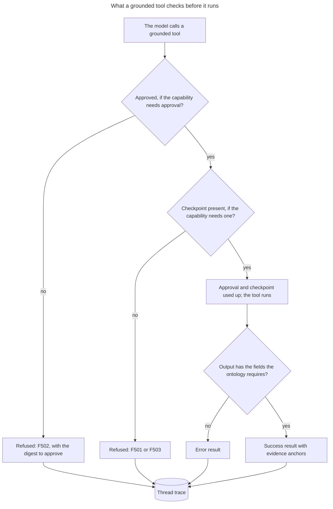
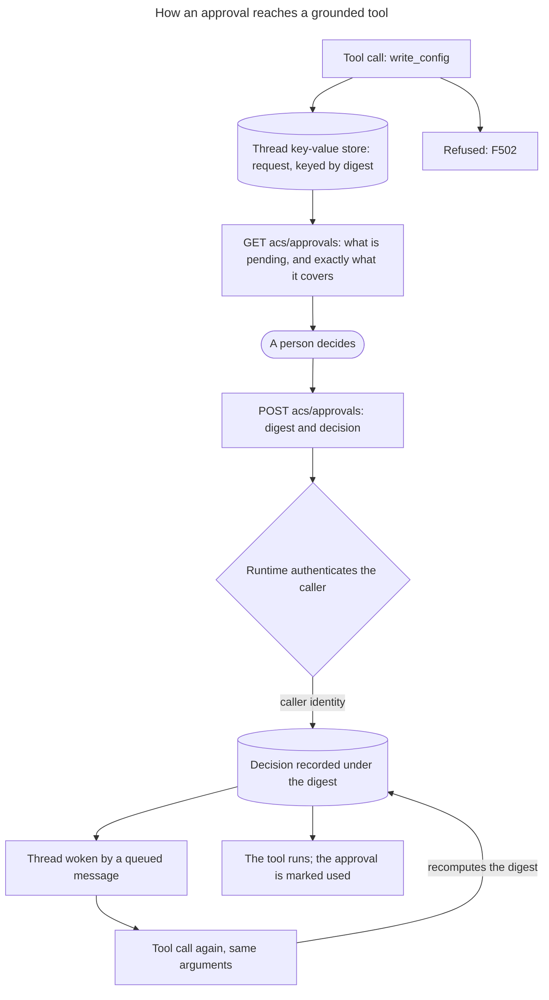
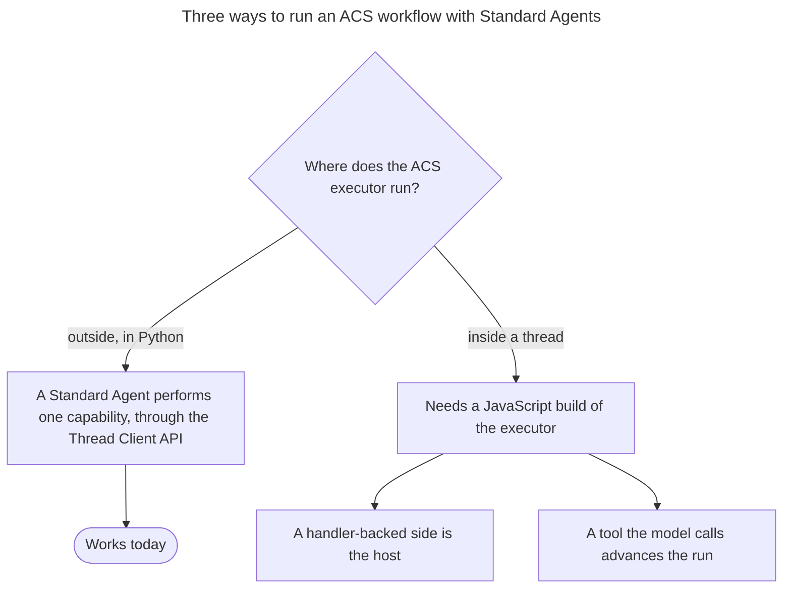

# Standard Agents interoperability

The [Standard Agent Specification](https://standardagentspec.org) defines how
an agent is written, run and packaged. The Agent Capability Standard defines
what an agent's actions mean, which of them are risky, and what must be true
before a risky one runs. This document maps the two, shows how to build a
grounded agent on Standard Agents today, and lists what each standard would
have to change for the combination to be complete.

| | Compared here |
|---|---|
| Agent Capability Standard (ACS) | [Standard 1.1.0](../../spec/STANDARD-v1.1.0.md), ontology 2.1.0 |
| Standard Agent Specification (SA) | 0.2.0, [`standardagents/spec`](https://github.com/standardagents/spec) at commit `faccc8b` (12 November 2026), and the published `@standardagents/spec` 0.45.10 types |

Statements about Standard Agents cite the page and section they come from.
Where the specification text and the published types differ, the difference
is noted. [How this analysis was done](#how-this-analysis-was-done) says what
was checked and what was not.

## Summary

- **The two standards fit together and barely overlap.** Standard Agents has
  no notion of risk, checkpoints, approval records, evidence or audit; ACS has
  no notion of prompts, models, threads or packaging.
- **A grounded Standard Agent can be built today**, using only surfaces SA
  0.2.0 specifies. [`examples/standard_agents/`](../../examples/standard_agents/README.md)
  is a working reference: a tool is classified by an ontology capability, and
  the capability's rules are enforced inside the tool. The example compiles
  against the published SA types and its rules are tested.
- **Enforcement is cooperative, not imposed.** SA has no hook that can refuse
  a tool call before it runs, so a safety rule holds only for tools written
  with the binding. A tool written without it is not covered, and neither a
  runtime nor a composing agent can add the rule from outside.
- **Approval can be recorded without a model in between**, through an
  authenticated thread endpoint, bound to a digest of exactly what was shown.
  The digest is the same one the ACS reference executor computes.
- **ACS workflows cannot yet run inside an SA runtime.** The reference
  executor is Rust with Python bindings and SA definitions are TypeScript. The
  core compiles to WebAssembly unchanged; it lacks a JavaScript interface.
- **Changes are proposed to both standards**, listed at the end. The most
  important is a hook in SA that can decline a tool call before it runs.

## What each standard covers


| Question | Standard Agents answers | ACS answers |
|----------|------------------------|-------------|
| How do I write an agent? | `defineAgent`, `definePrompt`, `defineTool` and the other definitions, in TypeScript | Not covered |
| What runs it? | A runtime that executes threads one step at a time and persists every message | Not covered for model-driven agents; a deterministic executor for workflows |
| How do I ship it? | An npm package with a `standardagent` field | Not covered |
| What does this tool do to the world? | Not covered: a tool is a description, an argument schema and a function | One of 36 capabilities, each with an input and output contract |
| Is this action risky? | Not covered | `risk`, `mutation`, `requires_checkpoint`, `requires_approval` on every capability |
| What must happen before it? | Not covered | Typed edges between capabilities, checked before a workflow runs and enforced while it runs |
| Who approved it, and what exactly? | A waiting state for a human-backed side; no approval record | A decision bound to a digest of what the approver saw |
| What is the claim based on? | Not covered | Evidence anchors on every capability output |

SA states its own boundary in the same terms. Its packaging page says: "When
an agent category needs a new runtime primitive, that primitive belongs in the
specification and its conformance surface rather than in a product-private
package/runtime agreement."
([Packaging, Portability requirements](https://standardagentspec.org/0.2.0/distribution/packaging#portability-requirements))
The proposals at the end of this document follow from that sentence.

## How the concepts map

Each table sets an ACS concept beside the nearest Standard Agents concept.
**Fit** is one of:

- *Partial*: one covers part of the other.
- *Fits*: they address different layers and combine without conflict.
- *ACS only* / *SA only*: the other standard has nothing comparable.

No row is a conflict: nowhere does following one standard as written break a
requirement of the other.

### Capabilities and tools

| ACS | Standard Agents | Fit | Combined |
|---|---|---|---|
| A capability: one of 36 verbs with an input contract, an output contract and safety flags ([§4.1](../../spec/STANDARD-v1.1.0.md#41-capability-definition)) | A function tool: a description, an argument schema and an `execute` function ([Tools §2](https://standardagentspec.org/0.2.0/specification/tools#2-function-tool-definition)) | Fits | A tool performs one capability and says which in `annotations.acs` |
| Domain parameter (`detect` with `domain: anomaly`) | Nothing comparable | ACS only | A `domain` field in the annotation |
| Input contract as JSON Schema, checked when a workflow is validated ([§5.5](../../spec/STANDARD-v1.1.0.md#55-consumer-contract-checking)) | `args` as a Zod schema, validated on every call ([Tools §9](https://standardagentspec.org/0.2.0/specification/tools#9-conformance-notes)) | Partial | The tool's `args` are the tool's contract; they specialise the capability's inputs and need not equal them |
| Output contract with required fields, `evidence_anchors` among them | A result is a status and one string; there is no output schema | ACS only | The output object is JSON in `result`; the binding checks the required fields |
| Cognitive capabilities (`classify`, `critique`, `plan`, ...) | A prompt tool: a prompt named in another prompt's `tools` ([Tools §1](https://standardagentspec.org/0.2.0/specification/tools#1-tool-categories)) | Partial | Prompts cannot carry annotations, so the classification goes on the function tools the prompt can call |
| `classify`, `detect`, `measure`: typed judgements with a confidence | `state.decide()`: typed questions answered with probabilities ([Decisions](https://standardagentspec.org/0.2.0/specification/threads/decisions)) | Partial | A grounded tool calls `decide()` and maps the answer to the capability's output |
| One capability per step ([§3.4](../../spec/STANDARD-v1.1.0.md#34-composable-atoms)) | A tool is arbitrary code and may call other tools through `uses` | Partial | Classify by the strictest capability a tool performs, or split the tool |
| Every action passes through the safety layer | Provider tools "execute server-side" at the model provider ([Providers §10](https://standardagentspec.org/0.2.0/specification/providers#10-provider-tools)) | SA only | Such a call never reaches a tool's `execute`. Offer one only where its capability needs neither checkpoint nor approval |
| Capability skills: one `SKILL.md` per capability | `state.skills`, an Agent Skills library ([Threads §7.4](https://standardagentspec.org/0.2.0/specification/threads#74-agent-skills)) | Fits | The ACS skills could be installed as guidance beside grounded tools. Whether a runtime's frontmatter check accepts their extra keys is not stated |

### Safety flags and enforcement

| ACS | Standard Agents | Fit | Combined |
|---|---|---|---|
| `risk`, `mutation`, `requires_checkpoint`, `requires_approval` on every capability | Nothing comparable. Tool `annotations` are hints with no defined keys | ACS only | The effective flags travel in `annotations.acs` |
| "Validators, executors and safety layers MUST act on effective flags" ([§5.2.1](../../spec/STANDARD-v1.1.0.md#521-safety-flags)) | A runtime must "never let them affect execution" ([Tools §9](https://standardagentspec.org/0.2.0/specification/tools#9-conformance-notes)) | Partial | The annotation may publish the flags; enforcement may not be keyed on it by a runtime. The binding enforces in the tool's own code |
| A check that refuses a step before it runs | No hook can refuse a tool call. `tool_call_started` is observational; the others run afterwards ([Hooks §5](https://standardagentspec.org/0.2.0/specification/hooks#5-tool-execution-hooks)) | ACS only | Enforcement in the tool's own `execute`. [Proposed to SA](#changes-proposed-to-the-standard-agent-specification) |
| A failing gate fires ([§5.6](../../spec/STANDARD-v1.1.0.md#56-gate-semantics)) | A hook's "failures are non-fatal to the decorated turn" | Partial | Nothing safety-relevant is placed in a hook |
| `requires` edges, checked before a workflow runs (V102) | The model chooses the calls; the runtime runs them in order | Fits | Checked per call by the tool, and per prompt by `lintPromptTools` |
| `conflicts_with`: not in the same `parallel_group` (F504) | "Tool calls **MUST** execute sequentially in the returned order" ([Runtime §5.1](https://standardagentspec.org/0.2.0/infrastructure/runtime#51-ordering)) | Fits | Cannot arise between the tool calls of one thread. Effects and endpoints run apart from them |
| Safety diagnostics with fixed codes ([§9.6](../../spec/STANDARD-v1.1.0.md#96-safety-errors)) | A tool error is a persisted result, never a halt ([Runtime §5.2](https://standardagentspec.org/0.2.0/infrastructure/runtime#52-error-handling)) | Fits | A refusal is an error result carrying the ACS code |
| Bounds on repetition: `retry.max`, `max_loops` | `maxSteps`, `maxSessionTurns`, runtime hard caps | Partial | Both apply; a model that repeats a refused call is stopped by SA's caps |

### Checkpoints, state and memory

| ACS | Standard Agents | Fit | Combined |
|---|---|---|---|
| `checkpoint`: save state for recovery | No snapshot primitive | ACS only | A grounded `checkpoint` tool saves what a rollback needs, in the thread's files or key-value store |
| `rollback`: restore a checkpoint | No restore or undo. The one statement on the subject concerns a handler that throws: "Nothing is rolled back." ([Handlers §5](https://standardagentspec.org/0.2.0/specification/handlers#5-error-semantics)) | ACS only | A grounded `rollback` tool restores what the checkpoint tool saved |
| A checkpoint record that authorises one later step | A durable, per-thread key-value store ([Runtime, Durable Key-Value Store](https://standardagentspec.org/0.2.0/infrastructure/runtime#14-durable-key-value-store)) | Fits | The record lives in the store; a later call reads it |
| A wait invalidates earlier checkpoints (W608) | `execution.flowId`, the "Unique execution ID" | Fits | A checkpoint counts only in the execution that took it |
| `persist`, `recall` | `setValue`, `getValue`; user-scope values in the Draft Users page | Partial | Thread scope maps directly. The ontology gives `persist` no scope; the skill names `session`, `project` and `global` |
| World state: `state`, `transition`, the world state schema ([§6.3](../../spec/STANDARD-v1.1.0.md#63-world-state-requirements)) | Nothing comparable: a thread holds messages, files and values | ACS only | A world model is data a grounded agent keeps in the thread |
| Run snapshot and restore (canonical JSON, SHA-256, optional HMAC) | Messages and tool results persisted before the runtime advances | Fits | Different things: SA persists the conversation, ACS the position in a workflow |

### Approval and identity

| ACS | Standard Agents | Fit | Combined |
|---|---|---|---|
| `requires_approval` on `execute`, `mutate`, `send` | No tool, prompt or agent property says an action needs approval | ACS only | The flag is in the annotation and enforced in the tool |
| Structured approval: who, what they see, digest, expiry ([§5.14](../../spec/STANDARD-v1.1.0.md#514-approval)) | The approval gate: a child with a human-backed side that parks in `awaiting_human` ([Agents §7](https://standardagentspec.org/0.2.0/specification/agents#7-human-in-the-loop-composition)) | Partial | SA defines the waiting; ACS defines what a decision is. The binding uses an authenticated endpoint rather than the gate |
| The decision binds to a digest of the shown values | Nothing comparable | ACS only | Computed by the tool from its own arguments |
| The approver, by role and number | `auth.caller` in a thread endpoint, with application `roles` ([Thread Endpoints §4](https://standardagentspec.org/0.2.0/specification/threads/endpoints#4-access-and-authentication)) | Fits | The endpoint records the authenticated caller |
| A person's answer in the conversation | A message with `role: 'user'`, which a parent or package code can also create | Partial | Not usable as proof of a decision. [Proposed to SA](#changes-proposed-to-the-standard-agent-specification) |
| `expires`; an unanswered request | A parked human turn has no deadline | ACS only | Expiry is checked by the tool when it runs |
| `standing_mandate`: pre-approval with nobody present | Nothing comparable for actions | ACS only | Not implemented in the binding |
| Agent identity and trust class ([§5.17](../../spec/STANDARD-v1.1.0.md#517-sender-identity), [RFC-0004](../../spec/RFC-0004-agent-identity.md)) | `ThreadUser`: id, role, optional application roles; the Users page is a Draft | Partial | A caller maps to a principal; trust classes have no SA counterpart |

### Evidence, provenance and audit

| ACS | Standard Agents | Fit | Combined |
|---|---|---|---|
| `evidence_anchors` on every capability output | A result is one string; `HookToolResult` has no metadata field | ACS only | Anchors travel inside `result` as JSON |
| Evidence collected after each tool call | `tool_call_done`: fires once per call, success or failure ([Hooks §5.5](https://standardagentspec.org/0.2.0/specification/hooks#55-tool_call_done)) | Partial | The hook observes every call; the tool records what a hook cannot see |
| An anchor that names its tool call | The call id reaches hooks, not the tool | Partial | Joined afterwards by the audit hook |
| An audit trail: the `audit` capability, action records | No audit or trace surface. Hooks are for "logging, validation, transformation" | ACS only | The binding's trace in the thread's key-value store |
| Append-only, tamper-evident records | Thread storage is mutable and deletable by code in the thread | ACS only | Not achievable inside the thread. Export the trace to a store outside it |
| Provenance of a received item: `sender`, trust class | `metadata.subagent_id`, `metadata.forwarded_from`: "conventions, not requirements" ([Messages §1.1](https://standardagentspec.org/0.2.0/specification/threads/messages#11-provenance-metadata-conventions)) | Partial | Not usable as a guarantee |
| Auditable transforms ([§3.2](../../spec/STANDARD-v1.1.0.md#32-auditable-transforms)) | Hooks may rewrite a result before it is stored, and filter history before each model call | Partial | A hook that rewrites results can remove evidence. A grounded agent should list its hooks and know what each changes |
| The authority trust model ([§8](../../spec/STANDARD-v1.1.0.md#8-authority-trust-model)) | Nothing comparable | ACS only | Stays in ACS |

### Composition across agents

| ACS | Standard Agents | Fit | Combined |
|---|---|---|---|
| `delegate`: assign a task to another agent | A subagent relationship and the injected `subagent_create` tool ([Subagents §5](https://standardagentspec.org/0.2.0/specification/subagents#5-lifecycle-tools)) | Partial | `subagent_create` is a `delegate`. It is injected by the runtime, so it has no `execute` to wrap |
| A waiting delegate ([§5.15](../../spec/STANDARD-v1.1.0.md#515-delegation)) | `blocking: true` on a relationship | Partial | Equivalent; SA has no timeout on the wait |
| `fresh_context`, attested in `effective` | A child is its own thread, and persists: a later call may continue it | Partial | Fresh only when a new instance was created |
| `read_only` delegation | No read-only mode for a child | ACS only | Cannot be attested. A grounded child enforces its own rules |
| `invoke`: a nested run that shares the caller's checkpoints | Prompt tools, in the same thread | Partial | A prompt tool is classified by what it does, not as `invoke` |
| `synchronize`, quorum ([§5.16](../../spec/STANDARD-v1.1.0.md#516-quorum)) | No agreement or voting construct | ACS only | Built from several children and code that counts |
| `inquire` | A human-backed side: the session parks until input arrives | Partial | A text reply that hands the turn to the person |
| Nothing comparable | `parentHooks`: hooks a child requires of its parent, failing closed ([Agents §6](https://standardagentspec.org/0.2.0/specification/agents#6-required-parent-hooks)) | SA only | A grounded child can require its audit hook on whoever composes it |
| Nothing comparable | Handoff: another agent takes over the same thread | SA only | The end of one actor's run and the start of another's |
| Safety flags of what a delegate may do | No machine-readable statement of a child's effects | ACS only | A parent cannot know that a child mutates. Each agent grounds its own tools |

### Workflows

| ACS | Standard Agents | Fit | Combined |
|---|---|---|---|
| A workflow catalog: declared steps, validated before they run ([§5](../../spec/STANDARD-v1.1.0.md#5-workflow-dsl)) | No declarative format. A model, or handler code, decides the order at run time | ACS only | See [Running ACS workflows](#running-acs-workflows-with-standard-agents) |
| The executor: a state machine that does no I/O and is driven by a host | A handler-backed side: code the runtime calls once per inbound message ([Handlers](https://standardagentspec.org/0.2.0/specification/handlers)) | Fits | A handler could be the host |
| `InvokeCapability` | `state.invokeTool(name, args)` | Partial | Needs a map from capability inputs to tool arguments |
| `RequestApproval` | An authenticated endpoint, or a human-backed child | Partial | As in the binding |
| `AwaitEvent`, `Sleep` | Inbound messages and endpoints; `scheduleEffect(name, args, delay)` | Partial | A handler resumes on a message; an effect resumes after a delay |
| Triggers: schedule, event ([§5.10](../../spec/STANDARD-v1.1.0.md#510-triggers)) | A user message, a queued message or tool, a scheduled effect. No recurring schedule | Partial | Recurrence is rebuilt from one-shot effects |
| Conditions, gates, failure modes, retries | None of these; a tool error is returned to the model | ACS only | Stay in the executor |
| `parallel_group` | One execution per thread; concurrency only across threads | Partial | Members run in order, or each as a child thread |

### Packaging, versions and conformance

| ACS | Standard Agents | Fit | Combined |
|---|---|---|---|
| A Claude Code plugin and a Python package | A packed agent: an npm package with a `standardagent` field ([Packaging](https://standardagentspec.org/0.2.0/distribution/packaging)) | Fits | A grounded agent ships as an SA package; its tools carry their annotations |
| Classification is data, readable without running code | `package.json` lists entry agents, effects, endpoints and required parent hooks; nothing about tools | Partial | A tool's annotation is readable only by loading the package |
| Workflow catalogs and domain profiles | Nothing comparable; configuration is `env` | ACS only | Shipped as data files; nothing in SA reads them |
| Conformance levels L1 to L4, for validators ([§10](../../spec/STANDARD-v1.1.0.md#10-conformance)) | Requirement lists per page and a runtime summary; no public test suite was found | Fits | Neither covers a grounded agent yet |
| Diagnostics: `code`, `name`, `severity`, `message`, `location` ([§9.8](../../spec/STANDARD-v1.1.0.md#98-diagnostic-format)) | Definition issues: `code`, `severity`, `message`, `path` | Partial | Close enough to convert; SA's codes are listed only in the published types |
| Semantic versioning, a version declared in each document ([§11](../../spec/STANDARD-v1.1.0.md#11-versioning-and-compatibility)) | Versioned folders: older versions are frozen, the current one (0.2.0) is still edited. The types package is 0.45.10 for specification 0.2.0 | Partial | A binding pins both: the specification version and the types version |
| RFCs ([Governance](../../spec/GOVERNANCE.md)) | "A conversation or a pull request is enough to propose a change" | Partial | Proposals to SA go as issues |

### What needs no mapping

Models, providers, prompts, context assembly, threads, the client API, the
file system and code execution have no ACS counterpart. A grounded agent uses
them as Standard Agents defines them. Two of them touch evidence:

- **Context hooks can hide history from the model.** `filter_messages` and
  `prefilter_llm_history` change what one model request sees, and must leave
  the stored history untouched. Evidence stays on record, but a model can be
  shown less than the record holds.
- **Secrets.** A tool declares which of its variables are `secret`. ACS has no
  rule keeping secret values out of evidence anchors, so the author of a
  grounded tool has to.

## A grounded Standard Agent today

[`examples/standard_agents/`](../../examples/standard_agents/README.md) holds
a reference binding and an agent built with it. It uses four surfaces SA 0.2.0
specifies, and nothing else:

| The binding needs | Standard Agents provides | Requirement |
|---|---|---|
| A place to describe a tool | Tool `annotations` | "`defineTool()` **MUST** return `annotations` unchanged" ([Tools §8](https://standardagentspec.org/0.2.0/specification/tools#8-annotations)) |
| Code that runs before the side effect | The tool's own `execute` | Tool calls run "sequentially in the order they were returned" ([Tools §9](https://standardagentspec.org/0.2.0/specification/tools#9-conformance-notes)) |
| State that outlives a tool call | The thread's key-value store | A write "**MUST** be visible to every subsequent `getValue(key)` on the same thread, across any execution context (tools, hooks, endpoints)" ([Runtime, Durable Key-Value Store](https://standardagentspec.org/0.2.0/infrastructure/runtime#14-durable-key-value-store)) |
| A way for a person to decide, with their identity | An authenticated thread endpoint | "The runtime **MUST** authenticate the request and enforce its thread access policy before invoking the handler" ([Thread Endpoints §4](https://standardagentspec.org/0.2.0/specification/threads/endpoints#4-access-and-authentication)) |

The first three are required of every runtime. Thread endpoints are specified
on their own page, and the Runtime page's conformance summary does not list
them, so the approval path needs a runtime that serves them.

### Classify: the `acs` annotation

A tool is classified by one ontology capability, optionally with a domain:

```typescript
annotations: {
  acs: {
    standard: '1.1.0',
    ontology: '2.1.0',
    capability: 'mutate',
    layer: 'EXECUTE',
    domain: 'config',
    risk: 'high',
    mutation: true,
    requires_checkpoint: true,
    requires_approval: true,
  },
}
```

The flags are the capability's **effective** flags
([Standard §5.2.1](../../spec/STANDARD-v1.1.0.md#521-safety-flags)): a tool
may declare stricter flags than the ontology's, never weaker ones. The schema
is
[`standard_agents_annotation.schema.json`](../../schemas/interop/standard_agents_annotation.schema.json),
generated from the ontology.

SA says annotations are "implementation-specific hints, keyed by the runtime
or tool that reads them", that the specification "defines no annotation
keys", and that a runtime "**MUST** ignore keys it does not" understand. So
`acs` is a key this binding owns, other owners' keys are left alone, and a
runtime that has never heard of ACS carries the classification untouched.

The annotation describes; it cannot enforce. SA is explicit:

> Annotations **MUST NOT** change argument validation, execution, the tool's
> results, or what is sent to the model. A tool behaves identically in a
> runtime that ignores them.

A runtime that changed its behaviour because of `acs` would not conform.
Enforcement therefore has to live somewhere else.

### Enforce: inside the tool

The Hooks page defines fourteen thread hooks. None is specified to stop a
tool call:

| Hook | When | What it can do |
|---|---|---|
| `tool_call_started` | When the call appears in the model's output | Observe. "The return value **MUST** be ignored; the hook cannot modify the tool call", and its arguments "**MAY** be an incomplete JSON fragment" |
| `after_tool_call_success`, `after_tool_call_failure` | After the tool ran | Replace the result |
| `before_store_tool_result` | Before the result is stored | Replace the result |
| `tool_call_done` | After the tool ran | Observe |

([Hooks §5](https://standardagentspec.org/0.2.0/specification/hooks#5-tool-execution-hooks).)
One message hook comes close. `before_create_message` runs before the
assistant message that carries the calls is stored, and "Failures **SHOULD**
prevent message creation", but the text does not say what then happens to the
calls. A hook also cannot be relied on to fail closed: a hook's "failures are
non-fatal to the decorated turn".

The one place where code is certain to run before a tool's side effect is the
tool's own `execute`. `groundedTool` wraps it:



A refusal is an ordinary SA error result, so the runtime stores it and the
model reads it like any other tool error ("persist tool errors as tool result
messages rather than halting execution"). It carries the ACS code and a
diagnostic in the format of
[Standard §9.8](../../spec/STANDARD-v1.1.0.md#98-diagnostic-format):

```json
{
  "status": "error",
  "error": "F501 CHECKPOINT_REQUIRED: Every earlier checkpoint has been used; each call that requires a checkpoint needs its own. Call a 'checkpoint' tool, then call write_config again.",
  "error_code": "F501",
  "error_data": {
    "code": "F501",
    "name": "CHECKPOINT_REQUIRED",
    "severity": "error",
    "message": "Every earlier checkpoint has been used; each call that requires a checkpoint needs its own.",
    "location": { "tool": "write_config", "capability": "mutate" },
    "suggestion": "Call a 'checkpoint' tool, then call write_config again."
  }
}
```

`error_code` and `error_data` are in the published `ToolResult` type but not
in the 0.2.0 text, so the code is also the first word of `error`.

The rules, and where each comes from:

| ACS rule | In the binding |
|---|---|
| A `checkpoint` must have run before `mutate`, `send` and `rollback` (`requires` edges, [§4.3](../../spec/STANDARD-v1.1.0.md#43-edge-types-and-dependency-semantics)) | A call is refused until a `checkpoint` tool has executed in the thread |
| One checkpoint authorises one step that requires one ([Running workflows](../guides/RUNNING_WORKFLOWS.md#what-the-executor-enforces)) | The newest valid checkpoint is marked used when the call runs; the next call needs its own |
| A checkpoint taken before a wait "no longer authorises the step" ([§5.13](../../spec/STANDARD-v1.1.0.md#513-waiting-for-events), W608) | A checkpoint counts only in the execution it was taken in (`state.execution.flowId`). A thread that went idle, for instance to wait for a person, needs a new one |
| An action that requires approval runs only on a valid decision ([§5.14](../../spec/STANDARD-v1.1.0.md#514-approval)) | See [Approval](#approval) |
| A refused or skipped step leaves the checkpoint valid | Nothing is used up until every check has passed |
| A capability's output has the fields its contract requires | The return type of `execute` is the capability's output contract, checked again at run time |
| A step cannot weaken a capability's flags (W602) | The `requires_*` flags can only be declared `true`; a weaker `risk` or `mutation` fails the definition |

`precedes` and `conflicts_with` edges are not enforced at run time.
`precedes` orders the steps of one workflow, and a thread has no fixed list of
steps to order. `conflicts_with` forbids two capabilities in one
`parallel_group`, and SA runs a thread's tool calls one at a time, so within a
thread the conflict cannot arise.

### Checkpoints

A checkpoint is a `checkpoint` tool like any other grounded tool: its code
saves whatever a rollback would need, and returns a `checkpoint_id`. The
wrapper records the id in the thread's key-value store, where later calls
find it.

Approval is checked before the checkpoint, as in the reference executor, and
a checkpoint counts only in the execution it was taken in. Where the executor
finds no valid checkpoint it asks its host to take one; a tool has nobody to
ask, so it refuses and names what is missing. The order that works is
therefore: ask, wait for the approval, then take the restore point and make
the change in the same execution. The restore point then describes the state
just before the change, however long the approval took.

What a checkpoint can restore is what its tool saved. In the example that is a
file in the thread's file system. SA has no snapshot or undo of its own. Of a
handler turn that fails, it says: "The inbound message stays persisted.
Nothing is rolled back."
([Handlers §5](https://standardagentspec.org/0.2.0/specification/handlers#5-error-semantics))
For an effect outside the thread, such as a sent email, a checkpoint tool can
only record enough to compensate. This is the same limit ACS has everywhere:
the standard requires that a restore point exists, and the host decides what
restoring means.

### Approval

SA's own pattern for a person's decision is the approval gate: a child agent
with a human-backed side, which "parks in `awaiting_human` until the approver
responds"
([Agents §7](https://standardagentspec.org/0.2.0/specification/agents#7-human-in-the-loop-composition)).
The specification defines "only the waiting state and its fulfillment". In
that pattern a model reads the person's reply and records the decision by
calling a tool, so what gets recorded is the model's reading of the reply.

The binding records the decision without a model in between:



- **What is approved.** The shown values are
  `[{ action, capability, args }]`: the tool's name, its capability and its
  validated arguments. Their digest is the SHA-256 of their RFC 8785 canonical
  JSON, as [§5.14](../../spec/STANDARD-v1.1.0.md#514-approval) defines it. The
  binding's digest is tested against digests the reference executor computed.
- **Who approves.** `auth.caller` in the endpoint is "the authenticated
  identity when the request presented credentials the runtime verified". The
  model cannot produce it, and the endpoint never reads model output. In the
  0.2.0 text a thread endpoint is the only place where package code is handed
  an authenticated caller.
- **Why the model cannot shortcut it.** The tool reads the decision from the
  key-value store by recomputing the digest from the arguments it was actually
  called with. A message saying "approved" changes nothing, and an approval
  for one set of arguments does not match another.
- **Single use, expiry, several approvers, roles.** As in §5.14: a decision is
  used once, may expire, may need several distinct approvers, and may be
  limited to callers holding an application role.

| §5.14 field | In the binding |
|---|---|
| `approver.kind: human` | The authenticated caller of the endpoint |
| `approver.role` | `approval.role`, checked against the caller's `roles` |
| `approver.min_approvers` | `approval.min_approvers`, counting distinct callers |
| `mode: out_of_band` | Always: the decision arrives through the endpoint, not the conversation |
| `shows`, `binds_to: digest` | The action, capability and arguments; the digest of their canonical JSON |
| `recheck` | Implicit: the digest is recomputed from the arguments at the moment the tool runs |
| `expires` | `approval.expires_ms`, counted from the last decision |
| `approver.kind: standing_mandate`, `when_unattended` | Not implemented: an unapproved call is refused, which is `when_unattended: fail` |

### Evidence and audit trail

Every ACS capability returns `evidence_anchors`. A grounded tool's `execute`
must return them, and the wrapper refuses an output without them. The result
the model sees is the capability's output as JSON, anchors included.

Each call, refused ones too, becomes an entry in a trace kept in the thread's
key-value store: the tool, its capability, a digest of its arguments, the
outcome, the checkpoint and approval it used, and its evidence anchors.

Two SA limits shape this part:

- **A tool cannot see its own call id or name.** `execute` receives the thread
  state and the arguments; hooks receive the call. The binding's
  `tool_call_done` hook therefore joins the two, giving each trace entry the
  id of the call that produced it, and adding an entry for any tool call that
  no grounded tool recorded.
- **A tool result has no metadata slot.** `HookToolResult` is `status`,
  `result`, `error`, `stack` and `attachments`. Evidence has to travel inside
  `result`, as text the model also reads.

### Checking a prompt before it runs

The ACS validator checks a workflow against the ontology before anything
runs. A prompt has no steps, but it has a fixed list of tools, and
`lintPromptTools` checks what can be checked from that list: every tool is
classified, and no tool needs a capability the prompt never offers. A prompt
with a `mutate` tool and no `checkpoint` tool is an error, because the model
could never get the call accepted.

### What this guarantees, and what it does not

| It holds | It does not hold |
|---|---|
| A grounded tool never runs its side effect without the checkpoint and approval its capability requires | A tool defined with plain `defineTool` is not covered. Nothing in SA lets the binding, a runtime or a composing agent add the check from outside |
| An approval applies to exactly the arguments shown, once | The trace is as trustworthy as the thread's key-value store: code running in the thread can write to it |
| The approver's identity is the one the runtime authenticated | Identity is as strong as the runtime's authentication, which SA leaves "implementation-defined" |
| Every grounded call is recorded, including refusals | The audit hook is best effort: a hook failure is "non-fatal", and a runtime "**SHOULD**" time hooks out |
| The classification survives packaging and any conforming runtime | No runtime acts on it |
| | A provider-executed tool never reaches `execute`, so it cannot be grounded this way |
| | Records are read and rewritten in a store with no atomic update, and SA does not say whether an endpoint can run while a tool call is in progress |

The example has been type-checked against `@standardagents/spec` 0.45.10 and
its rules are tested against an in-memory `ThreadState`. It has not been run
in a Standard Agents runtime.

## Running ACS workflows with Standard Agents

Standard Agents has no workflow format. What runs next is decided by whatever
backs a side: a model following a prompt, or handler code. ACS has a workflow
format and an executor that "does no I/O": it names the next action, a host
performs it and reports back
([Running workflows](../guides/RUNNING_WORKFLOWS.md)). The two fit as
executor and host. Three arrangements are possible, and one works today.



| Arrangement | How | State |
|---|---|---|
| The executor outside, an SA agent as one capability | The Python host answers `InvokeCapability` by creating a thread, sending the inputs as a message and reading the result, through the [Thread Client API](https://standardagentspec.org/0.2.0/specification/threads/client-api) | Works today, with any runtime that exposes that API (a runtime "**SHOULD**"). The result is the agent's last message, parsed as JSON |
| A handler as the host | A handler-backed side restores the run from the thread's key-value store on each inbound message, answers the pending action, performs the next ones and saves the run | Needs the executor in JavaScript |
| A tool the model calls | A function tool submits the model's output for the pending step and returns the next step | Needs the executor in JavaScript. Order is advisory unless every tool that can mutate guards itself, as grounded tools do |

With a handler as host, each executor action has a Standard Agents mechanism:

| Executor action | In a Standard Agents thread |
|---|---|
| `InvokeCapability` | `state.invokeTool(name, inputs)`, or a child agent for `delegate`. The result string is parsed and checked against the capability's output contract |
| `CreateCheckpoint`, `Rollback` | A grounded `checkpoint` or `rollback` tool |
| `RequestApproval` | An approval record and an authenticated endpoint, as in the binding. The executor supplies the shown values and the digest |
| `AwaitEvent` | The handler returns. An inbound message, a child's completion, or an authenticated endpoint that queues the event wakes it |
| `Sleep`, deadlines | `scheduleEffect(name, args, delay)` with an effect that queues a message |
| `Completed`, `Failed` | `state.stopSession({ result })` |
| The run between turns | `run.snapshot()` in the key-value store or a file, restored at the start of the next turn |

What stands in the way is the language, not the design. The reference core is
a Rust crate with Python bindings. It compiles for `wasm32-unknown-unknown`
without source changes, but exports no JavaScript interface, and its context
loads the ontology from file paths. See
[Changes proposed to ACS](#changes-proposed-to-the-agent-capability-standard).

Until then, the rules a workflow would enforce by position are enforced per
call by grounded tools. That covers the safety rules. It does not cover what
only a workflow has: gates, conditions, typed bindings between steps, failure
modes and recovery.

## Composing grounded agents

A Standard Agents child runs in its own thread, with its own key-value store
and files. The store's rules say: "Values **MUST NOT** be automatically
copied, inherited, or synchronized between threads when subagents are
spawned." The records the binding keeps are therefore per thread, and three
things follow.

- **Each agent grounds its own tools.** A parent's checkpoint does not cover
  what a child changes, and a parent's approval does not reach a child's
  tools. A child that mutates takes its own checkpoints and asks for its own
  approvals, in its own thread.
- **A parent cannot see what a child may do.** Nothing in a child's definition
  that a parent can read says whether it mutates. `subagent_create` is
  injected by the runtime and has no `execute` to wrap. A parent that wants to
  gate a delegation has to spawn the child from its own code, a grounded tool
  or a handler, with every relationship on that side `hidden`. The rule is
  "For a prompt-backed side with non-hidden relationships, runtimes inject
  three built-in tools", so one visible relationship brings them back. The
  text does not yet say how code names that call.
- **A child can require its audit hook of its parent.** `parentHooks` lets an
  exposed child name hooks that the composing agent must run, and a missing
  one "**MUST** fail composition closed". A grounded child can use this so
  that whoever composes it also records its use. No hook can refuse a tool
  call, so this carries observation, not enforcement.

One limit applies inside a single agent too. An agent's `hooks` are a
fallback: "If the prompt has no hooks, the agent's `hooks` array is the
parent's fallback base set"
([Hooks §1.3](https://standardagentspec.org/0.2.0/specification/hooks#13-hook-scoping)).
A prompt that lists hooks of its own drops the agent's. The audit hook has to
be listed on every prompt that should be audited.

## Packaging and conformance

A grounded agent is an ordinary Standard Agents package. The example's
[`src/package.ts`](../../examples/standard_agents/src/package.ts) exports the
registries the Packaging page describes, and a test loads each tool through
them and finds its annotation intact. The binding uses only surfaces the
specification defines (tools, the key-value store, thread endpoints, hooks),
so it meets the rule that packed definitions "MUST NOT require private runtime
RPCs".

Three things a consumer of such a package cannot yet do:

- **Read the classification without running code.** Annotations are on tool
  definitions, behind loaders. `package.json` names a package's entry agents,
  effects, endpoints and required parent hooks, and says nothing about its
  tools.
- **Claim conformance.** ACS conformance levels describe validators. Nothing
  in either standard says what it means for an agent, or a runtime, to be
  grounded.
- **Rely on a version pair.** The specification is 0.2.0; the types package
  that an agent compiles against is 0.45.10 and declares
  `SPEC_VERSION = "0.2.0"`. The two version independently, and the types
  contain members the 0.2.0 text does not define. A binding has to pin both.

## Changes proposed to the Standard Agent Specification

Each is written up as an issue for `standardagents/spec`, in the form its
maintainers use (problem, proposed rule, alternatives, conformance impact).
None has been filed yet.

| Proposal | What it would allow |
|---|---|
| **A hook that runs before a tool executes and can decline the call.** `before_tool_call` returns a result to use in place of running the tool, or nothing to let it run. A hook that fails declines the call | A safety rule imposed on tools one did not write, by an agent on itself or by a child on its parent. This is the one change that turns cooperative enforcement into imposed enforcement |
| **Record who or what sent a message.** A read-only `sender` set by the runtime, saying whether a message came from an authenticated caller, a model, a tool, package code or another thread | Telling a person's answer from a message a model or a parent queued. An approval gate built on messages cannot be trusted without it |
| **Let a tool know which call it is serving.** The call's id and name on `state.execution` while `execute` runs | Evidence, audit entries and idempotency keys tied to the stored tool result, without matching by order |
| **Specify what `execute` returns, and add a metadata field.** Define `ToolResult` in the text, carry `error_code` and `error_data` through hooks and storage, and add `metadata` that is stored but not sent to the model | Refusal codes that clients can act on, and evidence that is not model-facing text |
| **Annotations on prompts and agents, readable by code.** The same inert field on `definePrompt` and `defineAgent`, a `loadTool` beside the existing loaders, and a stated subject for the rule, so that it reads as a requirement on runtimes | A composed agent that carries a classification, and hooks that can read a tool's |
| **Editorial.** Nine places where two passages disagree, such as two sections numbered 14 on the Runtime page | Nothing for grounding; found while checking references |

Smaller points the mapping turned up, not written up as proposals: the thread
file system has no durability or isolation rules like the key-value store's;
a parked human turn has no deadline; a child returns text and files but no
structured data; and no hook list on an agent applies to all of its prompts.

## Changes proposed to the Agent Capability Standard

The mapping tested ACS against a host it was not designed around, and found
gaps of its own.

1. **Say how the rules apply to a stream of tool calls.** The Standard defines
   its rules over the steps of a workflow. For a model-driven host it has one
   sentence, "Validators, executors and safety layers MUST act on effective
   flags", and does not define a safety layer.
   This binding had to decide what a `requires` edge means over a thread's
   history, how long a checkpoint stays valid, and what an approval for a tool
   call shows. The Claude Agent SDK integration made its own choices. A
   normative profile for tool-calling hosts, with language-neutral fixtures,
   would make bindings agree. It should include the rule that one checkpoint
   authorises one step, which today is stated in the
   [guide](../guides/RUNNING_WORKFLOWS.md#what-the-executor-enforces) and the
   executor but not in the Standard, and settle a difference between the two
   reference implementations: the executor uses a checkpoint up before the
   step runs, the Python adapter after it succeeds.
2. **Define a tool binding.** The word "tool" does not occur in the Standard.
   How a concrete tool is classified exists only in the Python SDK and in this
   binding's annotation schema. A binding record (capability, domain, declared
   flags, ontology version) and its rules belong in the Standard: what an
   unclassified tool is treated as, how a tool that performs several
   capabilities is classified, and how a tool whose capability depends on its
   arguments is.
3. **Make every binding compute effective flags the same way.** The Python
   `ToolCapabilityMapper.register_mcp_tool` accepts a declared risk below the
   ontology's (`mutate` with `risk: "low"` needs no checkpoint) and an unknown
   capability id. This binding refuses both, as §5.2.1 requires.
4. **Publish the contracts as strict JSON Schema.** The ontology's schemas use
   `type: any` and unions written `string|object`, which Draft 2020-12 tools
   reject. A generated strict rendering would let a Zod-based host derive or
   check tool schemas mechanically. `evidence_anchors` also needs an item
   schema: the ontology says only `array`, and the Python SDK's anchor kinds
   (`tool_output`, `file`, `command`, `mutation`) differ from the world state
   schema's (`file`, `url`, `tool`, `log`, `sensor`, `human_note`).
5. **Ship the core for JavaScript.** A WebAssembly build of the validator and
   executor with a typed wrapper, taking parsed documents instead of file
   paths, would let ACS workflows run inside a Standard Agents thread. This is
   the roadmap's
   [multi-language SDKs](https://github.com/synaptiai/agent-capability-standard/issues/83)
   item, with one data point: the crate already compiles for
   `wasm32-unknown-unknown` unchanged. The host protocol (actions, responses,
   the snapshot envelope) should become a published schema at the same time;
   today it is described in a guide and defined in Rust types.
6. **Say what crosses a delegation.** An invoked workflow "shares the caller's
   checkpoints"; nothing equivalent is said of a delegate. On Standard Agents
   a child's effects are outside its parent's checkpoints and rollback, and the
   Standard should say so in §5.15.

Standard Agents also does several things ACS could learn from: numbered,
testable runtime rules for storage; `uses`, a declared and enforced list of
what a composite unit may call; `parentHooks`, by which a component states
what it needs of whoever composes it; and persistent delegations that can be
continued instead of restarted.

## How this analysis was done

- **Sources.** The Standard Agent Specification was read from its repository
  at commit `faccc8b`, all 24 pages of `content/0.2.0`, with the published
  `@standardagents/spec` 0.45.10 type declarations. ACS was read from this
  repository: Standard 1.1.0, the ontology, the RFCs, the reference executor
  and the Python SDK.
- **Mapping.** Ten concerns were mapped separately, each from the full text
  of both sides. A second reader, told to refute the citations, went through
  three of the ten (approval, checkpoints and state, composition) and its
  corrections are applied here. The other seven did not get that second
  reading. Every passage this document quotes was checked mechanically
  against the source files, and every statement about what Standard Agents
  requires was checked by hand against the page it cites.
- **The binding.** The example compiles against the published types under
  TypeScript's strict settings. Its rules are tested against an in-memory
  `ThreadState`, and its approval digest is tested against digests produced by
  the ACS reference executor.
- **What was not done.** The example was not run in a Standard Agents runtime,
  so nothing here is a statement about how any runtime behaves beyond what the
  specification requires of it. No runtime's source and no conformance suite
  was examined. The specification is at 0.2.0 and its maintainers edit that
  version in place; a passage quoted here may have changed since the commit
  above.
