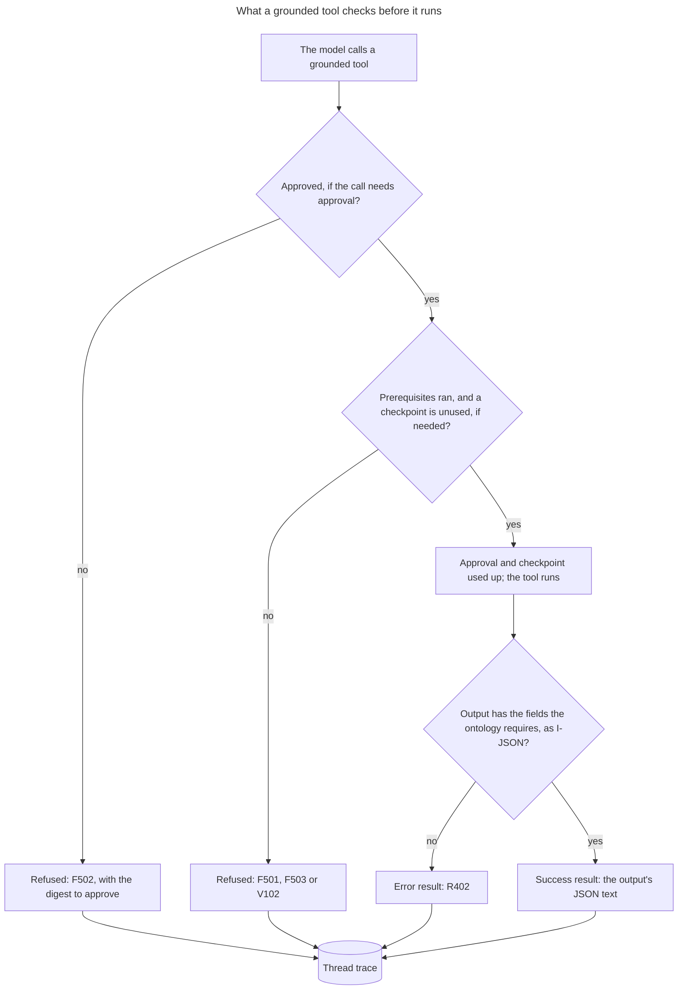
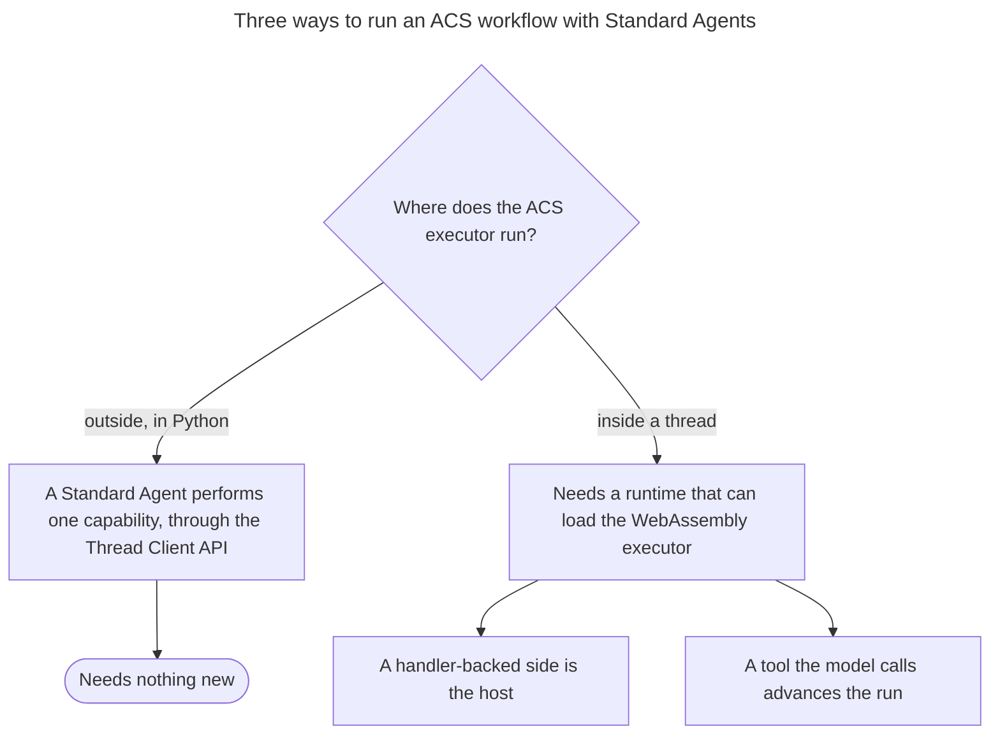

# Standard Agents interoperability

The [Standard Agent Specification](https://standardagentspec.org) defines how
an agent is written, run and packaged. The Agent Capability Standard defines
what an agent's actions mean, which of them are risky, and what must be true
before a risky one runs. This document maps the two, shows how to build a
grounded agent on Standard Agents today, and lists what each standard would
have to change for the combination to be complete.

| Standard | Compared here |
|---|---|
| Agent Capability Standard (ACS) | [Standard 1.1.0](../../spec/STANDARD-v1.1.0.md), ontology 2.1.0, for the mapping. The binding implements [Standard 1.2.0](../../spec/STANDARD-v1.2.0.md), ontology 2.2.0 |
| Standard Agent Specification (SA) | 0.2.0, [`standardagents/spec`](https://github.com/standardagents/spec) at commit `faccc8b` (12 November 2026), and the published `@standardagents/spec` 0.45.10 types |

Standard 1.2.0 added the rules for tool calls that the mapping found missing
([§5.18](../../spec/STANDARD-v1.2.0.md#518-tool-calling-hosts)). Where the
binding follows one of them, the section cited is 1.2.0's; the mapping's own
citations are 1.1.0's. Statements about Standard Agents cite the page and
section they come from.
Where the specification text and the published types differ, the difference
is noted. [How this analysis was done](#how-this-analysis-was-done) says what
was checked and what was not.

## Summary

- **The two standards fit together and barely overlap.** Standard Agents has
  no notion of risk, checkpoints, approval records, evidence or audit; ACS has
  no notion of prompts, models, threads or packaging.
- **A grounded Standard Agent can be built today** on what SA 0.2.0
  specifies. [`examples/standard_agents/`](../../examples/standard_agents/README.md)
  is a working reference: a tool is classified by an ontology capability, and
  the capability's rules are enforced inside the tool. The example compiles
  against the published SA types and its rules are tested. The binding is a
  safety layer under Standard 1.2.0 §5.18 and claims its conformance class,
  SL ([Conformance](#conformance-class-sl)).
- **Enforcement is cooperative, not imposed.** SA has no hook that can refuse
  a tool call before it runs, so a safety rule holds only for tools written
  with the binding. A tool written without it is not covered, and no hook
  lets a runtime or a composing agent add the rule from outside. The indirect
  routes SA does have are [listed below](#enforce-inside-the-tool), with what
  each costs.
- **Approval can be recorded without a model in between**, through an
  authenticated thread endpoint, bound to a digest of exactly what was shown.
  The digest is the same one the ACS reference executor computes. SA
  authenticates a caller; that the caller is a person is for the deployment
  to ensure.
- **ACS workflows can run in process from TypeScript, but not yet inside an
  SA runtime.** The reference executor is Rust; the TypeScript package
  [`@synaptiai/acs-core`](../../packages/acs-core/README.md) loads it through
  a WebAssembly JSON interface (`@synaptiai/acs-core/wasm`). SA does not say
  that definition code can load WebAssembly.
- **Changes to both standards are listed at the end.** Those to ACS are
  made: they are Standard 1.2.0. Those to SA are proposals, the most
  important a hook that can decline a tool call before it runs.

## What each standard covers


| Question | Standard Agents answers | ACS answers |
|----------|------------------------|-------------|
| How do I write an agent? | `defineAgent`, `definePrompt`, `defineTool` and the other definitions, in TypeScript | Not covered |
| What runs it? | A runtime that executes threads one step at a time and persists every message | Not covered for model-driven agents; a deterministic executor for workflows |
| How do I ship it? | An npm package with a `standardagent` field | Not covered |
| What does this tool do to the world? | Not covered: a tool is a description, an argument schema and a function | One of 36 capabilities, each with an input and output contract |
| Is this action risky? | Not covered | `risk`, `mutation`, `requires_checkpoint`, `requires_approval` on every capability |
| What must happen before it? | Not covered | Typed edges between capabilities, checked before a workflow runs and enforced while it runs |
| Who approved it, and what exactly? | A waiting state for a human-backed side; no approval record | A decision bound to a digest of what the approver saw |
| What is the claim based on? | Not covered | Evidence anchors on every capability output |

SA states its own boundary in the same terms. Its packaging page says: "When
an agent category needs a new runtime primitive, that primitive belongs in the
specification and its conformance surface rather than in a product-private
package/runtime agreement."
([Packaging, Portability requirements](https://standardagentspec.org/0.2.0/distribution/packaging#portability-requirements))
The proposals at the end of this document follow from that sentence.

### Words the two standards use differently

| Word | In ACS | In Standard Agents |
|---|---|---|
| Capability | One of the 36 verbs of the ontology | A feature or limit of a model (`ModelCapabilities`) |
| Step | One entry of a workflow | One model request and response: `stepCount` is "Total LLM request/response cycles" |
| Handler | A workflow step that runs only as an escalation target (`handler: true`, [§5.11](../../spec/STANDARD-v1.1.0.md#511-handler-steps)) | "a function that takes one side's turns in a conversation" ([Handlers](https://standardagentspec.org/0.2.0/specification/handlers)) |
| Hook | A Claude Code hook: the plugin's, or one a skill declares | A thread hook defined with `defineHook` |
| Skill | A `SKILL.md`: one per capability, and one per composed workflow | An entry in the thread owner's Agent Skills library (`state.skills`) |
| Invoke | The `invoke` capability: run another workflow as a nested run | `state.invokeTool()`: call a tool, a prompt or an agent by name from code |
| Host, runtime | The host performs the actions the executor names | The runtime executes threads |

Below, a handler is always the Standard Agents kind.

## How the concepts map

Each table sets an ACS concept beside the nearest Standard Agents concept.
The tables summarise the
[row-level mapping](../research/analysis/standard_agents_mapping/index.yaml):
319 rows in ten files, each with the passages it rests on. **Fit** is one of:

- *Partial*: one covers part of the other.
- *Fits*: they address different layers and combine without conflict.
- *ACS only* / *SA only*: the other standard has nothing comparable.

No row is a conflict: nowhere does following one standard as written break a
requirement of the other.

### Capabilities and tools

| ACS | Standard Agents | Fit | Combined |
|---|---|---|---|
| A capability: one of 36 verbs with an input contract, an output contract and safety flags ([§4.1](../../spec/STANDARD-v1.1.0.md#41-capability-definition)) | A function tool: a description, an argument schema and an `execute` function ([Tools §2](https://standardagentspec.org/0.2.0/specification/tools#2-function-tool-definition)) | Fits | A tool performs one capability and says which in `annotations.acs` |
| Domain parameter (`detect` with `domain: anomaly`) | Nothing comparable | ACS only | A `domain` field in the annotation |
| Input contract as JSON Schema, checked when a workflow is validated ([§5.5](../../spec/STANDARD-v1.1.0.md#55-consumer-contract-checking)) | `args` as a Zod schema, validated on every call ([Tools §9](https://standardagentspec.org/0.2.0/specification/tools#9-conformance-notes)) | Partial | The tool's `args` are the tool's contract; they specialise the capability's inputs and need not equal them |
| Output contract with required fields, `evidence_anchors` among them | A result is a status and one string; there is no output schema | ACS only | The output object is JSON in `result`; the binding checks the required fields |
| Cognitive capabilities (`classify`, `critique`, `plan`, ...) | A prompt tool: a prompt named in another prompt's `tools` ([Tools §1](https://standardagentspec.org/0.2.0/specification/tools#1-tool-categories)) | Partial | Prompts cannot carry annotations, so the classification goes on the function tools the prompt can call |
| `classify`, `detect`, `measure`: typed judgements with a confidence | `state.decide()`: typed questions answered with probabilities ([Decisions](https://standardagentspec.org/0.2.0/specification/threads/decisions)) | Partial | A grounded tool calls `decide()` and maps the answer to the capability's output |
| One capability per step ([§3.4](../../spec/STANDARD-v1.1.0.md#34-composable-atoms)) | A tool is arbitrary code and may call other tools through `uses` | Partial | Classify by the strictest capability a tool performs, or split the tool |
| Every action passes through the safety layer | Provider tools "execute server-side" at the model provider ([Providers §10](https://standardagentspec.org/0.2.0/specification/providers#10-provider-tools)) | SA only | Per the published types such a call is "not" to "be re-executed locally"; the 0.2.0 text does not say whether its `execute` runs. It does not pass through a grounded wrapper. Offer one only where its capability needs neither checkpoint nor approval |
| Capability skills: one `SKILL.md` per capability | `state.skills`, an Agent Skills library ([Threads §7.4](https://standardagentspec.org/0.2.0/specification/threads#74-agent-skills)) | Partial | A user or an administrator could install the ACS skills in their own library as guidance. A package cannot ship them: the library belongs to the thread's owner. Whether a runtime's frontmatter check accepts their extra keys is not stated |

### Safety flags and enforcement

| ACS | Standard Agents | Fit | Combined |
|---|---|---|---|
| `risk`, `mutation`, `requires_checkpoint`, `requires_approval` on every capability | Nothing comparable. Tool `annotations` are hints with no defined keys | ACS only | The effective flags travel in `annotations.acs` |
| "Validators, executors and safety layers MUST act on effective flags" ([§5.2.1](../../spec/STANDARD-v1.1.0.md#521-safety-flags)) | A runtime must "never let them affect execution" ([Tools §9](https://standardagentspec.org/0.2.0/specification/tools#9-conformance-notes)) | Fits | The annotation may publish the flags; enforcement may not be keyed on it by a runtime. The binding enforces in the tool's own code |
| A check that refuses a step before it runs | No hook can refuse a tool call. `tool_call_started` is observational; the others run afterwards ([Hooks §5](https://standardagentspec.org/0.2.0/specification/hooks#5-tool-execution-hooks)) | ACS only | Enforcement in the tool's own `execute`. [Proposed to SA](#changes-proposed-to-the-standard-agent-specification) |
| A gate whose expression errors fires, except an `end` gate ([§5.8.2](../../spec/STANDARD-v1.1.0.md#582-evaluation)) | A hook's "failures are non-fatal to the decorated turn" | Partial | Nothing safety-relevant is placed in a hook |
| `requires` edges, checked before a workflow runs (V102) | The model chooses the calls; the runtime runs them in order | Fits | Checked per call by the tool, and per prompt by `lintPromptTools` |
| `conflicts_with`: not in the same `parallel_group` (F504) | "Tool calls **MUST** execute sequentially in the returned order" ([Runtime §5.1](https://standardagentspec.org/0.2.0/infrastructure/runtime#51-ordering)) | Partial | Cannot arise between the tool calls of one thread. Effects and endpoints run apart from them |
| Safety diagnostics with fixed codes ([§9.6](../../spec/STANDARD-v1.1.0.md#96-safety-errors)) | A tool error is a persisted result, never a halt ([Runtime §5.2](https://standardagentspec.org/0.2.0/infrastructure/runtime#52-error-handling)) | Fits | A refusal is an error result carrying the ACS code |
| Bounds on repetition: `retry.max`, `max_loops` | `maxSteps`, `maxSessionTurns`, runtime hard caps | Fits | Both apply. A model that repeats a refused call is stopped only by a cap the agent sets (`maxSteps` and `maxSessionTurns` have no default) or by a runtime's own |

### Checkpoints, state and memory

| ACS | Standard Agents | Fit | Combined |
|---|---|---|---|
| `checkpoint`: save state for recovery | No snapshot primitive | ACS only | A grounded `checkpoint` tool saves what a rollback needs, in the thread's files or key-value store |
| `rollback`: restore a checkpoint | No restore or undo. The one statement on the subject concerns a handler that throws: "Nothing is rolled back." ([Handlers §5](https://standardagentspec.org/0.2.0/specification/handlers#5-error-semantics)) | ACS only | A grounded `rollback` tool restores what the checkpoint tool saved |
| A checkpoint record that authorises one later step | A durable, per-thread key-value store ([Runtime, Durable Key-Value Store](https://standardagentspec.org/0.2.0/infrastructure/runtime#14-durable-key-value-store)) | Fits | The record lives in the store; a later call reads it |
| A wait invalidates earlier checkpoints (W608) | `execution.flowId`, the "Unique execution ID" | Fits | A checkpoint counts only in the execution that took it |
| `persist`, `recall` | `setValue`, `getValue`; user-scope values in the Draft Users page | Partial | The thread is the `session` memory scope ([§4.5](../../spec/STANDARD-v1.2.0.md#45-memory)); the binding's `memoryTools` store `{v, data, stored_at, expires_at}` envelopes there and refuse any other scope (`unsupported_scope`) and data holding a credential (`secret_in_data`) |
| World state: `state`, `transition`, the world state schema ([§6.3](../../spec/STANDARD-v1.1.0.md#63-world-state-requirements)) | Nothing comparable: a thread holds messages, files and values | ACS only | A world model is data a grounded agent keeps in the thread |
| Run snapshot and restore (canonical JSON, SHA-256, optional HMAC) | Messages and tool results persisted before the runtime advances | Fits | Different things: SA persists the conversation, ACS the position in a workflow |

### Approval and identity

| ACS | Standard Agents | Fit | Combined |
|---|---|---|---|
| `requires_approval` on `execute`, `mutate`, `send` | No tool, prompt or agent property says an action needs approval | ACS only | The flag is in the annotation and enforced in the tool |
| Structured approval: who, what they see, digest, expiry ([§5.14](../../spec/STANDARD-v1.1.0.md#514-approval)) | The approval gate: a child with a human-backed side that parks in `awaiting_human` ([Agents §7](https://standardagentspec.org/0.2.0/specification/agents#7-human-in-the-loop-composition)) | Partial | SA defines the waiting; ACS defines what a decision is. The binding uses an authenticated endpoint rather than the gate |
| The decision binds to a digest of the shown values | Nothing comparable | ACS only | Computed by the tool from its own arguments |
| The approver, by role and number | `auth.caller` in a thread endpoint, with application `roles` ([Thread Endpoints §4](https://standardagentspec.org/0.2.0/specification/threads/endpoints#4-access-and-authentication)) | Fits | The endpoint records the authenticated caller |
| A person's answer in the conversation | A message with `role: 'user'`, which a parent or package code can also create | Partial | Not usable as proof of a decision. [Proposed to SA](#changes-proposed-to-the-standard-agent-specification) |
| `expires`; an unanswered request | A parked human turn has no deadline | ACS only | Expiry is checked by the tool when it runs and by the approval endpoint when a decision arrives |
| `standing_mandate`: pre-approval with nobody present | Nothing comparable for actions | ACS only | Not implemented in the binding |
| Agent identity and trust class ([§5.17](../../spec/STANDARD-v1.1.0.md#517-sender-identity), [RFC-0004](../../spec/RFC-0004-agent-identity.md)) | `ThreadUser`: id, role, optional application roles; the Users page is a Draft | Partial | A caller maps to a principal; trust classes have no SA counterpart |

### Evidence, provenance and audit

| ACS | Standard Agents | Fit | Combined |
|---|---|---|---|
| `evidence_anchors` on every capability output | A result is one string; `HookToolResult` has no metadata field | ACS only | Anchors travel inside `result` as JSON |
| Evidence collected after each tool call | `tool_call_done`: fires once per call, success or failure ([Hooks §5.5](https://standardagentspec.org/0.2.0/specification/hooks#55-tool_call_done)) | Partial | Where it is in the active hook set, the hook observes each tool call the model issues; the text does not say whether it fires for `invokeTool`, `queueTool`, lifecycle or provider-executed calls. The tool records what a hook cannot see |
| An anchor that names its tool call | The call id is passed to hooks, not to the tool | Partial | Joined afterwards by the audit hook |
| An audit trail: the `audit` capability, action records | No audit or trace surface. Hooks are for "logging, validation, transformation" | ACS only | The binding's trace in the thread's key-value store |
| Append-only, tamper-evident records | Thread storage is mutable and deletable by code in the thread | ACS only | Not achievable inside the thread. Export the trace to a store outside it |
| Provenance of a received item: `sender`, trust class | `metadata.subagent_id`, `metadata.forwarded_from`: "conventions, not requirements" ([Messages §1.1](https://standardagentspec.org/0.2.0/specification/threads/messages#11-provenance-metadata-conventions)) | Partial | Not usable as a guarantee |
| Auditable transforms ([§3.2](../../spec/STANDARD-v1.1.0.md#32-auditable-transforms)) | Hooks may rewrite a result before it is stored, and filter history before each model call | Partial | A hook that rewrites results can remove evidence. A grounded agent should list its hooks and know what each changes |
| The authority trust model ([§8](../../spec/STANDARD-v1.1.0.md#8-authority-trust-model)) | Nothing comparable | ACS only | Stays in ACS |

### Composition across agents

| ACS | Standard Agents | Fit | Combined |
|---|---|---|---|
| `delegate`: assign a task to another agent | A subagent relationship and the injected `subagent_create` tool ([Subagents §5](https://standardagentspec.org/0.2.0/specification/subagents#5-lifecycle-tools)) | Partial | `subagent_create` is a `delegate`. It is injected by the runtime, so it has no `execute` to wrap |
| A waiting delegate ([§5.13](../../spec/STANDARD-v1.1.0.md#513-waiting-for-events)) | `blocking: true` on a relationship | Partial | The same shape; SA has no timeout on the wait. A host can also wait on a non-blocking child: see [How a `delegate` step maps to a host](#how-a-delegate-step-maps-to-a-host) |
| `fresh_context`, attested in `effective` | A child is its own thread, and persists: a later call may continue it | Partial | Fresh only when a new instance was created |
| `read_only` delegation | No read-only mode for a child | ACS only | Cannot be attested. A grounded child enforces its own rules |
| `invoke`: a nested run that shares the caller's checkpoints | Prompt tools, in the same thread | Partial | A prompt tool is classified by what it does, not as `invoke` |
| `synchronize`, quorum ([§5.16](../../spec/STANDARD-v1.1.0.md#516-quorum)) | No agreement or voting construct | ACS only | Built from several children and code that counts |
| `inquire` | A human-backed side: the session parks until input arrives | Fits | A tool returns the questions and the model puts them to the person in a reply that hands over the turn |
| Nothing comparable | `parentHooks`: hooks a child requires of its parent, failing closed ([Agents §6](https://standardagentspec.org/0.2.0/specification/agents#6-required-parent-hooks)) | SA only | A grounded child can require its audit hook on whoever composes it |
| Nothing comparable | Handoff: another agent takes over the same thread | SA only | The end of one actor's run and the start of another's: the host cancels the source agent's ACS run if it has not ended (§5.17, §5.19.5 of 1.2); a run that ended `deferred` may instead be resumed under the agent that took over (§5.14.1). A saved run is never restored under it |
| Safety flags of what a delegate may do | No machine-readable statement of a child's effects | ACS only | A parent cannot know that a child mutates. Each agent grounds its own tools |

### Workflows

| ACS | Standard Agents | Fit | Combined |
|---|---|---|---|
| A workflow catalog: declared steps, validated before they run ([§5](../../spec/STANDARD-v1.1.0.md#5-workflow-dsl)) | No declarative format. A model, or handler code, decides the order at run time | ACS only | See [Running ACS workflows](#running-acs-workflows-with-standard-agents) |
| The executor: a state machine that does no I/O and is driven by a host | A handler-backed side: code the runtime calls once per inbound message ([Handlers](https://standardagentspec.org/0.2.0/specification/handlers)) | Fits | A handler could be the host |
| `InvokeCapability` | `state.invokeTool(name, args)` | Partial | Needs a map from capability inputs to tool arguments |
| `RequestApproval` | An authenticated endpoint, or a human-backed child | Partial | As in the binding |
| `AwaitEvent`, `Sleep` | Inbound messages and endpoints; `scheduleEffect(name, args, delay)` | Partial | A handler resumes on a message; an effect resumes after a delay |
| Triggers: schedule, event ([§5.10](../../spec/STANDARD-v1.1.0.md#510-triggers)) | A user message, a queued message or tool, a scheduled effect. No recurring schedule | Partial | Recurrence is rebuilt from one-shot effects |
| Conditions, gates, failure modes, retries | None of these; a tool error is returned to the model | ACS only | Stay in the executor |
| `parallel_group` | One execution per thread; concurrency only across threads | Partial | Members run in order. The reference executor issues one action at a time, so running each member as a child thread needs a host that schedules the group itself |

### Packaging, versions and conformance

| ACS | Standard Agents | Fit | Combined |
|---|---|---|---|
| A Claude Code plugin and a Python package | A packed agent: an npm package with a `standardagent` field ([Packaging](https://standardagentspec.org/0.2.0/distribution/packaging)) | Fits | A grounded agent ships as an SA package; its tools carry their annotations |
| Classification is data, readable without running code | `package.json` lists entry agents, effects, endpoints and required parent hooks; nothing about tools | Partial | A tool's annotation is readable only by loading the package |
| Workflow catalogs and domain profiles | Nothing comparable; configuration is `env` | ACS only | Shipped as data files; nothing in SA reads them |
| Conformance levels L1 to L4, for validators ([§10](../../spec/STANDARD-v1.1.0.md#10-conformance)) | Requirement lists per page and a runtime summary; no public test suite was found | Fits | Neither covers a grounded agent yet |
| Diagnostics: `code`, `name`, `severity`, `message`, `location` ([§9.8](../../spec/STANDARD-v1.1.0.md#98-diagnostic-format)) | Definition issues: `code`, `severity`, `message`, `path` | Partial | Close enough to convert; SA's codes are listed only in the published types |
| Semantic versioning, a version declared in each document ([§11](../../spec/STANDARD-v1.1.0.md#11-versioning-and-compatibility)) | Versioned folders: older versions are frozen, the current one (0.2.0) is still edited. The types package is 0.45.10 for specification 0.2.0 | Partial | A binding pins both: the specification version and the types version |
| RFCs ([Governance](../../spec/GOVERNANCE.md)) | "A conversation or a pull request is enough to propose a change" | Partial | Proposals to SA go as issues |

### What needs no mapping

Models, providers, prompts, context assembly, threads, the client API, the
file system and code execution have no ACS counterpart. A grounded agent uses
them as Standard Agents defines them. There is one point of contact: ACS asks
a host to attest a delegate's `model_family`
([§5.15](../../spec/STANDARD-v1.1.0.md#515-delegation)), and SA reports no
model family for a child. Two of them touch evidence:

- **Context hooks can hide history from the model.** `filter_messages` and
  `prefilter_llm_history` change what one model request sees, and must leave
  the stored history untouched. Evidence stays on record, but a model can be
  shown less than the record holds.
- **Secrets.** A tool declares which of its variables are `secret`. Standard
  1.2.0 keeps secrets out of evidence, records, notifications, diagnostics
  and stored memory
  ([§6.7](../../spec/STANDARD-v1.2.0.md#67-secrets-in-records)): the binding
  redacts every trace entry it writes with default patterns, and
  `configureLayer({ secrets })` registers the deployment's own values for
  every entry, the audit hook's for plain tools included, and for the data a
  `persist` or `audit` call would store (a grounded tool's `secrets` option,
  and `recordToolCall`'s, add more). An evidence anchor that held a secret
  keeps no `digest` of what it cites (its metadata says `digest_omitted:
  secret`): the redacted excerpt would show the text to check a guess
  against.

## A grounded Standard Agent today

[`examples/standard_agents/`](../../examples/standard_agents/README.md) holds
a reference binding and an agent built with it. Its enforcement rests on four
surfaces SA 0.2.0 specifies:

| The binding needs | Standard Agents provides | Requirement |
|---|---|---|
| A place to describe a tool | Tool `annotations` | "`defineTool()` **MUST** return `annotations` unchanged" ([Tools §8](https://standardagentspec.org/0.2.0/specification/tools#8-annotations)) |
| Code that runs before the side effect | The tool's own `execute` | Tool calls run "sequentially in the order they were returned" ([Tools §9](https://standardagentspec.org/0.2.0/specification/tools#9-conformance-notes)) |
| State that outlives a tool call | The thread's key-value store | A write "**MUST** be visible to every subsequent `getValue(key)` on the same thread, across any execution context (tools, hooks, endpoints)" ([Runtime, Durable Key-Value Store](https://standardagentspec.org/0.2.0/infrastructure/runtime#14-durable-key-value-store)) |
| A way for a person to decide, with their identity | An authenticated thread endpoint | "The runtime **MUST** authenticate the request and enforce its thread access policy before invoking the handler" ([Thread Endpoints §4](https://standardagentspec.org/0.2.0/specification/threads/endpoints#4-access-and-authentication)) |

The first three are required of every runtime. Thread endpoints are specified
on their own page, and the Runtime page's conformance summary does not list
them, so the approval path needs a runtime that serves them. Around those
four the example also uses a `tool_call_done` hook for the audit trail,
`state.execution.flowId` to tell one execution from the next, `queueMessage`
to wake the thread after a decision, and the thread file system for its
restore point.

### Classify: the `acs` annotation

A tool's `acs` annotation carries its **tool binding record**
([Standard 1.2.0 §5.18.1](../../spec/STANDARD-v1.2.0.md#5181-tool-bindings)), the record a safety
layer reads to know what a call of the tool does. `groundedTool` writes it
from the tool's definition. For the example's `write_config`:

```typescript
annotations: {
  acs: {
    standard: '1.2.0',
    ontology: '2.2.0',
    tool: 'write_config',
    capability: 'mutate',
    layer: 'EXECUTE',
    domain: 'config',
    approval: { expires: '15m' },
    risk: 'high',
    mutation: true,
    requires_checkpoint: true,
    requires_approval: true,
  },
}
```

| Member | What it holds |
|---|---|
| `tool` | The name the tool states for itself: what an approver is shown and the trace records. It must be the name the prompt offers the tool under (V111) |
| `ontology`, `capability`, `domain` | The ontology version, the capability the tool performs, and the capability's domain parameter |
| `flags` | Flags the tool declares stricter than its capability's ([§5.2.1](../../spec/STANDARD-v1.2.0.md#521-safety-flags)). A weaker one has no effect (W602); `groundedTool` refuses it when the tool is defined |
| `additional_capabilities` | Other capabilities each call performs. A call takes the strictest flags and every prerequisite of all of them ([§5.18.3](../../spec/STANDARD-v1.2.0.md#5183-classification)) |
| `invokes` | The tools it calls while it runs ([Composite tools](#composite-tools)) |
| `approval` | Who may approve the tool's calls, how many, and for how long |
| `standard` | The Standard the annotation follows |
| `layer`, `risk`, `mutation`, `requires_checkpoint`, `requires_approval` | Informative copies of the capability's layer and the tool's **effective** flags. A layer ignores them and computes the flags from the record |

The schema is
[`standard_agents_annotation.schema.json`](../../schemas/interop/standard_agents_annotation.schema.json),
generated from the ontology. It refuses a copy that names another layer than
the capability's or a flag weaker than the ontology's, so a reader that does
use the copies is not misled. A tool with no `acs` annotation is **unbound**:
[§5.18.2](../../spec/STANDARD-v1.2.0.md#5182-unbound-tools) treats each of its calls as the strictest
case, high risk with a checkpoint and an approval. A tool that only signals
the host carries `{ standard, ontology, tool, control: true }` instead
([Control tools](#control-tools)).

SA says annotations are "implementation-specific hints, keyed by the runtime
or tool that reads them", that the specification "defines no annotation
keys", and that a runtime "**MUST** ignore keys it does not" understand. So
`acs` is a key this binding owns, other owners' keys are left alone, and a
runtime that has never heard of ACS carries the classification untouched.

The annotation describes; it cannot enforce. SA is explicit:

> Annotations **MUST NOT** change argument validation, execution, the tool's
> results, or what is sent to the model. A tool behaves identically in a
> runtime that ignores them.

A runtime that changed its behaviour because of `acs` would not conform.
Enforcement therefore has to live somewhere else.

### Which construct for which capability

Any capability can be a function tool. The table gives the construct that
suits each layer, as the
[row-level mapping](../research/analysis/standard_agents_mapping/index.yaml)
works it out.

| Layer | Capabilities | On Standard Agents |
|---|---|---|
| PERCEIVE | `retrieve`, `search`, `observe`, `receive` | Function tools over the thread's own reads (`readFile`, `grepFiles`, `getMessages`, `status()`). `receive` is inbound traffic: a client's message, a thread endpoint, a child's completion. A search the model's provider executes passes through no tool, so nothing anchors its sources |
| UNDERSTAND | `detect`, `classify`, `measure`, `predict`, `compare`, `discover` | A prompt tool, or a function tool that asks `state.decide()` for a typed judgement and maps the answer to the capability's output |
| REASON | `plan`, `decompose`, `critique`, `explain` | Prompt tools. Every capability in the layer is low risk, so no flag needs enforcing |
| MODEL | `state`, `transition`, `attribute`, `ground`, `simulate` | The world model is data the agent keeps in thread files or values, one version per change. `ground` is a function tool that resolves the cited records and asks `state.decide()` whether they support the claim |
| SYNTHESIZE | `generate`, `transform`, `integrate` | A model step that must call one output tool whose arguments mirror the capability's output. The tool checks that each anchor resolves |
| EXECUTE | `execute`, `mutate`, `send` | Grounded function tools, behind approval and, for `mutate` and `send`, a checkpoint. `execute` can run on `state.runCode` where the runtime has it. A `send` scheduled as an effect can still be cancelled before it goes out |
| VERIFY | `verify`, `checkpoint`, `rollback`, `constrain`, `audit` | Grounded function tools. A quorum on `constrain` is counted by code, from one child per reviewer. `audit` is a tool, backed by the audit hook |
| REMEMBER | `persist`, `recall` | Function tools over `setValue` and `getValue`, under a key prefix of their own, with expiry checked on read |
| COORDINATE | `delegate`, `synchronize`, `invoke`, `inquire` | `delegate` is the injected `subagent_create`, or a grounded tool that creates the child. `synchronize` is code over several children. `invoke` is a nested ACS workflow and stays inside the executor; a prompt tool is classified by what it does. `inquire` is a tool whose questions the model then puts to the person |

### Enforce: inside the tool

The Hooks page defines fourteen thread hooks. None is specified to stop a
tool call:

| Hook | When | What it can do |
|---|---|---|
| `tool_call_started` | When the call appears in the model's output | Observe. "The return value **MUST** be ignored; the hook cannot modify the tool call", and its arguments "**MAY** be an incomplete JSON fragment" |
| `after_tool_call_success`, `after_tool_call_failure` | After the tool ran | Replace the result |
| `before_store_tool_result` | Before the result is stored | Replace the result |
| `tool_call_done` | After the tool ran | Observe |

([Hooks §5](https://standardagentspec.org/0.2.0/specification/hooks#5-tool-execution-hooks).)
One message hook comes close. `before_create_message` runs before the
assistant message that carries the calls is stored, and "Failures **SHOULD**
prevent message creation", but the text does not say what then happens to the
calls. The published types add that a runtime "can still perform an insertion
that an execution cannot go on without, such as the message of a model step",
so a failure there does not stop the calls. A hook also cannot be relied on to
fail closed: a hook's "failures are non-fatal to the decorated turn".

SA gives an author's code three other positions ahead of a tool call. Each
has a cost:

- **A provider extension.** An override of `generate` or `stream` returns
  the response that carries the tool calls
  ([Providers §1.3](https://standardagentspec.org/0.2.0/specification/providers#13-provider-extension-factories)),
  so it could drop or replace a call. It receives the thread's `state` only
  "when the runtime has one"
  ([Infrastructure: Providers](https://standardagentspec.org/0.2.0/infrastructure/providers#method-overrides)).
  It belongs to a model definition, not to an agent. It does not see calls made through `invokeTool` or `queueTool`, or
  by a child's models, and the text does not say that a runtime executes only
  the calls an override returns.
- **A handler-backed side.** Code takes that side's turns and can be the only
  caller of the tools that mutate. This changes the agent's shape: the model
  proposes and the handler acts.
- **A guard tool.** A grounded tool can front a tool it did not write and
  reach it through `state.invokeTool()` under `uses`. The model must then be
  unable to call the fronted tool directly, and the 0.2.0 text does not say
  what a runtime does with a call to a tool the prompt did not offer.

The one place where code is certain to run before a tool's side effect is the
tool's own `execute`. `groundedTool` wraps it:



A refusal is an ordinary SA error result, so the runtime stores it and the
model reads it like any other tool error ("persist tool errors as tool result
messages rather than halting execution"). It carries the ACS code, the text
form `CODE NAME: message` of
[§5.18.8](../../spec/STANDARD-v1.2.0.md#5188-refusals-records-and-failure), and a diagnostic in the
format of [§9.8](../../spec/STANDARD-v1.2.0.md#98-diagnostic-format):

```json
{
  "status": "error",
  "error": "F501 CHECKPOINT_REQUIRED: Every earlier checkpoint has been used; each call that requires a checkpoint needs its own. Call a 'checkpoint' tool, then call write_config again.",
  "error_code": "F501",
  "error_data": {
    "code": "F501",
    "name": "CHECKPOINT_REQUIRED",
    "severity": "error",
    "message": "Every earlier checkpoint has been used; each call that requires a checkpoint needs its own.",
    "location": { "tool": "write_config", "capability": "mutate" },
    "suggestion": "Call a 'checkpoint' tool, then call write_config again."
  }
}
```

`error_code` and `error_data` are defined only in the published `ToolResult`
type. The 0.2.0 text uses `error_code` once, in a Runtime Streams example, and
defines neither, so the code is also the first word of `error`.

The rules, and where each comes from:

| ACS rule | In the binding |
|---|---|
| Each capability a call's capabilities `requires` has run earlier in the scope ([§5.18.5](../../spec/STANDARD-v1.2.0.md#5185-scope-order-and-concurrency)) | A call is refused until a tool of each prerequisite has completed in the thread: F501 for a missing checkpoint, F503 for a rollback with none, V102 for any other |
| One checkpoint authorises one call that requires one ([§5.2.2](../../spec/STANDARD-v1.2.0.md#522-checkpoint-use), [§5.18.6](../../spec/STANDARD-v1.2.0.md#5186-checkpoints-for-calls)) | The newest valid checkpoint is marked used when the call is allowed; the next call needs its own |
| A checkpoint stops authorising at a boundary of the scope, and after 30 minutes at most ([§5.18.6](../../spec/STANDARD-v1.2.0.md#5186-checkpoints-for-calls)) | A checkpoint counts only in the execution it was taken in (`state.execution.flowId`), and for ten minutes at most, less where a tool sets `checkpoint_max_age_ms`. A thread that went idle, for instance to wait for a person, needs a new one |
| A call that requires approval runs only on a valid decision for exactly that call ([§5.18.7](../../spec/STANDARD-v1.2.0.md#5187-approval-for-calls)) | See [Approval](#approval) |
| A refused call uses nothing ([§5.18.6](../../spec/STANDARD-v1.2.0.md#5186-checkpoints-for-calls)) | Nothing is used up until every check has passed |
| A capability output carried as a string is the I-JSON text of the output object, with every required field ([§5.18.9](../../spec/STANDARD-v1.2.0.md#5189-text-only-results)) | The return type of `execute` is the capability's output contract. At run time the wrapper checks that every required field is present, that `evidence_anchors` is an array, that a required `confidence` is a number from 0 to 1, and that the output is I-JSON; it returns the text, or R402 |
| A binding cannot weaken a capability's flags (W602) | The `requires_*` flags can only be declared `true`; a weaker `risk` or `mutation` fails the definition |
| The arguments of a call that requires approval are I-JSON ([§5.18.7](../../spec/STANDARD-v1.2.0.md#5187-approval-for-calls)) | A call that needs approval whose arguments are not I-JSON (a lone surrogate, a number written as an integer beyond ±2^53) is refused with F502 before anything is asked or used: no decision can bind to them. The runtime parses a call's arguments before the tool sees them, so an integer literal beyond 2^53 arrives rounded and is checked, digested and run as rounded (a host gap the statement names) |
| A layer that cannot complete its checks refuses the call, and every call is recorded with the layer that decided it ([§5.18.8](../../spec/STANDARD-v1.2.0.md#5188-refusals-records-and-failure)) | A store write that fails, or the arguments of a call that needs no approval with no canonical JSON, refuse the call with R407. A call that ran but whose record cannot be completed returns R407 in place of its result. Each entry a grounded or control tool writes, refusals and the layer's own failures included, names the layer (`recorded_by`: the binding's name, the Standard version and a digest of the tool's annotation and checkpoint maximum age); only the audit hook's entry for a call no grounded tool recorded has none |

As [§5.18.5](../../spec/STANDARD-v1.2.0.md#5185-scope-order-and-concurrency) states, `precedes` and
`conflicts_with` edges are not enforced over calls. `precedes` orders the
steps of one workflow, and a thread has no fixed list of steps to order.
`conflicts_with` forbids two capabilities in one `parallel_group`, and SA
runs a thread's tool calls one at a time, so within a thread the conflict
cannot arise.

### Sends and memory

Every grounded `send` tool obeys the destination policies the layer puts in
force ([§4.4.2](../../spec/STANDARD-v1.2.0.md#442-transmissions)):
`configureLayer({destinations, profiles})` in the module that defines
the agent's tools, before them (`profiles` are domain profiles every grounded
tool applies, as `bindingProfiles` checked them, their
`allowed_destinations` joining the host's; `profilePolicy`, the core's
`CoreContext.profilePolicy(profiles)`, adds the destinations alone, and is
refused when it also sets a minimum confidence or grounding policies, which
it would not put in force). A call whose destination no policy allows, or is not a string, is
refused with F504 before any approval is asked for. The tool's `destination`
option says where the destination is: an RFC 6901 pointer into the
arguments (`destination: '/to'`, which the annotation states as the
binding record's `destination`) or a function of them (`(args) =>
args.to`). A `send` tool defined without it has a destination the layer
cannot tell, so while any policy is in force every call of it is refused
with F504 ([§5.18.10](../../spec/STANDARD-v1.2.0.md#51810-capability-checks)):
the layer does not guess an argument (`destination`, say) that the model can
set to an allowed value while the tool's code sends elsewhere. A tool's own
`profiles` add their
policies, and a composite's reach the sends its code invokes, at any depth.
`memoryTools()` gives a `persist` and a `recall` tool on the
thread's store (scope `session`), which apply its `profiles` and
`grounding` options and the layer's profiles as any grounded tool does, and pass the session cases of
`tests/conformance/memory/store.json`. Its entries survive a restart of the
host (the runtime MUST keep thread values across process restarts and
redeploys), are retained while the thread lasts unless their `ttl` ends
them, and are limited to `max_value_bytes` per value (1,000,000 by
default), with no limit of the binding's on their number: the runtime's
own caps on key length, value size and key count, which it MAY set, apply
(§4.5, what a host states).

### Checkpoints

A checkpoint is a `checkpoint` tool like any other grounded tool: its code
saves whatever a rollback would need, and returns a `checkpoint_id`. The
wrapper records the id in the thread's key-value store, where later calls
find it.

Approval is checked before the checkpoint, as in the reference executor, and
a checkpoint counts only in the execution it was taken in, and for ten minutes
at most ([§5.18.6](../../spec/STANDARD-v1.2.0.md#5186-checkpoints-for-calls) allows up to 30). The time
limit is the rule the binding guarantees. The execution rule
rests on each execution of a thread having its own `flowId`; the 0.2.0 text
calls it the "Unique execution ID" and says no more, so that rule holds as far
as a runtime issues a new id when an idle thread runs again. A call made
outside an execution, as from a thread endpoint, has no `flowId`, and
neither a checkpoint nor an approval authorises it: SA runs one execution of a
thread at a time and does not serialise endpoint requests with it. Where the executor
finds no valid checkpoint it asks its host to take one; a tool has nobody to
ask, so it refuses and names what is missing. The order that works is
therefore: ask, wait for the approval, then take the restore point and make
the change in the same execution. The restore point then describes the state
just before the change, however long the approval took.

What a checkpoint can restore is what its tool saved. In the example that is a
file in the thread's file system. SA has no snapshot or undo of its own. Of a
handler turn that fails, it says: "The inbound message stays persisted.
Nothing is rolled back."
([Handlers §5](https://standardagentspec.org/0.2.0/specification/handlers#5-error-semantics))
For an effect outside the thread, such as a sent email, a checkpoint tool can
only record enough to compensate. This is the same limit ACS has everywhere:
the standard requires that a restore point exists, and the host decides what
restoring means.

### Approval

SA's own pattern for a person's decision is the approval gate: a child agent
with a human-backed side, which "parks in `awaiting_human` until the approver
responds"
([Agents §7](https://standardagentspec.org/0.2.0/specification/agents#7-human-in-the-loop-composition)).
The specification defines "only the waiting state and its fulfillment". In
that pattern a model reads the person's reply and records the decision by
calling a tool, so what gets recorded is the model's reading of the reply.

The binding records the decision without a model in between:


- **What is approved.** The shown values are
  `[{ action, capability, args }]`: the tool's name, its capability and its
  validated arguments, as [§5.18.7](../../spec/STANDARD-v1.2.0.md#5187-approval-for-calls) defines them
  for a call. Their digest is the SHA-256 of their RFC 8785 canonical JSON,
  as [§5.14](../../spec/STANDARD-v1.2.0.md#514-approval) defines it. The binding's digest is tested
  against digests the reference executor computed, the `tool_call` vectors
  among them.
- **Who approves.** `auth.caller` in the endpoint is "the authenticated
  identity when the request presented credentials the runtime verified". The
  model cannot produce it, and the endpoint never reads model output. Outside
  the Draft Users page, a thread endpoint is the only place in the 0.2.0 text
  where package code is handed an authenticated caller.
- **A caller is not necessarily a person.** A runtime may authenticate an API
  key as well as a session, and `ThreadUser` does not say which kind of party
  it describes. `approver.kind: human` is therefore asserted by the
  deployment, not attested by SA. A deployment has to keep every credential
  the runtime accepts out of reach of the agent's tools; a tool that can make
  an HTTP request with such a credential could approve its own request.
- **Why the model cannot shortcut it.** The tool reads the decision from the
  key-value store by recomputing the digest from the arguments it was actually
  called with. A message saying "approved" changes nothing, and an approval
  for one set of arguments does not match another.
- **Single use, expiry, several approvers, roles.** As in §5.14, a decision is
  used once, may expire and may need several distinct approvers. The binding
  also checks `approver.role`, which §5.14 names without saying how it is
  checked, against the caller's application roles. A decision is made on one
  round of a request. Once a round is rejected, expired or used, a call with the
  same values opens the next round, and a decision sent for a closed round (one
  made on a list loaded before another approver rejected, or a client's retry
  after the approval was used) is refused with 409. The same decision sent
  again for its own round is answered as the first was.
- **The settings are part of the tool.** The role, the number of approvers
  and the expiry are fixed in the tool's definition. They are not read from
  `state.env()`, which code in the thread can set. `groundedTool` refuses,
  when the tool is defined, a `min_approvers` that is not an integer of at
  least 1 and an `expires_ms` that is not a number of milliseconds above zero.
- **Decisions that arrive together.** Nothing serialises two endpoint
  requests, and the key-value store has no conditional write. A decision
  therefore never rewrites the request: a rejection sets one fixed key, and
  each approval is stored under the approver's own key. A request can lose an
  approval that way, and never a rejection. A rejection can also arrive while a
  call that read the request as approved is starting. The tool marks the
  approval used and then looks for a rejection; the endpoint stores the
  rejection and then looks for that mark. At least one of the two sees the
  other, so a rejection the endpoint answers as recorded always stops the
  call, and one that arrives after the call used the approval is answered 409.

| §5.14 field | In the binding |
|---|---|
| `approver.kind: human` | The authenticated caller of the endpoint, recorded as an approver identity per the identity map (`endpoint_caller`): principal `sa-user:<id>`, `kind: human` as the deployment's assertion, `role` when the caller holds the requested one, `authenticated_by: x-acs.sa-caller`, and `trust_class: owner` when the caller owns the thread. The trace entry's `approval` carries the approvers that counted when the call ran (an approval that had lapsed is not listed): their principals in `approvers` and their `approver_identities` (§5.17 of 1.2) |
| `approver.role` | `approval.role`, checked against the caller's `roles` |
| `approver.min_approvers` | `approval.min_approvers`, an integer of at least 1, counting distinct callers whose approval has not expired |
| `mode` | Decisions arrive through an authenticated endpoint, separate from the conversation: `out_of_band` (§5.14 of 1.2) |
| `shows`, `binds_to: digest` | The action, capability and arguments; the digest of their canonical JSON, which the endpoint takes in either case and stores in lowercase |
| `recheck` | Implicit: the digest is recomputed from the arguments at the moment the tool runs |
| `expires` | `approval.expires_ms`. As in the reference executor, no approval is accepted later than `expires_ms` after the request, and one stored later counts for nothing. Each approval then counts for `expires_ms` after it was given: the executor uses a decision when it arrives, a tool when the model calls again, so a request can be used up to twice `expires_ms` after it was made, however many approvers decide. A rejection is accepted until the request is used or expires, since it can only stop the call |
| `approver.kind: standing_mandate`, `when_unattended` | Not implemented: an unapproved call is refused, which is `when_unattended: fail` |

### Composite tools

A grounded tool can call other tools while it runs, through
`state.invokeTool()`. It lists them in `invokes`, by the names the runtime
knows them under ([§5.18.4](../../spec/STANDARD-v1.2.0.md#5184-composite-tools)):

```typescript
export default groundedTool({
  name: 'apply_change',
  capability: 'mutate',
  invokes: { write_config: writeConfig, verify_config: verifyConfig },
  // ...
});
```

- **Flags and approval.** The composite takes the effective flags of every
  tool it lists, transitively, joined with its own, and the approval they
  need: the most approvers, the shortest expiry, and a role one of them
  sets (its own first), since its approval covers their nested calls. A
  listed tool is one defined with `groundedTool` or `controlTool`, or with
  plain `defineTool` and an `acs` annotation that loads as a binding record;
  one with no binding the binding loads throws when the composite is
  defined (V107).
- **The list is enforced twice.** The binding passes the names as the tool's
  `uses`, so a runtime that enforces `uses` refuses an invocation outside the
  list. The wrapper refuses one itself (F504) and records it.
- **Nesting tokens.** Each invocation the composite's own code makes while
  it runs issues a one-shot token for that tool, those arguments and that
  execution, carrying what the composite's call held. A grounded tool that
  takes a token is covered by the composite's approval and checkpoint: it
  needs neither again, and its trace entry names the composite's
  (`covered_by`), when the decisions that approved the composite are valid
  for its own approval too (its role, approvers and expiry), and, if it
  needs a checkpoint, when the composite's call used one. The runtime runs
  whatever tool it knows under the invoked name, which need not be the one
  listed (a copy, a wrapper, another definition), so the composite's flags
  prove nothing about the call. Every other check still applies, its
  prerequisites included. A call that finds no token, or that what the
  composite held does not cover, is checked as a call of its own, such as
  one an endpoint or a parallel call makes while the composite runs: being
  in the same thread or execution is not evidence that the composite made
  it.
- **Only while it runs.** Once the composite's own code has settled, an
  invocation through the state it was given is not a nested call: code that
  kept the state and invokes later is refused with F504, and the token of an
  invocation the composite did not wait for is no longer honoured.
- **Tools defined with plain `defineTool`.** Their code runs without the
  wrapper, so the composite's nesting state checks an invocation of one
  itself: a `send`'s destination, at its record's `destination` pointer,
  against every policy in force; that the composite's decisions are valid
  for its approval (no decision of its own can be asked); and its
  prerequisites. It records the call before it runs and again with its
  outcome, with the composite's `covered_by`.
- **What `invokes` cannot bound.** The composite's own code can still write
  the store or reach the network directly, so the flags it takes from
  `invokes` are a lower bound. Declare `flags` or `additional_capabilities`
  for what it does itself.

### Control tools

A stop or session action (`stopTool`, `sessionStop`, `sessionFail`,
`sessionStatus`) acts when the named tool is called, whatever its result.
`controlTool` defines a tool for that job: a **control-only** tool
([§5.18.3](../../spec/STANDARD-v1.2.0.md#5183-classification)) that performs no capability, is never
refused, and records each call (`control: true`). Its annotation is
`{ standard, ontology, tool, control: true }`. A record that cannot be
written is reported to `onRecordFailure`, and the call still succeeds. Bind
each stop or session action to one, and have the model call it once the gated
work has succeeded. `lintAgentBindings` reports a binding to a tool that can
be refused (F506).

### Evidence and audit trail

Every ACS capability returns `evidence_anchors`. A grounded tool's `execute`
must return them as an array, and the wrapper refuses an output without them.
The result the model sees is the output's I-JSON text with nothing around it,
which [§5.18.9](../../spec/STANDARD-v1.2.0.md#5189-text-only-results) requires of every capability
output carried as a string. `encodeCapabilityOutput` from
[`@synaptiai/acs-core`](../../packages/acs-core/README.md) writes it, and
refuses (R402) an output that lacks a required field, has an
`evidence_anchors` that is not an array or a required `confidence` outside 0
to 1, or holds a value I-JSON does not allow, such as an integer beyond 2^53. `decodeCapabilityOutput`
reads such a text back.

Each call, refused ones too, becomes an entry in a trace kept in the thread's
key-value store: the tool, its capability, a digest of its arguments, the
outcome, the checkpoint and approval it used, the composite call that covered
it, the layer that decided it (`recorded_by`), and its evidence anchors. A
control tool's call is an entry with `control: true`. `actionRecord(entry,
scope)` exports an entry as an audit record
([§6.4](../../spec/STANDARD-v1.2.0.md#64-audit-records)), with the thread as
`scope`: a refused call is `rejected` with its code, and the record keeps the
entry's `recorded_by`. The entry is written as
`started` before the tool's own code runs and completed when it returns, so a
call that is cut off in between (the client API's stop route "**MUST** abort
the execution in flight") still shows what it used.

Two SA limits shape this part:

- **A tool is not told which call it is serving.** `execute` receives the
  thread state and the arguments; hooks receive the call. A tool can look for
  its call in the last assistant message on `state.execution.messageHistory`,
  which is ambiguous for two identical calls and has nothing for `invokeTool`
  or `queueTool`. The binding's `tool_call_done` hook therefore joins the two,
  giving each trace entry the id of the call that produced it, and adding an
  entry for any call it is told about that no grounded tool recorded. It
  matches by tool name among the entries of its own execution and model step,
  oldest first. An entry of an earlier step or execution, whose hook did not
  run, keeps no id; within one step, the next call of the same tool gives its
  id to such an entry.
- **A tool result has no metadata slot.** `HookToolResult` is `status`,
  `result`, `error`, `stack` and `attachments`. Evidence has to travel inside
  `result`, as text the model also reads.

An evidence anchor is the Standard's one item of `evidence_anchors`
([§6.5](../../spec/STANDARD-v1.2.0.md#65-evidence-anchors)): `{ref, kind}`
with an optional `digest` of what was read. The example tools return such
anchors (`fileAnchor` gives `{ref: 'file:...', kind: 'file', digest:
'sha256:...'}`), and `checkpoint_config` also cites the record of the
checkpoint it took, `{ref: 'checkpoint:<id>', kind: 'record'}`: an output
that reports an action is grounded by that action's record (§3.1). A bare
string or another object is a deprecated legacy form: the default output
check accepts it, as 1.1's did.

The thread's trace is its evidence store
([§6.6](../../spec/STANDARD-v1.2.0.md#66-evidence-records-and-stores)):
`exportEvidence(state)` gives the thread's anchors as `EvidenceRecord`s
(`record_id` `<threadId>/<seq>/<index>`, the execution as `run_id`, the
step, capability, tool and call id), `getEvidence(state, recordId)` one by
its id, `findEvidence(state, {capability, kind, run_id})` those that match,
and `exportEvidenceJsonl(state)` the JSON Lines export, each in the order
they were appended. The store is deleted with its thread, so it is `session`
durability, not bounded (`EVIDENCE_STORE_INFO`): evidence that must outlive
the thread is exported when it is written. When a call completes with
evidence anchors, the binding emits `acs.evidence_recorded` through
`state.emit`, at most once and only to connected clients: it is a
notification, not the record, and an `emit` that is missing or throws never
fails the call.

A grounded tool takes four more options:

- **`grounding`**: one policy or a list
  ([§5.20](../../spec/STANDARD-v1.2.0.md#520-grounding)). When a policy
  requires the tool's capability, an output that is neither grounded nor
  marked inferred (`inference_method` and `confidence`) is refused with F505
  and its entry recorded `failed`. A policy naming a capability the
  ontology does not define throws when the tool is defined (V101). Without
  the option the output check is 1.1's: items, `inference_method` and an
  optional `confidence` are not checked.
- **`seen`**: what the call's producer had, as `evidence_seen`: only what
  this call received (`refsIn(args)`) and what the tool's own code read
  during `execute`. Never the stored trace: a ref there was seen by an
  earlier request, not by this one.
- **`secrets`**: values the redactor replaces besides its default patterns
  and those `configureLayer({ secrets })` registers for every tool and the
  audit hook. Redaction is always on: every trace entry's `evidence_anchors`
  and `error`, and every notification, pass through it. A `persist` or
  `audit` tool refuses data that holds a credential-shaped value or a
  registered secret (F504, §5.18.10).
- **`profiles`**: the domain profiles the layer applies
  ([§5.21](../../spec/STANDARD-v1.2.0.md#521-domain-profiles)), as the core
  computes them: `bindingProfiles(context, documents)` with a `CoreContext`
  of `@synaptiai/acs-core/wasm`, once, passed to every tool, or to
  `configureLayer({ profiles })` before the tools are defined, which applies
  them to every grounded tool beside its own (a tool defined before the
  layer's profiles changed refuses its calls, R407). They raise
  each capability's flags at the call's effective risk, with the tools it
  `invokes`, and a composite's flags for what the tools it invokes perform,
  transitively, so profiles given to a composite alone reach its nested
  calls; a call they require a person for counts only approvals the
  deployment attests as a person's (`kind: human`) and its entries carry
  `person_required`. A composite that invokes such a tool needs a person's
  approval too, since its approval covers the nested call (§5.18.4); a
  nested call that needs a person is not covered by an approval no person
  gave. Their grounding policies join `grounding`; and an output below
  their `minimum_confidence` fails with F504 (`reason_code`), after the
  grounding check. Their `allowed_destinations` join the layer's
  destination policies for the tool's `send` calls (§4.4.2) and, given to a
  composite, for every send its code invokes, at any depth: a nested call
  the binding attributes to the composite (§5.18.4) is checked against the
  policies of the profiles of each composite enclosing it. A profile with
  an error throws; each warning (a misspelled member is W604, and ignored) goes
  to `onWarning`, `console.warn` by default, and stays in `warnings`. The
  profiles are part of every record's `config_sha256`.

### Checking a prompt before it runs

The ACS validator checks a workflow against the ontology before anything
runs. A prompt has no steps, but it has a fixed list of tools, and
`lintPromptTools` checks what can be checked from that list, as
[§5.18.2](../../spec/STANDARD-v1.2.0.md#5182-unbound-tools) recommends of a host that knows the tools it
offers:

| Code | When |
|---|---|
| W617 UNBOUND_TOOL (warning) | A tool has no `acs` annotation. Its calls are the strictest case |
| V111 TOOL_NAME_MISMATCH (error) | A tool states another name than the one the prompt offers it under. An approver would be shown, and the trace would record, another tool's name |
| V102 MISSING_PREREQUISITE (error) | A tool's capability requires one that no offered tool performs, a checkpoint included, so the model could never get the call accepted. A host that takes checkpoints itself (`hostTakesCheckpoints`) counts as performing `checkpoint`, and an offered tool whose binding names a `classifier` as performing any capability |
| F506 GATED_CONTROL_ACTION (error) | Reported by `lintAgentBindings`: a stop or session action is tied to a tool that is unbound, has a prerequisite, or needs a checkpoint or an approval |

`lintAgentBindings` checks an agent definition. `stopTool`, `sessionStop`,
`sessionFail` and `sessionStatus` act when the named tool is called
([Agents §1.2](https://standardagentspec.org/0.2.0/specification/agents#12-sideconfig)),
and the text does not make any of them depend on the call's result. A refused
call to a bound tool could therefore end the turn or the session, and hand a
parent the model's text for an action that never ran. Bind a
[control tool](#control-tools) instead. Both checks are the package's
`checkBindings`, which the Python loader mirrors and the binding fixtures pin.

### What this guarantees, and what it does not

| It holds | It does not hold |
|---|---|
| A grounded tool never runs its side effect without the checkpoint and approval its capability requires | A tool defined with plain `defineTool` is not covered. No hook lets the binding, a runtime or a composing agent add the check from outside, and the [indirect routes](#enforce-inside-the-tool) each reshape the agent or rest on behaviour the text does not state |
| An approval applies to exactly the arguments shown, once, and only to a call made in an execution | The trace, the checkpoint records and the approval decisions are as trustworthy as the thread's key-value store. Any code running in the thread can write them, including a hook that a composed child requires of it. The binding stops a model from skipping a checkpoint or an approval; it is not a boundary against other code in the thread. Two calls that a tool's own code starts together through `state.invokeTool()` are taken one at a time only where the runtime runs them in one JavaScript realm; the 0.2.0 text does not say where an invoked tool runs |
| The approver's identity is the one the runtime authenticated | Identity is as strong as the runtime's authentication, which SA leaves "implementation-defined", and an authenticated caller need not be a person |
| Every grounded call is recorded, including refusals. A call cut off while its tool runs stays recorded as `started`, with the approval and checkpoint it used. A store write that fails after an approval or checkpoint was used leaves a `failed` entry naming them, if the store accepts that entry | The audit hook is best effort: a hook failure is "non-fatal", and a runtime "**SHOULD**" time hooks out. A call whose hook did not run keeps no call id, and within one model step the next call of the same tool takes its entry |
| A checkpoint older than ten minutes is not accepted, and none is accepted outside an execution | That a checkpoint taken before the thread last went idle is refused sooner than that rests on each execution having its own `flowId`, which the 0.2.0 text does not state |
| The classification survives packaging and any conforming runtime | No runtime acts on it |
| | A provider-executed tool does not pass through a grounded wrapper, so it cannot be grounded this way |
| | A write made by an effect, a hook, a handler or a thread endpoint does not pass through any tool's `execute`. Code that runs in an execution can route its writes through a grounded tool with `state.invokeTool()`. In an endpoint `state.execution` is null, and the text does not say what it is in an effect; a tool that needs a checkpoint or an approval refuses there, so a deferred write is checked when it is scheduled |
| A rejection is never lost to an approval made at the same moment, and a rejection the endpoint answers as recorded stops a call that is starting on that approval | The store has no conditional write, and SA does not serialise endpoint requests with one another or with a running tool call. Two approvals that arrive together can lose one, which leaves the request pending until that approver decides again. A rejection that arrives after the call used the approval is answered 409, and the change runs |
| A nested call is covered by its composite's approval and checkpoint only when the composite's own code made it while it ran, with those arguments, in that execution, and only as far as the composite's call held them. A call to a tool the composite does not list, or through its state after it returned, is refused | Tokens live in the memory of the JavaScript realm that runs the composite. A tool invoked in another realm, or in a new execution, finds none and is checked as a call of its own, which can refuse a call the composite needed. Other code that calls a listed tool with exactly the pending arguments, at the same moment, can take that invocation's one covered call |
| Two calls never both pass on one checkpoint or one approval: one thread's checks run one at a time in a realm (`serial.ts`), and the runtime runs a thread's tool calls in order | Across realms nothing serialises the checks; the binding relies on the runtime running one execution of a thread at a time, and refuses a call outside an execution that needs a checkpoint or an approval |

The example has been type-checked against `@standardagents/spec` 0.45.10 and
its rules are tested against an in-memory `ThreadState`. It has not been run
in a Standard Agents runtime.

### Conformance (class SL)

The binding claims the safety-layer conformance class of
[Standard 1.2.0 §10.4](../../spec/STANDARD-v1.2.0.md#104-safety-layer-conformance).
Its statement,
[`standard_agents_binding.json`](../../tests/conformance/calls/statements/standard_agents_binding.json),
says what it covers (calls of tools defined with `groundedTool` or
`controlTool`) and what it cannot see (tools defined with plain `defineTool`,
provider-executed tools, writes made by effects, hooks, handlers or
endpoints), its scope (one thread) and boundaries (a new execution), a
checkpoint's maximum age (ten minutes), how it obtains approval (recorded
through the endpoint) and how it keeps a check and its use atomic (the
runtime's order, and `serially` within a realm). It lists its host gaps, the
rows of the table above that rest on SA behaviour the text does not state,
and no check of §5.18.10 it does not apply: it applies the destination
policies in force to every `send` tool (`configureLayer`, §4.4.2) and the
secret checks of `persist` and `audit`, redacts every trace entry it
writes (§6.7), and checks every grounded tool's output against its
capability's output contract (R402, §5.18.10).

It passes the normative fixtures of the class
([CONFORMANCE.md](../../spec/CONFORMANCE.md#safety-layer-conformance-class-sl)):
the 33 binding fixtures in the package's `test/bindings.test.ts`, and the 30
call-sequence fixtures, played against the in-memory thread, in the binding's
`test/calls.test.ts`, which also compares the statement with the binding's
constants (its maximum age, `MAX_APPROVERS`). It skips two: one needs a call
of an unbound tool, which a Standard Agents tool without the binding's
wrapper never brings to the binding, and the other is for a layer that does
not see the calls a composite makes, which the binding sees.

## Running ACS workflows with Standard Agents

Standard Agents has no workflow format. What runs next is decided by whatever
backs a side: a model following a prompt, or handler code. ACS has a workflow
format and an executor that "does no I/O": it names the next action, a host
performs it and reports back
([Running workflows](../guides/RUNNING_WORKFLOWS.md)). The two fit as
executor and host. Three arrangements are possible, and one needs nothing new
from either standard.



| Arrangement | How | State |
|---|---|---|
| The executor outside, an SA agent as one capability | The Python host answers `InvokeCapability` by creating a thread, sending the inputs as a message and reading the result, through the [Thread Client API](https://standardagentspec.org/0.2.0/specification/threads/client-api) | Needs nothing new, with any runtime that exposes that API (a runtime "**SHOULD**"). It has not been built or run here. The result is the agent's last message, parsed as JSON |
| A handler as the host | A handler-backed side restores the run from the thread's key-value store on each inbound message, answers the pending action, performs the next ones and saves the run | Needs `@synaptiai/acs-core/wasm` loaded in definition code, which SA 0.2.0 does not say a runtime allows |
| A tool the model calls | A function tool submits the model's output for the pending step and returns the next step | Needs `@synaptiai/acs-core/wasm` loaded in definition code, as above. Order is advisory unless every tool that can mutate guards itself, as grounded tools do |

Whichever arrangement runs the executor, the host turns the string a tool, a
sub-prompt or the Thread Client API returns into the capability's output by
[Standard 1.2.0 §5.18.9](../../spec/STANDARD-v1.2.0.md#5189-text-only-results): the I-JSON text of the
output object, nothing around it, with every required field, else R402.
`decodeCapabilityOutput` (TypeScript) and `decode_capability_output` (Python)
do this; `encodeCapabilityOutput` is what `groundedTool` returns.

With a handler as host, each executor action has a Standard Agents mechanism:

| Executor action | In a Standard Agents thread |
|---|---|
| `InvokeCapability` | `state.invokeTool(name, inputs)`, or a child agent for `delegate`. The result string is parsed and checked against the capability's output contract |
| `CreateCheckpoint`, `Rollback` | A grounded `checkpoint` or `rollback` tool |
| `RequestApproval` | An approval record and an authenticated endpoint, as in the binding. The executor supplies the shown values and the digest. The prompt to the approvers is protocol traffic, not a `send` step, when it carries only the action's values ([STANDARD §5.19.6](../../spec/STANDARD-v1.2.0.md#5196-protocol-traffic)) |
| `AwaitEvent` | The handler returns. An inbound message, a child's completion, or an authenticated endpoint that queues the event wakes it |
| `Sleep`, deadlines | `scheduleEffect(name, args, run.wake_at() - now)` with an effect that queues a message: `wake_at` is the earliest time a tick changes the run ([STANDARD §5.19.3](../../spec/STANDARD-v1.2.0.md#5193-time)). SA requires only that an effect is enqueued and its arguments kept, so the handler also calls `run.tick(now)` on every inbound message |
| `Completed`, `Failed` | `state.stopSession({ result })`. SA gives code no way to end a session as failed, so a `Failed` run is a successful stop whose `result` carries the code. Delivering the result is protocol traffic (§5.19.6). The run's record (§5.19.8) and its action records go where the handler keeps its audit records |
| The run between turns | `run.snapshot()` in the key-value store, restored at the start of the next turn. The runtime runs one execution per thread, which gives the one writer a run needs ([§5.19.4](../../spec/STANDARD-v1.2.0.md#5194-saving-and-continuing-a-run)); the handler saves after every change, before it acts. A client that stops an execution leaves an interrupted turn: the next turn restores the latest state, unless the handler cancels the run. To stay within the store's value-size cap, the handler moves `run.take_trace()` into thread storage and `run.take_records()` into its audit records each turn |

What stands in the way is the runtime, not the design. The reference core is
a Rust crate; the TypeScript package's `./wasm` entry runs it in process
through a JSON interface over WebAssembly, with a context built from bundled
documents rather than file paths (`AcsCore`, `CoreContext.start`,
`CoreRun.next`/`submit`/`snapshot`). That needs a runtime whose definition
code can load WebAssembly, which SA 0.2.0 does not say; the package's plain
TypeScript entry (the ontology table, effective flags, canonical JSON, the
digest) has no such dependency. See
[What stays open](#what-stays-open).

Until then, the rules a workflow would enforce by position are enforced per
call by grounded tools. That covers the checkpoint and approval rules. It does
not cover the `precedes` ordering of
[§3.3](../../spec/STANDARD-v1.1.0.md#33-safety-by-construction), or what only a
workflow has: gates, conditions, typed bindings between steps, failure modes
and recovery.

## Composing grounded agents

A Standard Agents child runs in its own thread, with its own key-value store
and files. The store's rules say: "Values **MUST NOT** be automatically
copied, inherited, or synchronized between threads when subagents are
spawned." The records the binding keeps are therefore per thread, and three
things follow.

- **Each agent grounds its own tools.** A parent's checkpoint does not cover
  what a child changes, and a parent's approval does not reach a child's
  tools. A child that mutates takes its own checkpoints and asks for its own
  approvals, in its own thread: the per-thread rule is the tool-calling
  case of Standard 1.2.0
  [§5.15.4](../../spec/STANDARD-v1.2.0.md#5154-checkpoints-across-a-delegation),
  a delegate's checkpoint in the scope where its change is checked.
- **A parent cannot see what a child may do.** Nothing in a child's definition
  that a parent can read says whether it mutates. `subagent_create` is
  injected by the runtime and has no `execute` to wrap. A parent that wants to
  gate a delegation has to spawn the child from its own code, a grounded tool
  or a handler, with every relationship on that side `hidden`. The rule is
  "For a prompt-backed side with non-hidden relationships, runtimes inject
  three built-in tools", so one visible relationship brings them back. This
  also relies on the runtime refusing a `subagent_create` call the model was
  not offered; the text requires that for "undeclared or disabled"
  relationships and does not mention hidden ones. Nor does it yet say how
  code names that call.
- **A child can require its audit hook of its parent.** `parentHooks` lets an
  exposed child name hooks that the composing agent must run, and a missing
  one "**MUST** fail composition closed". A grounded child can use this so
  that whoever composes it also records its use. No hook can refuse a tool
  call, so this carries observation, not enforcement.

One limit applies inside a single agent too. An agent's `hooks` are a
fallback: "If the prompt has no hooks, the agent's `hooks` array is the
parent's fallback base set"
([Hooks §1.3](https://standardagentspec.org/0.2.0/specification/hooks#13-hook-scoping)).
A prompt that lists hooks of its own drops the agent's. The audit hook has to
be listed on every prompt that lists hooks of its own, and on the agent for
the prompts that list none.

### How a `delegate` step maps to a host

When the reference executor runs a workflow, a `delegate` step reaches the
host as an `InvokeCapability` action, and what a delegation is on the host is
the host's to decide. The Standard distinguishes a delegate that waits from
one that does not
([§5.13](../../spec/STANDARD-v1.1.0.md#513-waiting-for-events)) and has the
host report what it did
([§5.15](../../spec/STANDARD-v1.1.0.md#515-delegation)). The table gives the
host's part in each case and where it lands on Standard Agents. Its statements
come from rows `coord-01` to `coord-03`, `coord-05`, `coord-21` and `coord-22`
of the
[multi-agent mapping](../research/analysis/standard_agents_mapping/multi-agent.yaml)
and rows `wf-16` and `wf-20` of the
[workflow mapping](../research/analysis/standard_agents_mapping/workflow-execution.yaml).

| In the workflow | What the host does | On Standard Agents |
|---|---|---|
| A waiting delegate: a `delegate` step with `wait` and a `timeout`, in a workflow that declares `wait@1`. It "first delegates (an ordinary capability call), then waits for that delegate's result" | Answers the call with `accepted: true` and a string `task_id` (without one the step is R402). The executor then issues `AwaitEvent`, and the host answers it with that delegation's result when it arrives. The result is something the host waits for; one `timeout` bounds the call and the wait | A non-blocking relationship: the host records the child's reference under the `task_id` and reads the result from the child's own thread. A `blocking: true` relationship also returns the result, as the return value of the call, but SA sets no bound on that wait and the host is inside the call when the deadline passes ([Subagents §3.3](https://standardagentspec.org/0.2.0/specification/subagents#33-blocking-and-create-or-continue)) |
| A plain delegate: a `delegate` step without `wait` | Answers the call once the delegation is made. The step completes and the run goes on. A later `receive` step with `wait` and `correlate` can collect the result | A non-blocking child. Behind a blocking relationship the step would look instantaneous to the executor while the child ran, and checkpoints taken before it would stay valid across that time |
| A delegation the host refuses, for example over an instance cap | Reports `accepted: false` in the output, or answers the call with an `Error` | `maxInstances` is the "Cap on simultaneous instances" of a relationship, and creation beyond it returns a tool error (a MUST in [Runtime §7.2](https://standardagentspec.org/0.2.0/infrastructure/runtime#72-lifecycle-tooling), a SHOULD in [Subagents §1](https://standardagentspec.org/0.2.0/specification/subagents#1-subagentrelationship)). The host turns that error into one of the two answers |

What a refusal does depends on the form of the step.

- **On a waiting delegate it fails the step.** "A delegation the host did not
  accept (`accepted` not `true`) is R402." The step's retries and failure
  modes then apply.
- **On a plain delegate it fails nothing.** `accepted: false` is an ordinary
  output: the step completes and the next step runs. The refusal has an effect
  only where the workflow tests the value in a gate or a failure mode, as the
  reference catalog's `multi_agent_orchestration` does with
  `when: ${delegate_out.accepted} == false`. A host that wants the refusal to
  fail the step answers `Error` instead; any code other than R401 is read as
  R402 ([Running workflows](../guides/RUNNING_WORKFLOWS.md#actions-and-responses)).

Two Standard Agents behaviours limit what the host may report.

- **Create-or-continue is not a fresh context.** With `blocking: true` and
  `maxInstances: 1`, `subagent_create` on an existing instance continues it
  instead of creating one. A continued instance holds the history of its
  earlier sessions, so the host reports `effective.fresh_context: true` only
  for an instance it created for this call.
- **A retry needs room under the cap.** A retry of a waiting delegate
  "delegates again, and the new capability call names the delegation it
  replaces (`replaces`, its `task_id`) so the host can cancel it". The host
  terminates the old child and creates a new one. SA does not say whether a
  terminated instance still counts toward `maxInstances`, so a relationship
  whose delegations may be retried or replaced leaves it unset.

**The step's flags follow the target, when the workflow says so.** The
ontology gives `delegate` `risk: medium` and no checkpoint or approval flag.
Standard 1.2.0 lets a workflow that targets 1.2 declare the agents its
`delegate` steps may delegate to, `agents`
([§5.15.2](../../spec/STANDARD-v1.2.0.md#5152-delegation-targets)); a
`delegate` step then takes the maxima of its target's agent manifest
([§5.15.1](../../spec/STANDARD-v1.2.0.md#5151-agent-manifests)): a delegation
to an agent that may `mutate` needs a checkpoint before it (F501) and an
approval, and without the target's manifest the executor does not delegate.

```yaml
agents: [deployer]
steps:
- capability: checkpoint
  purpose: Save a restore point before handing the change over.
  store_as: checkpoint_out
  input_bindings:
    scope: service_config
- capability: delegate
  purpose: Hand the change to the deploy agent.
  store_as: delegate_out
  input_bindings:
    task: {apply: rotate_certificate}
    agent: deployer
```

In Standard Agents an agent exercises what the tools its prompts offer
perform, what the tools they invoke perform (a composite's `invokes`,
§5.18.4), and what its subagents may: `deriveAgentManifest`
(`examples/standard_agents/src/acs/agents.ts`) builds an agent's manifest
from the `acs` annotations of those tools, following `invokes` transitively,
and from its subagents' manifests. It loads the annotations as binding
records, as the layer does, and reads the capabilities from what loads.
Pass the helper tools a composite invokes
but the prompts do not offer as `invoked`. A manifest has no member for
flags: its maxima are its capabilities'. So `deriveAgentManifest` throws
`ManifestDerivationError` when an offered or invoked tool has no annotation
(`unannotated`), an annotation does not load, which the layer would treat
as an unbound `mutate` at high risk (`malformed`, with its diagnostics), a
tool invokes one it is not given (`unresolvedInvokes`), a tool's declared `flags` are stricter than
its capabilities' ontology flags (`raisedFlags`), or a subagent's manifest is
missing (`missingChildren`): each would leave out what the agent can do and
lower the delegate step's flags. Annotate every tool with its binding record,
bind a tool whose flags exceed its capability's by the capability that has
them, and give every invoked tool before declaring `agents`. More of the
mapping:

- In a workflow that targets 1.2, its `agents` are the parent's declared
  relationships: `lintDelegationTargets` reports a listed agent with no
  relationship as V107 at `agents[i]`, with its `path` (§9.8). Below 1.2,
  or with no version, `agents` has no effect: `declaredAgents` returns
  `null` and the lint reports nothing. Both take the catalog's version
  header (`null` for none), as §11.5 requires of a binding.
- A manifest's `task` is the subagent's declared arguments:
  `subagent_arguments_required` is the host side of a task refusal
  (`taskRefusal`, the package's `checkTask`).
- A delegation with `read_only: true` that the SA host cannot confine is
  refused; in a 1.2 workflow, one accepted without `effective.read_only:
  true` fails the step, not retried.
- Create-or-continue is `continues`
  ([§5.15.3](../../spec/STANDARD-v1.2.0.md#5153-continuing-a-delegation)):
  each call returns its own `task_id` and attests `effective.fresh_context:
  false`; `continues` that resolves to null creates a new child.
- The model family is `modelFamily(model)` of the SA model definition's
  `model` (the package's derivation rule, §5.15), and `effective.model_id` is
  that model id.

A workflow that does not declare `agents` keeps 1.1's behaviour: the author
raises a delegate step's flags by hand (`requires_checkpoint: true`,
`requires_approval: true`), as the reference catalog's
`multi_agent_orchestration` does, or binds `read_only: true`. The raised
flags act in the delegating workflow only. Its checkpoint covers its own
state, not what the child changes, as the first point under
[Composing grounded agents](#composing-grounded-agents) says.

**Diagnostics.** A diagnostic's `location` projects to a `DefinitionIssue`'s
`path` by §9.8 (`issuePath` in the package): `workflow`, then
`.steps[step]`, then `.` and `field` (`review.steps[1].gates[0].when`).

## Packaging and conformance

A grounded agent is an ordinary Standard Agents package. The example's
[`src/package.ts`](../../examples/standard_agents/src/package.ts) exports the
registries the Packaging page describes, and a test loads each tool through
them and finds its annotation intact. The binding uses only surfaces the
specification defines (tools, the key-value store, thread endpoints, hooks),
so it meets the rule that packed definitions "MUST NOT require private runtime
RPCs". One dependency lies outside the specification: the digest uses Web
Crypto (`crypto.subtle`), and the endpoints use `Request` and `Response`. SA
0.2.0 does not say which platform globals definition code may use, so a
runtime without Web Crypto would need a bundled SHA-256.

Three things a consumer of such a package cannot yet do:

- **Read the classification without running code.** Annotations are on tool
  definitions, behind loaders. `package.json` names a package's entry agents,
  effects, endpoints and required parent hooks, and says nothing about its
  tools.
- **Claim conformance for the agent.** The safety-layer class of Standard
  1.2.0, which the binding claims ([Conformance](#conformance-class-sl)),
  covers its tools' calls.
  Nothing in either standard says what it means for an agent, or a runtime,
  to be grounded.
- **Rely on a version pair.** The specification is 0.2.0; the types package
  that an agent compiles against is 0.45.10 and declares
  `SPEC_VERSION = "0.2.0"`. The two version independently, and the types
  contain members the 0.2.0 text does not define. A binding has to pin both.

## Changes proposed to the Standard Agent Specification

Each is written up as an issue for `standardagents/spec`, under the headings
a recent pull request there uses (problem, proposed rule, alternatives,
conformance impact). The texts are in this repository under
`tasks/standard-agents-upstream/`. None has been filed yet.

| Proposal | What it would allow |
|---|---|
| **A hook that runs before a tool executes and can decline the call.** `before_tool_call` returns a result to use in place of running the tool, or nothing to let it run. A hook that fails declines the call | A safety rule imposed on tools one did not write, by an agent on itself or by a child on its parent. This is the one change that turns cooperative enforcement into imposed enforcement, for an agent's own prompts and for a child's parent. It would not let a composing agent gate the calls inside a packaged child |
| **Record the authenticated caller on a message sent through the Thread Client API.** A read-only `user_id` on the message record, set by the runtime and `null` on every other message | Telling a client's answer from a message a model or a parent queued. An approval gate built on messages cannot be trusted without it |
| **Let a tool know which call it is serving.** The call's id and name on `state.execution` while `execute` runs | Evidence, audit entries and idempotency keys tied to the stored tool result, without matching by order |
| **Specify what `execute` returns, and add a metadata field.** Define `ToolResult` in the text, carry `error_code` and `error_data` through hooks and storage, and add `metadata` that is stored but not sent to the model | Refusal codes that clients can act on, and evidence that is not model-facing text |
| **Annotations on agents and prompts, and on the call a hook receives.** The same inert field on `defineAgent` and then `definePrompt`, a tool's annotations passed to its hooks, and a stated subject for the rule, so that it reads as a requirement on runtimes | A composed agent that carries a classification, and hooks that can read a tool's |
| **What a runtime does with a tool call the request did not offer.** Such a call, and any call under `toolChoice: 'none'`, is not executed and gets an error result; the same for a model's lifecycle call that targets a hidden relationship | A prompt's tool list and `hidden` as boundaries. A read-only prompt, a guard tool and a gated delegation rest on it |
| **The lifecycle operations code calls to create and message a child.** The call, its arguments, how the caller gets the new reference, what a child without a side A prompt accepts, and which user a child thread has | A delegation that is checked first: the injected `subagent_create` has no `execute` to wrap, so the child has to be created from code |
| **What may run alongside an execution, and when `flowId` changes.** A definition of a flow, what is serialized with a running execution, and a `flowId` that is unique per execution | Records that are read and rewritten without a conditional write, and a checkpoint rule keyed on `flowId` |
| **Editorial.** Ten places where two passages disagree, such as two sections numbered 14 on the Runtime page | Nothing for grounding; found while checking references |

The nine come out of 83 findings about the specification, none of which
stops a grounded agent from being built and 29 of which leave a rule
enforceable only cooperatively or with a workaround. They are listed, with
evidence and with the issue that covers each, in
[`findings_standard_agents.yaml`](../research/analysis/standard_agents_mapping/findings_standard_agents.yaml).
Among those not written up as proposals: which tool calls fire the tool
hooks; no way for code to end a session as failed; scheduled effects have no
delivery guarantee; the thread file system has no durability or isolation
rules like the key-value store's; a parked human turn has no deadline; and a
child returns text and files but no structured data.

## Changes to the Agent Capability Standard

The mapping tested ACS against a host it was not designed around, and found
gaps of its own: 64 findings, listed with their evidence and their status in
[`findings_agent_capability_standard.yaml`](../research/analysis/standard_agents_mapping/findings_agent_capability_standard.yaml).
All 64 are fixed. Those that needed no new normative text were fixed in this
repository first. The rest are in [Standard 1.2.0](../../spec/STANDARD-v1.2.0.md),
a Candidate Standard whose changes
[RFC-0005](../../spec/RFC-0005-tool-calling-hosts.md) to
[RFC-0010](../../spec/RFC-0010-profiles-trust-versioning-and-dialect.md)
record and the maintainers accepted, as [GOVERNANCE](../../spec/GOVERNANCE.md)
requires for normative changes. Every change is backward compatible: a
workflow valid under 1.1.0 validates and runs as before.

### Fixed in this repository

- **The Python SDK fails closed and follows the ontology.**
  `ToolCapabilityMapper` used to classify a tool it did not know as `observe`
  with no checkpoint, and `register_mcp_tool` accepted an unknown capability
  and a declared risk below the ontology's. An unknown tool now gets the
  strictest classification, an unknown capability is refused (V101), and a
  weaker declaration has no effect and is reported (W602). The adapter asks
  the host's permission flow for the approval the ontology requires of
  `execute`, `mutate` and `send`, and its refusals open with the diagnostic
  code. Evidence anchors no longer store a tool's input unless asked to.
- **The plugin's hooks.** The audit hook logs every tool call, with a digest
  of the input in place of the input. The skills' command hooks block with
  the exit code Claude Code blocks on; they used one that blocked nothing.
- **Data a binding can load.**
  [`standard_agents_mapping.yaml`](../../schemas/interop/standard_agents_mapping.yaml)
  holds this binding's conventions, and
  [`capability_contracts.schema.json`](../../schemas/generated/capability_contracts.schema.json)
  renders the 72 capability contracts as strict JSON Schema 2020-12.
- **Vectors other implementations can test against**: the reference
  executor's approval digests and the trust score arithmetic of §8, listed in
  [CONFORMANCE.md](../../spec/CONFORMANCE.md).
- **Documents that say what is enforced.** Domain profiles take effect where
  a host or safety layer applies them, and §5.21 says what each rule changes:
  the reference executor, the Python adapter and this binding (a grounded
  tool's `profiles`) apply their flags, person requirements, grounding
  policies, minimum confidence and destination policies
  (`allowed_destinations`, §4.4.2; no shipped profile sets one); the
  validator given a profile reports the flags it raises. The executor's trace kinds
  are listed and tested.

### Accepted in Standard 1.2.0

1. **How the rules apply to a stream of tool calls** (RFC-0005). Standard
   1.1.0 defined its rules over the steps of a workflow and no safety layer.
   Standard 1.2.0 says what a `requires` edge means over a sequence of calls,
   how long a checkpoint stays valid and when it is used up, what an approval
   for a call shows and binds, and how a refusal and a layer's own failure
   are reported ([§5.18](../../spec/STANDARD-v1.2.0.md#518-tool-calling-hosts)),
   with a conformance class for safety layers
   ([§10.4](../../spec/STANDARD-v1.2.0.md#104-safety-layer-conformance)).
   The reference implementations had disagreed on several of these; the
   Python SDK adapter and this binding now pass the same fixtures.
2. **A tool binding record** (RFC-0005). The word "tool" did not occur in
   Standard 1.1.0. Standard 1.2.0 has one record (capability, domain,
   declared flags, ontology version, the tools a composite invokes) and the
   rules for an unbound tool, a tool that performs several capabilities, a
   tool whose capability depends on its arguments and a tool that only
   signals the host.
3. **One evidence anchor item** (RFC-0008). `evidence_anchors` had no item
   schema, and the schemas and the Python SDK used three different
   vocabularies of anchor kinds. Standard 1.2.0 has one evidence anchor
   ([§6.5](../../spec/STANDARD-v1.2.0.md#65-evidence-anchors)), which this
   binding's tools return and its trace records; grounding policies that the
   executor and the safety layers check
   ([§5.20](../../spec/STANDARD-v1.2.0.md#520-grounding)); and a rule that
   keeps secrets out of evidence, audit records and stored data
   ([§6.7](../../spec/STANDARD-v1.2.0.md#67-secrets-in-records)).
4. **Approval, runs and the host protocol** (RFC-0006). The approval request
   and its digest are stated in full, approvers can be attested, and a
   deferred run can be resumed
   ([§5.14.1](../../spec/STANDARD-v1.2.0.md#5141-resuming-a-deferred-run)).
   The host protocol is a published schema,
   `schemas/host_protocol.schema.json`
   ([§5.19](../../spec/STANDARD-v1.2.0.md#519-host-protocol)), with
   cancellation, wake-up times and a run record every host keeps, and
   executors have a conformance class, EX
   ([§10.5](../../spec/STANDARD-v1.2.0.md#105-executor-conformance)).
5. **What crosses a delegation** (RFC-0007, RFC-0009). With agent manifests
   and a workflow's `agents`, a `delegate` step's flags follow its target
   ([§5.15.2](../../spec/STANDARD-v1.2.0.md#5152-delegation-targets)). A
   delegate's effects are outside its delegator's checkpoints, and a
   rollback reaches only what its checkpoint captured
   ([§5.15.4](../../spec/STANDARD-v1.2.0.md#5154-checkpoints-across-a-delegation)).
   Catalogs gain manifests and qualified names
   ([§5.1.1](../../spec/STANDARD-v1.2.0.md#511-catalog-manifests-and-qualified-names)).
6. **Checkpoints, sends and memory** (RFC-0009): what a checkpoint captures
   and a rollback restores
   ([§4.4.1](../../spec/STANDARD-v1.2.0.md#441-checkpoints-and-rollback)),
   idempotency keys and destination policies for transmissions
   ([§4.4.2](../../spec/STANDARD-v1.2.0.md#442-transmissions)), and memory
   scopes ([§4.5](../../spec/STANDARD-v1.2.0.md#45-memory)).
7. **What applying a domain profile changes** (RFC-0010). Executors, safety
   layers and validators apply profiles, which only tighten
   ([§5.21](../../spec/STANDARD-v1.2.0.md#521-domain-profiles)); the
   contracts' schema dialect is defined
   ([§4.1.2](../../spec/STANDARD-v1.2.0.md#412-schema-dialect)), and so is
   how a document cites the ontology's version
   ([§11.6](../../spec/STANDARD-v1.2.0.md#116-ontology-versions)).

### What stays open

- **Publishing and loading the core in an SA runtime.** What a
  tool-calling binding needs (the ontology table, effective flags, canonical
  JSON, the digest, the binding checks and the text-only output rule) is in
  the TypeScript package [`@synaptiai/acs-core`](../../packages/acs-core/README.md),
  which the binding imports, and its `./wasm` entry runs the reference
  validator and executor, domain profiles included, in process. The package
  is published to npm from a tag `acs-core-vX.Y.Z` on `main` once the
  repository enables publishing (`.github/workflows/publish-npm.yml`). What
  stays open is SA's: whether definition code may load WebAssembly, and how
  a packed agent's npm dependencies are resolved (bundle the package to be
  safe). Until a runtime allows it, an ACS workflow does not run inside an
  SA thread ([Running ACS workflows](#running-acs-workflows-with-standard-agents)).
  This was the roadmap's
  [multi-language SDKs](https://github.com/synaptiai/agent-capability-standard/issues/83)
  item.

Standard Agents also does several things ACS could learn from: numbered,
testable runtime rules for storage; `uses`, a declared and enforced list of
what a composite unit may call; `parentHooks`, by which a component states
what it needs of whoever composes it; and persistent delegations that can be
continued instead of restarted.

## How this analysis was done

- **Sources.** The Standard Agent Specification was read from its repository
  at commit `faccc8b`, all 24 pages of `content/0.2.0`, with the published
  `@standardagents/spec` 0.45.10 type declarations. ACS was read from this
  repository: Standard 1.1.0, the ontology, the RFCs, the reference executor
  and the Python SDK.
- **Mapping.** Ten concerns were mapped separately, each from the full text
  of both sides. Each mapping was then read by two independent reviewers.
  One, told to refute, checked every reference and quotation and searched
  again for everything a row said was absent. The other checked that every
  combination relies only on what the specification requires of every
  runtime, and compiled what it could against the published types. A third
  pass reconciled each mapping with both reviews.
- **Across the concerns.** Two further checks read the ten mappings together.
  One compared rows that rest on the same passage and settled, from the
  sources, every place where two rows would lead two implementers to build
  different things: it changed the text of 43 rows and the relation of 16.
  The other went through every section of both standards looking for
  anything no row accounted for, and added two rows. The result is 319 rows,
  published with their references and quotations in
  [`standard_agents_mapping/`](../research/analysis/standard_agents_mapping/index.yaml).
- **Findings.** The gaps the ten concerns recorded, 259 in all, were merged
  into 83 findings about the Standard Agent Specification and 64 about ACS.
  Each was checked against the sources again, by running code where that was
  the way to check. The 221 questions the concerns left open were checked the
  same way: 22 turned out to be answered by the texts, and the 45 that an
  implementer most needs answered are listed with the findings.
- **This document.** After the reviews, a separate reader checked every
  factual statement here and in the first six proposals against the sources.
  It confirmed 340 and found 6 errors, 18 imprecise statements and 11
  omissions, all corrected. The three later proposals were each drafted from
  verified findings and then given to a reader told to find what was wrong,
  whose corrections are in the texts. Every quoted passage is compared
  mechanically with the source files.
- **The binding.** The example compiles against the published types under
  TypeScript's strict settings. Its rules are tested against an in-memory
  `ThreadState`, and its approval digest is tested against digests produced by
  the ACS reference executor. Three of its rules changed because of the
  mapping: a rejection can no longer be lost to an approval made at the same
  moment, a call is recorded before its tool runs, and a checkpoint is valid
  for ten minutes at most and never outside an execution. A later review of
  its code changed more: a decision applies only to the round it was made on, a
  rejection the endpoint records while a call is starting stops that call, a
  call that needs an approval is refused outside an execution, an approval
  counts for `expires` after it was given and none is accepted after the
  request expired, the audit hook links a call id only within its own
  execution and model step, and canonical JSON refuses unpaired surrogates.
- **What was not done.** The example was not run in a Standard Agents runtime,
  so nothing here is a statement about how any runtime behaves beyond what the
  specification requires of it. No runtime's source and no conformance suite
  was examined. The specification is at 0.2.0 and its maintainers edit that
  version in place; a passage quoted here may have changed since the commit
  above.
