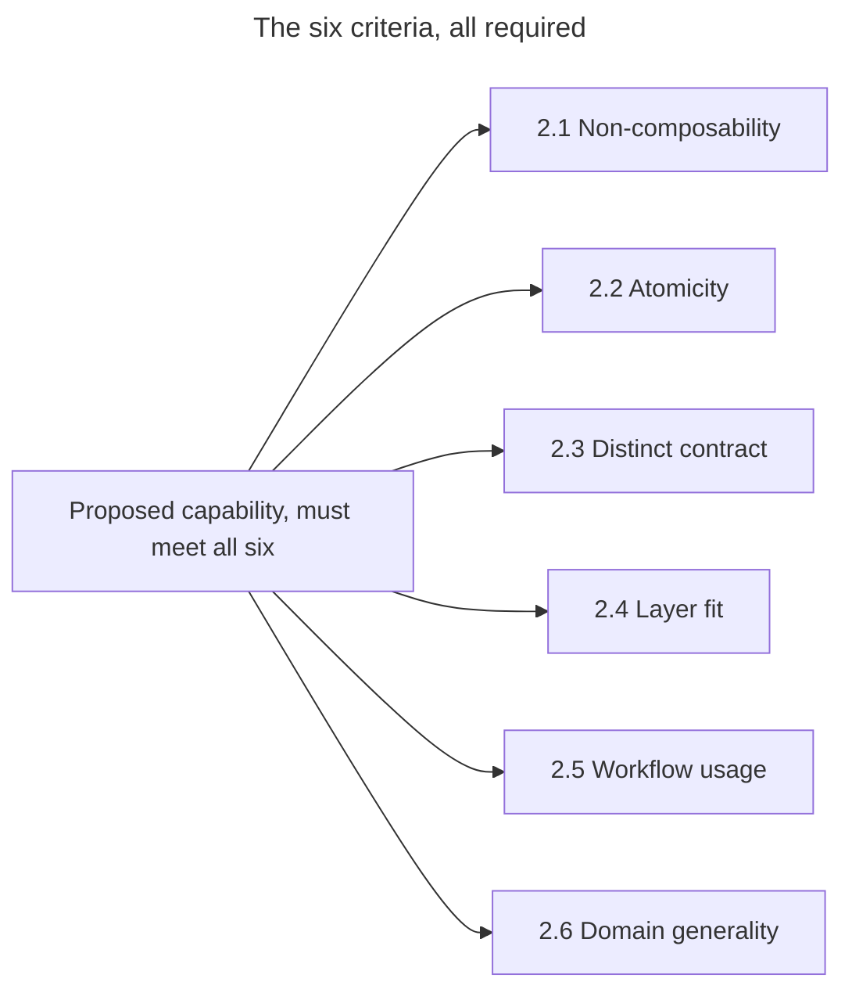
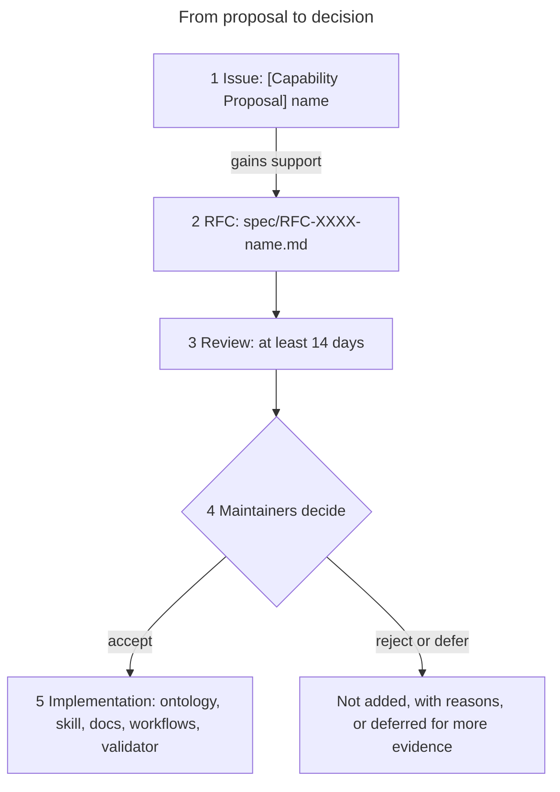
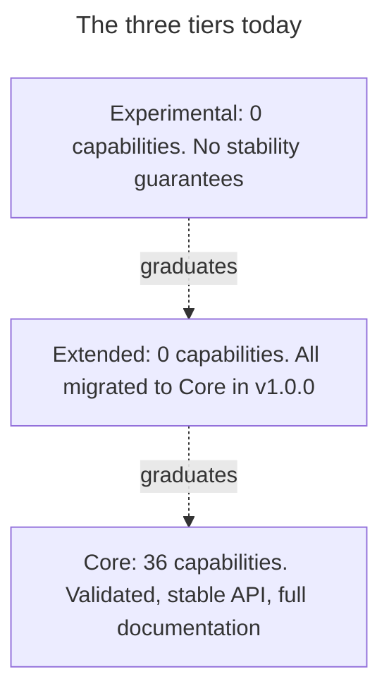
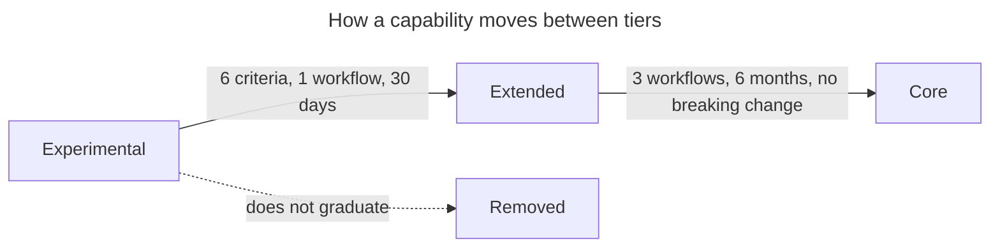
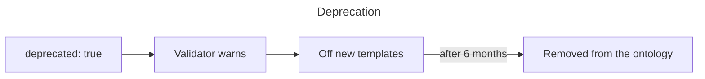
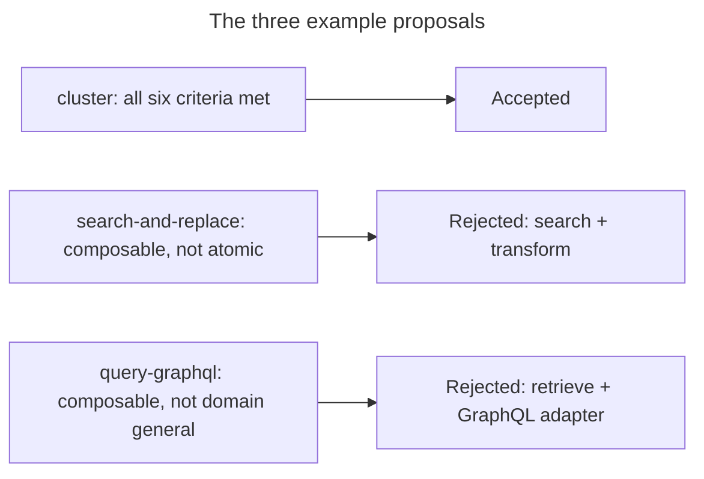
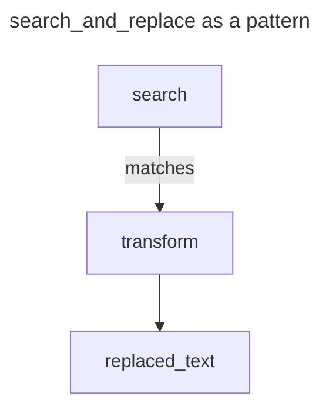

# Extension Governance: Adding a New Capability

**Document Status**: Normative
**Last Updated**: 2026-01-26
**Version**: 1.0.0

---

## Purpose

This document defines when and how new capabilities may be added to the Grounded Agency ontology. The goal is to maintain ontology integrity while allowing principled evolution.

---

## 1. Philosophy

### Default: Stability

The ontology should be **stable by default**. Adding capabilities has costs:
- Increases complexity for implementers
- May introduce redundancy
- Requires documentation, validation, tooling updates

### Exception: Justified Extension

New capabilities may be added when:
- A clear gap is demonstrated
- The proposed capability is truly atomic
- No existing composition covers the need

---

## 2. Criteria for a New Atomic Capability

A proposed capability MUST satisfy ALL of the following:



### 2.1 Non-Composability

**The capability cannot be expressed as a composition of existing capabilities.**

Evidence required:
- [ ] Attempt to compose from existing capabilities
- [ ] Document why composition is insufficient
- [ ] Show semantic loss if forced to use composition

### 2.2 Atomicity

**The capability is irreducible—it cannot be decomposed into simpler operations.**

Evidence required:
- [ ] Define the single, clear purpose
- [ ] Show that decomposition loses essential semantics
- [ ] Verify no sub-operations are independently useful

### 2.3 Distinct Contract

**The capability has a unique I/O contract not covered by existing capabilities.**

Evidence required:
- [ ] Define input_schema
- [ ] Define output_schema
- [ ] Show no existing capability has equivalent contract

### 2.4 Layer Fit

**The capability fits clearly into exactly one layer.**

Evidence required:
- [ ] Identify the layer
- [ ] Justify why this layer (not others)
- [ ] Show no layer ambiguity

### 2.5 Workflow Usage

**The capability is used in at least one reference workflow.**

Evidence required:
- [ ] Provide a workflow that uses the capability
- [ ] Show the workflow cannot be built without it
- [ ] Demonstrate value in production scenarios

### 2.6 Domain Generality

**The capability is domain-general, not specific to one use case.**

Evidence required:
- [ ] Show applicability across multiple domains
- [ ] Ensure not tool-specific (e.g., "query-postgres")
- [ ] Ensure not framework-specific (e.g., "langchain-chain")

---

## 3. Proposal Process



### Step 1: Issue

Open a GitHub issue with:
- Title: `[Capability Proposal] <name>`
- Template: Use the capability proposal template

### Step 2: RFC

If the issue gains support, create an RFC:
- File: `spec/RFC-XXXX-<name>.md`
- Follow the RFC template in [GOVERNANCE.md](../../spec/GOVERNANCE.md)

### Step 3: Review Period

- Minimum 14 days for community review
- Address all feedback
- Demonstrate criteria satisfaction

### Step 4: Decision

The maintainers decide:
- **Accept**: Capability added to ontology
- **Reject**: Capability not added (with reasons)
- **Defer**: Needs more evidence or discussion

### Step 5: Implementation

If accepted:
1. Add to `schemas/capability_ontology.yaml`
2. Create skill in `skills/<name>/SKILL.md`
3. Update documentation
4. Add to reference workflow(s)
5. Update validator

---

## 4. Capability Tiers

To manage ontology evolution, we use tiers:

### Core Tier

- Validated in reference workflows
- Stable API
- Full documentation
- Currently: 36 capabilities

### Extended Tier

- Proposed but not fully validated
- May change based on feedback
- Limited workflow coverage
- Currently: 0 capabilities (all migrated to Core in v1.0.0)

### Experimental Tier

- New proposals under evaluation
- No stability guarantees
- Must graduate to Extended or be removed
- Currently: 0 capabilities



### Graduation Criteria

**Experimental → Extended**:
- [ ] Passes all 6 criteria
- [ ] At least 1 reference workflow
- [ ] 30-day stability period

**Extended → Core**:
- [ ] At least 3 reference workflows
- [ ] 6-month stability period
- [ ] No breaking changes during period



---

## 5. Deprecation Process

Capabilities may be deprecated if:
- Proven to be a composition of others
- Proven redundant with another capability
- No usage in any workflow after 12 months

### Deprecation Steps

1. Mark as `deprecated: true` in ontology
2. Emit warnings in validator
3. Remove from new workflow templates
4. After 6 months, remove from ontology



---

## 6. Examples

### Example: Accepted Proposal

**Proposed**: `cluster` (group similar entities)

**Analysis**:
- Non-composable: ✓ (detect-pattern is for finding patterns, not grouping)
- Atomic: ✓ (single purpose: partition entities by similarity)
- Distinct contract: ✓ (input: entities, output: clusters)
- Layer fit: ✓ (MODEL - forms beliefs about structure)
- Workflow usage: ✓ (data analysis workflows)
- Domain general: ✓ (applies to any domain with entities)

**Decision**: Accepted

### Example: Rejected Proposal

**Proposed**: `search-and-replace` (find text and replace it)

**Analysis**:
- Non-composable: ✗ (= search + transform)
- Atomic: ✗ (two operations: find and replace)

**Decision**: Rejected (use search + transform composition)

### Example: Rejected Proposal (Domain-Specific)

**Proposed**: `query-graphql` (execute GraphQL queries)

**Analysis**:
- Non-composable: ✗ (= retrieve with GraphQL-specific parameters)
- Domain general: ✗ (specific to GraphQL)

**Decision**: Rejected (implement as `retrieve` with GraphQL adapter)



---

## 7. Counter-Proposal: Workflow Pattern

Before proposing a new capability, consider:

**Could this be a workflow pattern instead?**

Workflow patterns are reusable compositions that don't require ontology changes.

Example: "search-and-replace" as a workflow pattern:
```yaml
search_and_replace:
  steps:
    - capability: search
      store_as: matches
      input_bindings:
        query: old_function_name
    - capability: transform
      input_bindings:
        input: ${matches}
        target_format: replaced_text
        options: {operation: replace}
```

If it works as a pattern, don't propose it as a capability.



---

## 8. FAQ

### Q: Who decides?

**A:** Maintainers decide, with community input. Decisions are documented in RFC discussions.

### Q: What if I need a capability urgently?

**A:** Use a workflow composition. The governance process cannot be rushed.

### Q: Can I fork with my own capabilities?

**A:** Yes. The ontology is Apache 2.0 licensed. But consider contributing back.

### Q: How often are capabilities added?

**A:** Rarely. We expect 0-2 additions per year. Stability is a feature.

---

## 9. Conclusion

The 36 capabilities are not arbitrary, but they're also not final. This governance process ensures:

1. **Stability**: Changes are rare and justified
2. **Quality**: New capabilities meet rigorous criteria
3. **Transparency**: Decisions are documented publicly
4. **Evolution**: The ontology can grow when needed

When in doubt, compose from existing capabilities. Only propose when composition truly fails.

---

## References

- [FIRST_PRINCIPLES_REASSESSMENT.md](FIRST_PRINCIPLES_REASSESSMENT.md) — How the 36 capabilities were derived
- [REJECTED_CANDIDATES.md](REJECTED_CANDIDATES.md) — Capabilities considered but rejected
- [GOVERNANCE.md](../../spec/GOVERNANCE.md) — General governance process
