# Rejected Capability Candidates

**Document Status**: Normative Reference
**Last Updated**: 2026-01-26
**Version**: 1.0.0
**Purpose**: Document capabilities considered but rejected, with explicit reasoning

---

## Purpose

This document records capabilities that were considered during ontology development but **rejected** for specific reasons. This documentation is essential for:

1. **Transparency**: Showing the derivation was principled, not arbitrary
2. **Preventing re-proposals**: Explaining why rejected candidates shouldn't be added
3. **Guiding future proposals**: Illustrating the rejection criteria

---

## Rejection Categories

| Category | Criteria | Example |
|----------|----------|---------|
| **COMPOSITION** | Can be expressed as sequence of existing capabilities | `mitigate` = measure → plan → constrain → checkpoint → mutate |
| **REDUNDANT** | Semantically equivalent to existing capability | `validate` = `verify` |
| **PARAMETERIZABLE** | Domain specialization that should be a parameter | `detect-person` = `detect(domain: person)` |
| **TOO VAGUE** | No clear, specific semantics | `process`, `handle` |
| **TOOL-SPECIFIC** | Implementation detail, not capability | `query-postgres` |
| **FRAMEWORK-SPECIFIC** | Tied to specific framework | `langchain-chain` |

---

## 1. Rejected: Compositions

These were considered but are actually compositions of atomic capabilities.

### 1.1 `mitigate`

**Description**: Reduce risk through intervention

**Rejection Reason**: COMPOSITION

**Decomposition**:

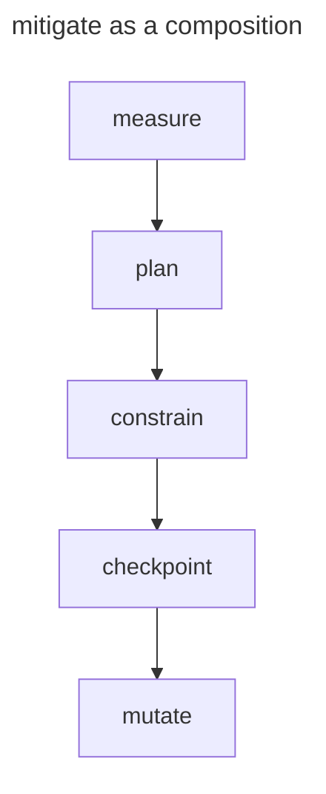

```yaml
mitigate:
  steps:
    - capability: measure
      purpose: Quantify the risk
    - capability: plan
      purpose: Create mitigation plan
    - capability: constrain
      purpose: Apply limits
    - capability: checkpoint
      purpose: Save state before the change
    - capability: mutate
      purpose: Execute mitigation
```

**Why it's not atomic**: Mitigation is inherently multi-step. You must first understand the risk, then plan how to address it, then act. These are separate cognitive operations.

---

### 1.2 `improve`

**Description**: Make something better over time

**Rejection Reason**: COMPOSITION

**Decomposition**:

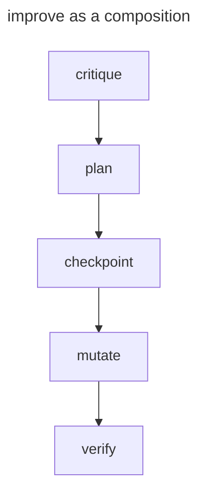

```yaml
improve:
  steps:
    - capability: critique
      purpose: Identify weaknesses
    - capability: plan
      purpose: Create improvement plan
    - capability: checkpoint
      purpose: Save state before the change
    - capability: mutate
      purpose: Execute improvements
    - capability: verify
      purpose: Confirm improvement
```

**Why it's not atomic**: "Improve" requires knowing what's wrong (critique), planning fixes (plan), doing the work (mutate), and checking results (verify). Each step is a distinct capability.

---

### 1.3 `optimize`

**Description**: Find the best solution among alternatives

**Rejection Reason**: COMPOSITION

**Decomposition**:

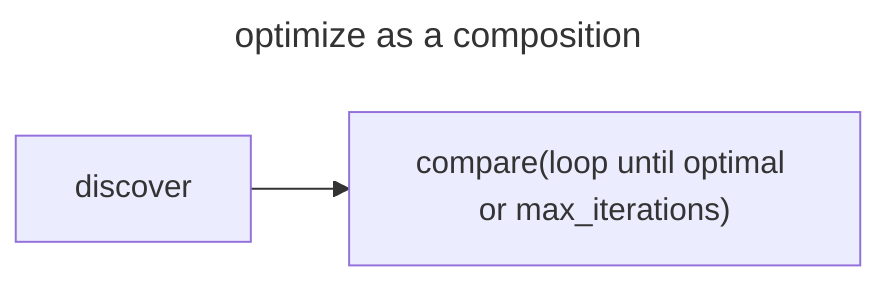

```yaml
optimize:
  steps:
    - capability: discover
      purpose: Find candidate solutions
    - capability: compare
      purpose: Evaluate alternatives and select the best option
      loop: until optimal or max_iterations
```

**Why it's not atomic**: Optimization is iterative search. It repeats discovery and comparison, which are separate operations.

---

### 1.4 `digital-twin`

**Description**: Create and maintain a synchronized digital replica

**Rejection Reason**: COMPOSITION

**Decomposition**:

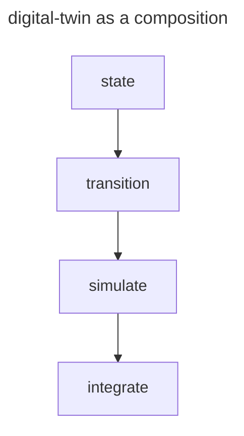

```yaml
digital_twin:
  steps:
    - capability: state
      purpose: Create initial snapshot
    - capability: transition
      purpose: Define dynamics
    - capability: simulate
      purpose: Run scenarios
    - capability: integrate
      purpose: Sync with real world
```

**Why it's not atomic**: A digital twin is a *system* composed of world modeling, dynamics, and synchronization. These are separable concerns.

---

### 1.5 `generalize`

**Description**: Extract general patterns from specific examples

**Rejection Reason**: COMPOSITION

**Decomposition**:

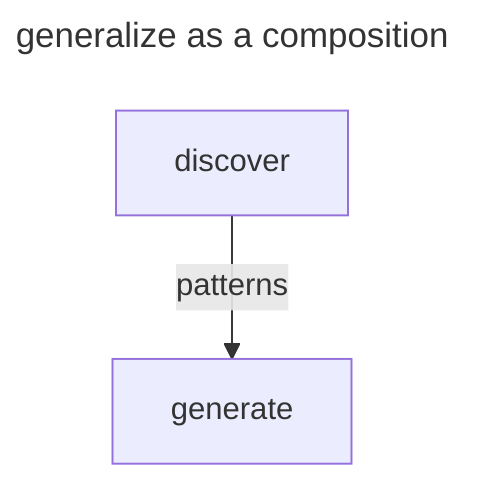

```yaml
generalize:
  steps:
    - capability: discover
      purpose: Find patterns in examples
    - capability: generate
      purpose: Create generalized rule/model
```

**Why it's not atomic**: Generalization requires first discovering patterns, then expressing them. The `discover` capability already handles pattern finding.

---

## 2. Rejected: Redundant

These were considered but duplicate existing capabilities.

### 2.1 `validate` (→ merge with `verify`)

**Description**: Check that something meets requirements

**Rejection Reason**: REDUNDANT with `verify`

**Analysis**:
- `validate`: Check against requirements/specification
- `verify`: Check against criteria/postconditions

These are semantically identical—both check if something meets expectations. The term difference is stylistic, not functional.

**Resolution**: Use `verify` for all "check correctness" operations.

---

### 2.2 `evaluate` (→ merge with `compare`)

**Description**: Assess the quality/value of something

**Rejection Reason**: REDUNDANT with `compare`

**Analysis**:
- `evaluate`: Assess quality against criteria
- `compare`: Evaluate alternatives against criteria

Evaluation is comparison with an implicit baseline (criteria). When you "evaluate", you're comparing against expectations.

**Resolution**: Use `compare(target, criteria)` for evaluation.

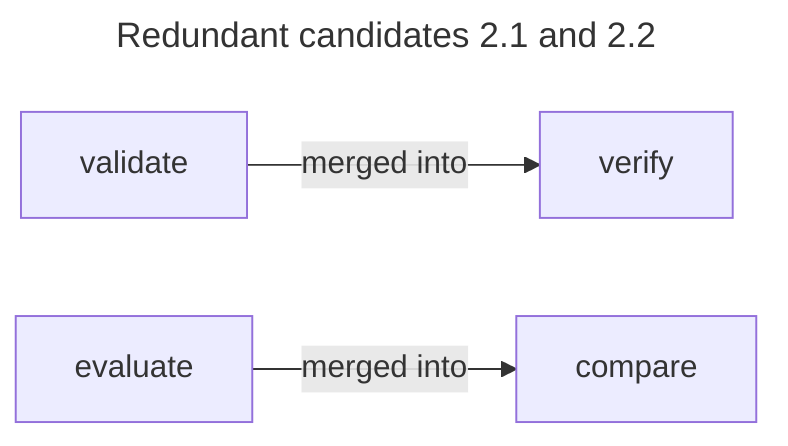

---

### 2.3 `decide` (→ merge with `compare`)

**Description**: Select an option from alternatives

**Rejection Reason**: REDUNDANT with `compare`

**Analysis**:
- `decide`: Choose from options
- `compare`: Rank options by criteria

A decision is the output of comparison. You compare options to decide.

**Resolution**: Use `compare` which outputs a recommendation/ranking.

---

### 2.4 `prioritize` (→ merge with `compare`)

**Description**: Rank items by importance

**Rejection Reason**: REDUNDANT with `compare`

**Analysis**: Prioritization is comparison by importance criteria.

**Resolution**: Use `compare(items, criteria: importance)`.

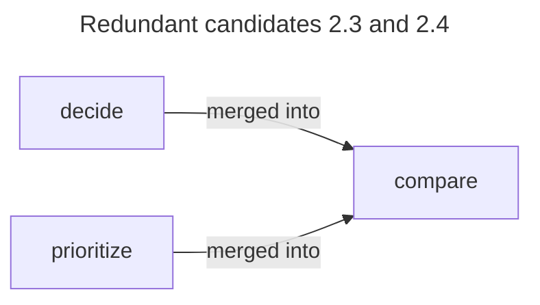

---

### 2.5 `schedule` (→ merge with `plan`)

**Description**: Assign times to tasks

**Rejection Reason**: REDUNDANT with `plan`

**Analysis**: Scheduling is planning with temporal constraints.

**Resolution**: Use `plan(constraints: {temporal: true})`.

---

### 2.6 `summarize` (→ merge with `generate`)

**Description**: Create a condensed version

**Rejection Reason**: REDUNDANT with `generate`

**Analysis**: Summarization is text generation with compression.

**Resolution**: Use `generate(modality: text, style: summary)`.

---

### 2.7 `translate` (→ merge with `generate`)

**Description**: Convert between languages

**Rejection Reason**: REDUNDANT with `generate`

**Analysis**: Translation is text generation with language transform.

**Resolution**: Use `generate(modality: text, transform: translate, target_language: X)`.

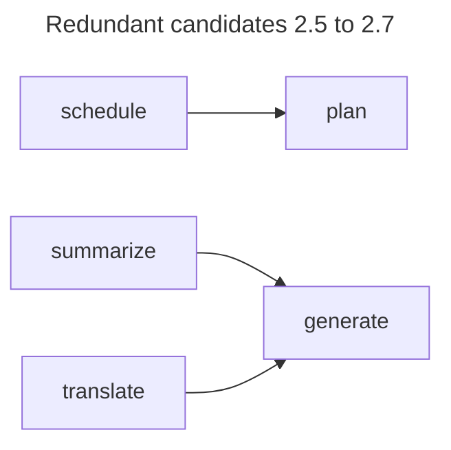

---

### 2.8 `provenance` (→ merge with `ground`)

**Description**: Track claim origins

**Rejection Reason**: REDUNDANT with `ground`

**Analysis**: Provenance is part of grounding. Grounding = anchoring claims to evidence AND tracking where claims came from.

**Resolution**: Include provenance as part of `ground` output.

---

### 2.9 `uncertainty-model` (→ implicit)

**Description**: Attach uncertainty to claims

**Rejection Reason**: REDUNDANT (implicit in all capabilities)

**Analysis**: Every capability output already includes `confidence`. Uncertainty is not a separate operation—it's a property of all estimates.

**Resolution**: All capabilities output `confidence` and `uncertainty_type`.

---

### 2.10 `map-relationships` (→ merge with `discover`)

**Description**: Build relationship graph

**Rejection Reason**: REDUNDANT with `discover`

**Analysis**: Mapping relationships is discovering them.

**Resolution**: Use `discover(target: relationships)`.

---

### 2.11 `diff-world-state` (→ merge with `compare`)

**Description**: Compute differences between world states

**Rejection Reason**: REDUNDANT with `compare`

**Analysis**: Diffing is comparing with structured output.

**Resolution**: Use `compare(state_a, state_b, output_format: diff)`.

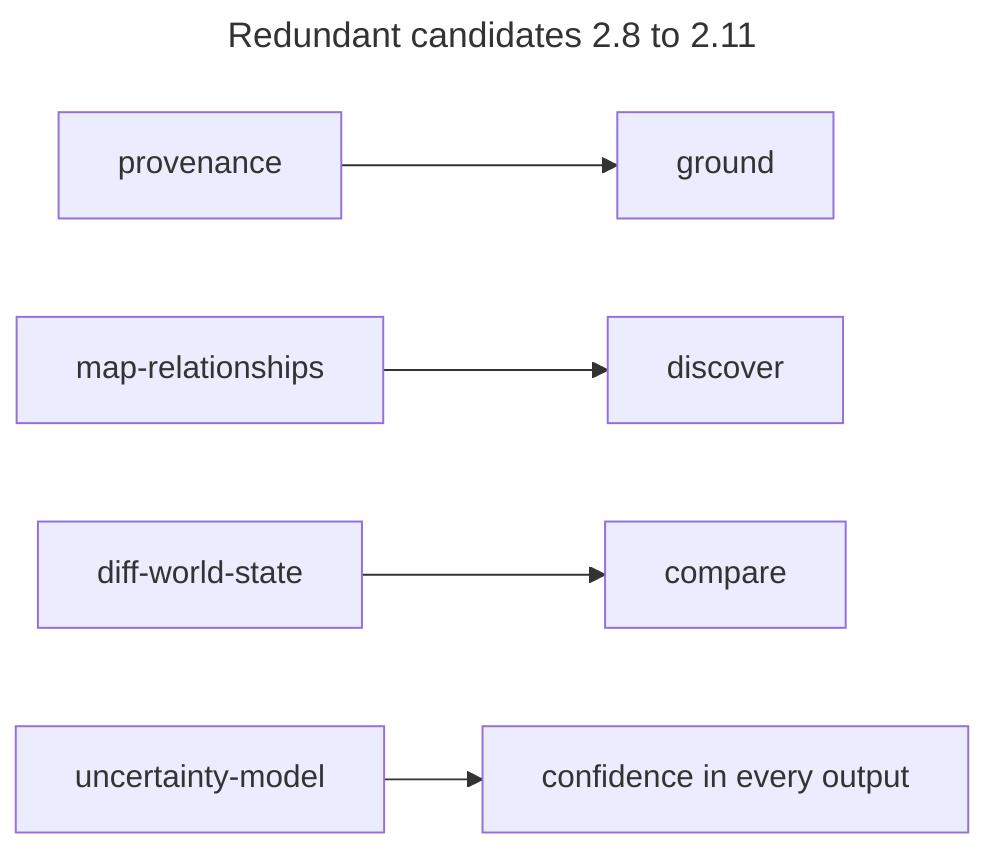

---

## 3. Rejected: Parameterizable

These were considered but should be parameters of base capabilities.

### 3.1 Domain Specializations of Atomic Capabilities

| Rejected Capability | Base Verb | Parameter |
|---------------------|-----------|-----------|
| `detect-person` | detect | `domain: person` |
| `detect-entity` | detect | `domain: entity` |
| `detect-activity` | detect | `domain: activity` |
| `detect-attribute` | detect | `domain: attribute` |
| `detect-world` | detect | `domain: world` |
| `identify-person` | classify | `domain: person` |
| `identify-entity` | classify | `domain: entity` |
| `identify-human-attribute` | classify | `domain: human-attribute` |
| `identify-anomaly` | classify | `domain: anomaly` |
| `identify-attribute` | classify | `domain: attribute` |
| `identify-activity` | classify | `domain: activity` |
| `identify-world` | classify | `domain: world` |
| `estimate-relationship` | measure | `target: relationship` |
| `estimate-activity` | measure | `target: activity` |
| `estimate-outcome` | measure | `target: outcome` |
| `estimate-world` | measure | `target: world` |
| `estimate-attribute` | measure | `target: attribute` |
| `estimate-impact` | measure | `target: impact` |
| `forecast-time` | predict | `target: time` |
| `forecast-impact` | predict | `target: impact` |
| `forecast-outcome` | predict | `target: outcome` |
| `forecast-attribute` | predict | `target: attribute` |
| `forecast-world` | predict | `target: world` |
| `forecast-risk` | predict | `target: risk` |
| `compare-entities` | compare | `target: entities` |
| `compare-plans` | compare | `target: plans` |
| `compare-attributes` | compare | `target: attributes` |
| `compare-people` | compare | `target: people` |
| `compare-impact` | compare | `target: impact` |
| `compare-documents` | compare | `target: documents` |
| `discover-relationship` | discover | `target: relationship` |
| `discover-anomaly` | discover | `target: anomaly` |
| `discover-outcome` | discover | `target: outcome` |
| `discover-activity` | discover | `target: activity` |
| `discover-human-attribute` | discover | `target: human-attribute` |
| `generate-audio` | generate | `modality: audio` |
| `generate-image` | generate | `modality: image` |
| `generate-text` | generate | `modality: text` |
| `generate-numeric-data` | generate | `modality: numeric` |
| `generate-attribute` | generate | `target: attribute` |
| `generate-world` | generate | `target: world` |
| `generate-plan` | generate | `target: plan` (→ but use `plan`) |

**Rejection Reason**: PARAMETERIZABLE

**Analysis**: These are not semantically distinct operations. `detect-person` is the same operation as `detect-entity`—just with different input domain. The domain should be a **parameter**, not a separate capability.

**Why this matters**:
1. **Reduces capability explosion**: 7 capabilities vs. 42 domain-specialized
2. **Clearer semantics**: One capability = one operation
3. **Composability**: Same capability, different parameters

---

### 3.2 Reasoning Domain Specializations

| Rejected Capability | Base Verb | Parameter |
|---------------------|-----------|-----------|
| `temporal-reasoning` | (reasoning) | `domain: temporal` |
| `spatial-reasoning` | (reasoning) | `domain: spatial` |

**Rejection Reason**: PARAMETERIZABLE

**Analysis**: Temporal and spatial are not distinct cognitive operations—they're domains to which reasoning is applied.

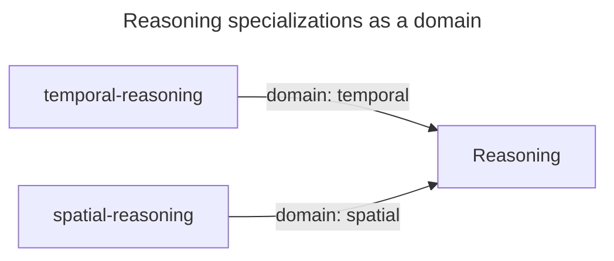

---

## 4. Rejected: Too Vague

These were considered but have unclear semantics.

### 4.1 `process`

**Description**: Do something with input

**Rejection Reason**: TOO VAGUE

**Analysis**: "Process" could mean transform, analyze, validate, or many other things. It has no clear, specific semantics.

**Resolution**: Use specific capabilities: `transform`, or `detect`, `classify` and `measure` for analysis.

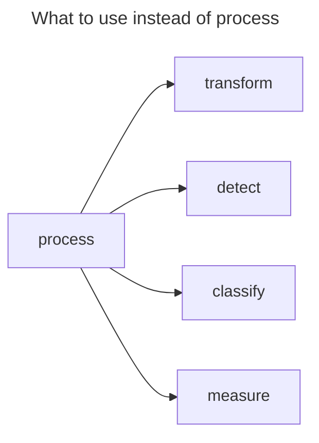

---

### 4.2 `handle`

**Description**: Deal with something

**Rejection Reason**: TOO VAGUE

**Analysis**: "Handle" is not a cognitive operation. It's a catch-all that could mean anything.

**Resolution**: Use specific capabilities based on what "handling" actually means.

---

### 4.3 `analyze`

**Description**: Examine in detail

**Rejection Reason**: TOO VAGUE

**Analysis**: "Analyze" is an umbrella term that could mean detect, classify, measure, compare, or any combination. It's not a single operation.

**Resolution**: Use specific capabilities: detect (find patterns), classify (label), measure (quantify), compare (evaluate).

---

### 4.4 `understand`

**Description**: Comprehend meaning

**Rejection Reason**: TOO VAGUE

**Analysis**: "Understanding" is an outcome of multiple operations (detect, classify, measure, state), not a single operation.

**Resolution**: Use specific capabilities that produce understanding as output.

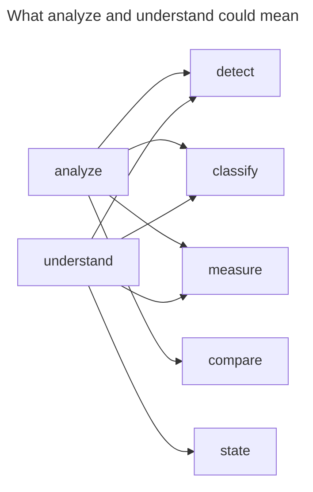

---

## 5. Rejected: Tool-Specific

These were considered but are implementation details.

### 5.1 `query-postgres`

**Description**: Execute PostgreSQL query

**Rejection Reason**: TOOL-SPECIFIC

**Analysis**: This is an implementation of `retrieve`, not a separate capability. The storage backend is an implementation detail.

**Resolution**: Use `retrieve(source: postgres, query: ...)`.

---

### 5.2 `call-api`

**Description**: Make HTTP API request

**Rejection Reason**: TOOL-SPECIFIC

**Analysis**: This is an implementation of `retrieve` (GET), `send` (POST), or `mutate` (changes to state).

**Resolution**: Use appropriate capability with API as the source/target.

---

### 5.3 `read-file`

**Description**: Read from filesystem

**Rejection Reason**: TOOL-SPECIFIC

**Analysis**: This is an implementation of `retrieve`.

**Resolution**: Use `retrieve(source: file, path: ...)`.

---

### 5.4 `run-shell`

**Description**: Execute shell command

**Rejection Reason**: TOOL-SPECIFIC

**Analysis**: This is an implementation of `execute` or `generate` depending on purpose.

**Resolution**: Use `execute(tool: shell, command: ...)`.

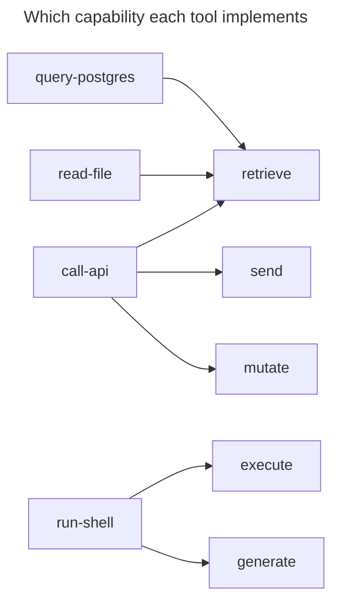

---

## 6. Rejected: Framework-Specific

These were considered but are tied to specific frameworks.

### 6.1 `langchain-chain`

**Description**: Execute LangChain chain

**Rejection Reason**: FRAMEWORK-SPECIFIC

**Analysis**: This is a LangChain implementation detail, not a general capability.

**Resolution**: Express as a workflow using general capabilities.

---

### 6.2 `autogen-conversation`

**Description**: Run AutoGen conversation

**Rejection Reason**: FRAMEWORK-SPECIFIC

**Analysis**: This is AutoGen-specific. General capability is `delegate` + `synchronize`.

**Resolution**: Use coordination capabilities.

---

## 7. Summary

| Category | Count | Examples |
|----------|-------|----------|
| COMPOSITION | 5 | mitigate, improve, optimize, digital-twin, generalize |
| REDUNDANT | 11 | validate, evaluate, decide, prioritize, schedule, summarize, translate, provenance, uncertainty-model, map-relationships, diff-world-state |
| PARAMETERIZABLE | 44 | Domain specializations of atomic capabilities and of reasoning |
| TOO VAGUE | 4 | process, handle, analyze, understand |
| TOOL-SPECIFIC | 4 | query-postgres, call-api, read-file, run-shell |
| FRAMEWORK-SPECIFIC | 2 | langchain-chain, autogen-conversation |
| **TOTAL REJECTED** | **70** | |

---

## 8. Implications

This analysis shows that of 99 current capabilities:
- **39 are truly atomic** (should be kept)
- **60 should not be separate capabilities**

The rejected candidates fall into clear categories with principled rejection reasons. This demonstrates the derivation process is rigorous, not arbitrary.

---

## References

- [FIRST_PRINCIPLES_REASSESSMENT.md](FIRST_PRINCIPLES_REASSESSMENT.md) — Full analysis
- [EXTENSION_GOVERNANCE.md](EXTENSION_GOVERNANCE.md) — Criteria for new capabilities
