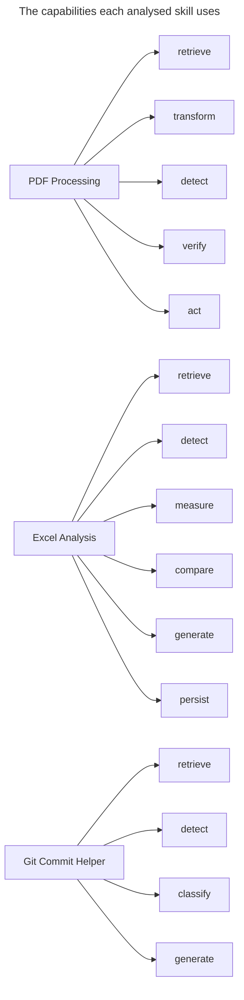
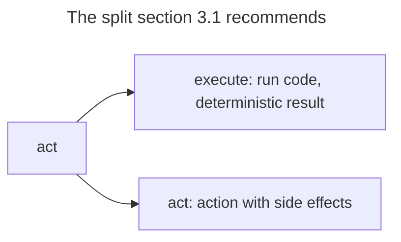
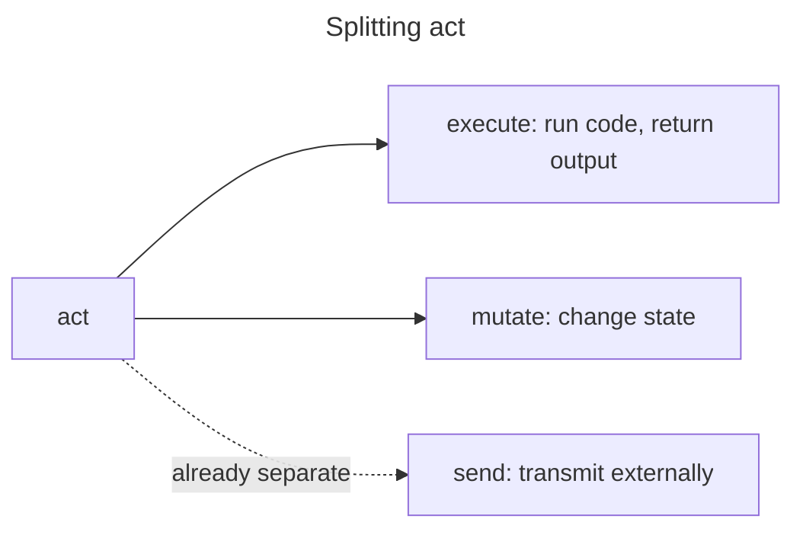
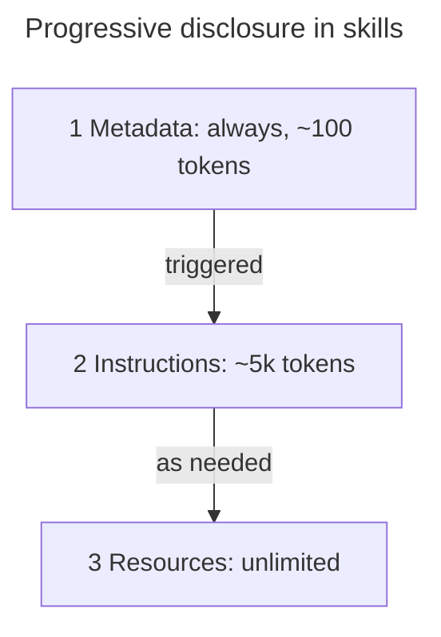
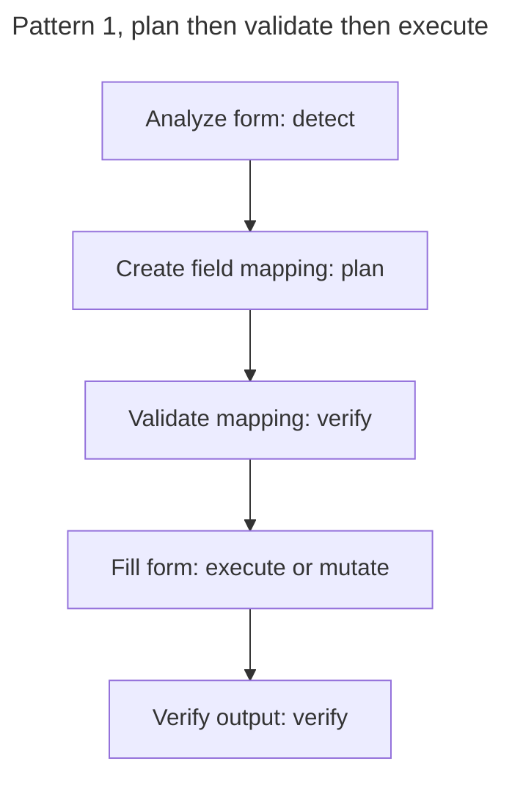
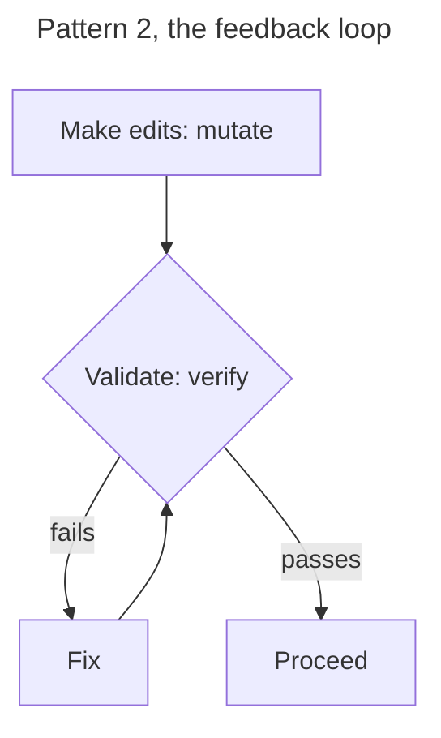
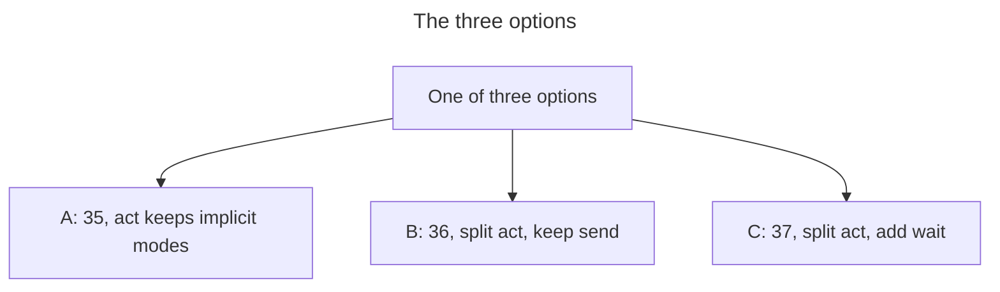
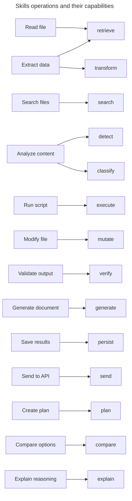

# Skills Alignment Evaluation

**Document Status**: Historical (Informative)
**Last Updated**: 2026-01-26
**Purpose**: Evaluate proposed capability ontology against Claude Skills architecture

> **⚠️ Historical Document**: This document captures the evaluation process that informed the final 35-capability model. The capability counts, layer names, and proposals here reflect an intermediate design stage. For the authoritative ontology, see [`schemas/capability_ontology.yaml`](../../schemas/capability_ontology.yaml) and [`FIRST_PRINCIPLES_REASSESSMENT.md`](FIRST_PRINCIPLES_REASSESSMENT.md).

---

## Executive Summary

After analyzing Claude's Skills architecture against our proposed 35-capability ontology, we find:

| Finding | Assessment |
|---------|------------|
| Abstraction level | ✅ Correct - Capabilities sit between tool primitives and Skills |
| Alignment with Skills | ✅ Good - Our capabilities map to what Skills actually compose |
| Naming conventions | ⚠️ Needs adjustment - Should use gerund form per Skills best practices |
| Missing primitives | ⚠️ Some gaps - No explicit "execute" capability for code/scripts |
| Over-abstraction | ⚠️ Minor - "act" is too vague for practical use |

**Verdict**: The 35-capability model is fundamentally sound but needs refinement to better align with how Skills actually work.

---

## 1. Understanding the Hierarchy

### The Three-Layer Model

Based on Claude Skills documentation, there's a clear hierarchy:

```
┌─────────────────────────────────────────────────────────┐
│  LAYER 3: SKILLS                                        │
│  High-level compositions with instructions + resources  │
│  Examples: pdf-processing, excel-analysis, git-commit   │
│  Token cost: ~100 (metadata) + ~5k (instructions)       │
└─────────────────────────────────────────────────────────┘
                           ↓ compose from
┌─────────────────────────────────────────────────────────┐
│  LAYER 2: CAPABILITIES (Our Ontology)                   │
│  Abstract operations agents perform                     │
│  Examples: detect, classify, generate, verify, plan     │
│  What agents "do" conceptually                          │
└─────────────────────────────────────────────────────────┘
                           ↓ implemented via
┌─────────────────────────────────────────────────────────┐
│  LAYER 1: TOOL PRIMITIVES (Claude's Actual Tools)       │
│  Concrete tool invocations                              │
│  Examples: Read, Write, Bash, code execution            │
│  What agents "call" mechanically                        │
└─────────────────────────────────────────────────────────┘
```

### Validation: Where Do Our Capabilities Fit?

**Good news**: Our capabilities sit at the correct abstraction level.

| Capability | Not a Tool Primitive Because... | Not a Skill Because... |
|------------|--------------------------------|------------------------|
| `detect` | Multiple tools may be used (Read + pattern match) | It's a single operation, not a workflow |
| `plan` | Reasoning, not tool invocation | It's a cognitive operation, not packaged instructions |
| `verify` | May use multiple checks | It's one verification step, not a validation workflow |
| `generate` | Not just "write file" - includes reasoning | Not a full document generation skill |

**Our capabilities describe WHAT agents do. Tools describe HOW. Skills describe WHEN and WITH WHAT RESOURCES.**

---

## 2. Mapping Capabilities to Skills Operations

### PDF Processing Skill Analysis

From the documentation, the PDF Processing skill includes:
- Extract text and tables from PDF files
- Fill forms
- Merge documents

**Capability mapping**:

| Skill Operation | Our Capability | Tool Primitives Used |
|-----------------|----------------|---------------------|
| Extract text | `retrieve` + `transform` | Read (file), Bash (pdfplumber) |
| Analyze form fields | `detect` | Bash (analyze_form.py) |
| Validate mapping | `verify` | Bash (validate_fields.py) |
| Fill form | `transform` + `act` | Bash (fill_form.py) |
| Verify output | `verify` | Bash (verify_output.py) |

**Assessment**: ✅ Our capabilities cover this skill's operations.

### Excel Analysis Skill Analysis

From the documentation:
- Analyze spreadsheets
- Create pivot tables
- Generate charts

**Capability mapping**:

| Skill Operation | Our Capability | Tool Primitives Used |
|-----------------|----------------|---------------------|
| Read spreadsheet | `retrieve` | Read, code execution |
| Analyze data | `detect` + `measure` | code execution |
| Compare metrics | `compare` | code execution |
| Generate chart | `generate` | code execution |
| Save output | `persist` | Write |

**Assessment**: ✅ Our capabilities cover this skill's operations.

### Git Commit Helper Skill Analysis

From the documentation:
- Generate descriptive commit messages
- Analyze git diffs

**Capability mapping**:

| Skill Operation | Our Capability | Tool Primitives Used |
|-----------------|----------------|---------------------|
| Read git diff | `retrieve` | Bash (git diff) |
| Analyze changes | `detect` + `classify` | Reasoning |
| Generate message | `generate` | Reasoning |

**Assessment**: ✅ Our capabilities cover this skill's operations.



---

## 3. Gap Analysis

### 3.1 Missing: Explicit "Execute" Capability

**Problem**: Skills heavily rely on **script execution** as a core pattern:

```markdown
## Utility scripts
Run: `python scripts/analyze_form.py input.pdf`
Run: `python scripts/validate_fields.py fields.json`
Run: `python scripts/fill_form.py input.pdf fields.json output.pdf`
```

Our `act` capability is too vague. Skills documentation emphasizes:
- "Make clear in your instructions whether Claude should **execute the script** or **read it as reference**"
- "Prefer scripts for deterministic operations"

**Recommendation**: Split `act` into:
- `execute` — Run code/script and get result (deterministic)
- `act` — Take action with side effects (non-deterministic)



### 3.2 Naming Convention Mismatch

**Skills best practice**: Use **gerund form** (verb + -ing) for names:
- `processing-pdfs` ✓
- `analyzing-spreadsheets` ✓
- `managing-databases` ✓

**Our capability names**: Use **base verb** form:
- `detect` (not `detecting`)
- `classify` (not `classifying`)
- `plan` (not `planning`)

**Assessment**: This is actually **not a problem**.

Why? Skills are **things Claude has** (like folders with instructions). Capabilities are **operations Claude performs**. Different naming conventions are appropriate:

| Construct | Form | Example | Rationale |
|-----------|------|---------|-----------|
| Skill | Gerund | `processing-pdfs` | "A skill for processing PDFs" (noun phrase) |
| Capability | Base verb | `detect` | "Claude can detect patterns" (action) |

**Recommendation**: Keep base verb form for capabilities. It's semantically correct.

### 3.3 "act" Is Too Vague

**Problem**: The Skills documentation shows very specific actions:
- Run a Python script
- Execute bash command
- Make file changes
- Call external API

Our single `act` capability tries to cover all of these.

**Skills pattern**: Operations are specific and deterministic:
```bash
python scripts/fill_form.py input.pdf fields.json output.pdf
```

**Recommendation**: Consider whether `act` should be split:
- `execute` — Run code/script (deterministic, returns output)
- `mutate` — Change state (file, database, etc.)
- `send` — Transmit to external system (already separate)

Or keep `act` but document that it's parameterized by action type.



### 3.4 Progressive Disclosure Pattern

**Skills insight**: Content loads in stages:
1. Metadata (always) — ~100 tokens
2. Instructions (when triggered) — ~5k tokens
3. Resources (as needed) — unlimited



**Implication for capabilities**: Our capability definitions should also support progressive disclosure:
- **Level 1**: Capability name + brief description (in workflow metadata)
- **Level 2**: Full I/O contract (when capability is selected)
- **Level 3**: Domain-specific details (as needed)

This validates our parameterization approach — domains are "Level 3" details loaded as needed.

---

## 4. Revised Capability Recommendations

### 4.1 Refinement: Split "act" into Specific Operations

**Before** (35 capabilities):
```
EXECUTION (2): act, send
```

**After** (36 capabilities):
```
EXECUTION (3): execute, mutate, send
```

| Capability | Purpose | Example |
|------------|---------|---------|
| `execute` | Run code/script, return output | `python analyze.py` |
| `mutate` | Change persistent state | Modify file, update database |
| `send` | Transmit to external system | API call, webhook |

**Rationale**: Skills documentation emphasizes that script execution is a distinct, critical operation. Separating `execute` from `mutate` allows clearer reasoning about side effects.

### 4.2 Alternative: Keep "act" with Explicit Modes

If we prefer not to add a capability:

```yaml
act:
  modes:
    - execute    # Run code, return output
    - mutate     # Change state
    - interact   # User/agent interaction
  parameters:
    mode: string
    target: any
    input: any
```

**Assessment**: This is valid but less clear than explicit capabilities.

### 4.3 Validation Against Skills Workflow Patterns

Skills documentation shows common workflow patterns. Let's validate:

**Pattern 1: Plan → Validate → Execute**
```
1. Analyze form (detect)
2. Create field mapping (plan)
3. Validate mapping (verify)
4. Fill form (execute/mutate)
5. Verify output (verify)
```

**Our capabilities cover this**: ✅



**Pattern 2: Feedback Loop**
```
1. Make edits (mutate)
2. Validate (verify)
3. If fails → fix → validate again
4. Proceed when passes
```

**Our capabilities cover this**: ✅ (verify + conditional logic in workflow)



**Pattern 3: Progressive Disclosure**
```
1. Read main instructions (retrieve)
2. If advanced feature needed → read additional file (retrieve)
3. Execute specialized script (execute)
```

**Our capabilities cover this**: ✅

---

## 5. Final Assessment

### Strengths of Our 35-Capability Model

| Strength | Evidence |
|----------|----------|
| **Correct abstraction level** | Capabilities sit between tool primitives and Skills |
| **Covers Skills operations** | All analyzed Skills map to our capabilities |
| **Composable** | Skills workflows compose our capabilities |
| **Aligned with industry** | MCP, LangChain use similar patterns |

### Weaknesses / Areas for Improvement

| Weakness | Recommendation |
|----------|----------------|
| `act` too vague | Split into `execute` + `mutate`, or add mode parameter |
| No async primitives | Consider adding `wait` or making `receive` cover this |
| `world-state` vs `inspect` overlap | Clarify: `inspect` is observation, `world-state` is model creation |

### Recommended Changes

**Option A: Minimal Change (keep 35)**
- Document that `act` has implicit modes: execute, mutate, interact
- Clarify in I/O contracts

**Option B: Small Expansion (36 capabilities)**
- Split `act` → `execute` + `mutate`
- Keep `send` for external transmission

**Option C: Moderate Expansion (37 capabilities)**
- Split `act` → `execute` + `mutate`
- Add `wait` for async operations
- Keep `send` for external transmission



### Verdict

**The 35-capability model is fundamentally sound.** It correctly captures what agents do at the right abstraction level.

**Recommended refinement**: **Option B (36 capabilities)** — Split `act` into `execute` and `mutate` for clarity, since Skills documentation emphasizes script execution as a distinct pattern.

---

## 6. Updated 36-Capability Proposal

```yaml
PERCEPTION (4):
  - retrieve      # Pull specific data by ID/path
  - search        # Query by criteria
  - inspect       # Examine current state
  - receive       # Accept pushed data/events

UNDERSTANDING (6):
  - detect        # Find patterns/occurrences
  - classify      # Categorize and label
  - measure       # Quantify uncertain values
  - predict       # Forecast future states
  - compare       # Evaluate alternatives
  - discover      # Find unknown patterns

REASONING (4):
  - plan          # Create action sequence
  - decompose     # Break into subproblems
  - critique      # Identify weaknesses
  - explain       # Justify conclusions

WORLD_MODELING (6):
  - world-state       # Create state snapshot
  - state-transition  # Define dynamics
  - causal-model      # Cause-effect relationships
  - ground            # Anchor to evidence
  - resolve-identity  # Deduplicate entities
  - simulate          # Run what-if scenarios

SYNTHESIS (3):
  - generate      # Produce new content
  - transform     # Convert formats
  - integrate     # Merge sources

EXECUTION (3):                    # ← Changed from 2 to 3
  - execute       # Run code/script, return output (NEW)
  - mutate        # Change persistent state (was: act)
  - send          # Transmit externally

SAFETY (5):
  - verify        # Check conditions
  - checkpoint    # Save state
  - rollback      # Restore state
  - constrain     # Enforce limits
  - audit         # Record provenance

MEMORY (2):
  - persist       # Store durably
  - recall        # Retrieve stored

COORDINATION (3):
  - delegate      # Assign to agent
  - synchronize   # Achieve agreement
  - invoke        # Execute workflow

TOTAL: 36 capabilities
```

---

## 7. Skills-Capability Mapping Table

For reference, here's how common Skills operations map to capabilities:



| Skills Operation | Capability | Notes |
|-----------------|------------|-------|
| Read file | `retrieve` | |
| Search files | `search` | |
| Analyze content | `detect` + `classify` | |
| Extract data | `retrieve` + `transform` | |
| Run script | `execute` | New capability |
| Modify file | `mutate` | Renamed from `act` |
| Validate output | `verify` | |
| Generate document | `generate` | |
| Save results | `persist` | |
| Send to API | `send` | |
| Create plan | `plan` | |
| Compare options | `compare` | |
| Explain reasoning | `explain` | |

---

## References

- [Claude Skills Overview](https://platform.claude.com/docs/en/agents-and-tools/agent-skills/overview)
- [Claude Skills Best Practices](https://platform.claude.com/docs/en/agents-and-tools/agent-skills/best-practices)
- [AGENT_ARCHITECTURE_RESEARCH.md](AGENT_ARCHITECTURE_RESEARCH.md)
- [FIRST_PRINCIPLES_REASSESSMENT.md](FIRST_PRINCIPLES_REASSESSMENT.md) — Final 35-capability derivation
