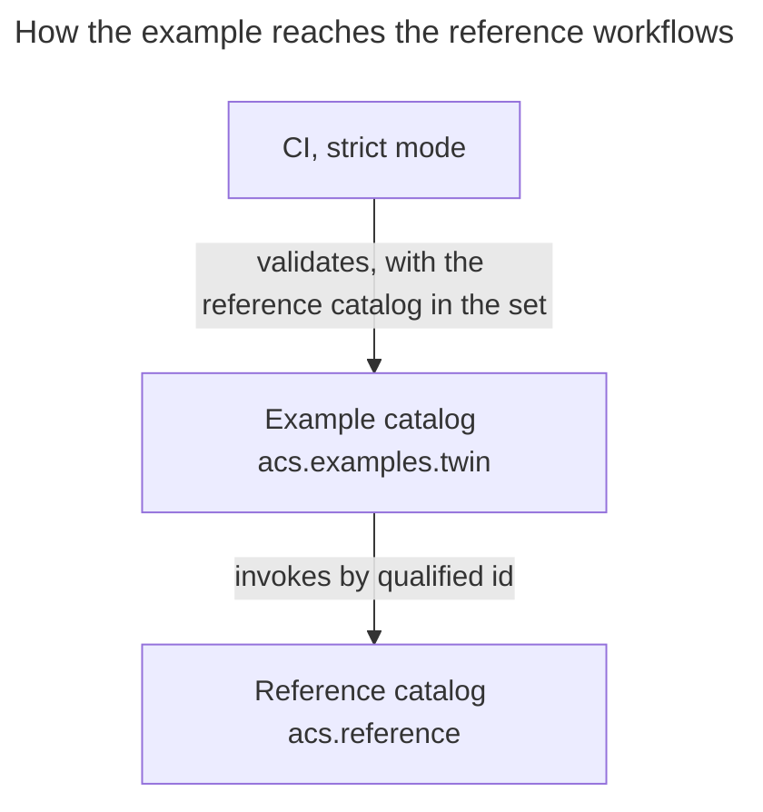

# Examples

This directory contains usage examples for the Agent Capability Standard.

## Quick Start

### Run the Workflow Validator

Validate workflow definitions against the capability ontology:

```bash
# From repository root
python tools/validate_workflows.py

# Emit suggested patch diffs for type coercions
python tools/validate_workflows.py --emit-patch
```

### Run Conformance Tests

```bash
# From repository root
python scripts/run_conformance.py
```

## Example Workflows

`digital_twin_sync_loop.workflow_catalog.yaml` is a catalog of its own,
`acs.examples.twin`, with one workflow, `plant_twin_bootstrap`. It reuses the
reference catalog's digital twin workflows instead of copying them: its
`invoke` steps name them by qualified id, `acs.reference/world_model_build`
and `acs.reference/digital_twin_sync_loop` (Standard 1.2.0 §5.1.1). The
reference catalog's manifest gives it the id `acs.reference` and exports
those workflows.

A qualified id resolves only when its catalog is in the catalog set, so the
example is validated with the reference catalog beside it. CI does this in
strict mode:



```bash
python tools/validate_workflows.py --catalog examples/digital_twin_sync_loop.workflow_catalog.yaml --with-catalog schemas/workflow_catalog.yaml --strict
```

Validated alone, each qualified id is W607 (its catalog is not in the set),
which fails under `--strict`.

`tainted_input_gate.workflow_catalog.yaml` holds `tainted_input_summary`,
the tainted input gate pattern of
[Workflow Patterns §4.4](../docs/WORKFLOW_PATTERNS.md#44-tainted-input-gate-pattern):
it summarises a retrieved page and sends the summary to a destination the
person gave, after `constrain` has checked the outgoing message. It is in
no catalog the site or the skills read; CI validates it in strict mode.

The workflow skills run the reference catalog's workflows step by step:
- `skills/debug-workflow/` - Diagnose and fix a bug (`debug_code_change`)
- `skills/capability-gap-analysis/` - Identify missing capabilities (`capability_gap_analysis`)
- `skills/digital-twin-bootstrap/` - Build a world model and run a first sync (`digital_twin_bootstrap`)
- `skills/digital-twin-sync-loop/` - Keep a digital twin in sync (`digital_twin_sync_loop`)


To run a workflow on the reference executor from Python, see
[Running workflows](../docs/guides/RUNNING_WORKFLOWS.md).

## SDK Demos

| Script | Shows |
|--------|-------|
| `grounded_agent_demo.py` | `GroundedAgentAdapter` wrapping SDK options with the safety layer |
| `checkpoint_enforcement_demo.py` | Mutations blocked until a checkpoint exists |
| `capability_skills_demo.py` | Capability metadata for SDK tools |
| `grounded_query_demo.py` | `grounded_query` and `GroundedClient` |
| `structured_output_demo.py` | Structured output and budget enforcement |
| `discovery_demo.py` | Capability discovery |
| `mcp_tools_demo.py` | Capability-aware MCP tools |
| `subagent_bridge_demo.py` | Subagent bridge |

```bash
python examples/grounded_agent_demo.py
```

## Using Skills via Claude Code

```bash
# Invoke a capability skill
claude> /agent-capability-standard:detect

# Invoke a workflow skill
claude> /agent-capability-standard:debug-workflow
```
