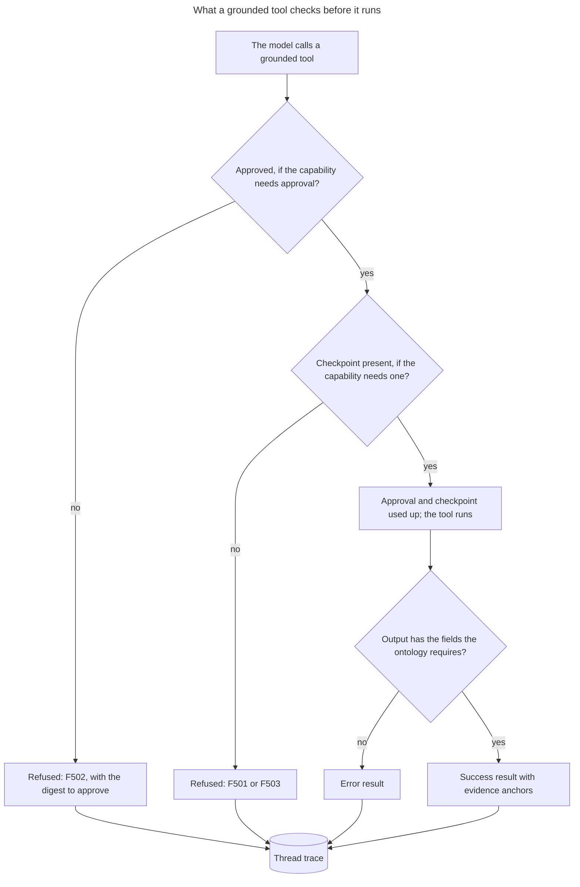

# A grounded Standard Agent

A reference binding of the Agent Capability Standard for the
[Standard Agent Specification](https://standardagentspec.org) (0.2.0), and an
agent built with it. The agent changes a settings document, and its write
tool is classified as the ontology's `mutate` capability, so every change
needs a restore point and an approval recorded through an authenticated
endpoint.

[Standard Agents interoperability](../../docs/integrations/standard_agents.md)
explains the design, what it guarantees and what it cannot.



## Run it

Node 22.12 or newer on the 22, 24 or 26 release line (CI uses the version in
`site/.nvmrc`).

The binding depends on the TypeScript package
[`@synaptiai/acs-core`](../../packages/acs-core/README.md) of this repository
(`file:../../packages/acs-core`), which holds the ontology table, effective
flags, canonical JSON and the digest. Build it first:

```bash
cd packages/acs-core
npm ci
npm run build   # dist/, which the binding imports
cd ../../examples/standard_agents
npm ci
npm run check   # type-check against the published @standardagents/spec types
npm test        # the binding's rules, against an in-memory thread
```

A packed agent bundles the package with the binding's code: the Standard
Agents packaging page does not say how a packed agent's npm dependencies are
resolved.

The tests call the tools, the hook and the endpoints directly with an
in-memory `ThreadState` (`test/memory_thread.ts`). No model runs and no
Standard Agents runtime is involved, so the tests show that the binding's
code enforces its rules, not how a particular runtime behaves.

## What is here

| Path | What it is |
|------|------------|
| `src/acs/grounded.ts` | `groundedTool`: defines a function tool for one capability and enforces its safety flags inside the tool |
| `src/acs/ontology.ts` | The ontology table, types and effective flags, from `@synaptiai/acs-core`, and the Standard version the binding follows |
| `src/acs/approval.ts` | Approval requests and decisions, bound to a digest of what the approver was shown |
| `src/acs/audit.ts` | Joins tool call ids to the trace from a `tool_call_done` hook, and records calls no grounded tool recorded |
| `src/acs/lint.ts` | Checks before anything runs. A prompt's tool list: every tool classified, each stating the name the prompt offers it under, no requirement the prompt can never meet. An agent's stop and session bindings: none names a tool that can be refused |
| `src/acs/records.ts` | The records kept in the thread's key-value store |
| `src/acs/serial.ts` | Takes one thread's checks and record writes one at a time, for calls in one JavaScript realm |
| `src/package.ts` | The example as a packed agent: the entry point exports that Packaging describes |
| `agents/tools/` | The example's five tools: `retrieve`, `checkpoint`, `mutate`, `verify`, `rollback` |
| `agents/api/acs/` | Thread endpoints a person's client calls to list pending approvals, each with the round a decision applies to, and to decide one (`digest`, `round`, `decision`) |
| `agents/hooks/` | The audit hook |
| `agents/prompts/`, `agents/agents/`, `agents/models/` | The prompt, the agent and its model |

The `agents/` layout is the one the Standard Agents examples use; the
specification itself defines no folder layout.

## Defining a grounded tool

```typescript
// agents/tools/write_config.ts
import { z } from 'zod';
import { groundedTool } from '../../src/acs/grounded.js';

export default groundedTool({
  name: 'write_config',
  capability: 'mutate',
  domain: 'config',
  description: 'Change one setting.',
  approval: { expires_ms: 15 * 60 * 1000 },
  args: z.object({ key: z.string().min(1), value: z.string() }),
  execute: async (state, { key, value }) => {
    // ... make the change ...
    return { success: true, evidence_anchors: [/* what was read and written */] };
  },
});
```

`groundedTool` returns an ordinary `defineTool` definition. It adds the `acs`
annotation
([schema](../../schemas/interop/standard_agents_annotation.schema.json)), and
wraps `execute` so that the call is refused until the capability's rules are
met. The return type of `execute` is the capability's output contract: leaving
out `evidence_anchors`, or returning one that is not an array, is a compile
error, and an error result at run time. A required `confidence` outside 0 to
1 is an error result at run time. `name` must be the name the tool is
registered under: a tool cannot see that name, the approver is shown the one
stated here, and `lintPromptTools` reports a difference.

A restore point counts only in the execution it was taken in, and for ten
minutes at most, so the order that works is: ask, wait for the approval, then
take the restore point and make the change. The example's prompt tells the model so, and a tool that is
refused says what is missing. A call that needs an approval or a restore
point is refused outside an execution, as when a thread endpoint invokes the
tool: the runtime runs a thread's executions one at a time, but does not
serialise endpoint requests with them.

## Deploying one

Three things the binding cannot do for a deployment:

- **Keep credentials away from tools.** The runtime authenticates whoever
  calls the approval endpoint; it does not say that the caller is a person.
  No tool, prompt variable or thread environment value should hold a
  credential the runtime accepts.
- **Set a step limit.** `maxSteps` and `maxSessionTurns` have no default, and
  nothing else stops a model from repeating a refused call.
- **Bind stop and session actions to ungated tools.** `stopTool`,
  `sessionStop`, `sessionFail` and `sessionStatus` act when the named tool is
  called, whatever its result. `lintAgentBindings` reports a bound tool that
  can be refused.

## Generated files

The ontology table the binding uses is the package's
`packages/acs-core/src/ontology.gen.ts`, generated from this repository's
ontology; the package's tests read the reference executor's approval digest
vectors (`tests/conformance/approval/digests.json`) in place. After changing
the ontology, from the repository root:

```bash
python scripts/gen_standard_agents_binding.py
```

CI fails when they are out of date.
