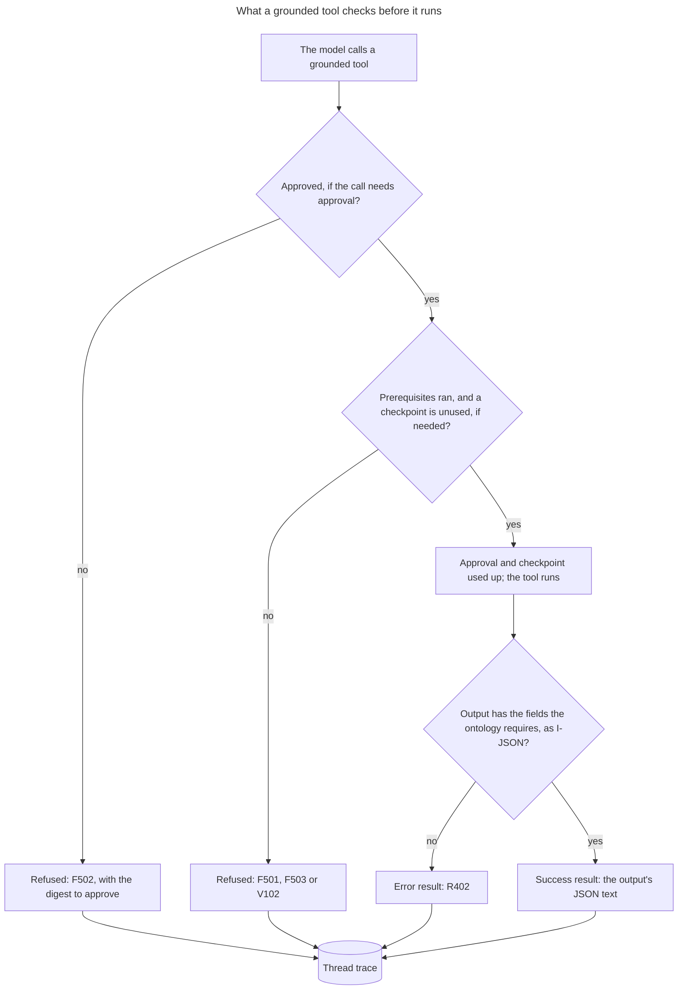

# A grounded Standard Agent

A reference binding of the Agent Capability Standard for the
[Standard Agent Specification](https://standardagentspec.org) (0.2.0), and an
agent built with it. The agent changes a settings document, and its write
tool is classified as the ontology's `mutate` capability, so every change
needs a restore point and an approval recorded through an authenticated
endpoint.

The binding is a safety layer on a tool-calling host under Standard 1.2.0
([§5.18](../../spec/STANDARD-v1.2.0.md#518-tool-calling-hosts)), and claims
its conformance class, SL
([§10.4](../../spec/STANDARD-v1.2.0.md#104-safety-layer-conformance)). Its statement is
[`standard_agents_binding.json`](../../tests/conformance/calls/statements/standard_agents_binding.json).
[Standard Agents interoperability](../../docs/integrations/standard_agents.md)
explains the design, what it guarantees and what it cannot.



## Run it

Node 22.12 or newer on the 22, 24 or 26 release line (CI uses the version in
`site/.nvmrc`).

The binding depends on the TypeScript package
[`@synaptiai/acs-core`](../../packages/acs-core/README.md) of this repository
(`file:../../packages/acs-core`), which holds the ontology table, effective
flags, canonical JSON, the digest, the binding checks and the text-only
output rule. Build it first; the binding imports only its plain-TypeScript
entry, so `build:ts` is enough (the package's full `npm run build` also
bundles the schema documents through its WebAssembly core, which
`npm run build:wasm` builds with Rust first):

```bash
cd packages/acs-core
npm ci
npm run build:ts   # dist/, which the binding imports
cd ../../examples/standard_agents
npm ci
npm run check   # type-check against the published @standardagents/spec types
npm test        # the binding's rules, against an in-memory thread
```

A packed agent bundles the package with the binding's code: the Standard
Agents packaging page does not say how a packed agent's npm dependencies are
resolved.

The tests call the tools, the hook and the endpoints directly with an
in-memory `ThreadState` (`test/memory_thread.ts`). No model runs and no
Standard Agents runtime is involved, so the tests show that the binding's
code enforces its rules, not how a particular runtime behaves.

## What is here

| Path | What it is |
|------|------------|
| `src/acs/grounded.ts` | `groundedTool`: defines a function tool for one capability (and any additional ones, and the tools it invokes) and enforces their safety flags inside the tool. `controlTool`: defines a tool that only signals the host, never refused and always recorded |
| `src/acs/ontology.ts` | The ontology table, types, effective flags and prerequisites, from `@synaptiai/acs-core`, and the Standard version the binding follows (`STANDARD_VERSION`, 1.2.0) |
| `src/acs/approval.ts` | Approval requests and decisions, bound to a digest of what the approver was shown |
| `src/acs/audit.ts` | Joins tool call ids to the trace from a `tool_call_done` hook, and records calls no grounded tool recorded |
| `src/acs/lint.ts` | Checks before anything runs. A prompt's tool list: every tool bound (W617), each stating the name the prompt offers it under (V111), no prerequisite the prompt can never meet (V102). An agent's stop and session bindings: none names a tool that can be refused (F506) |
| `src/acs/records.ts` | The records kept in the thread's key-value store, and the refusal codes with their names |
| `src/acs/serial.ts` | Takes one thread's checks and record writes one at a time, for calls in one JavaScript realm |
| `src/package.ts` | The example as a packed agent: the entry point exports that Packaging describes |
| `agents/tools/` | The example's five tools: `retrieve`, `checkpoint`, `mutate`, `verify`, `rollback` |
| `agents/api/acs/` | Thread endpoints a person's client calls to list pending approvals, each with the round a decision applies to, and to decide one (`digest`, `round`, `decision`) |
| `agents/hooks/` | The audit hook |
| `agents/prompts/`, `agents/agents/`, `agents/models/` | The prompt, the agent and its model |

The `agents/` layout is the one the Standard Agents examples use; the
specification itself defines no folder layout.

## Defining a grounded tool

```typescript
// agents/tools/write_config.ts
import { z } from 'zod';
import { groundedTool } from '../../src/acs/grounded.js';

export default groundedTool({
  name: 'write_config',
  capability: 'mutate',
  domain: 'config',
  description: 'Change one setting.',
  approval: { expires_ms: 15 * 60 * 1000 },
  args: z.object({ key: z.string().min(1), value: z.string() }),
  execute: async (state, { key, value }) => {
    // ... make the change ...
    return { success: true, evidence_anchors: [/* what was read and written */] };
  },
});
```

`groundedTool` returns an ordinary `defineTool` definition. It adds the `acs`
annotation
([schema](../../schemas/interop/standard_agents_annotation.schema.json)), and
wraps `execute` so that the call is refused until the capability's rules are
met. The return type of `execute` is the capability's output contract: leaving
out `evidence_anchors`, or returning one that is not an array, is a compile
error, and an error result at run time. A required `confidence` outside 0 to
1, or a value with no exact I-JSON form, is an error result at run time
(R402). The success result is the output's I-JSON text, as Standard 1.2.0
§5.18.9 requires. `name` must be the name the tool is registered under: a
tool cannot see that name, the approver is shown the one stated here, and
`lintPromptTools` reports a difference (V111).

Every refusal is an error result whose text opens with the code and its name,
for example `F501 CHECKPOINT_REQUIRED: ...`, with the §9.8 diagnostic in
`error_data`:

| Code | When |
|---|---|
| F502 | The call needs an approval that has not been given for exactly these arguments |
| F501, F503 | No unused checkpoint of this execution; F503 for a rollback when no checkpoint was ever taken |
| V102 | A capability the call requires (other than `checkpoint`) has not run in the thread |
| F504 | A composite invoked a tool it does not list in `invokes`, or invoked through its state after it returned; `persist` data or an `audit` record holds a credential; a `send` call's destination is not one the destination policies in force allow, or the tool states none (no `destination` option) while a policy is in force |
| R402 | The output breaks its contract or is not I-JSON |
| R407 | The binding could not complete its checks, or the record of a call that ran |

A tool that calls other tools with `state.invokeTool` lists them in
`invokes`, which also becomes its `uses`:

```typescript
groundedTool({
  name: 'apply_change',
  capability: 'mutate',
  invokes: { write_config: writeConfig, verify_config: verifyConfig },
  // ...
});
```

It takes their flags, and a call its own code makes to one of them while it
runs is covered by its approval and checkpoint (a one-shot nesting token per
invocation), as far as its own call held them; a call to a tool it does not
list, or through its state after it returned, is refused. A stop or
session action is bound to a `controlTool`, which is never refused:

```typescript
controlTool({ name: 'finish', description: 'End the turn.', args: z.object({}) });
```

Sends go only where the destination policies in force allow (Standard
1.2.0 §4.4.2). Put the host's policies, and the applied profiles' (the
core's `profilePolicy`), in force for every grounded `send` tool in the
module that defines the agent's tools:

```typescript
import { configureLayer } from '../../src/acs/layer.js';

configureLayer({ destinations: [['https://hooks.example.com/*', '*@example.com']] });
```

A `send` call whose destination no pattern of a policy matches, or whose
destination is not a string, is refused with F504 before any approval is
asked for. A `send` tool says where its destination is with its
`destination` option, an RFC 6901 pointer into its arguments (`destination:
'/to'`, stated in its annotation) or a function of them (`(args) =>
args.to`). One defined without it has a destination the layer cannot tell,
so every call of it is refused while a policy is in force (§5.18.10): the
layer does not guess an argument the model can set while the tool's code
sends elsewhere. Without `configureLayer`, no policy is in force.
`configureLayer({ secrets })` registers the host's own credentials (§6.7):
every trace entry the binding writes, the audit hook's included, is
redacted with them, and `persist` data holding one is refused. A tool's `profiles` add
their `allowed_destinations` for that tool and, given to a composite, for
the sends its code invokes at any depth (each nested call the binding
attributes to it, §5.18.4).

`memoryTools()` gives a `persist` and a `recall` tool on the thread's
key-value store (§4.5): scope `session` (the thread), an envelope with the
data's `stored_at` and, with a `ttl`, its `expires_at`, after which a recall
does not find it; data or a key holding a credential is refused
(`secret_in_data`). What §4.5 asks a host to state, for its one scope:
entries survive a restart of the host, since the runtime keeps thread values
in durable per-thread storage that survives process restarts and redeploys
(Standard Agents Runtime, Durable Key-Value Store); they are retained while
the thread lasts, unless their `ttl` ends them first, and the binding
deletes none; a value is limited to `max_value_bytes` (1,000,000 bytes of
JSON text by default; `over_capacity` above it), and the binding sets no
limit on the number of entries, so the runtime's own caps on key length,
value size and key count, which it may set, are the limits.

A restore point counts only in the execution it was taken in, and for ten
minutes at most, so the order that works is: ask, wait for the approval, then
take the restore point and make the change. The example's prompt tells the model so, and a tool that is
refused says what is missing. A call that needs an approval or a restore
point is refused outside an execution, as when a thread endpoint invokes the
tool: the runtime runs a thread's executions one at a time, but does not
serialise endpoint requests with them.

## Deploying one

Three things the binding cannot do for a deployment:

- **Keep credentials away from tools.** The runtime authenticates whoever
  calls the approval endpoint; it does not say that the caller is a person.
  No tool, prompt variable or thread environment value should hold a
  credential the runtime accepts.
- **Set a step limit.** `maxSteps` and `maxSessionTurns` have no default, and
  nothing else stops a model from repeating a refused call.
- **Bind stop and session actions to ungated tools.** `stopTool`,
  `sessionStop`, `sessionFail` and `sessionStatus` act when the named tool is
  called, whatever its result. Bind each to a `controlTool`;
  `lintAgentBindings` reports a bound tool that can be refused (F506).

## Generated files

The ontology table the binding uses is the package's
`packages/acs-core/src/ontology.gen.ts`, generated from this repository's
ontology; the package's tests read the reference executor's approval digest
vectors (`tests/conformance/approval/digests.json`) in place. After changing
the ontology, from the repository root:

```bash
python scripts/gen_standard_agents_binding.py
```

CI fails when they are out of date.
