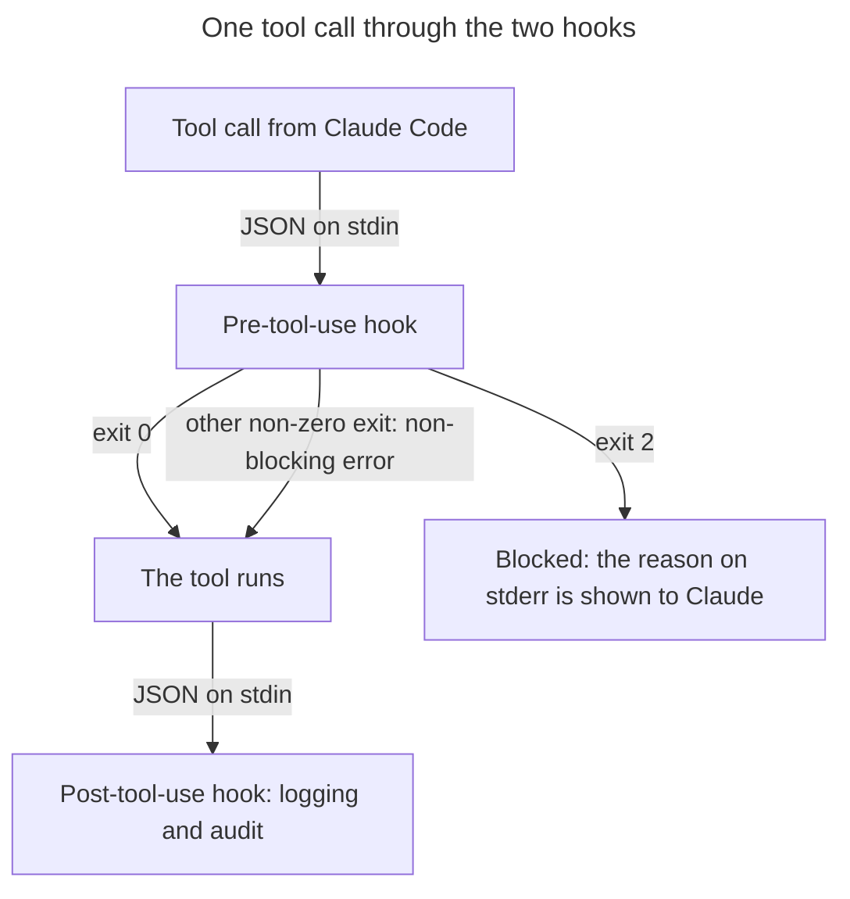
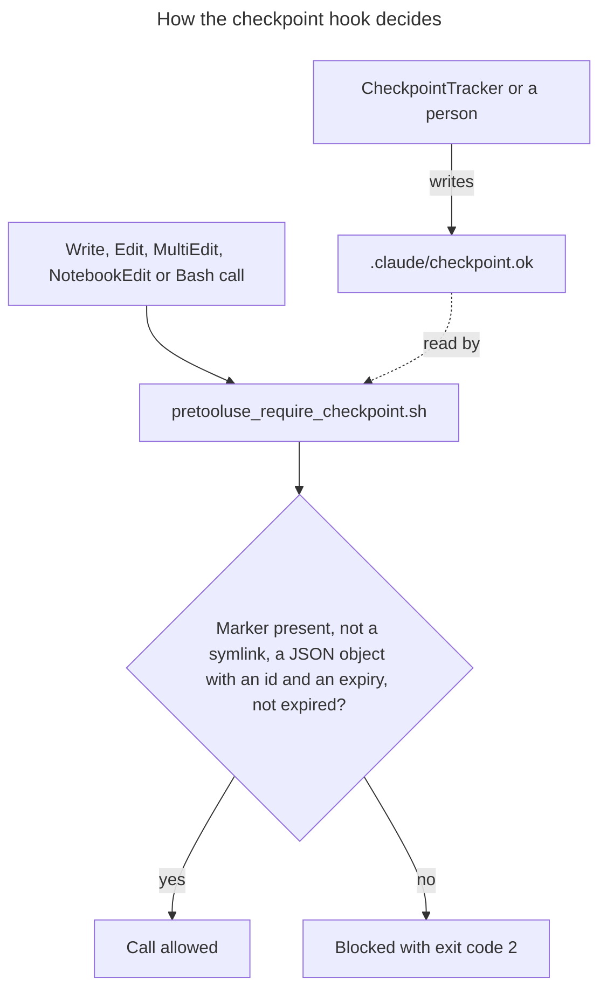
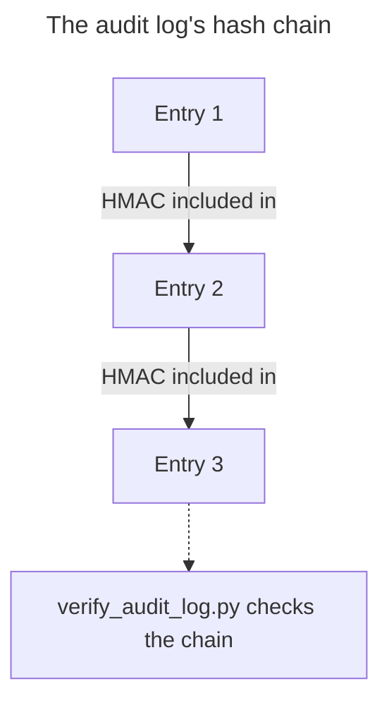

# Safety Hooks

This directory contains hooks that implement the VERIFY layer capabilities from the Agent Capability Standard.

## Spec-Aligned Hooks

These hooks directly implement capabilities defined in the standard's VERIFY layer:

| Hook | Capability | Purpose |
|------|------------|---------|
| `pretooluse_require_checkpoint.sh` | `checkpoint` | Require checkpoint marker before mutation operations |
| `posttooluse_log_tool.sh` | `audit` | Log every tool call for audit trail and provenance |

## How Hooks Work




### Pre-Tool-Use Hooks

Run **before** a tool executes and can block operations. Claude Code passes
the tool call as JSON on stdin; exit 0 allows the call, and exit 2 blocks it,
with the reason on stderr shown to Claude (any other non-zero exit is a
non-blocking error, so the tool would still run). The reason opens with the
Standard's code and name for the refusal, `F501 CHECKPOINT_REQUIRED:`.

```bash
echo '{"tool_name": "Write", "tool_input": {"file_path": "a.py"}}' \
  | ./pretooluse_require_checkpoint.sh   # exit 2 without a valid marker
./pretooluse_require_checkpoint.sh "Write a.py"   # a payload as $1 is also accepted
```

### Post-Tool-Use Hooks

Run **after** a tool executes for logging and audit. Claude Code fires
`PostToolUse` after a call that succeeded and `PostToolUseFailure` after one
that failed; the audit hook is registered for both, for every tool. The tool
call arrives as JSON on stdin.

```bash
echo '{"hook_event_name": "PostToolUse", "tool_name": "Bash", "tool_input": {"command": "ls"}}' \
  | ./posttooluse_log_tool.sh
```

## Configuration

Hooks are configured in `hooks.json` (loaded automatically by the Claude Code plugin):

```json
{
  "hooks": {
    "PreToolUse": [
      {
        "matcher": "Write|Edit|MultiEdit|NotebookEdit|Bash",
        "hooks": [
          {
            "type": "command",
            "command": "${CLAUDE_PLUGIN_ROOT}/hooks/pretooluse_require_checkpoint.sh"
          }
        ]
      }
    ],
    "PostToolUse": [
      {
        "matcher": "*",
        "hooks": [
          {
            "type": "command",
            "command": "${CLAUDE_PLUGIN_ROOT}/hooks/posttooluse_log_tool.sh"
          }
        ]
      }
    ],
    "PostToolUseFailure": [
      {
        "matcher": "*",
        "hooks": [
          {
            "type": "command",
            "command": "${CLAUDE_PLUGIN_ROOT}/hooks/posttooluse_log_tool.sh"
          }
        ]
      }
    ]
  }
}
```

Each hook entry specifies:
- **matcher**: Regex pattern matching tool names that trigger the hook (`*` matches every tool)
- **hooks**: Array of hook commands to execute
- **type**: Hook type (`command` for shell scripts)
- **command**: Path to the hook script (`${CLAUDE_PLUGIN_ROOT}` resolves to the plugin directory)

## Checkpoint System

The `pretooluse_require_checkpoint.sh` hook enforces the `checkpoint` capability requirement:
- Expects a marker file at `.claude/checkpoint.ok` before allowing mutation operations: every `Write`, `Edit`, `MultiEdit`, `NotebookEdit` and `Bash` call (it fails closed: a shell command is not trusted to be read-only). The marker is written outside these tools, by `CheckpointTracker` or by a person
- Blocks with exit code 2 and the reason on stderr, which opens with `F501 CHECKPOINT_REQUIRED:` (the code and name the Standard gives a mutation without a checkpoint)
- Validates that the marker is a JSON object with a `checkpoint_id` and a numeric `expires_at` (SEC-001); `created_at` is written for the reader and not checked. Without `jq` it checks only that the marker is under 30 minutes old
- Rejects markers that have expired, and removes them
- Fails closed: a marker that is not a JSON object, or any command in the hook that fails, blocks the call with exit code 2 (any other exit code would let it run)
- Rejects symlinks to prevent bypass attacks (SEC-006)
- Uses `CLAUDE_PROJECT_DIR` for absolute path resolution (SEC-006)
- Maps to the spec's `requires_checkpoint: true` field on capabilities




The marker file must contain a JSON object (`created_at` is optional):
```json
{"checkpoint_id": "chk_...", "created_at": 1706000000, "expires_at": 1706001800}
```

When using the Python SDK, `CheckpointTracker(marker_dir=".claude")` automatically
manages this marker file, bridging the shell and Python safety layers.

## Audit Trail

The `posttooluse_log_tool.sh` hook implements the `audit` capability:
- Logs every tool call that ran, one JSON line per call in `.claude/audit.log` (the `PostToolUse` and `PostToolUseFailure` matchers are `*`). A call that a pre-tool-use hook or a permission rule refused did not run and is not logged
- Never writes the tool input: a command, a file's content or a skill's arguments can hold a credential. A SHA-256 digest of the input is written in its place
- Uses HMAC-SHA256 chaining for tamper detection (SEC-005)
- Each entry includes the HMAC of the previous entry, creating a hash chain
- Serializes concurrent runs (tool calls made in parallel) with `flock`, or with a lock directory where `flock` is not installed, so the chain stays in order
- Needs `jq` to read the tool call; without it nothing is logged and the hook exits 0, so no error is reported

Each entry holds these fields:

| Field | Value |
|-------|-------|
| `ts` | Time of the entry, ISO 8601 in UTC |
| `event` | `PostToolUse` (the call succeeded) or `PostToolUseFailure` (it failed) |
| `tool` | Tool name |
| `skill` | Skill name, on a `Skill` call only |
| `input_sha256` | SHA-256 of the tool input as compact JSON with sorted keys (`jq -cS .tool_input`), or `unavailable` when it cannot be computed (none of `sha256sum`, `shasum` and `openssl` is installed, or the one used fails); the entry is written either way |
| `prev_hmac` | HMAC of the previous entry, empty on the first |
| `hmac` | HMAC of this entry's other fields |

A `Skill` call with the input `{"skill": "checkpoint"}`, logged with `AUDIT_HMAC_KEY=example-key`:

```json
{"ts":"2026-01-30T12:00:00Z","event":"PostToolUse","tool":"Skill","skill":"checkpoint","input_sha256":"a69e8f80ec2830e5006e68ce275a5077f299455c58def8f4d12762083815e11a","prev_hmac":"","hmac":"c8e3958eb21f82334d55b1c9c6d7d4a887ea8857fdd925573a67ca083203e19c"}
```

A reader who holds a tool input can confirm it against `input_sha256`. The
digest is not a way to keep a short or guessable input secret: such an input
can be found by trying candidates. The digest is taken over the text jq
prints, and jq 1.6 and 1.7 print some numbers differently (jq 1.7 keeps
`1.000` as written, jq 1.6 prints `1`), so an input that holds such a number
is confirmed with the jq version that wrote the log.

A log begun before the hook logged every tool call opens with entries of the
earlier form (`ts`, `skill`, `args`, `prev_hmac`, `hmac`, for `Skill` calls
only). The chain continues across the change and the verifier accepts both
forms; the earlier entries still hold the skill arguments they were written
with.




Verify audit log integrity:
```bash
python tools/verify_audit_log.py
```

Set a custom HMAC key via the `AUDIT_HMAC_KEY` environment variable.

## Hooks in Skill Frontmatter

Six skills (`audit`, `checkpoint`, `persist`, `rollback`, `send`, `transform`)
declare hooks of their own in the frontmatter of their `SKILL.md`. Claude Code
registers them when the skill is invoked. Their command hooks follow the same
contract as the hooks here: the tool call as JSON on stdin, exit 2 to block
with the reason on stderr, and a digest in place of the tool input in what
they log. [SECURITY.md §5.4](../spec/SECURITY.md#54-checks-enforced-by-code-and-checks-a-model-judges)
lists which of the plugin's and the skills' checks are enforced by code and
which are prompts a model judges.

## Relationship to Spec

These hooks implement runtime enforcement of VERIFY layer requirements:

| Spec Field | Hook Implementation |
|------------|---------------------|
| `requires_checkpoint: true` | `pretooluse_require_checkpoint.sh` blocks without checkpoint |
| `audit` capability | `posttooluse_log_tool.sh` records tool usage |

See `schemas/capability_ontology.yaml` for full capability definitions.
