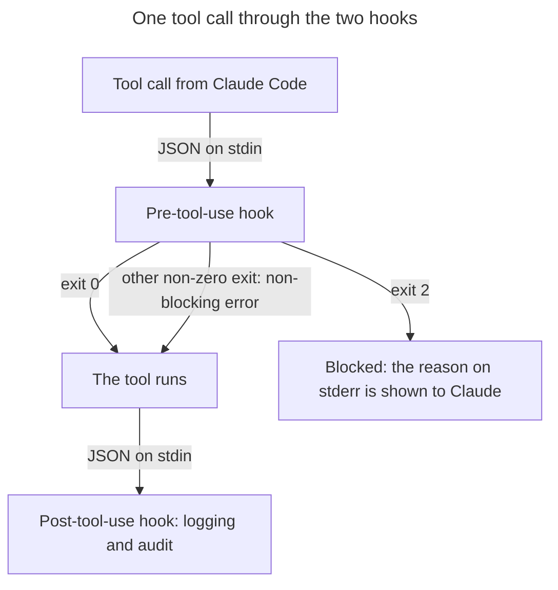
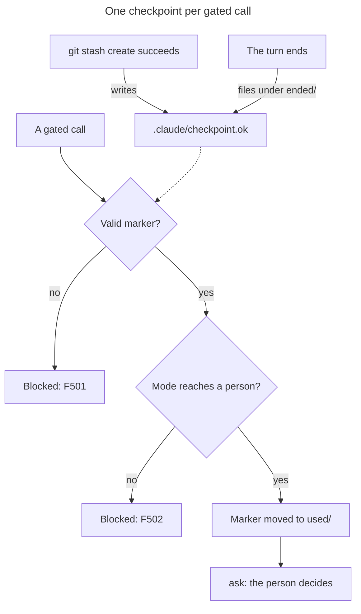
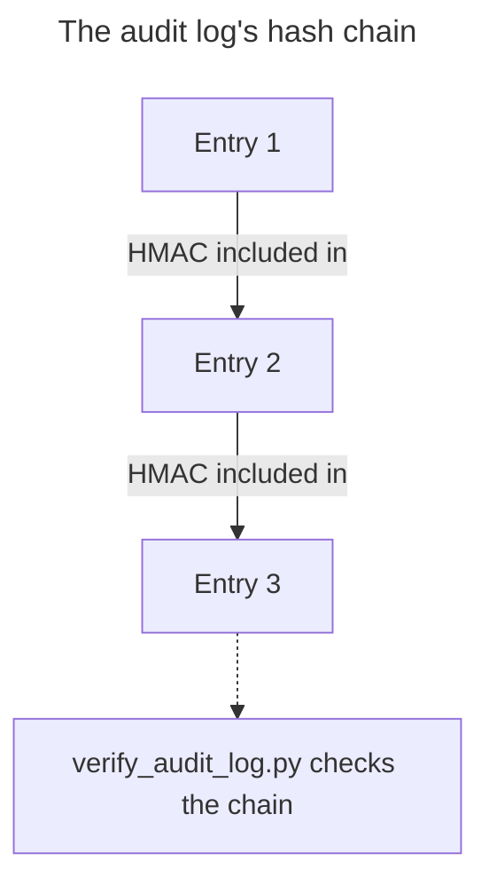

# Safety Hooks

This directory contains hooks that implement the VERIFY layer capabilities from the Agent Capability Standard.

## Spec-Aligned Hooks

These hooks directly implement capabilities defined in the standard's VERIFY layer:

| Hook | Event | Purpose |
|------|-------|---------|
| `pretooluse_require_checkpoint.sh` | PreToolUse (`Write`, `Edit`, `MultiEdit`, `NotebookEdit`, `Bash`) | Classify the call; one checkpoint marker per gated call; ask for approval; let a restore of a recorded checkpoint run as a rollback |
| `posttooluse_take_checkpoint.sh` | PostToolUse (`Bash`) | Write the checkpoint marker after a successful `git stash create`, filing a marker it replaces under `.claude/checkpoints/ended/` |
| `stop_end_checkpoints.sh` | Stop | End the marker's validity, filing it under `.claude/checkpoints/ended/`: the end of a turn is an execution boundary |
| `posttooluse_log_tool.sh` | PostToolUse, PostToolUseFailure (every tool) | Log every tool call as an action record (§6.4), with the configuration that decided it, for the audit trail and provenance; it is not an `audit` step |

The hooks apply the rules of
[STANDARD 1.2.0 §5.18](../spec/STANDARD-v1.2.0.md#518-tool-calling-hosts)
where Claude Code lets them, and do not claim the safety-layer class SL
([SECURITY.md §5.5](../spec/SECURITY.md#55-hooks-and-the-safety-layer-class)
says why). The Standard Agents binding claims it; the Python SDK adapter
meets it except the §5.18.10 check its conformance statement
(`tests/conformance/calls/statements/`) lists as not applied, and claims it
once that is applied.

## How Hooks Work




### Pre-Tool-Use Hooks

Run **before** a tool executes and can block operations. Claude Code passes
the tool call as a JSON object on stdin; exit 0 allows the call (with an
`ask` decision on stdout for a call that needs approval), and exit 2 blocks
it, with the reason on stderr shown to Claude (any other non-zero exit is a
non-blocking error, so the tool would still run). The reason opens with the
Standard's code and name for the refusal, such as `F501
CHECKPOINT_REQUIRED:`. Only Claude Code's JSON object is read: a payload that
is not one, or a system without `jq`, is blocked with `R407
SAFETY_CHECK_FAILED:`.

```bash
echo '{"tool_name": "Write", "tool_input": {"file_path": "a.py"}}' \
  | ./pretooluse_require_checkpoint.sh   # exit 2 without a valid marker
./pretooluse_require_checkpoint.sh '{"tool_name": "Bash", "tool_input": {"command": "ls"}}'   # $1 also works
```

### Post-Tool-Use Hooks

Run **after** a tool executes for logging and audit. Claude Code fires
`PostToolUse` after a call that succeeded and `PostToolUseFailure` after one
that failed; the audit hook is registered for both, for every tool. The tool
call arrives as JSON on stdin.

```bash
echo '{"hook_event_name": "PostToolUse", "tool_name": "Bash", "tool_input": {"command": "ls"}}' \
  | ./posttooluse_log_tool.sh
```

## Configuration

Hooks are configured in `hooks.json` (loaded automatically by the Claude Code plugin):

```json
{
  "hooks": {
    "PreToolUse": [
      {
        "matcher": "Write|Edit|MultiEdit|NotebookEdit|Bash",
        "hooks": [
          {
            "type": "command",
            "command": "${CLAUDE_PLUGIN_ROOT}/hooks/pretooluse_require_checkpoint.sh"
          }
        ]
      }
    ],
    "PostToolUse": [
      {
        "matcher": "*",
        "hooks": [
          {
            "type": "command",
            "command": "${CLAUDE_PLUGIN_ROOT}/hooks/posttooluse_log_tool.sh"
          }
        ]
      },
      {
        "matcher": "Bash",
        "hooks": [
          {
            "type": "command",
            "command": "${CLAUDE_PLUGIN_ROOT}/hooks/posttooluse_take_checkpoint.sh"
          }
        ]
      }
    ],
    "PostToolUseFailure": [
      {
        "matcher": "*",
        "hooks": [
          {
            "type": "command",
            "command": "${CLAUDE_PLUGIN_ROOT}/hooks/posttooluse_log_tool.sh"
          }
        ]
      }
    ],
    "Stop": [
      {
        "hooks": [
          {
            "type": "command",
            "command": "${CLAUDE_PLUGIN_ROOT}/hooks/stop_end_checkpoints.sh"
          }
        ]
      }
    ]
  }
}
```

Each hook entry specifies:
- **matcher**: Regex pattern matching tool names that trigger the hook (`*` matches every tool)
- **hooks**: Array of hook commands to execute
- **type**: Hook type (`command` for shell scripts)
- **command**: Path to the hook script (`${CLAUDE_PLUGIN_ROOT}` resolves to the plugin directory)

## Checkpoint System

`pretooluse_require_checkpoint.sh` classifies each call it is routed by its
effect (STANDARD 1.2.0 §5.18.3), with lists derived from the SDK mapper's
(`grounded_agency/capabilities/mapper.py`; `tests/test_hook_lists_match_mapper.py`
keeps the hook's read-only list a subset of the mapper's and its `git stash`
table equal to it):

- `Write`, `Edit`, `MultiEdit`, `NotebookEdit`: `mutate`.
- `Bash`: a command with any of `` ; & | < > $ ` ( ) { } \ `` or a line
  break may be more than one command or expand something, so it is `mutate`.
  Otherwise it is read as one simple command: an option that writes
  (`git ... --output`, `file -C`) is `mutate`; `git stash create` takes a
  checkpoint; `git stash list` and `git stash show` only read; `git stash pop
  <commit>` and `git stash apply <commit>` restore one (`rollback`) when
  `<commit>` is the full id of a commit a checkpoint marker recorded; any
  other `pop` or `apply`, a bare one included, is `mutate`, since git applies
  any merge commit as if it were a stash; any other `git stash` form
  is `mutate`; a command on the read-only list (`ls`, `cat`, `head`, `tail`,
  `wc`, `pwd`, `grep`, `stat`, `file`, `du`, `df`, `which`, `whoami`,
  `uname`, `echo`, `printf`, `git status`, `git log`, `git diff`, `git show`,
  `git rev-parse`, `git ls-files`) only reads and needs nothing; anything else
  is `mutate`.

Then:

- **Rollback** (`git stash pop|apply <commit>`): allowed when the marker,
  or a marker filed under `.claude/checkpoints/used/` or
  `.claude/checkpoints/ended/`, recorded `<commit>` as its `commit`, so the
  checkpoint was taken in the project. It uses no checkpoint: one that was
  used, expired, ended with its turn or was replaced can still be restored.
  Restoring anything else is a `mutate`.
- **Mutate**: the marker `.claude/checkpoint.ok` must exist, be a regular
  file (not a symlink, SEC-006), be a JSON object with a `checkpoint_id`, a
  `created_at` and an `expires_at` in whole seconds of at most 12 digits, the
  first not in the future and the second at most 1800 seconds (30 minutes)
  after it, and not have expired (SEC-001); otherwise the call is blocked
  with `F501 CHECKPOINT_REQUIRED:`, an expired marker is filed under
  `.claude/checkpoints/ended/` and a malformed one is removed. Unless `ACS_HOOK_APPROVAL=off`,
  the permission mode must put the call to a person (`default`,
  `acceptEdits` or `plan`); in any other mode the call is blocked with `F502
  APPROVAL_REQUIRED:` and the marker is left in place. The call then **uses
  the marker up**: one rename moves it into `.claude/checkpoints/used/`, so
  two calls never pass on one marker (the one that loses is blocked with
  F501). Finally, unless `ACS_HOOK_APPROVAL=off`, the hook answers
  `permissionDecision: "ask"` with an `F502 APPROVAL_REQUIRED:` reason, so
  Claude Code asks the person; with `off`, approval is left to Claude Code's
  permission rules, and every audit line records that setting.
- A failure of the hook itself blocks the call with `R407
  SAFETY_CHECK_FAILED:` (exit 2; any other exit code would let it run).

The marker is written by `posttooluse_take_checkpoint.sh` after a `git stash
create` that succeeded (the call that saves the state takes the checkpoint,
§5.18.6), and by `CheckpointTracker(marker_dir=".claude")` in the Python SDK.
Its expiry is `ACS_CHECKPOINT_MAX_AGE` seconds when that is an integer from 1
to 1800, else 1800 (the Standard caps a checkpoint's maximum age at 30
minutes). A new marker replaces the old one, which is filed under
`.claude/checkpoints/ended/`. `stop_end_checkpoints.sh` files the marker
there when a turn ends: the end of a turn is an execution boundary. Each
gated call needs its own checkpoint; every marker filed under `used/` or
`ended/` stays the record of a checkpoint taken, which a rollback reads.



The marker file holds a JSON object. `checkpoint_id`, `created_at` and
`expires_at` are checked; `commit` is what a rollback may restore (a full
commit id, or `HEAD` for a clean tree, which no rollback names); `source` is
written for the reader:

```json
{"checkpoint_id": "3f2a...", "commit": "3f2a...", "created_at": 1706000000, "expires_at": 1706001800, "source": "git stash create"}
```

## Audit Trail

The `posttooluse_log_tool.sh` hook keeps the plugin's log of tool calls,
one action record ([STANDARD v1.2 §6.4](../spec/STANDARD-v1.2.0.md#64-audit-records))
per call, in `.claude/audit.log`. It is not an `audit` step: the `audit`
skill writes its own records, of the events a workflow reports.

- Logs every tool call that ran, one JSON line per call (the `PostToolUse` and `PostToolUseFailure` matchers are `*`). A call that a pre-tool-use hook or a permission rule refused did not run and is not logged
- Never writes the tool input: a command, a file's content or a skill's arguments can hold a credential. A SHA-256 digest of the input is written in its place
- Uses HMAC-SHA256 chaining for tamper detection (SEC-005)
- Each entry includes the HMAC of the previous entry, creating a hash chain
- Serializes concurrent runs (tool calls made in parallel) with flock(2) on the log file itself, opened for append, taken by `perl` or, without it, by `flock`, so the chain stays in order and sessions using either exclude each other. There is no separate lock file, and the kernel releases the lock when its holder exits, however it exits. A run tries for at most `AUDIT_LOCK_WAIT` seconds (default 40, at most 55) and then appends without the lock, with a warning, at once where the lock cannot be taken at all: the verifier reports an entry out of chain order, and a held lock cannot silence the log

The log is a best-effort capture (STANDARD v1.2 §6.4): it can miss a call,
but never silently. When it does not log a call, or logs it without a valid
HMAC or chain link, the hook says why on standard error and exits 1, which
Claude Code shows as a non-blocking hook error: no `jq`, a symlinked
`audit.log` (refused, SEC-006), no `openssl` (no line is written: an unsigned
one would make every later line fail verification), a line that could not
be built or written, a last line whose `hmac` cannot be read (the line is
written and starts a new chain), an input digest that could not be computed
(the line is written with `unavailable`). It exits 0 for a call it logged and
for input that is not a tool call.

As a store ([STANDARD v1.2 §6.6](../spec/STANDARD-v1.2.0.md#66-evidence-records-and-stores)),
the log is `durable`: a file in the project, which outlives the session,
with no retention of its own: lines are kept until someone removes them
(§6.3).

Each entry is an action record with these fields, in this order:

| Field | Value |
|-------|-------|
| `action_id` | The call's `tool_use_id`, or `<timestamp>-<pid>-<8 hex digits>` when the input names none |
| `timestamp` | Time of the entry, ISO 8601 in UTC |
| `actor` | `agent` |
| `intent` | `<tool> call` |
| `status` | `executed` (the call succeeded, `PostToolUse`) or `failed` (`PostToolUseFailure`) |
| `tool` | Tool name |
| `call_id` | The call's `tool_use_id`, when the input names one |
| `details` | `event` (the hook event), `skill` (the skill name, on a `Skill` call only) and `input_sha256`: SHA-256 of the tool input as compact JSON with sorted keys (`jq -cS .tool_input`), or `unavailable` when it cannot be computed (no SHA-256 tool, or the one used fails) |
| `recorded_by` | The layer and the configuration that decided the call (STANDARD 1.2.0 §5.18.8): `name`, `version` (from `.claude-plugin/plugin.json`), `config_sha256` (SHA-256 of `hooks/hooks.json`) and `settings`, the effective `approval` (`ask`, or `off` with `ACS_HOOK_APPROVAL=off`) and `checkpoint_max_age_s` (`ACS_CHECKPOINT_MAX_AGE`, 1 to 1800, default 1800) |
| `prev_hmac` | HMAC of the previous entry, empty on the first |
| `hmac` | HMAC of this entry's other fields, as written |

A `Skill` call with the input `{"skill": "checkpoint"}`, logged with `AUDIT_HMAC_KEY=example-key`:

```json
{"action_id":"toolu_01AbCdEf","timestamp":"2026-11-15T12:00:00Z","actor":"agent","intent":"Skill call","status":"executed","tool":"Skill","call_id":"toolu_01AbCdEf","details":{"event":"PostToolUse","skill":"checkpoint","input_sha256":"a69e8f80ec2830e5006e68ce275a5077f299455c58def8f4d12762083815e11a"},"recorded_by":{"name":"agent-capability-standard plugin hooks","version":"2.0.0","config_sha256":"6c98aa16607af86666be909d5d881ee687786e34d10ad39fadd6edd5f21285e3","settings":{"approval":"ask","checkpoint_max_age_s":1800}},"prev_hmac":"","hmac":"5313a3a6fd0a51c83cad1f16e468199cbc2c648c528f46d0bcdd4c66c53e12ac"}
```

A reader who holds a tool input can confirm it against `input_sha256`. The
digest is not a way to keep a short or guessable input secret: such an input
can be found by trying candidates. The digest is taken over the text jq
prints, and jq 1.6 and 1.7 print some numbers differently (jq 1.7 keeps
`1.000` as written, jq 1.6 prints `1`), so an input that holds such a number
is confirmed with the jq version that wrote the log.

A log begun before Standard 1.2 opens with entries of an earlier form: `ts`,
`event`, `tool`, `skill`, `input_sha256`, `prev_hmac`, `hmac`, and, before the
hook logged every tool call, `ts`, `skill`, `args`, `prev_hmac`, `hmac`, for
`Skill` calls only. The chain continues across each change and the verifier
accepts every form; the earliest entries still hold the skill arguments they
were written with.




Verify audit log integrity:
```bash
python tools/verify_audit_log.py
```

Set a custom HMAC key via the `AUDIT_HMAC_KEY` environment variable.

## Hooks in Skill Frontmatter

Six skills (`audit`, `checkpoint`, `persist`, `rollback`, `send`, `transform`)
declare hooks of their own in the frontmatter of their `SKILL.md`. Claude Code
registers them when the skill is invoked. Their command hooks follow the same
contract as the hooks here: the tool call as JSON on stdin, exit 2 to block
with the reason on stderr, and a digest in place of the tool input in what
they log. Their prompt hooks hold only model-judged additions: a check the
Standard requires (approval, the checkpoint, rollback history, the
destination policy, secrets) is decided by code (STANDARD 1.2.0 §5.18.10).
[SECURITY.md §5.4](../spec/SECURITY.md#54-checks-enforced-by-code-and-checks-a-model-judges)
maps every condition of the skills' hooks to the Standard's checks or marks
it a model-judged addition. The rollback skill's command hook reads the
same markers as the hook here: a `git stash pop` or `git stash apply` that
does not name a commit a marker recorded (the marker, `used/` or `ended/`)
restores no checkpoint and is blocked with `F503 ROLLBACK_FAILED:`.

The `persist` skill's command hook and the `audit` skill's `Bash` hook share
one secret scan, `secret_scan.sh` in this directory: each copies it verbatim
between its `# BEGIN secret-scan` and `# END secret-scan` lines (a skill
copied out of the plugin keeps working), and `tests/test_skill_hooks.py`
keeps every copy equal to the file. The file is not a hook: `hooks.json`
does not run it. The scan blocks content written to memory, and a record
appended to `.claude/audit/records.jsonl`, that holds a credential-shaped
value, with `F504 CONSTRAINT_VIOLATED:` (STANDARD v1.2 §6.7).

## Relationship to Spec

These hooks implement runtime enforcement of VERIFY layer requirements:

| Spec Field | Hook Implementation |
|------------|---------------------|
| `requires_checkpoint: true` | `pretooluse_require_checkpoint.sh` blocks without a valid marker and uses one up per call (F501) |
| `requires_approval: true` | `pretooluse_require_checkpoint.sh` asks for approval in modes that reach a person, and blocks in others (F502) |
| `checkpoint` → `rollback` (`requires`) | `pretooluse_require_checkpoint.sh` counts a restore as a rollback only for a commit a marker recorded, so a checkpoint was taken before it; any other restore is a `mutate` (F501) |
| Taking a checkpoint (§5.18.6) | `posttooluse_take_checkpoint.sh` writes the marker after a successful `git stash create` |
| Execution boundary (§5.18.6) | `stop_end_checkpoints.sh` removes the marker when a turn ends |
| Audit records (§6.4), the layer's identity (§5.18.8) | `posttooluse_log_tool.sh` writes an action record of every tool call, with the configuration that decided it; the `audit` capability is the `audit` skill's |

The hooks apply no domain profile (Standard 1.2.0 §5.21): to apply one to
tool calls, use the Python adapter (`GroundedAgentConfig(profiles=...)`), or
a host that gives profiles to its runs.

See `schemas/capability_ontology.yaml` for full capability definitions.
