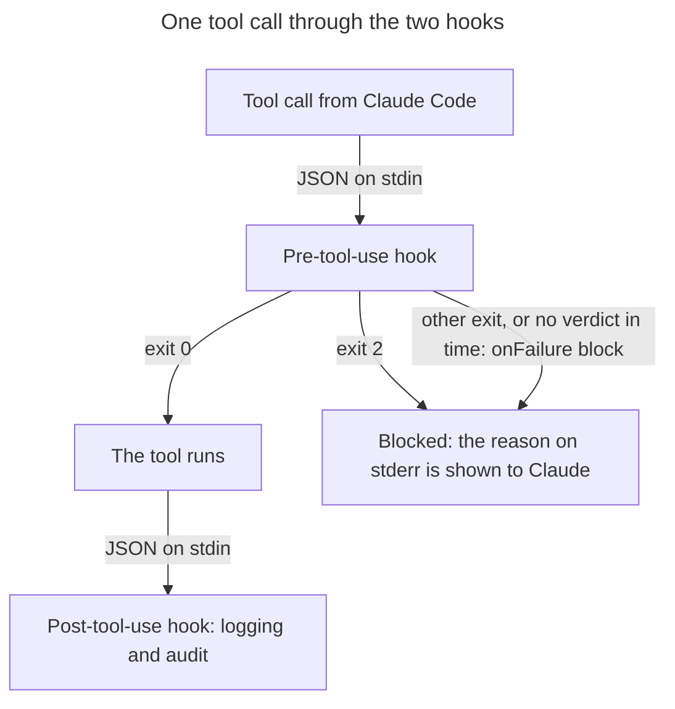
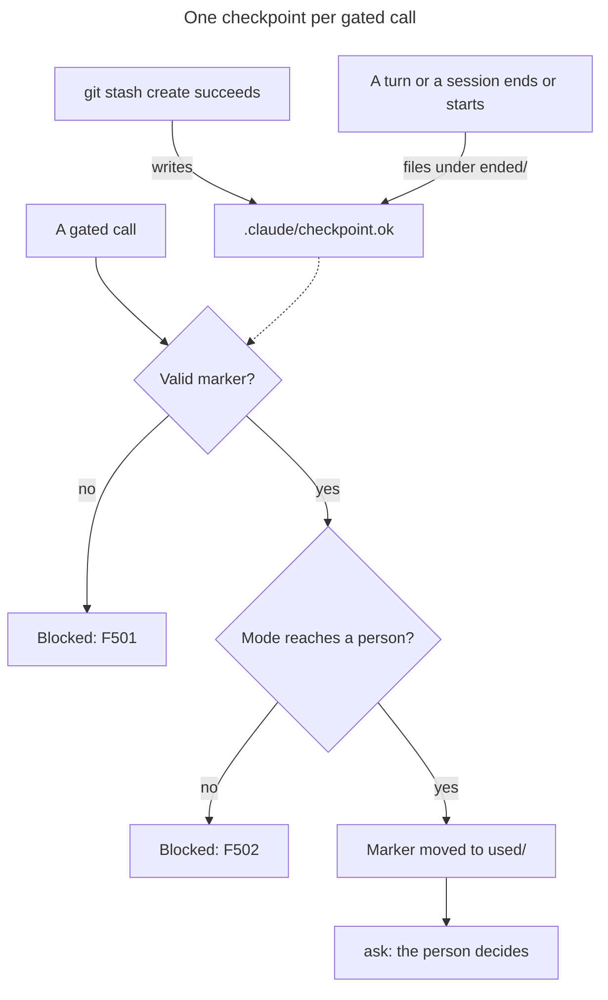
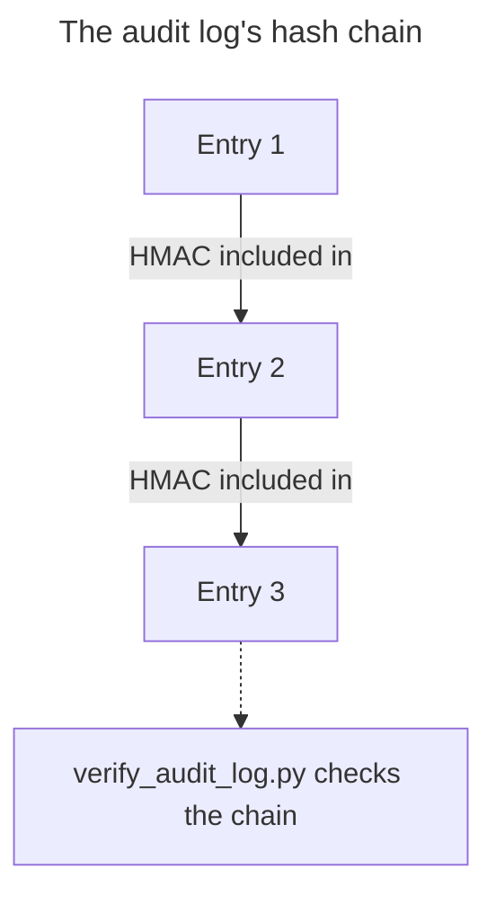

# Safety Hooks

This directory contains hooks that implement the VERIFY layer capabilities from the Agent Capability Standard.

## Spec-Aligned Hooks

These hooks directly implement capabilities defined in the standard's VERIFY layer:

| Hook | Event | Purpose |
|------|-------|---------|
| `pretooluse_require_checkpoint.sh` | PreToolUse (every tool, `onFailure: "block"`) | Classify the call; one checkpoint marker per gated call; ask for approval; let a restore of a recorded checkpoint run as a rollback |
| `posttooluse_take_checkpoint.sh` | PostToolUse (`Bash`) | Write the checkpoint marker after a successful `git stash create`, with its commit entered in the git directory (`<git dir>/acs/checkpoints/commits/`), filing a marker it replaces under `.claude/checkpoints/ended/` |
| `stop_end_checkpoints.sh` | Stop, StopFailure, UserPromptSubmit, SessionStart, SessionEnd | End the marker's validity, filing it under `.claude/checkpoints/ended/`: the end and the start of a turn or a session are execution boundaries |
| `posttooluse_log_tool.sh` | PostToolUse, PostToolUseFailure (every tool) | Log every tool call as an action record (§6.4), with the configuration that decided it, for the audit trail and provenance; it is not an `audit` step |

The hooks apply the rules of
[STANDARD 1.2.0 §5.18](../spec/STANDARD-v1.2.0.md#518-tool-calling-hosts)
where Claude Code lets them, and do not claim the safety-layer class SL
([SECURITY.md §5.5](../spec/SECURITY.md#55-hooks-and-the-safety-layer-class)
says why). The Python SDK adapter and the Standard Agents binding claim it
(their conformance statements are in `tests/conformance/calls/statements/`).

## How Hooks Work




### Pre-Tool-Use Hooks

Run **before** a tool executes and can block operations. Claude Code passes
the tool call as a JSON object on stdin; exit 0 allows the call (with an
`ask` decision on stdout for a call that needs approval), and exit 2 blocks
it, with the reason on stderr shown to Claude. Any other non-zero exit, a
run that cannot start and one that gives no verdict within the hook's
`timeout` (30 seconds) are failures: `hooks.json` sets `onFailure: "block"`
on this hook, so Claude Code blocks the call (a Claude Code that does not
support the setting treats a failure as a non-blocking error and runs the
tool). Every tool call is routed here (matcher `*`). The reason opens with the
Standard's code and name for the refusal, such as `F501
CHECKPOINT_REQUIRED:`. Only Claude Code's JSON object is read: a payload that
is not one, or a system without `jq`, is blocked with `R407
SAFETY_CHECK_FAILED:`.

```bash
echo '{"tool_name": "Write", "tool_input": {"file_path": "a.py"}}' \
  | ./pretooluse_require_checkpoint.sh   # exit 2 without a valid marker
./pretooluse_require_checkpoint.sh '{"tool_name": "Bash", "tool_input": {"command": "ls"}}'   # $1 also works
```

### Post-Tool-Use Hooks

Run **after** a tool executes for logging and audit. Claude Code fires
`PostToolUse` after a call that succeeded and `PostToolUseFailure` after one
that failed; the audit hook is registered for both, for every tool. The tool
call arrives as JSON on stdin.

```bash
echo '{"hook_event_name": "PostToolUse", "tool_name": "Bash", "tool_input": {"command": "ls"}}' \
  | ./posttooluse_log_tool.sh
```

## Configuration

Hooks are configured in `hooks.json` (loaded automatically by the Claude Code plugin):

```json
{
  "hooks": {
    "PreToolUse": [
      {
        "matcher": "*",
        "hooks": [
          {
            "type": "command",
            "command": "${CLAUDE_PLUGIN_ROOT}/hooks/pretooluse_require_checkpoint.sh",
            "timeout": 30,
            "onFailure": "block"
          }
        ]
      }
    ],
    "PostToolUse": [
      {
        "matcher": "*",
        "hooks": [
          {
            "type": "command",
            "command": "${CLAUDE_PLUGIN_ROOT}/hooks/posttooluse_log_tool.sh"
          }
        ]
      },
      {
        "matcher": "Bash",
        "hooks": [
          {
            "type": "command",
            "command": "${CLAUDE_PLUGIN_ROOT}/hooks/posttooluse_take_checkpoint.sh"
          }
        ]
      }
    ],
    "PostToolUseFailure": [
      {
        "matcher": "*",
        "hooks": [
          {
            "type": "command",
            "command": "${CLAUDE_PLUGIN_ROOT}/hooks/posttooluse_log_tool.sh"
          }
        ]
      }
    ],
    "UserPromptSubmit": [
      {
        "hooks": [
          {
            "type": "command",
            "command": "${CLAUDE_PLUGIN_ROOT}/hooks/stop_end_checkpoints.sh"
          }
        ]
      }
    ],
    "Stop": [
      {
        "hooks": [
          {
            "type": "command",
            "command": "${CLAUDE_PLUGIN_ROOT}/hooks/stop_end_checkpoints.sh"
          }
        ]
      }
    ],
    "StopFailure": [
      {
        "hooks": [
          {
            "type": "command",
            "command": "${CLAUDE_PLUGIN_ROOT}/hooks/stop_end_checkpoints.sh"
          }
        ]
      }
    ],
    "SessionStart": [
      {
        "hooks": [
          {
            "type": "command",
            "command": "${CLAUDE_PLUGIN_ROOT}/hooks/stop_end_checkpoints.sh"
          }
        ]
      }
    ],
    "SessionEnd": [
      {
        "hooks": [
          {
            "type": "command",
            "command": "${CLAUDE_PLUGIN_ROOT}/hooks/stop_end_checkpoints.sh"
          }
        ]
      }
    ]
  }
}
```

Each hook entry specifies:
- **matcher**: Regex pattern matching tool names that trigger the hook (`*` matches every tool; an event with no tool, such as Stop, has none)
- **hooks**: Array of hook commands to execute
- **type**: Hook type (`command` for shell scripts)
- **command**: Path to the hook script (`${CLAUDE_PLUGIN_ROOT}` resolves to the plugin directory)
- **timeout**: Seconds the hook may run (Claude Code's default otherwise)
- **onFailure**: `block` makes a run that fails, cannot start or times out block the call

## Checkpoint System

`pretooluse_require_checkpoint.sh` classifies every tool call by its
effect (STANDARD 1.2.0 §5.18.3), with lists derived from the SDK mapper's
(`grounded_agency/capabilities/mapper.py`; `tests/test_hook_lists_match_mapper.py`
keeps the hook's tool list and read-only list subsets of the mapper's and its
`git stash` table equal to it):

- A tool the mapper maps to a capability that needs neither a checkpoint nor
  approval (`Read`, `Glob`, `Grep`, `LS`, `WebFetch`, `WebSearch`, `Task`,
  `Agent`, `Skill`, `AskUserQuestion`, `TodoWrite`, `TaskList`, `TaskGet`,
  `TaskCreate`, `TaskUpdate`, `ToolSearch`, `BashOutput`, `TaskOutput`,
  `ListMcpResourcesTool`, `ReadMcpResourceTool`, `ExitPlanMode`, and the
  older names `AskUser` and `TodoRead`): needs nothing.
- `Write`, `Edit`, `MultiEdit`, `NotebookEdit`: `mutate`.
- `Bash`: a command over 4096 bytes is `mutate`, decided before anything
  else is done with it, so no reading runs into the hook's time limit (a
  command padded with 50,000 blanks once took 44 seconds to trim). A command
  with any of `` ; & | < > $ ` ( ) { } \ `` or a line
  break may be more than one command or expand something, so it is `mutate`.
  Otherwise it is read as one simple command, its words split and dequoted
  as bash does (`"--output=x"` is `--output=x`; an unbalanced quote is
  `mutate`): an option that writes is `mutate` (for `git`, `--output` or an
  abbreviation of it such as `--outp`; for `file`, `-C` or `-p` in any short
  option, or `--compile` or `--preserve-date` or an abbreviation such as
  `--compi`), and so is a `git` or `file` command with a word holding an
  unquoted `*`, `?` or `[`, which bash replaces with file names, options
  included; `git stash create` takes a
  checkpoint; `git stash list` and `git stash show` only read; `git stash pop
  <commit>` and `git stash apply <commit>` restore one (`rollback`) when
  `<commit>` is the full id of a commit a checkpoint recorded and the call
  runs in the project's repository; any
  other `pop` or `apply`, a bare one included, is `mutate`, since git applies
  any merge commit as if it were a stash; any other `git stash` form
  is `mutate`; a command on the read-only list (`ls`, `cat`, `head`, `tail`,
  `wc`, `pwd`, `grep`, `stat`, `file`, `du`, `df`, `which`, `whoami`,
  `uname`, `echo`, `printf`, `git status`, `git log`, `git diff`, `git show`,
  `git rev-parse`, `git ls-files`) only reads and needs nothing; anything else
  is `mutate`. A git command that would only read (`git stash list` and
  `git stash show` included) is `mutate` where the call's directory (the
  payload's `cwd`, else the project directory) is in a partial clone (a
  promisor remote, or `extensions.partialClone`), or where git cannot say:
  there git fetches each object it lacks from the promisor remote, so `git
  show <id>` sends the id to that host. `git stash create` still takes a
  checkpoint there (it reads only what the local state holds).
- Any other tool (`Monitor` and `PowerShell`, which run commands,
  `EnterWorktree`, `ExitWorktree`, every MCP tool, a tool the hook does not
  know) is unbound: `mutate`, since a layer cannot know that an unknown tool
  only reads (§5.18.2). Its approval request says
  `<tool> (unbound: treated as a mutation, STANDARD 1.2.0 §5.18.2)`.

Then:

- **Rollback** (`git stash pop|apply <commit>`): allowed when a checkpoint
  of the project recorded `<commit>`, an entry
  `<git dir>/acs/checkpoints/commits/<commit>` that
  `posttooluse_take_checkpoint.sh` writes for each checkpoint it takes, and
  the call runs in the project's repository (its `cwd`; a restore into
  another repository or worktree restores other state). The entries are in
  the project's git directory, outside the work tree: a clone, a checkout
  or an applied stash can put files in the work tree, `.claude/` included,
  but none there. The check is one lookup, however many checkpoints were
  taken. It uses no checkpoint: one that was used, expired, ended with its
  turn or was replaced can still be restored. Restoring anything else is a
  `mutate`.
- **The layer's records**: a `mutate` call that names them, a `Write`,
  `Edit`, `MultiEdit` or `NotebookEdit` of a path, or a `Bash`, `Monitor`
  or `PowerShell` command whose text holds `checkpoint.ok`,
  `.claude/checkpoints` or `acs/checkpoints`, is blocked with
  `F504 CONSTRAINT_VIOLATED:`: only the hooks write them. The text is read
  as a path is: in any letter case, with a run of slashes and `./` segments
  as one slash, and, in a text of at most 4096 bytes, each `x/../`
  resolved. Reading them is not refused, and a path a command builds when it
  runs is not seen.
- **Mutate**: the marker `.claude/checkpoint.ok` must exist, be a regular
  file (not a symlink, SEC-006) that git does not track (a repository can
  ship a tracked one; git is asked from the marker's own directory, so a
  linked or submodule `.claude` counts too, and the file is left as it is),
  be a JSON object with a `checkpoint_id`, a
  `created_at` and an `expires_at` in whole seconds of at most 12 digits, the
  first not in the future and the second at most 1800 seconds (30 minutes)
  after it, and be within both its `expires_at` and the layer's maximum age,
  `ACS_CHECKPOINT_MAX_AGE` seconds after its `created_at` (SEC-001), whoever
  wrote it; otherwise the call is blocked
  with `F501 CHECKPOINT_REQUIRED:`, a marker past either is filed under
  `.claude/checkpoints/ended/` and a malformed one is removed. Unless `ACS_HOOK_APPROVAL=off`,
  the permission mode must put the call to a person (`default`,
  `acceptEdits` or `plan`); in any other mode the call is blocked with `F502
  APPROVAL_REQUIRED:` and the marker is left in place. The call then **uses
  the marker up**: one rename moves it into `.claude/checkpoints/used/`, so
  two calls never pass on one marker (the one that loses is blocked with
  F501). Finally, unless `ACS_HOOK_APPROVAL=off`, the hook answers
  `permissionDecision: "ask"` with an `F502 APPROVAL_REQUIRED:` reason, so
  Claude Code asks the person; with `off`, approval is left to Claude Code's
  permission rules, and every audit line records that setting. The marker
  was used before the person answers, and Claude Code runs no hook when
  they do: a call allowed after the marker's maximum age, or after a
  boundary of another session, runs all the same (a host gap of these
  hooks, which do not claim the safety-layer class; SECURITY.md §5.5).
- A failure of the hook itself blocks the call with `R407
  SAFETY_CHECK_FAILED:` (exit 2; another exit code is blocked by
  `onFailure: "block"` only where Claude Code supports it).

The marker is written by `posttooluse_take_checkpoint.sh` after a `git stash
create` that succeeded (the call that saves the state takes the checkpoint,
§5.18.6), and by `CheckpointTracker(marker_dir=".claude")` in the Python SDK.
The hook writes none for a command over 4096 bytes, for a call run in the
background (its output is not yet the command's), for one whose `cwd` is in
another repository than the project's, for a commit it has no git directory
to enter in, or for output that is neither a commit id nor empty; empty
output (nothing to save) gives `HEAD` as the restore point only when the
project's tracked files and index are `HEAD`'s.
Its expiry is `ACS_CHECKPOINT_MAX_AGE` seconds when that is an integer from 1
to 1800, else 1800 (the Standard caps a checkpoint's maximum age at 30
minutes). Before it writes the marker, the hook enters the commit in
`<git dir>/acs/checkpoints/commits/` (an empty file named by the commit),
where a rollback looks it up. A new marker replaces the old one, which is
filed under `.claude/checkpoints/ended/`. `stop_end_checkpoints.sh` files the
marker there at an execution boundary: when a turn ends (`Stop`, or
`StopFailure` when an API error ended it), when the next turn starts
(`UserPromptSubmit`, which also ends a marker an interrupted turn left) and
when a session starts or ends (`SessionStart`, `SessionEnd`).

The hooks' scope is the project directory: every session in it, and each
session's subagents, share one marker, its history and the commit entries,
so a boundary of any session ends the marker.
Each gated call needs its own checkpoint; every marker filed under `used/`
or `ended/` stays the record of a checkpoint taken.



The marker file holds a JSON object. `checkpoint_id`, `created_at` and
`expires_at` are checked; `commit` names the restore point (a full commit
id, entered in the git directory, or `HEAD` for a clean tree), and `source`
is written for the reader:

```json
{"checkpoint_id": "3f2a...", "commit": "3f2a...", "created_at": 1706000000, "expires_at": 1706001800, "source": "git stash create"}
```

## Audit Trail

The `posttooluse_log_tool.sh` hook keeps the plugin's log of tool calls,
one action record ([STANDARD v1.2 §6.4](../spec/STANDARD-v1.2.0.md#64-audit-records))
per call, in `.claude/audit.log`. It is not an `audit` step: the `audit`
skill writes its own records, of the events a workflow reports.

- Logs every tool call that ran, one JSON line per call (the `PostToolUse` and `PostToolUseFailure` matchers are `*`). A call that a pre-tool-use hook or a permission rule refused did not run and is not logged
- Never writes the tool input: a command, a file's content or a skill's arguments can hold a credential. A SHA-256 digest of the input is written in its place
- Uses HMAC-SHA256 chaining for tamper detection (SEC-005)
- Each entry includes the HMAC of the previous entry, creating a hash chain
- Serializes concurrent runs (tool calls made in parallel) with flock(2) on the log file itself, opened for append, taken by `perl` or, without it, by `flock`, so the chain stays in order and sessions using either exclude each other. There is no separate lock file, and the kernel releases the lock when its holder exits, however it exits. A run tries for at most `AUDIT_LOCK_WAIT` seconds (default 40, at most 55) and then appends without the lock, with a warning, at once where the lock cannot be taken at all: the verifier reports an entry out of chain order, and a held lock cannot silence the log

The log is a best-effort capture (STANDARD v1.2 §6.4): it can miss a call,
but never silently. When it does not log a call, or logs it without a valid
HMAC or chain link, the hook says why on standard error and exits 1, which
Claude Code shows as a non-blocking hook error: no `jq`, a symlinked
`audit.log` (refused, SEC-006), no `openssl` (no line is written: an unsigned
one would make every later line fail verification), a line that could not
be built or written, a last line whose `hmac` cannot be read (the line is
written and starts a new chain), an input digest that could not be computed
(the line is written with `unavailable`), and input `jq` cannot parse:
Claude Code passes a call's input and result on as they are, and `jq`
refuses JSON nested past its depth limit or holding a lone surrogate escape
(a string cut in the middle of an emoji), so such input may be a tool call.
It exits 0 for a call it logged and for JSON that is not a tool call (no
input, a value that is not an object, no string `tool_name`).

As a store ([STANDARD v1.2 §6.6](../spec/STANDARD-v1.2.0.md#66-evidence-records-and-stores)),
the log is `durable`: a file in the project, which outlives the session,
with no retention of its own: lines are kept until someone removes them
(§6.3).

Each entry is an action record with these fields, in this order:

| Field | Value |
|-------|-------|
| `action_id` | The call's `tool_use_id`, or `<timestamp>-<pid>-<8 hex digits>` when the input names none |
| `timestamp` | Time of the entry, ISO 8601 in UTC |
| `actor` | `agent` |
| `intent` | `<tool> call` |
| `status` | `executed` (the call succeeded, `PostToolUse`) or `failed` (`PostToolUseFailure`) |
| `tool` | Tool name |
| `call_id` | The call's `tool_use_id`, when the input names one |
| `details` | `event` (the hook event), `skill` (the skill name, on a `Skill` call only) and `input_sha256`: SHA-256 of the tool input as compact JSON with sorted keys (`jq -cS .tool_input`), or `unavailable` when it cannot be computed (no SHA-256 tool, or the one used fails) |
| `recorded_by` | The layer and the configuration that decided the call (STANDARD 1.2.0 §5.18.8): `name`, `version` (from `.claude-plugin/plugin.json`), `config_sha256` (SHA-256 of `hooks/hooks.json`) and `settings`, the effective `approval` (`ask`, or `off` with `ACS_HOOK_APPROVAL=off`) and `checkpoint_max_age_s` (`ACS_CHECKPOINT_MAX_AGE`, 1 to 1800, default 1800) |
| `prev_hmac` | HMAC of the previous entry, empty on the first |
| `hmac` | HMAC of this entry's other fields, as written |

A `Skill` call with the input `{"skill": "checkpoint"}`, logged with `AUDIT_HMAC_KEY=example-key`:

```json
{"action_id":"toolu_01AbCdEf","timestamp":"2026-11-15T12:00:00Z","actor":"agent","intent":"Skill call","status":"executed","tool":"Skill","call_id":"toolu_01AbCdEf","details":{"event":"PostToolUse","skill":"checkpoint","input_sha256":"a69e8f80ec2830e5006e68ce275a5077f299455c58def8f4d12762083815e11a"},"recorded_by":{"name":"agent-capability-standard plugin hooks","version":"2.0.0","config_sha256":"0ceea65560acc150f04a3b2a0fda541747b3dd4da7d8908d55fb5a6dbbbcc9f1","settings":{"approval":"ask","checkpoint_max_age_s":1800}},"prev_hmac":"","hmac":"c54196a4763dcfe01a567d39bfa73f5e43d16ede4f10984ea5861a6e2ad94900"}
```

A reader who holds a tool input can confirm it against `input_sha256`. The
digest is not a way to keep a short or guessable input secret: such an input
can be found by trying candidates. The digest is taken over the text jq
prints, and jq 1.6 and 1.7 print some numbers differently (jq 1.7 keeps
`1.000` as written, jq 1.6 prints `1`), so an input that holds such a number
is confirmed with the jq version that wrote the log.

A log begun before Standard 1.2 opens with entries of an earlier form: `ts`,
`event`, `tool`, `skill`, `input_sha256`, `prev_hmac`, `hmac`, and, before the
hook logged every tool call, `ts`, `skill`, `args`, `prev_hmac`, `hmac`, for
`Skill` calls only. The chain continues across each change and the verifier
accepts every form; the earliest entries still hold the skill arguments they
were written with.




Verify audit log integrity:
```bash
python tools/verify_audit_log.py
```

Set a custom HMAC key via the `AUDIT_HMAC_KEY` environment variable.

## Hooks in Skill Frontmatter

Six skills (`audit`, `checkpoint`, `persist`, `rollback`, `send`, `transform`)
declare hooks of their own in the frontmatter of their `SKILL.md`. Claude Code
registers them when the skill is invoked. Their command hooks follow the same
contract as the hooks here: the tool call as JSON on stdin, exit 2 to block
with the reason on stderr, and a digest in place of the tool input in what
they log. Each sets `onFailure: block` and a 30-second `timeout`, as
`hooks.json` does for the pre-tool-use hook, so a run that fails, cannot
start or gives no verdict in time blocks the call; each reads a command in
time that grows with its length alone. Their prompt hooks hold only model-judged additions: a check the
Standard requires (approval, the checkpoint, rollback history, the
destination policy, secrets) is decided by code (STANDARD 1.2.0 §5.18.10).
[SECURITY.md §5.4](../spec/SECURITY.md#54-checks-enforced-by-code-and-checks-a-model-judges)
maps every condition of the skills' hooks to the Standard's checks or marks
it a model-judged addition. The rollback skill's command hook reads the
same entries as the hook here: a `git stash pop` or `git stash apply` that
does not name a commit a checkpoint entered in `<git dir>/acs/checkpoints/commits/`,
or that runs in another repository, restores no checkpoint and is blocked
with `F503 ROLLBACK_FAILED:`.

The `persist` skill's command hook and the `audit` skill's `Bash` hook share
one secret scan, `secret_scan.sh` in this directory: each copies it verbatim
between its `# BEGIN secret-scan` and `# END secret-scan` lines (a skill
copied out of the plugin keeps working), and `tests/test_skill_hooks.py`
keeps every copy equal to the file. The file is not a hook: `hooks.json`
does not run it. The scan blocks content written to memory, and a record
appended to `.claude/audit/records.jsonl`, that holds a credential-shaped
value, with `F504 CONSTRAINT_VIOLATED:` (STANDARD v1.2 §6.7). The `persist`
hook scans the text a call carries and the lines the file will hold after it
that it does not hold now, each also with its JSON-style escapes decoded, so
a credential whose key is already in the file, or that two edits build, is
read whole. GNU grep reads the scan's patterns in time linear in the text.

The `send` and `audit` skills' `Bash` hooks share one reader of a command's
words, `shell_words.jq` in this directory, copied the same way between
`# BEGIN shell-words` and `# END shell-words` and kept equal by the same
tests. It reads a command's simple commands and their words as the shell
passes them (quotes removed, unquoted glob characters marked, a
redirection's target and whether it writes) and names what it cannot follow
(an unclosed quote, a here-document, a process substitution). jq's global
match costs the text times its matches, so each hook reads a command of at
most 16384 bytes with it; skill hooks stay registered for the rest of the
session, so each reads only a command that may concern it (one that names
`curl`, `wget` or `http`, or the audit records, in any quoting) and leaves
the others alone.

## Relationship to Spec

These hooks implement runtime enforcement of VERIFY layer requirements:

| Spec Field | Hook Implementation |
|------------|---------------------|
| `requires_checkpoint: true` | `pretooluse_require_checkpoint.sh` blocks without a valid marker and uses one up per call (F501) |
| `requires_approval: true` | `pretooluse_require_checkpoint.sh` asks for approval in modes that reach a person, and blocks in others (F502) |
| `checkpoint` → `rollback` (`requires`) | `pretooluse_require_checkpoint.sh` counts a restore as a rollback only for a commit a checkpoint recorded, so a checkpoint was taken before it; any other restore is a `mutate` (F501) |
| Taking a checkpoint (§5.18.6) | `posttooluse_take_checkpoint.sh` writes the marker after a successful `git stash create` |
| Execution boundary (§5.18.6) | `stop_end_checkpoints.sh` files the marker under `.claude/checkpoints/ended/` when a turn or a session ends or starts; a rollback can still restore its commit |
| Unbound tools (§5.18.2) | `pretooluse_require_checkpoint.sh` treats every tool it does not list, MCP tools included, as a `mutate` |
| Audit records (§6.4), the layer's identity (§5.18.8) | `posttooluse_log_tool.sh` writes an action record of every tool call, with the configuration that decided it; the `audit` capability is the `audit` skill's |

The hooks apply no domain profile (Standard 1.2.0 §5.21): to apply one to
tool calls, use the Python adapter (`GroundedAgentConfig(profiles=...)`), or
a host that gives profiles to its runs.

See `schemas/capability_ontology.yaml` for full capability definitions.
