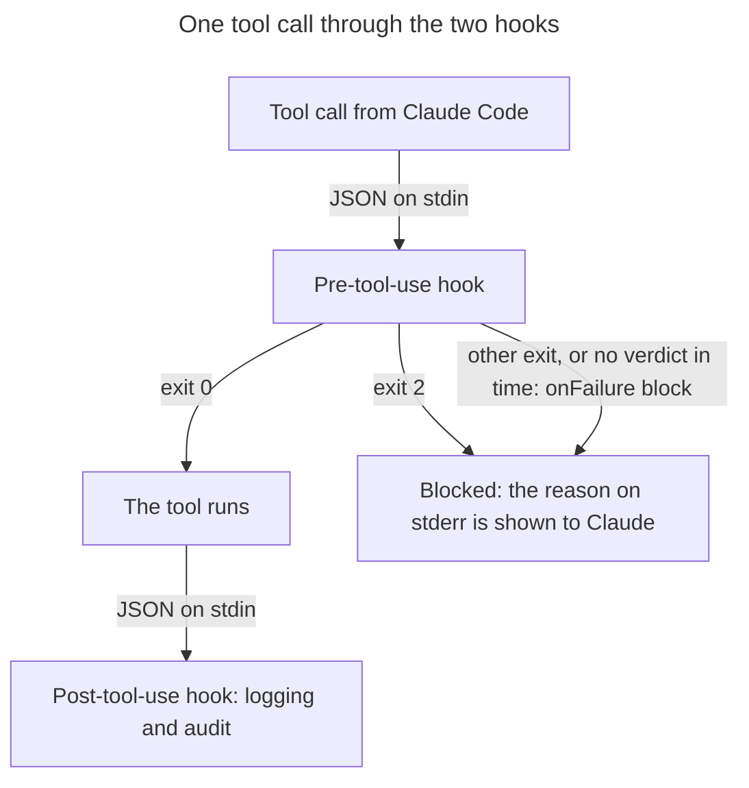
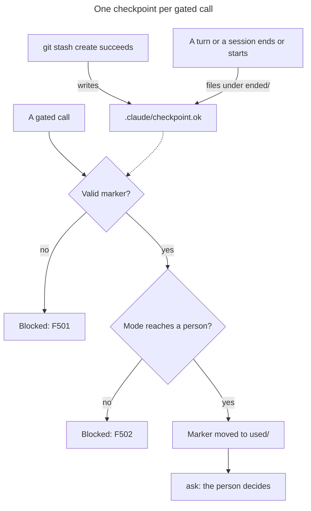
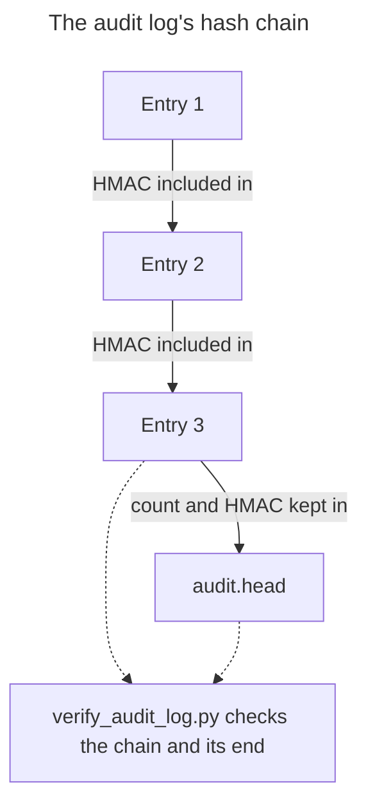

# Safety Hooks

This directory contains hooks that implement the VERIFY layer capabilities from the Agent Capability Standard.

## Spec-Aligned Hooks

These hooks directly implement capabilities defined in the standard's VERIFY layer:

| Hook | Event | Purpose |
|------|-------|---------|
| `pretooluse_require_checkpoint.sh` | PreToolUse (every tool, `onFailure: "block"`) | Classify the call; one checkpoint marker per gated call; ask for approval; let a restore of a recorded checkpoint run as a rollback |
| `posttooluse_take_checkpoint.sh` | PostToolUse (`Bash`) | Write the checkpoint marker after a successful `git stash create`, with its commit entered in the git directory (`<git dir>/acs/checkpoints/commits/`), filing a marker it replaces under `.claude/checkpoints/ended/` |
| `stop_end_checkpoints.sh` | Stop, StopFailure, UserPromptSubmit, SessionStart, SessionEnd | End the marker's validity, filing it under `.claude/checkpoints/ended/`: the end and the start of a turn or a session are execution boundaries |
| `posttooluse_log_tool.sh` | PostToolUse, PostToolUseFailure (every tool) | Log every tool call as an action record (§6.4), with the configuration that decided it, for the audit trail and provenance; it is not an `audit` step |

The hooks apply the rules of
[STANDARD 1.2.0 §5.18](../spec/STANDARD-v1.2.0.md#518-tool-calling-hosts)
where Claude Code lets them, and do not claim the safety-layer class SL
([SECURITY.md §5.5](../spec/SECURITY.md#55-hooks-and-the-safety-layer-class)
says why). The Python SDK adapter and the Standard Agents binding claim it
(their conformance statements are in `tests/conformance/calls/statements/`).

## Platforms

The hooks need `bash`, `jq` and `openssl`, and perl or `find`, `awk` and a
GNU or BSD `stat` (the pre-tool-use hook counts the links of the layer's
records with them; without them every call is blocked with `R407` while
the git directory's `acs/` exists, and every call the hook gates
otherwise). CI runs them, and every test, on Linux (GNU tools,
bash 5) and on macOS. On macOS:

- **Bash.** The hooks start under `/bin/sh` and run the first `bash` on
  `PATH`: the `/bin/bash` 3.2 that macOS ships, or a newer one such as
  Homebrew's. Both work.
- **BSD tools.** `grep` and `sed` read the same patterns as on Linux, but
  about ten times more slowly. A Write of about 3.5 MB, or a command of a
  few hundred kilobytes of line breaks, runs past the hooks' 30-second
  limit there, and the call is blocked.
- **The agent's shell.** Claude Code runs the agent's commands in your login
  shell, zsh by default on macOS. The hooks read a command as bash 5 reads
  it. A form zsh reads differently, and that the hooks cannot read, is gated
  like any other command they cannot read (SECURITY.md §5.5).

## How Hooks Work




### Pre-Tool-Use Hooks

Run **before** a tool executes and can block operations. Claude Code passes
the tool call as a JSON object on stdin; exit 0 allows the call (with an
`ask` decision on stdout for a call that needs approval), and exit 2 blocks
it, with the reason on stderr shown to Claude. Any other non-zero exit, a
run that cannot start and one that gives no verdict within the hook's
`timeout` (30 seconds) are failures: `hooks.json` sets `onFailure: "block"`
on this hook, so Claude Code blocks the call (a Claude Code that does not
support the setting treats a failure as a non-blocking error and runs the
tool). Every tool call is routed here (matcher `*`). The reason opens with the
Standard's code and name for the refusal, such as `F501
CHECKPOINT_REQUIRED:`. Only Claude Code's JSON object is read: a payload that
is not one, or a system without `jq`, is blocked with `R407
SAFETY_CHECK_FAILED:`.

The hooks' settings (`ACS_HOOK_APPROVAL`, `ACS_CHECKPOINT_MAX_AGE`,
`AUDIT_HMAC_KEY`, `AUDIT_LOCK_WAIT`), and any variable that is not one of
Claude Code's own settings, belong in `~/.claude/settings.json` (`env`),
managed settings or the environment Claude Code starts in, never in the
project's `.claude/settings.json` or `.claude/settings.local.json`. Claude
Code applies a project's `env`, which is repository content, to every hook
and every command it runs, over the user's settings: a hook cannot tell the
person's value of a setting from the repository's (a cloned repository could
set `ACS_HOOK_APPROVAL=off`), and any other variable can change what a hook
or a command it lets pass runs (`BASH_ENV` runs a repository script first,
`SHELLOPTS=noexec` runs nothing, `PATH` or `HOME` a repository's `jq`, `git`
or `openssl` or a `jq` library, `LD_PRELOAD` a library, `GIT_CONFIG_*` a
program `git status` runs). While either project file sets in `env` a name
other than Claude Code's own (`ANTHROPIC_*`, `OTEL_*`,
`CLAUDE_CODE_ENABLE_TELEMETRY`, `CLAUDE_CODE_MAX_OUTPUT_TOKENS`,
`CLAUDE_CODE_USE_BEDROCK`, `CLAUDE_CODE_USE_VERTEX`,
`CLAUDE_CODE_DISABLE_NONESSENTIAL_TRAFFIC`, `DISABLE_TELEMETRY`,
`DISABLE_ERROR_REPORTING`, `DISABLE_AUTOUPDATER`, `MAX_THINKING_TOKENS`,
`MAX_MCP_OUTPUT_TOKENS`, `MCP_TIMEOUT`, `MCP_TOOL_TIMEOUT`,
`BASH_DEFAULT_TIMEOUT_MS`, `BASH_MAX_TIMEOUT_MS`, `BASH_MAX_OUTPUT_LENGTH`,
as written), or cannot be read, the pre-tool-use hook blocks every call with
`R407 SAFETY_CHECK_FAILED:`, the log hook writes no line and the checkpoint
hook writes no marker and runs no git command. Claude Code started in the
home directory reads `~/.claude/settings.json` as the project's too: there,
set them in the environment instead.

Each hook starts under `bash -p`, which reads no `BASH_ENV` or `ENV` file,
imports no shell function and ignores `SHELLOPTS`, `BASHOPTS`, `CDPATH` and
`GLOBIGNORE` (the scripts open with `#!/bin/sh` and start themselves so,
whoever starts them); the three that read a setting keep on `PATH` only the
absolute directories outside the project directory (all of them where the
project is the user's home directory, as the password database gives it,
or holds it), run `jq` with no `HOME`
(jq loads `$HOME/.jq` as a library), and read the settings files before
they run any other program. Each git command they run, and each read of a
settings file, is stopped after 5 seconds: git reads the files a
repository's configuration includes, and a FIFO or a terminal there
(`include.path = /dev/ptmx`) holds the read until someone writes, past the
30-second limit after which a Claude Code without `onFailure` runs the
call. A git that did not answer counts as one that cannot say: the
pre-tool-use hook blocks the call (`R407`, or `F501` for the marker's git
directory) or gates it (a git read, `git stash create` or a restore is
`mutate`), the checkpoint hook writes no marker, and the log hook writes
its line without the anchor and says why; a settings file that is not a
regular file is unreadable (`R407`). What they cannot reach: Claude Code starts each
hook through `/bin/sh -c` with that env applied, so where `/bin/sh` is bash
(macOS, Fedora, Arch, Git Bash) `SHELLOPTS=noexec` or an exported function
stops that shell first, and anywhere a `PATH` naming a repository directory
ahead of bash's, or `LD_PRELOAD`, runs the repository's code in the hook's
place: repository settings the person accepts reach as far as project hooks,
which run the repository's code. Review them before accepting them.

```bash
echo '{"tool_name": "Write", "tool_input": {"file_path": "a.py"}}' \
  | ./pretooluse_require_checkpoint.sh   # exit 2 without a valid marker
./pretooluse_require_checkpoint.sh '{"tool_name": "Bash", "tool_input": {"command": "ls"}}'   # $1 also works
```

### Post-Tool-Use Hooks

Run **after** a tool executes for logging and audit. Claude Code fires
`PostToolUse` after a call that succeeded and `PostToolUseFailure` after one
that failed; the audit hook is registered for both, for every tool. The tool
call arrives as JSON on stdin.

```bash
echo '{"hook_event_name": "PostToolUse", "tool_name": "Bash", "tool_input": {"command": "ls"}}' \
  | ./posttooluse_log_tool.sh
```

## Configuration

Hooks are configured in `hooks.json` (loaded automatically by the Claude Code plugin):

```json
{
  "hooks": {
    "PreToolUse": [
      {
        "matcher": "*",
        "hooks": [
          {
            "type": "command",
            "command": "${CLAUDE_PLUGIN_ROOT}/hooks/pretooluse_require_checkpoint.sh",
            "timeout": 30,
            "onFailure": "block"
          }
        ]
      }
    ],
    "PostToolUse": [
      {
        "matcher": "*",
        "hooks": [
          {
            "type": "command",
            "command": "${CLAUDE_PLUGIN_ROOT}/hooks/posttooluse_log_tool.sh"
          }
        ]
      },
      {
        "matcher": "Bash",
        "hooks": [
          {
            "type": "command",
            "command": "${CLAUDE_PLUGIN_ROOT}/hooks/posttooluse_take_checkpoint.sh"
          }
        ]
      }
    ],
    "PostToolUseFailure": [
      {
        "matcher": "*",
        "hooks": [
          {
            "type": "command",
            "command": "${CLAUDE_PLUGIN_ROOT}/hooks/posttooluse_log_tool.sh"
          }
        ]
      }
    ],
    "UserPromptSubmit": [
      {
        "hooks": [
          {
            "type": "command",
            "command": "${CLAUDE_PLUGIN_ROOT}/hooks/stop_end_checkpoints.sh"
          }
        ]
      }
    ],
    "Stop": [
      {
        "hooks": [
          {
            "type": "command",
            "command": "${CLAUDE_PLUGIN_ROOT}/hooks/stop_end_checkpoints.sh"
          }
        ]
      }
    ],
    "StopFailure": [
      {
        "hooks": [
          {
            "type": "command",
            "command": "${CLAUDE_PLUGIN_ROOT}/hooks/stop_end_checkpoints.sh"
          }
        ]
      }
    ],
    "SessionStart": [
      {
        "hooks": [
          {
            "type": "command",
            "command": "${CLAUDE_PLUGIN_ROOT}/hooks/stop_end_checkpoints.sh"
          }
        ]
      }
    ],
    "SessionEnd": [
      {
        "hooks": [
          {
            "type": "command",
            "command": "${CLAUDE_PLUGIN_ROOT}/hooks/stop_end_checkpoints.sh"
          }
        ]
      }
    ]
  }
}
```

Each hook entry specifies:
- **matcher**: Regex pattern matching tool names that trigger the hook (`*` matches every tool; an event with no tool, such as Stop, has none)
- **hooks**: Array of hook commands to execute
- **type**: Hook type (`command` for shell scripts)
- **command**: Path to the hook script (`${CLAUDE_PLUGIN_ROOT}` resolves to the plugin directory)
- **timeout**: Seconds the hook may run (Claude Code's default otherwise)
- **onFailure**: `block` makes a run that fails, cannot start or times out block the call

## Checkpoint System

`pretooluse_require_checkpoint.sh` classifies every tool call by its
effect (STANDARD 1.2.0 §5.18.3), with lists derived from the SDK mapper's
(`grounded_agency/capabilities/mapper.py`; `tests/test_hook_lists_match_mapper.py`
keeps the hook's tool list and read-only list subsets of the mapper's and its
`git stash` table equal to it):

- A tool the mapper maps to a capability that needs neither a checkpoint nor
  approval (`Read`, `Glob`, `Grep`, `LS`, `WebFetch`, `WebSearch`,
  `AskUserQuestion`, `TodoWrite`, `TaskList`, `TaskGet`, `TaskCreate`,
  `TaskUpdate`, `ToolSearch`, `BashOutput`, `TaskOutput`,
  `ListMcpResourcesTool`, `ReadMcpResourceTool`, `ExitPlanMode`, and the
  older names `AskUser` and `TodoRead`): needs neither. Those of them the
  mapper maps to `persist` (`TodoWrite`, `TaskCreate`, `TaskUpdate`) store
  what they are given, so a call whose input holds a secret the layer
  recognises is refused with `F504 CONSTRAINT_VIOLATED:` in every
  permission mode (STANDARD 1.2.0 §5.18.10, §6.7), as the SDK adapter
  refuses it: the shared scan (`secret_scan.sh`, copied into the hook) over
  every string of the input and its JSON text, and the SDK redactor's rule
  for data (`secret_member.jq`, copied too), a value of 4 or more
  characters (or a number) that is not a placeholder under a member named
  for a credential, the value of a `{"name": "Authorization", "value": ...}`
  pair, or the second of a `["Cookie", ...]` tuple. A test keeps the
  hook's verdict the adapter's on the credential vectors and on data forms.
  The credentials the plugin holds itself are refused too: `AUDIT_HMAC_KEY`'s
  value, and the project's checkpoint key, read from
  `<git dir>/acs/checkpoints/key` where git names the project's git
  directory (a git that cannot say reads none).
- `Write`, `Edit`, `MultiEdit`, `NotebookEdit`: `mutate`.
- `Skill`, `Agent`, `Task`: `mutate`. Claude Code runs the shell commands a
  skill's file embeds (``!`cmd` `` and ```` ```! ```` blocks, the call's
  arguments substituted into them) as the skill loads, under its
  `allowed-tools`, and the hooks and MCP servers a subagent's definition
  names as the subagent runs; none of them reaches a hook, and a project's
  skill or agent can take any name (a project's agent replaces a built-in
  one of the same name). The call is asked for approval with the reason
  `<tool> (capability 'mutate': the shell commands a skill's file embeds,
  and the hooks and MCP servers a subagent's definition names, run with no
  hook seeing them)`. Loading the checkpoint skill takes no checkpoint: run
  `git stash create` first.
- `Bash`: a command over 4096 bytes is `mutate`, decided before anything
  else is done with it, so no reading runs into the hook's time limit (a
  command padded with 50,000 blanks once took 44 seconds to trim). A command
  with any of `` ; & | < > $ ` ( ) { } \ `` or a line
  break may be more than one command or expand something, so it is `mutate`.
  Otherwise it is read as one simple command, its words split and dequoted
  as bash does (`"--output=x"` is `--output=x`; an unbalanced quote is
  `mutate`): an option that writes is `mutate` (for `git`, `--output` or an
  abbreviation of it such as `--outp`; for `file`, `-C` or `-p` in any short
  option, or `--compile` or `--preserve-date` or an abbreviation such as
  `--compi`; for `printf`, any option: `printf -v NAME` sets a shell
  variable), and so is a `git`, `file` or `printf` command with a word
  holding an unquoted `*`, `?` or `[`, which bash replaces with file names,
  options included; `git stash create` takes a
  checkpoint; `git stash list` and `git stash show` only read; `git stash pop
  <commit>` and `git stash apply <commit>` restore one (`rollback`) when
  `<commit>` is the full id of a commit a checkpoint recorded, the call
  runs in the project's repository and no smudge filter is configured
  (below); any
  other `pop` or `apply`, a bare one included, is `mutate`, since git applies
  any merge commit as if it were a stash; any other `git stash` form
  is `mutate`; a command on the read-only list (`ls`, `cat`, `head`, `tail`,
  `wc`, `pwd`, `grep`, `stat`, `file`, `du`, `df`, `which`, `whoami`,
  `uname`, `echo`, `printf`, `git status`, `git log`, `git diff`, `git show`,
  `git rev-parse`, `git ls-files`) only reads and needs nothing; anything else
  is `mutate`. The first word must be the listed program exactly, and a
  two-word entry's subcommand the second word: bash runs a first word that
  holds a blank (a quoted `"git status"`) or a slash as the program of that
  name, which is `mutate`. Each of these commands (the read-only list, `git
  stash create`, a restore) is `mutate` where the program bash finds for its
  first word, on the `PATH` Claude Code gives the hook and the agent's
  commands, may be the repository's own: the name is found under an empty
  or relative entry (bash reads it from the working directory:
  `PATH=node_modules/.bin:$PATH`, a leading colon), or in a file that lies,
  links followed, in the project (an entry in it: an activated virtual
  environment, direnv's `PATH_add`; not where the project is the home
  directory, or holds it), or nowhere. The entries the Bash tool adds from
  the user's shell startup files (its shell snapshot) reach no hook and are
  not seen, nor are the aliases, functions and shell options those files
  set (with zsh's `EXTENDED_GLOB`, `^`, `#` and `~` are pattern characters
  too, read here as text); the SDK mapper reads the CLI's `PATH` the same way. A git command that would only read (`git stash list` and
  `git stash show` included) is `mutate` where the call's directory (the
  payload's `cwd`, else the project directory) is in a partial clone (a
  promisor remote, or `extensions.partialClone`), in a repository with
  submodules (`modules/` in its common git directory, or a gitlink in its
  index), or where git cannot say: there git fetches each object it lacks
  from the promisor remote, its own or a submodule's (`--submodule=diff`,
  `diff.submodule`, `git status`), so `git show <id>` sends the id to that
  host. `git stash create` still takes a checkpoint there (it reads only
  what the local state holds). Every `git` command the hook would let pass
  (a read, `git stash create`, a restore) is `mutate` where the git
  directory git finds is not one git made for a work tree (a `.git`
  directory, or a linked worktree's or a submodule's under one): a
  repository can ship a directory holding `HEAD`, `objects/` and `refs/`
  (an embedded bare repository), and git run there reads its `config` and
  runs what it names (`core.fsmonitor` for `git status`, a textconv driver
  for `git log -p`). The same holds where the repository's own
  configuration (the local and worktree scopes, with the files they
  include) names a program git runs (a `core.fsmonitor` other than `true`
  or `false`, a diff driver's `textconv` or `command`, `diff.external`, a
  filter's `clean`, `smudge` or `process`, a merge driver, a signature
  program, a pager) or its hooks directory holds `post-index-change` (which
  `git status` runs when it writes the index): a project delivered with its
  `.git`, or one approved `git config core.fsmonitor ./x`, brings them. There
  a read and a restore are `mutate`, and `git stash create` is put to a
  person with no marker asked for (only it makes one; `F502` in a mode that
  asks no one). The user's own configuration (global, system) gates no
  read and no `git stash create`, but a restore is `mutate` wherever any
  scope, the user's included, configures a filter's `smudge` or `process`
  command (security round 5): git runs it when it writes the tree, and
  git-lfs's, which `git lfs install` writes to the user's configuration,
  asks the LFS server the repository's `.lfsconfig` or remote names for each
  object its store lacks, sending the object's id. The two commands `git
  lfs install --skip-smudge` writes (`git-lfs smudge --skip -- %f`,
  `git-lfs filter-process --skip`), which ask no server, count as none.
  The hooks' own git commands run with `core.fsmonitor` and hooks
  turned off and no object fetched (`hgit`), and the take hook's clean-tree
  check with the repository's filters turned off.
- Any other tool (`Monitor` and `PowerShell`, which run commands,
  `EnterWorktree`, `ExitWorktree`, every MCP tool, a tool the hook does not
  know) is unbound: `mutate`, since a layer cannot know that an unknown tool
  only reads (§5.18.2). Its approval request says
  `<tool> (unbound: treated as a mutation, STANDARD 1.2.0 §5.18.2)`.

Then:

- **Rollback** (`git stash pop|apply <commit>`): allowed when a checkpoint
  of the project recorded `<commit>`, an entry
  `<git dir>/acs/checkpoints/commits/<commit>` that
  `posttooluse_take_checkpoint.sh` writes for each checkpoint it takes, and
  the call runs in the project's repository (its `cwd`; a restore into
  another repository or worktree restores other state). The entries are in
  the project's git directory, outside the work tree: a clone, a checkout
  or an applied stash can put files in the work tree, `.claude/` included,
  but none there. Each holds the HMAC-SHA-256 of
  `acs-checkpoint-commit:<commit>` under the project's checkpoint key
  (`<git dir>/acs/checkpoints/key`, 64 hex digits the take hook draws from
  `/dev/urandom` the first time, mode 600), so a file a command creates
  there, through a link the repository ships for instance, is no entry; and
  the git directory must be one git made for a work tree (a shipped one
  could hold a key and entries of its own). The check is one lookup,
  however many checkpoints were taken. It uses no checkpoint: one that was used, expired, ended with its
  turn or was replaced can still be restored. Restoring anything else is a
  `mutate`.
- **The layer's records**: a `mutate` call that names them is blocked
  with `F504 CONSTRAINT_VIOLATED:`: only the hooks write them. The texts
  read are a `Write`, `Edit`, `MultiEdit` or `NotebookEdit` call's path, a
  `Bash` command, a `Skill` call's arguments, and every string and member
  name of any other tool's input but `Agent`'s and `Task`'s (`Monitor` and
  `PowerShell` commands, an MCP filesystem server's path, an MCP shell
  server's command; a subagent's own calls come here). A text that holds
  `checkpoint.ok`, `.claude/checkpoints`, `acs/checkpoints` or `audit.head`
  (the audit log's head, below) is blocked, read as a path is: in any
  letter case, with a run of slashes and `./` segments as one slash, and,
  in a text of at most 4096 bytes, each `x/../` resolved. In a text of at
  most 4096 bytes each path it names (a file tool's path whole, a
  command's words as the shell passes them; for other tools both, each
  string whole and as words) is then followed, from the call's directory,
  through the symbolic links on it, so `touch notes/todo.md`, where the
  repository ships `notes/todo.md` as a link to
  `.git/acs/checkpoints/key`, is blocked too. Each link target, the call's
  directory and git's answers are read exactly, line breaks that end a
  name included (a link to `evil<newline>` leads there, not to `evil`). So are the paths the shell
  reads differently from their text: a `~` it expands (`~`, `~+`, `~user`;
  `~-` and `~N`, which name a directory the hook cannot know, are blocked
  outright), a brace group it expands, found as bash finds it (the first
  `{` a `}` closes, at the first `}` after a comma at its own level, so
  `{a},.claude/check}point.ok` names the marker:
  `{fixtures/,.git/acs/check}points`, `audit.he{ad,x}`, `.claud{e..e}`,
  `.cl{a..a..+1}ude`) and expanded as bash 5.2 and bash 5.3 expand it.
  They differ on a group with no comma at its own level that is no
  sequence: `{a..b{c,d}}` is `a..bc a..bd` to 5.2 and `{a..bc} {a..bd}`
  to 5.3, the one word of 5.3's seen (on a runner, without its source),
  which two readings give; the hook reads both (`tests/brace_readings.py`
  holds words that tell them apart, which a runner with bash 5.3 checks).
  A sequence with a number of more than 9 digits (an increment of more
  than 18), leading zeros aside, is not read: bash 5.2 prints a padded one
  as a 32-bit number, and the call is blocked. So are a
  `$'...'` it decodes
  (`$'.git/acs/check\x70oints'`, and octal, `\u`, `\U` and `\c`
  escapes; `$"..."` as `"..."`), a path attached to a short option
  (`-tnotes/k`, `-onotes/todo.md`; of a long cluster only the texts whose
  first component exists in the call's directory, or that are absolute),
  and the command a quoted word holds for a shell that reads it again (`sh
  -c 'cp x notes/k/'`). A path that leads to the directory holding the
  records (the project's `.claude`, its git directory's `acs/`) is blocked
  too: `rm -rf .claude` removes the marker, and the audit log with its
  head. So is a link that cannot be followed (a loop, more than 40 links),
  and, rather than hold the hook past its time limit, a call with more than
  4096 strings and member names or more than 65536 bytes of strings of at
  most 4096 bytes, brace expansions that make more than 8192 words or read
  more than 65536 braces, commas and characters, or more than 262144 bytes
  of paths to resolve (the slowest reading found within
  these bounds takes about 4 seconds). Reading the records is not refused; a path a command builds when
  it runs, a pattern the shell expands and a link a command reaches without
  naming it (copying a directory that holds one) are not seen, nor is a
  text over 4096 bytes read for paths. This reading is an advisory early
  refusal, not the boundary: the deny rules below are.
- **A record with another name**: a regular file under the records with
  more links than names among them has a hard link elsewhere, through which
  a command or a file tool can read or write it past the deny rules (the
  Linux sandbox runtime denies a path, not a file). While a file under `acs/`
  in the git directory git names for the project (the checkpoint key, the
  entered commits, the head's anchor) has one, every call of any tool is
  blocked with `F504 CONSTRAINT_VIOLATED:`, reads included (`Read`, `Grep`,
  `cat`): the key could be read through the link. While a file of the
  project's records (`.claude/checkpoint.ok`, `.claude/checkpoints/`,
  `.claude/audit.log`, `.claude/audit.head`) has one, every call the hook
  does not let pass outright (`mutate`, a `git stash create` put to a
  person, a restore of a recorded checkpoint) is blocked the same way,
  whatever it names, before a marker is used. The reason names the record;
  remove the other name outside the session (`find <directory> -samefile
  <record>` lists them), since the command that removes it is refused too.
  The hook counts each regular file of the records that exist with `lstat`,
  following no link, with perl, or, where perl is not installed, with
  `find` and GNU `stat -c %h` or BSD `stat -f %l`. A file that goes while it
  is counted (a marker a parallel call takes) is no error. A count that
  finds a second name is taken once more after 0.2 seconds (the take hook
  enters the checkpoint key with `ln`, so it has two names for a moment),
  as is a `find` and `stat` count that meets an error; perl's count blocks
  the call at once when it meets an error. A directory of the records that cannot be read blocks the call
  with `R407`, with either counter, as does a git that does not say in time
  which git directory is the project's, for a call the hook gates.
- **Mutate**: the marker `.claude/checkpoint.ok` must exist, be a regular
  file (not a symlink, SEC-006) that git does not track (a repository can
  ship a tracked one; git is asked from the marker's own directory, so a
  linked or submodule `.claude` counts too, and the file is left as it is;
  the git directory git finds there must be one git made for a work tree,
  since a repository can ship `.claude` itself as a git directory whose
  index would answer and whose config names a program git runs; and an
  answer of git other than yes or no authorises nothing),
  be a JSON object with a `checkpoint_id`, a
  `created_at` and an `expires_at` in whole seconds of at most 12 digits, the
  first not in the future and the second at most 1800 seconds (30 minutes)
  after it, and be within both its `expires_at` and the layer's maximum age,
  `ACS_CHECKPOINT_MAX_AGE` seconds after its `created_at` (SEC-001), whoever
  wrote it; otherwise the call is blocked
  with `F501 CHECKPOINT_REQUIRED:`, a marker past either is filed under
  `.claude/checkpoints/ended/` and a malformed one is removed. Unless `ACS_HOOK_APPROVAL=off`,
  the permission mode must put the call to a person (`default`,
  `acceptEdits` or `plan`); in any other mode the call is blocked with `F502
  APPROVAL_REQUIRED:` and the marker is left in place. The call then **uses
  the marker up**: one rename moves it into `.claude/checkpoints/used/`, so
  two calls never pass on one marker (the one that loses is blocked with
  F501). Finally, unless `ACS_HOOK_APPROVAL=off`, the hook answers
  `permissionDecision: "ask"` with an `F502 APPROVAL_REQUIRED:` reason, so
  Claude Code asks the person; with `off`, approval is left to Claude Code's
  permission rules, and every audit line records that setting. The marker
  was used before the person answers, and Claude Code runs no hook when
  they do: a call allowed after the marker's maximum age, or after a
  boundary of another session, runs all the same (a host gap of these
  hooks, which do not claim the safety-layer class; SECURITY.md §5.5).
- A failure of the hook itself blocks the call with `R407
  SAFETY_CHECK_FAILED:` (exit 2; another exit code is blocked by
  `onFailure: "block"` only where Claude Code supports it).

The marker is written by `posttooluse_take_checkpoint.sh` after a `git stash
create` that succeeded (the call that saves the state takes the checkpoint,
§5.18.6), and by `CheckpointTracker(marker_dir=".claude")` in the Python SDK.
The hook writes none for a command over 4096 bytes, for a call run in the
background (its output is not yet the command's), for one the pre-tool-use
hook classified the worst case where it ran (its `cwd`: a `git` the shell
finds in the repository, or a git directory git did not make for a work
tree, such as a shipped `vendor/evil.git` whose `core.worktree` names the
project; the two hooks hold the same functions), for one whose `cwd` is in
another repository than the project's (another git directory or work tree),
for a commit it has no git directory to enter in, or for output that is
neither a commit id nor empty; empty
output (nothing to save) gives `HEAD` as the restore point only when the
project's tracked files and index are `HEAD`'s.
Its expiry is `ACS_CHECKPOINT_MAX_AGE` seconds when that is an integer from 1
to 1800, else 1800 (the Standard caps a checkpoint's maximum age at 30
minutes); while the project's settings files name one of the hooks' settings,
it writes no marker. Before it writes the marker, the hook enters the commit in
`<git dir>/acs/checkpoints/commits/` (an empty file named by the commit),
where a rollback looks it up. A new marker replaces the old one, which is
filed under `.claude/checkpoints/ended/`. `stop_end_checkpoints.sh` files the
marker there at an execution boundary: when a turn ends (`Stop`, or
`StopFailure` when an API error ended it), when the next turn starts
(`UserPromptSubmit`, which also ends a marker an interrupted turn left) and
when a session starts or ends (`SessionStart`, `SessionEnd`).

The hooks' scope is the project directory: every session in it, and each
session's subagents, share one marker, its history and the commit entries,
so a boundary of any session ends the marker.
Each gated call needs its own checkpoint; every marker filed under `used/`
or `ended/` stays the record of a checkpoint taken.



The marker file holds a JSON object. `checkpoint_id`, `created_at` and
`expires_at` are checked; `commit` names the restore point (a full commit
id, entered in the git directory, or `HEAD` for a clean tree), and `source`
is written for the reader:

```json
{"checkpoint_id": "3f2a...", "commit": "3f2a...", "created_at": 1706000000, "expires_at": 1706001800, "source": "git stash create"}
```

### Keeping the Agent from the Records

The hooks alone write the layer's records:

| Record | What it is |
|--------|------------|
| `.claude/checkpoint.ok` | The checkpoint marker |
| `.claude/checkpoints/` | Used and ended markers (`used/`, `ended/`) |
| `.claude/audit.log`, `.claude/audit.head` | The audit log and its head |
| `<git dir>/acs/` | The checkpoint key and entered commits (`checkpoints/`) and the head's anchor (`audit.head`) |

The audit log is not rotated: a person who starts a new log moves
`audit.log`, `audit.head` and the anchor aside under names of their own.

The boundary that keeps the agent's commands and file tools from the records
is Claude Code's permission deny rules, with the sandbox on. What was run
(Claude Code 2.1.332 on macOS, in `bypassPermissions` mode, on 2026-11-25):
`Edit(...)` deny rules for the marker, the checkpoint directories and the
audit log (relative, with `/**` and `audit.log*`; one absolute `//` form gave
the same result) refused the `Write` and `Edit` tools, and every route a
sandboxed command took: a symbolic or hard link made in the session, a
rename of the record or of a directory above it, `cp`, `rm`, truncation and
an interpreter's writes. A `Read(...)` rule, on a test directory, refused
the `Read` tool and `cat`. On Linux only the sandbox runtime was run
(`@anthropic-ai/sandbox-runtime` 0.0.82): literal absolute `denyWrite` paths
refused every route tried, and a glob was skipped. The exact rules below
(absolute, one per record), with the sandbox's `denyWrite` list, were run
under Claude Code 2.1.332 on macOS on 2026-11-25 for a fresh project: they
refused all 11 command routes tried (an append to the log and to the head,
`touch` of the marker, a new file under `.claude/checkpoints/` and under
`acs/`, a symbolic link to the log and to `.claude`, `python3`, `cp`, `rm`,
and a rename of `.claude`). The `Write` and `Edit` tools and the `Read`
rules on the git directories' records were not run with these rules, and
they have not been run under Claude Code on Linux. The sandbox's own `filesystem.denyWrite`
list covers sandboxed commands only, not the file tools. The hooks' reading of a call's
paths (above) refuses some calls early, and is advisory: it cannot see a
path a command builds when it runs. It still applies where the sandbox does
not: to hooks, to MCP servers and to commands the settings run outside the
sandbox.

`grounded_agency/layer_records.py` gives the rules for a project. It uses
the standard library alone and the syntax of Python 3.9, so it runs from the
plugin's directory under the system's `python3` (3.9 or newer):

```bash
python3 -I grounded_agency/layer_records.py /path/to/project
```

It prints a settings fragment, every path literal and absolute (the Linux
sandbox runtime skips a glob such as `audit.log*`):

```json
{
  "permissions": {
    "deny": [
      "Edit(//path/to/project/.claude/checkpoint.ok)",
      "Edit(//path/to/project/.claude/checkpoints/**)",
      "Edit(//path/to/project/.claude/audit.log)",
      "Edit(//path/to/project/.claude/audit.head)",
      "Edit(//path/to/project/.git/acs/**)",
      "Read(//path/to/project/.git/acs/**)"
    ]
  },
  "sandbox": {
    "filesystem": {
      "denyWrite": [
        "/path/to/project/.claude/checkpoint.ok",
        "/path/to/project/.claude/checkpoints",
        "/path/to/project/.claude/audit.log",
        "/path/to/project/.claude/audit.head",
        "/path/to/project/.git/acs"
      ]
    }
  }
}
```

- A permission rule's `//` opens an absolute path. A directory is denied as
  a whole: `dir/**` in a rule, the plain directory in `denyWrite`.
- Every record gets an `Edit(...)` rule. Only `acs/` gets a `Read(...)`
  rule: it holds the checkpoint key. The project's records hold no secret,
  and the audit skill cites the audit log as evidence.
- The git directory is the one `git rev-parse --absolute-git-dir` names for
  the project, where the hooks keep `acs/`: in a linked worktree, whose
  `.git` is a file, that is `.git/worktrees/<name>/acs` in the main
  repository. The `acs/` of the repository's other git directories gets the
  same rules: the main checkout's, each linked worktree's
  (`.git/worktrees/<name>`) and each submodule's (`.git/modules/<path>`,
  nested ones included), since a session in one checkout can otherwise
  write another's commit entries or read its key. A project in no
  repository has no `acs/` rule.
- A rule names a path that exists when the settings are made, so make them
  again after `git worktree add` or a submodule's first checkout.
- A project path reached through a symbolic link gets the rules under both
  its written and its physical path (`/var` and `/private/var` on macOS).
- A path that holds a character a rule reads as a pattern (`*`, `?`, `[`,
  `]`, `{`, `}`, `(`, `)`, `\`) or a control character cannot be written as
  a literal rule; the module refuses it (exit status 2), as it does when git
  does not say which git directory is the project's.
- `grounded_agency.layer_records.deny_settings(project_dir)` returns the
  same fragment to Python code; `layer_records(project_dir)` returns the
  records' paths. The pre-tool-use hook holds the same list of records, and
  a test keeps the two equal.

A deny rule protects a path, not a file. A record with a second hard link
made outside the boundary (by a person, a hook, an MCP server or a command
run outside the sandbox) can be written through that link on Linux, so the
pre-tool-use hook refuses every call it does not let pass outright while a
record has one (above).

While a sandboxed command runs, the Linux sandbox runtime puts empty files
and directories in the project as mount points (`.bashrc`, `.gitconfig`,
`.mcp.json`, an empty `.claude/` where there is none, and, under these
rules, an empty file at a record's path that does not exist yet), removed
when the command ends normally but left behind when it is killed. The
hooks must ignore them, and do for the files: an empty `.claude/` is used
as it is; an empty marker is removed, and the call needs a checkpoint; an
empty file has one link, so the link count passes it; the log hook reads
an empty `audit.head` as none and writes the head anew, while the anchor
in `acs/` still shows a cut log; an empty `audit.log` is a log with no
entries, a cut where its head or anchor records some. What the runtime
puts at a directory record that does not exist yet (`.claude/checkpoints`,
`acs`) has not been run; an empty file there would stop the hooks from
keeping that record (no marker is written, and the log hook says the
anchor is not kept) until it is removed.

The hooks write a new marker and a new head in `.claude/checkpoints/`, and
new entries, keys and anchors in `acs/`, then rename them onto the record,
so no file a hook writes is outside the rules before it becomes a record.

The `/grounded-setup` command (below) writes these rules, with the rest of
the sandbox's settings, to your user settings.

## Setting up the sandbox

A plugin cannot change your settings itself. The `/grounded-setup` command
turns on Claude Code's sandbox as the boundary the hooks rely on, in your
user settings (`~/.claude/settings.json`, or `settings.json` in the
directory `CLAUDE_CONFIG_DIR` names). Run it in Claude Code, in the project:

```text
/grounded-setup [--profile <domain profile file>] [--allow-domain <host>]...
```

It shows the change as a diff, asks, and writes only when you agree. The
command runs `grounded_agency/sandbox_settings.py`, which uses the standard
library alone and needs Python 3.9 or later (the `python3` of Apple's
command line tools, 3.9, or of a current Linux distribution is enough);
you can run it yourself from a terminal:

```bash
/usr/bin/env -i /usr/bin/python3 -I <plugin>/grounded_agency/sandbox_settings.py plan  [--project DIR] [--profile FILE] [--allow-domain HOST]...
/usr/bin/env -i /usr/bin/python3 -I <plugin>/grounded_agency/sandbox_settings.py apply [same options] [--digest HEX]
/usr/bin/env -i /usr/bin/python3 -I <plugin>/grounded_agency/sandbox_settings.py check [same options]
/usr/bin/env -i /usr/bin/python3 -I <plugin>/grounded_agency/sandbox_settings.py settings [same options]
```

The command runs the script with the system's interpreter,
`/usr/bin/python3`, by its absolute path, under `env -i`: a repository's
`.claude/settings.json` can set any variable for every Bash call in its
`env` block. `PATH` would put its own `python3` first, and on macOS
`DEVELOPER_DIR` makes the `/usr/bin/python3` stub run a program of its
choosing: under Claude Code 2.1.332 on macOS, on 2026-11-26, with both set
in a project's `env`, `python3` and `/usr/bin/python3` each ran the
project's program, and the command's form ran the system's Python 3.9. An absolute path is not looked up in `PATH`, bash imports no
exported function whose name holds a slash, and `env -i` passes on no
variable but `CLAUDE_CONFIG_DIR`, which the command adds when you set it
(Python then takes your home directory from the password database). Use
the same form when you run it yourself. A project `env` that sets
`BASH_ENV` runs a repository script before every Bash call, which no
command line prevents; the pre-tool-use hook blocks every call while a
project's `env` sets such a variable (above). The script refuses to run
under a Python inside the project, in an environment inside the project,
or in a directory another user owns or every user can write, and the plan
names the Python that ran it. It also refuses, and writes nothing, when
the project's settings set `HOME` or `CLAUDE_CONFIG_DIR` in their `env`
block, since those would move the settings file written or the paths
denied.

- `plan` prints the hosts of the allowlist and where each comes from, the
  entries it removes, settings it leaves that weaken the sandbox, the
  change to the `permissions` and `sandbox` members as a diff (the rest of
  the file, which can hold credentials in its `env` block, is not shown),
  and a digest of the change. It writes nothing. Text from the profile or
  the project (a destination, a manifest's path) is printed as JSON, so
  none of it can start a line; the command that writes the change is the
  last line.
- `apply --digest HEX` writes the change that digest names, and refuses
  when the file or the computed settings changed since the plan. In a
  terminal, without `--digest`, it shows the plan and asks.
- `check` reports what your settings lack, a setting of yours that undoes
  them, and what the project's own settings files do that may weaken them
  (exit status 1 for any of these).
- `settings` prints the computed settings alone, as JSON, for managed
  settings or `--settings`.

Within Claude Code, each run of the script is a Bash call the pre-tool-use
hook gates: it needs a checkpoint (`git stash create`) and your approval.
Where neither can be had (a project in no git repository or with no commit
yet, or a permission mode that puts no call to a person, such as
`bypassPermissions`), the command gives you the `apply` line to run in a
terminal instead; there, without `--digest`, it shows the change and asks.

### What it writes

Every filesystem path is literal and absolute, with no glob but a
directory's trailing `/**` in a permission rule: the Linux sandbox runtime
skips a glob in `denyWrite`, and Claude Code ignored relative `sandbox.filesystem`
entries passed with `--settings`.

| Setting | Value |
|---------|-------|
| `sandbox.enabled`, `sandbox.failIfUnavailable` | `true`: Claude Code exits at startup where the sandbox cannot start, rather than run commands unsandboxed |
| `sandbox.allowUnsandboxedCommands` | `false`: the `dangerouslyDisableSandbox` parameter is ignored |
| `sandbox.excludedCommands` | removed: a command it names runs outside the sandbox |
| `sandbox.network.allowedDomains` | the hosts below |
| `sandbox.network.strictAllowlist` | `true`: a host not on the list is refused in every permission mode. Without it, `bypassPermissions` lets an unlisted host through |
| `permissions.deny` | the records' rules (above); `Read(...)` and `Edit(...)` for the audit key file and `Edit(.../**)` for its directory; `Edit(...)` for the project's `.claude/settings.json`, `.claude/settings.local.json` and `.claude/hooks/**`, and for the plugin's `hooks/**` |
| `sandbox.filesystem.denyWrite` | the same paths, for a sandbox configured from this list |
| `sandbox.filesystem.denyRead`, `sandbox.credentials.files` (`deny`) | on macOS `~/Library/Keychains` and `/Library/Keychains`; `~/.ssh`, `~/.config/gh/hosts.yml`, `~/.git-credentials`, `~/.netrc`; the package registries' and Docker's credential files `~/.npmrc`, `~/.yarnrc.yml`, `~/.pypirc`, `~/.cargo/credentials`, `~/.cargo/credentials.toml`, `~/.gem/credentials`, `~/.docker/config.json`, `~/.config/composer/auth.json`, `~/.m2/settings.xml`, `~/.gradle/gradle.properties`, `~/.pub-cache/credentials.json`; and `~/.config/acs/audit.key` |
| `sandbox.credentials.envVars` (`deny`) | `GH_TOKEN`, `GITHUB_TOKEN`, `AUDIT_HMAC_KEY`, and the registries' publish tokens `NPM_TOKEN`, `NODE_AUTH_TOKEN`, `CARGO_REGISTRY_TOKEN`, `GEM_HOST_API_KEY`, `TWINE_PASSWORD`, `UV_PUBLISH_TOKEN`, `POETRY_PYPI_TOKEN_PYPI` |

`permissions.deny` rules cover the file tools and sandboxed commands;
`sandbox.filesystem` entries cover sandboxed commands only. A project's
settings files and hook scripts are denied because a command that could
write them could weaken the sandbox for the next session. The registries'
credential files and tokens are denied because the allowlist names those
registries, and a sandboxed command holding a publish token could send the
project's files out through them. A path reached
through a symbolic link (the project, or your home directory) is written
under its written and its physical path.

It also creates the audit key file, `~/.config/acs/audit.key`, when there
is none: 32 random bytes as 64 hexadecimal digits, mode 600, in a mode 700
directory, never printed. An existing key file is checked by its mode,
owner and link count only, and left as it is.

### The network allowlist

The allowlist holds:

- the hosts a domain profile's `allowed_destinations` name, when you give
  the profile with `--profile` (YAML or JSON; the plugin applies no profile
  of its own, so none is active unless you name it). A URL, or a prefix
  that names its whole authority (`https://hooks.example.com/*`), gives its
  host, and its port when it names one: the allowlist is by host, so a path
  in the pattern widens to the whole host. `*.example.com` gives itself. An
  address (`ops@example.com`, `*@example.com`) or a destination that names
  no host gives none, and the plan lists it. A pattern that is not one of
  the Standard's forms (§4.4.2) refuses the profile. The YAML is read for
  that one key without a YAML library: a block list or a one-line flow list
  of plain or quoted strings; any other form of it is refused;
- the public registries of the ecosystems whose manifest or lock files the
  project holds, in its top directory and three levels below (hidden,
  dependency and build directories skipped): npm and Yarn, PyPI, crates.io,
  Go modules, RubyGems, Maven Central, Gradle, NuGet, Packagist, pub.dev
  and Hex. A registry the project's own files configure (`.npmrc`,
  `pip.conf`) is not read, since the repository controls those files and
  the allowlist applies to every project. The Go module proxy
  (`proxy.golang.org`) fetches a module from whatever host its path names,
  so a request to it can carry data to any host; the plan says so beside
  the Go hosts;
- each host given with `--allow-domain`.

With no profile, the list holds the registries alone, and with no
manifests it is empty: sandboxed commands reach no host. The plan shows the
list before anything is written.

An entry is listed only when it is a dotted DNS name whose last label is
alphabetic, optionally `*.`-prefixed or with a `:port`. So no IP literal in
any spelling (`127.1`, `2130706433`, `[::1]`, `169.254.169.254`) and no
one-label name (`localhost`, `metadata`) is listed; neither is a name under
`.localhost`, `.local`, `.localdomain`, `.internal` or `.arpa`,
`metadata.google.internal`, `metadata.goog`, or a name that starts with a
dotted address (`127.0.0.1.nip.io`). Claude Code's proxy opens an IP
literal that is listed, metadata address included, and refuses a listed
name that resolves only to a local address. Every entry already in your
settings that is not of this form is removed, and the plan says so: an IP
literal, a local name, and a wildcard other than a leading `*.` (`*`,
`*:443`, `*.*`), which Claude Code's matcher reads as every host, IP
literals and metadata addresses included.

A destination pattern of the profile with a blank, a control or another
unprintable character refuses the profile; one with a character outside
ASCII is not listed (give its host in the `xn--` form with
`--allow-domain`).

The send skill's command hook, which reads a command's text for a request
to a private address or an unlisted host, is advisory: it cannot see a
destination a command builds when it runs. The allowlist, enforced by the
sandbox's proxy, holds whatever the spelling. A `WebFetch(domain:...)`
allow rule in your settings adds its host to the allowlist too; the plan
lists such rules.

### Your settings file

- It is read as Claude Code reads it, as strict JSON. A file with a
  comment, a trailing comma, a key given twice in one object, a top level
  that is not an object, or a `sandbox` or `permissions` member of the
  wrong type is refused and left as it is.
- Every list gains the entries it lacks, after the ones it has, so entries
  written for another project stay. The three switches and
  `strictAllowlist` are set. `excludedCommands` and a true
  `sandbox.filesystem.disabled` are removed. Every other key, a key Claude
  Code does not document included, is left in its place.
- A settings file that is a symbolic link is written through to its target,
  which keeps its mode. The new file is written beside it and renamed over
  it, after a check that the file has not changed since it was read.
- After writing, the script reads the file back and checks every key it
  wrote: Claude Code accepts a misspelled key without a word, so a typo in
  a safety key leaves it unset. It names any key of yours under `sandbox`
  or `permissions` that Claude Code does not document.
- The plan names settings of yours it leaves that weaken the sandbox: a
  proxy port (your proxy then filters the traffic, not the allowlist), Unix
  sockets, `enableWeakerNetworkIsolation`, `enableWeakerNestedSandbox`,
  `allowAppleEvents`, `allowNestedUserNamespaces`, `allowRead` or
  `allowWrite`, and `WebFetch(domain:...)` allow rules. Of these, the
  read-back and `check` fail on a proxy port, `allowAllUnixSockets`, and a
  `WebFetch(domain:...)` rule for a host the allowlist may not hold. An
  `allowRead` or `allowWrite` entry is named but does not fail them: under
  Claude Code 2.1.332 an entry at or above a path denied here (the key
  file, a record) did not reopen it.
- The plan and `check` name what the project's `.claude/settings.json` and
  `.claude/settings.local.json` do, by key name only, and say for each
  whether it was shown to override user settings: `sandbox.enabled: false`,
  `excludedCommands` and `filesystem.allowWrite` were; `allowRead`,
  `filesystem.disabled`, `failIfUnavailable: false`, the weaker-sandbox
  switches, Unix sockets, proxy ports and `WebFetch(domain:...)` allow
  rules have not been tested. `check` fails on each. From either project
  file, `allowUnsandboxedCommands`, `network.strictAllowlist` and
  `network.allowedDomains` had no effect, so they are not reported.

### What a repository can still do, and what stops working

User scope is where these keys take effect: under Claude Code 2.1.332 on
macOS, every sandbox key, the network allowlist included, took effect from
a user's `settings.json`. From a project's `.claude/settings.json` or
`.claude/settings.local.json`, `allowUnsandboxedCommands`,
`allowedDomains` and `strictAllowlist` had no effect. A repository's own
`.claude/settings.json` or `.claude/settings.local.json` can still turn
the sandbox off, exclude commands from it or widen its write scope, and
the hook then gates every Bash call. It cannot turn the escape parameter
back on, relax the network, or allow an edit a deny rule refuses. Only
managed settings prevent the three overrides; writing them needs
administrator rights. An administrator can take the `settings` output as a
starting point for managed settings.

With these settings, a sandboxed `gh` or `git push` cannot authenticate:
the keychain, `~/.ssh`, gh's `hosts.yml`, `~/.git-credentials` and the
token variables are denied to it. Neither can a publish to a package
registry (`npm publish`, `cargo publish`, `gem push`, `twine upload`,
`uv publish`). Tools that need the keychain fail. The tools also run
without `~/.npmrc`, `~/.yarnrc.yml`, `~/.m2/settings.xml`,
`~/.gradle/gradle.properties` and `~/.docker/config.json`, which are
denied too: a private registry, a mirror or a proxy set there is not used.
Under Claude Code 2.1.332, `npm config get registry` printed the public
registry in the sandbox where `~/.npmrc` named a mirror, and the mirror
outside it; so such an install fails or fetches from the public registry.
A host not on the list is refused without a prompt. Run those commands
yourself, outside Claude Code. On Linux and WSL2 the sandbox holds a write
denial on a file that does not exist yet, such as
`.claude/settings.local.json`, with an empty read-only placeholder while a
sandboxed command runs; one left behind by a killed session makes Claude
Code's own write there fail ("Yes, and don't ask again" is not saved).
`claude doctor` lists such files; remove them while no session runs in the
project. With `failIfUnavailable`, Claude Code on Linux does not start
until `bubblewrap` and `socat` are installed; the plan says when they are
missing.

The rules name this project's paths and the plugin's directory: run
`/grounded-setup` again in each project, after `git worktree add` or a
submodule's first checkout, and after the plugin is updated.
Once the sandbox is on, a sandboxed command cannot write
`~/.claude/settings.json` or `~/.config/acs`; a later run that needs to
write says so, and you run the `apply` line it prints from a terminal.

On native Windows Claude Code has no sandbox; the command says so and
writes nothing. Run Claude Code inside WSL2 instead.

### What was run

Claude Code 2.1.332 on macOS, on 2026-11-26, in `bypassPermissions` mode,
with the settings `sandbox_settings.py` computed (under the system's
Python 3.9) for a scratch project and a scratch home directory holding a
fake key file, with `--allow-domain example.com`, passed with `--settings`
(flag scope; not written to a user's `settings.json`). Each result was
read from the tool result and the file on disk, against a control run of
the same command outside the sandbox:

| Probe | With the settings | Control |
|-------|-------------------|---------|
| Append to `.claude/audit.log` | refused ("operation not permitted"), the file unchanged | the byte written |
| `cat` the key file | refused ("Operation not permitted") | the file's content printed |
| `npm config get registry`, with a `~/.npmrc` naming a mirror | the public registry: the file was not read | the mirror |
| Append to `.claude/audit.log` and `cat` the key file, with an `allowWrite` entry for the project's `.claude` directory and an `allowRead` entry for the key's directory, then with entries for the two files themselves | refused, both times | the byte written; the file read |
| `curl https://www.iana.org/`, a host not on the list | refused: the proxy answered 403 ("host is not on the allow list") | 200 |
| `curl https://example.com/`, on the list | 200 | 200 |
| `curl http://10.0.0.1/`, a private address | refused at once ("Couldn't connect", 1 ms) | no answer within 6 s |
| `curl http://169.254.169.254/`, the metadata address, directly and through the proxy | refused at once ("Couldn't connect", 1 to 2 ms) | no answer within 6 s |
| the metadata address as `http://0xa9fea9fe/` | refused ("Couldn't connect") | refused too, so this row shows nothing |
| the metadata address as `http://[::ffff:169.254.169.254]/` | refused: the proxy answered 403 ("host is not on the allow list") | refused at once ("Couldn't connect"); the refusal text above is the evidence |
| `curl http://metadata.google.internal/` | refused: the proxy answered 403 ("host is not on the allow list") | the name does not resolve |
| a listener on 127.0.0.1, as `127.1`, `127.0.0.1`, `localhost`, `2130706433` and `0x7f000001` | refused ("Couldn't connect"); `0x7f000001` also with `--noproxy` | 200 |
| the same listener as `[::ffff:127.0.0.1]` and `127.0.0.1.nip.io` | refused: the proxy answered 403 ("host is not on the allow list"); without the proxy, refused or unresolved | 200 |

These settings have not been run under Claude Code on Linux.

## Audit Trail

The `posttooluse_log_tool.sh` hook keeps the plugin's log of tool calls,
one action record ([STANDARD v1.2 §6.4](../spec/STANDARD-v1.2.0.md#64-audit-records))
per call, in `.claude/audit.log`. It is not an `audit` step: the `audit`
skill writes its own records, of the events a workflow reports.

- Logs every tool call that ran, one JSON line per call (the `PostToolUse` and `PostToolUseFailure` matchers are `*`). A call that a pre-tool-use hook or a permission rule refused did not run and is not logged
- Never writes the tool input: a command, a file's content or a skill's arguments can hold a credential. A SHA-256 digest of the input is written in its place
- Uses HMAC-SHA256 chaining for tamper detection (SEC-005)
- Each entry includes the HMAC of the previous entry, creating a hash chain: a changed or removed entry breaks the link of the entry after it
- Keeps the chain's end in `.claude/audit.head`: the number of entries and the last one's `hmac`, signed with the same key (`head_hmac`, the HMAC of `acs-audit-head:<entries>:<hmac>`), and the same head, its anchor, in the project's git directory (`<git dir>/acs/audit.head`; none outside a repository). Removing the last entries, or the whole log, breaks no link; the head shows it, and a command that removes `.claude` whole with the log and its head (`git clean -fdx`) leaves the anchor, which shows it. An earlier head written back with the cut, or one signed anew with the key, shows nothing: only a witness kept off the agent's reach does (below). Before it appends, the hook checks that the log still holds the entry the head and the anchor record, at its place: when it does not, or one is not a head this key signed, the hook says so, writes the line, and leaves both as they are, the evidence of the cut. The pre-tool-use hook refuses a call that names the head, `.claude` or the git directory's `acs/` (`F504`). To start a new log, move `audit.log`, `audit.head` and the anchor aside together
- Serializes concurrent runs (tool calls made in parallel) with flock(2) on the log file itself, opened for append, taken by `perl` or, without it, by `flock`, so the chain stays in order and sessions using either exclude each other. There is no separate lock file, and the kernel releases the lock when its holder exits, however it exits. A run tries for at most `AUDIT_LOCK_WAIT` seconds (default 40, at most 55) and then appends without the lock, with a warning, at once where the lock cannot be taken at all: the verifier reports an entry out of chain order, and a held lock cannot silence the log

The log is a best-effort capture (STANDARD v1.2 §6.4): it can miss a call,
but never silently. When it does not log a call, or logs it without a valid
HMAC or chain link, the hook says why on standard error and exits 1, which
Claude Code shows as a non-blocking hook error: no `jq`, a symlinked
`audit.log` (refused, SEC-006), no `openssl` (no line is written: an unsigned
one would make every later line fail verification), a line that could not
be built or written, a last line whose `hmac` cannot be read (the line is
written and starts a new chain), an input digest that could not be computed
(the line is written with `unavailable`), a log that no longer holds the
entry its head records or a head this key did not sign (the line is written
and the head kept), a log that had no head (one begun before the hook kept
one: its end is anchored from that line on), a head that cannot be written,
and input `jq` cannot parse:
Claude Code passes a call's input and result on as they are, and `jq`
refuses JSON nested past its depth limit or holding a lone surrogate escape
(a string cut in the middle of an emoji), so such input may be a tool call.
It exits 0 for a call it logged and for JSON that is not a tool call (no
input, a value that is not an object, no string `tool_name`).

As a store ([STANDARD v1.2 §6.6](../spec/STANDARD-v1.2.0.md#66-evidence-records-and-stores)),
the log is `durable`: a file in the project, which outlives the session,
with no retention of its own: lines are kept until someone removes them
(§6.3).

Each entry is an action record with these fields, in this order:

| Field | Value |
|-------|-------|
| `action_id` | The call's `tool_use_id`, or `<timestamp>-<pid>-<8 hex digits>` when the input names none |
| `timestamp` | Time of the entry, ISO 8601 in UTC |
| `actor` | `agent` |
| `intent` | `<tool> call`, the tool's name as `tool` shows it |
| `status` | `executed` (the call succeeded, `PostToolUse`) or `failed` (`PostToolUseFailure`) |
| `tool` | Tool name, as written when it is plain (1 to 128 ASCII letters, digits, `.`, `_`, `:` or `-`) and the secret scan (`hooks/secret_scan.sh`) finds no credential in it, else `[REDACTED]` (STANDARD 1.2.0 §6.7: an MCP server names its tools) |
| `call_id` | The call's `tool_use_id`, when the input names one |
| `details` | `event` (the hook event), `skill` (the skill name, on a `Skill` call only, shown as `tool` is: the model chooses it, and an MCP skill address is any text after a server's name, so one that is not plain or holds a credential is `[REDACTED]`) and `input_sha256`: SHA-256 of the tool input as compact JSON with sorted keys (`jq -cS .tool_input`), or `unavailable` when it cannot be computed (no SHA-256 tool, the one used fails, or jq's compact text is not JSON: jq prints a value nested past 256 levels as `<skipped: too deep>`, and a jq whose parser reads deeper input, as the CI runner's does, would otherwise digest that cut text) |
| `recorded_by` | The layer and the configuration that decided the call (STANDARD 1.2.0 §5.18.8): `name`, `version` (from `.claude-plugin/plugin.json`), `config_sha256` (SHA-256 of `hooks/hooks.json`) and `settings`, the effective `approval` (`ask`, or `off` with `ACS_HOOK_APPROVAL=off`) and `checkpoint_max_age_s` (`ACS_CHECKPOINT_MAX_AGE`, 1 to 1800, default 1800) |
| `prev_hmac` | HMAC of the previous entry, empty on the first |
| `hmac` | HMAC of this entry's other fields, as written |

A `Skill` call with the input `{"skill": "checkpoint"}`, logged with `AUDIT_HMAC_KEY=example-key`:

```json
{"action_id":"toolu_01AbCdEf","timestamp":"2026-11-15T12:00:00Z","actor":"agent","intent":"Skill call","status":"executed","tool":"Skill","call_id":"toolu_01AbCdEf","details":{"event":"PostToolUse","skill":"checkpoint","input_sha256":"a69e8f80ec2830e5006e68ce275a5077f299455c58def8f4d12762083815e11a"},"recorded_by":{"name":"agent-capability-standard plugin hooks","version":"2.0.0","config_sha256":"0ceea65560acc150f04a3b2a0fda541747b3dd4da7d8908d55fb5a6dbbbcc9f1","settings":{"approval":"ask","checkpoint_max_age_s":1800}},"prev_hmac":"","hmac":"c54196a4763dcfe01a567d39bfa73f5e43d16ede4f10984ea5861a6e2ad94900"}
```

A reader who holds a tool input can confirm it against `input_sha256`. The
digest is not a way to keep a short or guessable input secret: such an input
can be found by trying candidates. The digest is taken over the text jq
prints, and jq 1.6 and 1.7 print some numbers differently (jq 1.7 keeps
`1.000` as written, jq 1.6 prints `1`), so an input that holds such a number
is confirmed with the jq version that wrote the log.

A log begun before Standard 1.2 opens with entries of an earlier form: `ts`,
`event`, `tool`, `skill`, `input_sha256`, `prev_hmac`, `hmac`, and, before the
hook logged every tool call, `ts`, `skill`, `args`, `prev_hmac`, `hmac`, for
`Skill` calls only. The chain continues across each change and the verifier
accepts every form; the earliest entries still hold the skill arguments they
were written with.




Verify audit log integrity:
```bash
python tools/verify_audit_log.py
```

It checks the chain and that the log still holds the entry its head
records, at its place (`--head-file` names another head), and the same of
the anchor where there is one (`<git dir>/acs/audit.head` for a log in
`<project>/.claude/`; `--anchor-file` names another). Each line is
checked as the bytes the hook signed: the compact JSON `jq -c` writes,
ending in its `hmac` member, with each member named once, the HMAC taken
over the line without that member. A line that parses to the entry signed
but is not those bytes fails: one edited to name a member twice (most JSON
readers keep the last value, so `"status":"executed","status":"failed"`
parses to the signed `failed` and reads as `executed` to a reader that
keeps the first, or to grep), one with a blank or a `\u` escape inserted, one whose
`hmac` is not last, and a blank line. A log begun
before the hook kept a head, or a chain no head anchors (the `audit`
skill's `.claude/audit/records.jsonl`), is checked with `--no-head`, the
chain alone: removing its last entries is not seen.

The head and the anchor show a cut made by a writer that holds neither
the key nor an earlier head (an accident, a person's edit, `git clean
-fdx`). They do not show one made through the agent the log records: a
head stays valid for as long as its key, the agent's commands can read
the head and the anchor without a checkpoint or approval, and they can
read the key wherever it is in their environment or in a file they can
read. A command a person approved that names none of the records can then
cut the log and write back an earlier head, or a head the key signs anew,
and the log verifies. Keep a witness against that: copy `.claude/audit.head`
where the agent cannot write it (off the machine at the end of a session,
a CI artifact, a write-once store), and verify with
`--witness <copy>` (repeatable): a log cut before the witness's entry
fails, and goes on failing as the log grows again.

```bash
python tools/verify_audit_log.py --witness /mnt/audit-witness/project.head
```

Set a custom HMAC key via the `AUDIT_HMAC_KEY` environment variable, in
`~/.claude/settings.json`, managed settings or the environment Claude Code
starts in: while the project's settings files name it (or another of the
hooks' settings), the hook writes no line (exit 1 with the reason), so no
key the repository may know signs one. Claude Code passes the variable to
every command too, so the key is evidence against a writer that is not
the agent, not against the agent's own approved commands (above).

## Hooks in Skill Frontmatter

Six skills (`audit`, `checkpoint`, `persist`, `rollback`, `send`, `transform`)
declare hooks of their own in the frontmatter of their `SKILL.md`. Claude Code
registers them when the skill is invoked. Their command hooks follow the same
contract as the hooks here: the tool call as JSON on stdin, exit 2 to block
with the reason on stderr, and a digest in place of the tool input in what
they log. Each sets `onFailure: block` and a 30-second `timeout`, as
`hooks.json` does for the pre-tool-use hook, so a run that fails, cannot
start or gives no verdict in time blocks the call; each reads a command in
time that grows with its length alone. Their prompt hooks hold only model-judged additions: a check the
Standard requires (approval, the checkpoint, rollback history, the
destination policy, secrets) is decided by code (STANDARD 1.2.0 §5.18.10).
[SECURITY.md §5.4](../spec/SECURITY.md#54-checks-enforced-by-code-and-checks-a-model-judges)
maps every condition of the skills' hooks to the Standard's checks or marks
it a model-judged addition. The rollback skill's command hook reads the
same entries as the hook here: a `git stash pop` or `git stash apply` that
does not name a commit a checkpoint entered in `<git dir>/acs/checkpoints/commits/`,
or that runs in another repository, restores no checkpoint and is blocked
with `F503 ROLLBACK_FAILED:`; it reads the command's words as the shell
passes them, and any spelling of a stash restore but `git stash apply|pop
<id>`, those four words alone, is blocked the same way.

The `persist` skill's command hook, the `audit` skill's `Bash` hook and
`pretooluse_require_checkpoint.sh` (for `TodoWrite`, `TaskCreate` and
`TaskUpdate`) share one secret scan, `secret_scan.sh` in this directory:
each copies it verbatim between its `# BEGIN secret-scan` and `# END
secret-scan` lines (a skill copied out of the plugin keeps working), and
`tests/test_skill_hooks.py` keeps every copy equal to the file. The file is not a hook: `hooks.json`
does not run it. The scan blocks content written to memory, and a record
appended to `.claude/audit/records.jsonl`, that holds a credential-shaped
value, with `F504 CONSTRAINT_VIOLATED:` (STANDARD v1.2 §6.7). `secret_in`
reads a text line by line and again with its line breaks read as blanks, as
the SDK's and the TypeScript rules read whitespace (a value on the line after
its name); `secret_lines` reads each line on its own, for a hook that joins
texts read apart (each string of a persist tool's input or of an audit
record, given once as it is and once with its own line breaks read as
blanks); `secret_values` lists what the rules whose match may hold whitespace
find, for the `persist` hook's comparison. Each reads a text with the JSON
escapes other encoders write for the characters its rules read decoded
(`secret_decoded`: `\u0022` and `\u0027` as an escaped quote, `\u0026`,
`\u002b`, `\u003c`, `\u003d` and `\u003e` as the character, PHP's `\/` as
`/`), as the SDK's and the TypeScript refusal rules do; and `secret_lines`
first looks for a value the plugin holds itself (`secret_held`):
`AUDIT_HMAC_KEY`'s value and `SECRET_HELD`, which the pre-tool-use hook sets
to the project's checkpoint key (`<git dir>/acs/checkpoints/key`) for a
persist tool's data (STANDARD 1.2.0 §6.7: a host recognises at least the
credentials it holds itself). The `persist`
hook scans the text a call carries and the lines the file will hold after it
that it does not hold now, each also with its JSON-style escapes decoded, so
a credential whose key is already in the file, or that two edits build, is
read whole; it reads the lines a call changes with the six lines that are
not blank on each side, before and after the call, and refuses a value the
rules read there more often after it (a value put under a name the file
holds), and a change to a line of a private key block. Each of the scan's patterns reads the text in time linear in
its length: `grep -o`, which prints each match, looks for one from each
position of a line that matches, so its patterns start where no earlier
attempt's run can hold another (a URL's scheme from the start of its run)
or read a bounded run (a user option's name, at most 256 characters; a
cookie option's cookie name, at most 64); time
it with grep's output to a pipe, as the scan reads it, not to `/dev/null`,
where grep stops at the first match, and in a multibyte locale too: the
scan reads bytes (its functions set `LC_ALL=C` in the subshells they run in),
since in UTF-8 GNU grep reads a pattern whose class follows a repeated one
(the scheme rule, `[A-Za-z][A-Za-z0-9._-]* +`) with a matcher whose time
grows with the square of the line, and the skills' hooks run in the user's
locale.

The `audit` skill's `Bash` hook and `pretooluse_require_checkpoint.sh` also
share the SDK redactor's rule for JSON data, `secret_member.jq` in this
directory, copied the same way between `# BEGIN secret-member` and `# END
secret-member` (inside a single-quoted shell string, so the file holds no
single quote) and kept equal by the same tests: a value of 4 or more
characters, or a number, that is not a placeholder under a member named
for a credential, the value of a `{"name": "Authorization", "value": ...}`
pair, or the second of a `["Cookie", ...]` tuple. The pre-tool-use hook
applies it to what a persist tool stores, the audit hook to the record an
append writes (`{"password":"hunter2"}`, which the text scan, needing a
long or quoted value, does not see), each refusing with `F504
CONSTRAINT_VIOLATED:`. It compares names in ASCII lower case, as the SDK
does, with string functions rather than regular expressions, which jq
compiles at each test (1 MB of members took 22 s that way, 2 s now); a
name outside ASCII is also tested with Unicode case folding, so the hooks
find a name the SDK does not in rare spellings, never the reverse.

The `send`, `audit` and `rollback` skills' `Bash` hooks share one reader of
a command's words, `shell_words.jq` in this directory, copied the same way
between `# BEGIN shell-words` and `# END shell-words` and kept equal by the
same tests. It reads a command's simple commands and their words as the
shell passes them (quotes removed, unquoted glob characters marked, a
redirection's target and whether it writes), pairing quotes as bash pairs
them: a backslash escapes the next character, in double quotes and `$'...'`
too, so an escaped quote never closes one, and a line continuation is
removed, inside an operator (`<\<newline><` is `<<`) and before a comment as
well. It marks a word that holds `$'...'` or `$"..."` (kept as written: bash
decodes or translates them) and one that holds a command substitution whose
own quotes bash pairs apart from the text around it (a backtick, or `$(` or
`${` in double quotes), reads an unquoted extglob opener (`@(`, `!(`,
`+(`, `*(`, `?(`: once a command has run `shopt -s extglob`, bash expands
the group as a pattern and reads it as part of a word, blanks and `;`
included) as a token of its own, and names what it cannot follow (an
unclosed quote, an extglob pattern, a here-document, a process
substitution). jq's global
match costs the text times its matches, so each hook reads a command of at
most 16384 bytes with it; skill hooks stay registered for the rest of the
session, so each reads only a command that may concern it (one that names
`curl`, `wget` or `http`, the audit records, a program that writes the files
its input names, or `git stash`, in any quoting, line continuations joined,
or holds `$'...'`, `$"..."`, or a glob, a brace or an extglob opener that
may expand to one of those names) and leaves the others alone.

The same file holds the reader of a glob the three hooks match names with
(`glob_marks`, security round 5): each bracket expression is read as bash
reads one, a `[` with `!` or `^` and the characters up to the `]` that
closes it being one character, `[:alpha:]`, `[=c=]`, `[.c.]` and a `]`
first in the set included (`cur[[:alpha:]]`, `cur[]l]`, `.cl[a-z]ude` and
`git st[[:alpha:]]sh` once read the set's text as letters the name must
hold, or ended the set at its first `]`). Where a `[` that a `]` follows
opens a set it cannot read exactly, the run from it to the last `]` may
match any run, so it matches every name bash does, never fewer, and it
reads a word in time linear in its length. The send hook, which removes a
run's quotes before, also reads a `]` after a set as part of it.

## Relationship to Spec

These hooks implement runtime enforcement of VERIFY layer requirements:

| Spec Field | Hook Implementation |
|------------|---------------------|
| `requires_checkpoint: true` | `pretooluse_require_checkpoint.sh` blocks without a valid marker and uses one up per call (F501) |
| `requires_approval: true` | `pretooluse_require_checkpoint.sh` asks for approval in modes that reach a person, and blocks in others (F502) |
| `checkpoint` → `rollback` (`requires`) | `pretooluse_require_checkpoint.sh` counts a restore as a rollback only for a commit a checkpoint recorded, so a checkpoint was taken before it; any other restore is a `mutate` (F501) |
| Taking a checkpoint (§5.18.6) | `posttooluse_take_checkpoint.sh` writes the marker after a successful `git stash create` |
| Execution boundary (§5.18.6) | `stop_end_checkpoints.sh` files the marker under `.claude/checkpoints/ended/` when a turn or a session ends or starts; a rollback can still restore its commit |
| Unbound tools (§5.18.2) | `pretooluse_require_checkpoint.sh` treats every tool it does not list, MCP tools included, as a `mutate` |
| Audit records (§6.4), the layer's identity (§5.18.8) | `posttooluse_log_tool.sh` writes an action record of every tool call, with the configuration that decided it; the `audit` capability is the `audit` skill's |

The hooks apply no domain profile (Standard 1.2.0 §5.21): to apply one to
tool calls, use the Python adapter (`GroundedAgentConfig(profiles=...)`), or
a host that gives profiles to its runs.

See `schemas/capability_ontology.yaml` for full capability definitions.
