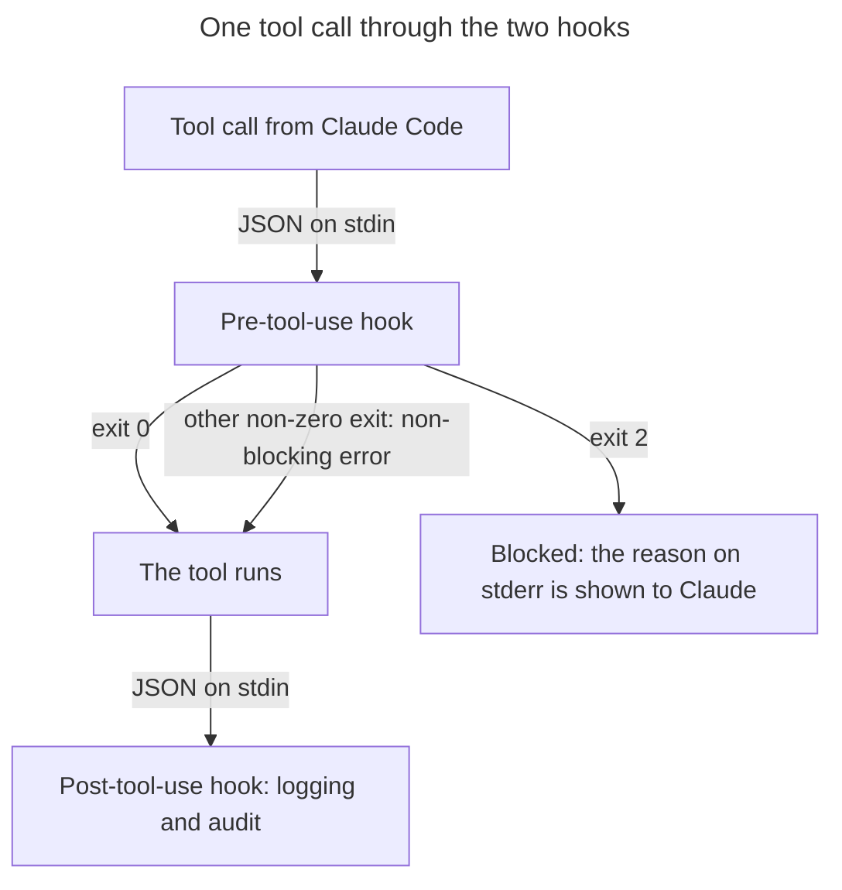
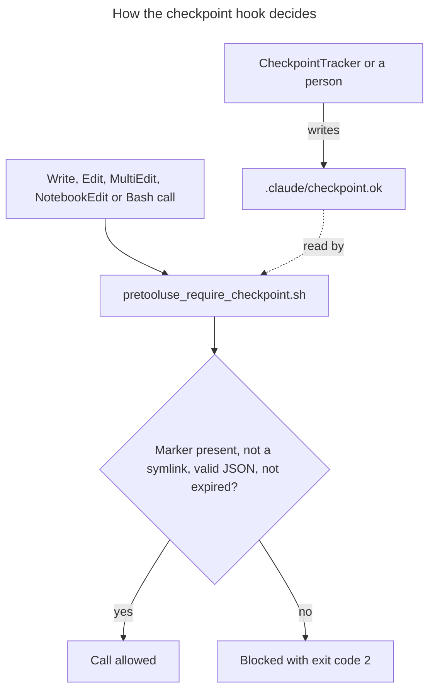
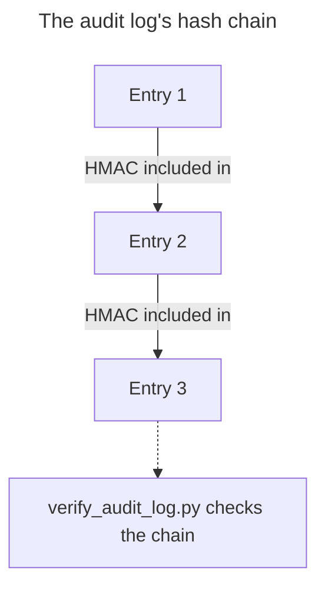

# Safety Hooks

This directory contains hooks that implement the VERIFY layer capabilities from the Agent Capability Standard.

## Spec-Aligned Hooks

These hooks directly implement capabilities defined in the standard's VERIFY layer:

| Hook | Capability | Purpose |
|------|------------|---------|
| `pretooluse_require_checkpoint.sh` | `checkpoint` | Require checkpoint marker before mutation operations |
| `posttooluse_log_tool.sh` | `audit` | Log tool usage for audit trail and provenance |

## How Hooks Work




### Pre-Tool-Use Hooks

Run **before** a tool executes and can block operations. Claude Code passes
the tool call as JSON on stdin; exit 0 allows the call, and exit 2 blocks it,
with the reason on stderr shown to Claude (any other non-zero exit is a
non-blocking error, so the tool would still run).

```bash
echo '{"tool_name": "Write", "tool_input": {"file_path": "a.py"}}' \
  | ./pretooluse_require_checkpoint.sh   # exit 2 without a valid marker
./pretooluse_require_checkpoint.sh "Write a.py"   # a payload as $1 is also accepted
```

### Post-Tool-Use Hooks

Run **after** a tool executes for logging and audit. The tool call arrives as
JSON on stdin.

```bash
echo '{"tool_name": "Skill", "tool_input": {"skill": "checkpoint"}}' \
  | ./posttooluse_log_tool.sh
```

## Configuration

Hooks are configured in `hooks.json` (loaded automatically by the Claude Code plugin):

```json
{
  "hooks": {
    "PreToolUse": [
      {
        "matcher": "Write|Edit|MultiEdit|NotebookEdit|Bash",
        "hooks": [
          {
            "type": "command",
            "command": "${CLAUDE_PLUGIN_ROOT}/hooks/pretooluse_require_checkpoint.sh"
          }
        ]
      }
    ],
    "PostToolUse": [
      {
        "matcher": "Skill",
        "hooks": [
          {
            "type": "command",
            "command": "${CLAUDE_PLUGIN_ROOT}/hooks/posttooluse_log_tool.sh"
          }
        ]
      }
    ]
  }
}
```

Each hook entry specifies:
- **matcher**: Regex pattern matching tool names that trigger the hook
- **hooks**: Array of hook commands to execute
- **type**: Hook type (`command` for shell scripts)
- **command**: Path to the hook script (`${CLAUDE_PLUGIN_ROOT}` resolves to the plugin directory)

## Checkpoint System

The `pretooluse_require_checkpoint.sh` hook enforces the `checkpoint` capability requirement:
- Expects a marker file at `.claude/checkpoint.ok` before allowing mutation operations: every `Write`, `Edit`, `MultiEdit`, `NotebookEdit` and `Bash` call (it fails closed: a shell command is not trusted to be read-only). The marker is written outside these tools, by `CheckpointTracker` or by a person
- Blocks with exit code 2 and the reason on stderr
- Validates marker contains JSON with checkpoint ID, creation time, and expiry (SEC-001)
- Rejects stale markers that have expired (default: 30 minutes)
- Rejects symlinks to prevent bypass attacks (SEC-006)
- Uses `CLAUDE_PROJECT_DIR` for absolute path resolution (SEC-006)
- Maps to the spec's `requires_checkpoint: true` field on capabilities




The marker file must contain valid JSON:
```json
{"checkpoint_id": "chk_...", "created_at": 1706000000, "expires_at": 1706001800}
```

When using the Python SDK, `CheckpointTracker(marker_dir=".claude")` automatically
manages this marker file, bridging the shell and Python safety layers.

## Audit Trail

The `posttooluse_log_tool.sh` hook implements the `audit` capability:
- Logs each Skill invocation (the PostToolUse matcher is `Skill`) as JSON with timestamps
- Uses HMAC-SHA256 chaining for tamper detection (SEC-005)
- Each entry includes the HMAC of the previous entry, creating a hash chain
- Records what was executed for provenance tracking
- Enables post-hoc analysis of agent behavior




Verify audit log integrity:
```bash
python tools/verify_audit_log.py
```

Set a custom HMAC key via the `AUDIT_HMAC_KEY` environment variable.

## Relationship to Spec

These hooks implement runtime enforcement of VERIFY layer requirements:

| Spec Field | Hook Implementation |
|------------|---------------------|
| `requires_checkpoint: true` | `pretooluse_require_checkpoint.sh` blocks without checkpoint |
| `audit` capability | `posttooluse_log_tool.sh` records tool usage |

See `schemas/capability_ontology.yaml` for full capability definitions.
