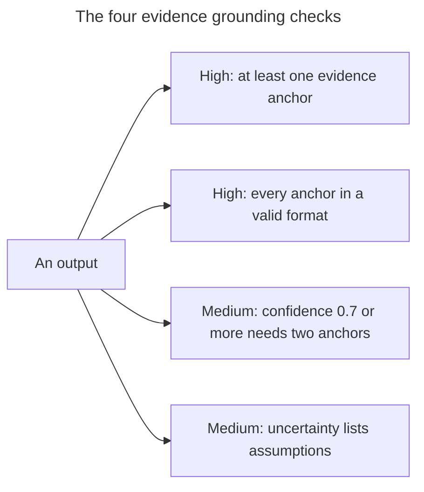
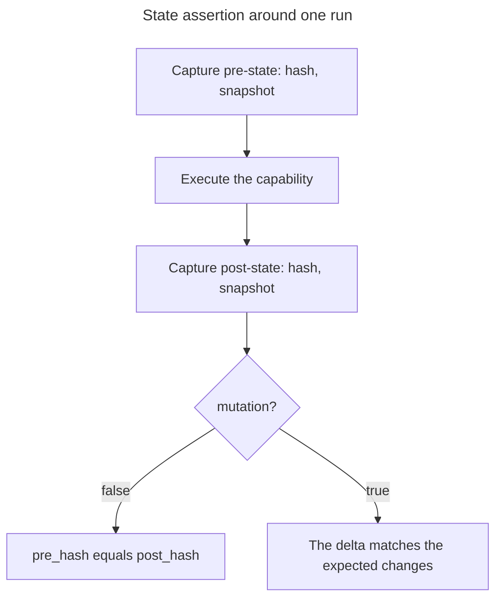
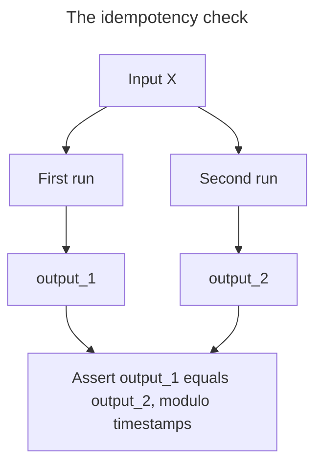
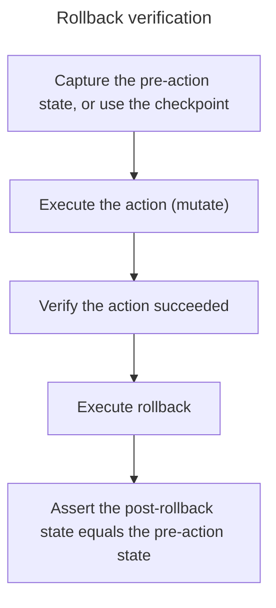
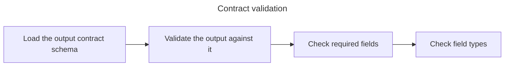
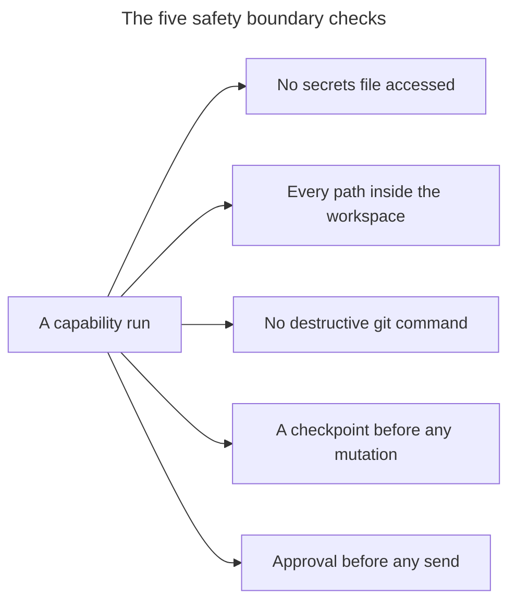
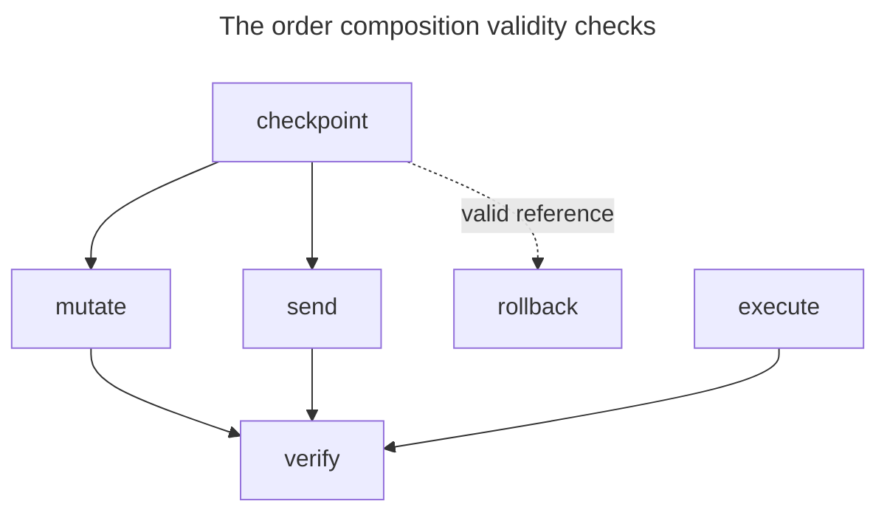

# Verification Patterns

Reusable verification patterns for capability skills. Apply these patterns to ensure outputs are correct, grounded, and safe.

---

## Pattern 1: Evidence Grounding

**Applies to:** All capabilities

**Purpose:** Ensure every non-trivial claim is anchored to verifiable evidence.

### Procedure

```yaml
pattern: evidence_grounding
checks:
  - name: evidence_anchors_present
    condition: output.evidence_anchors.length > 0
    severity: high
    message: "Output must contain at least one evidence anchor"

  - name: evidence_anchors_valid
    condition: all evidence_anchors match pattern (file:line|url|tool:.*)
    severity: high
    message: "Evidence anchors must be in valid format"

  - name: confidence_justified
    condition: confidence >= 0.7 implies evidence_anchors.length >= 2
    severity: medium
    message: "High confidence requires multiple evidence sources"

  - name: assumptions_explicit
    condition: if uncertainty exists, assumptions.length > 0
    severity: medium
    message: "Uncertain conclusions must list assumptions"
```



### Invariants

- `evidence_anchors.length > 0` for any output with `confidence > 0.5`
- Referenced files in evidence_anchors exist and are readable
- No evidence anchor references content outside the workspace

### Example Check

```python
def verify_evidence_grounding(output):
    errors = []

    # Check evidence anchors exist
    if not output.get('evidence_anchors') or len(output['evidence_anchors']) == 0:
        errors.append("No evidence anchors provided")

    # Validate anchor format
    anchor_pattern = r'^(file:\d+|https?://.*|tool:\w+:.*)$'
    for anchor in output.get('evidence_anchors', []):
        if not re.match(anchor_pattern, anchor):
            errors.append(f"Invalid anchor format: {anchor}")

    # Check confidence/evidence correlation
    if output.get('confidence', 0) >= 0.7:
        if len(output.get('evidence_anchors', [])) < 2:
            errors.append("High confidence requires 2+ evidence sources")

    return len(errors) == 0, errors
```

---

## Pattern 2: State Assertion

**Applies to:** `observe`, `state`, `checkpoint`, `rollback`, state-modifying capabilities

**Purpose:** Verify state before and after operations to detect unintended changes.

### Procedure

```yaml
pattern: state_assertion
steps:
  1. Capture pre-state:
     - hash: compute hash of relevant state
     - snapshot: capture key state variables

  2. Execute capability

  3. Capture post-state:
     - hash: compute hash of relevant state
     - snapshot: capture key state variables

  4. Assert expected delta:
     - If mutation=false: pre_hash == post_hash
     - If mutation=true: delta matches expected changes

checks:
  - name: no_unexpected_mutations
    condition: if mutation=false then pre_hash == post_hash
    severity: critical
    message: "Non-mutating capability modified state"

  - name: expected_changes_only
    condition: diff(pre_state, post_state) subset_of expected_changes
    severity: high
    message: "Unexpected state changes detected"

  - name: rollback_restores
    condition: if rollback then post_hash == checkpoint_hash
    severity: critical
    message: "Rollback did not restore to checkpoint state"
```



### Invariants

- Non-mutating capabilities leave state unchanged
- Mutating capabilities only change declared targets
- Rollback returns to exact checkpoint state

### Example Check

```python
def verify_state_assertion(pre_state, post_state, capability, expected_changes=None):
    errors = []

    pre_hash = compute_hash(pre_state)
    post_hash = compute_hash(post_state)

    if not capability.get('mutation', False):
        if pre_hash != post_hash:
            errors.append("Non-mutating capability modified state")
    else:
        actual_changes = compute_diff(pre_state, post_state)
        if expected_changes:
            unexpected = set(actual_changes) - set(expected_changes)
            if unexpected:
                errors.append(f"Unexpected changes: {unexpected}")

    return len(errors) == 0, errors
```

---

## Pattern 3: Idempotency Check

**Applies to:** `detect`, `classify`, `measure`, `predict`, `compare`, `discover`, all read-only capabilities

**Purpose:** Ensure repeated execution with same input produces same output.

### Procedure

```yaml
pattern: idempotency
steps:
  1. Execute capability with input X → output_1
  2. Execute capability with same input X → output_2
  3. Assert: output_1 == output_2 (modulo timestamps)

checks:
  - name: deterministic_result
    condition: output_1.result == output_2.result
    severity: high
    message: "Same input produced different results"

  - name: stable_confidence
    condition: abs(output_1.confidence - output_2.confidence) < 0.1
    severity: medium
    message: "Confidence unstable across executions"

  - name: consistent_evidence
    condition: set(output_1.evidence_anchors) == set(output_2.evidence_anchors)
    severity: medium
    message: "Evidence anchors differ between executions"
```



### Invariants

- `result` field is identical across runs
- `confidence` varies by less than 0.1
- `evidence_anchors` set is identical

### Example Check

```python
def verify_idempotency(capability_fn, input_data, runs=2):
    outputs = []
    for _ in range(runs):
        outputs.append(capability_fn(input_data))

    errors = []
    base = outputs[0]
    for i, output in enumerate(outputs[1:], 1):
        if output.get('result') != base.get('result'):
            errors.append(f"Run {i} result differs from run 0")

        conf_diff = abs(output.get('confidence', 0) - base.get('confidence', 0))
        if conf_diff >= 0.1:
            errors.append(f"Run {i} confidence differs by {conf_diff}")

    return len(errors) == 0, errors
```

---

## Pattern 4: Rollback Verification

**Applies to:** `mutate`, `rollback`, any mutation a checkpoint can restore (not `send`: a sent message cannot be recalled)

**Purpose:** Verify that rollback restores state exactly to the checkpoint.

### Procedure

```yaml
pattern: rollback_verification
steps:
  1. Capture pre-action state (or use checkpoint)
  2. Execute action (mutate)
  3. Verify action succeeded
  4. Execute rollback
  5. Assert: post-rollback state == pre-action state

checks:
  - name: checkpoint_exists
    condition: checkpoint_id is valid and restorable
    severity: critical
    message: "Cannot rollback without valid checkpoint"

  - name: state_restored
    condition: post_rollback_hash == checkpoint_hash
    severity: critical
    message: "Rollback did not restore to checkpoint state"

  - name: no_orphaned_artifacts
    condition: no new files exist that weren't in checkpoint
    severity: high
    message: "Orphaned files remain after rollback"

  - name: clean_git_state
    condition: git status shows no unexpected changes
    severity: high
    message: "Git state not clean after rollback"
```



### Invariants

- Checkpoint must exist before any mutating operation
- Post-rollback state hash matches checkpoint state hash
- No files created by action remain after rollback
- Git working tree is clean (if git was used)

### Example Check

```python
def verify_rollback(checkpoint_state, post_rollback_state, action_files):
    errors = []

    checkpoint_hash = compute_hash(checkpoint_state)
    rollback_hash = compute_hash(post_rollback_state)

    if checkpoint_hash != rollback_hash:
        errors.append("State hash mismatch after rollback")

    for file in action_files:
        if file_exists(file) and file not in checkpoint_state.files:
            errors.append(f"Orphaned file remains: {file}")

    git_status = run_command("git status --porcelain")
    if git_status.strip():
        errors.append(f"Git not clean: {git_status}")

    return len(errors) == 0, errors
```

---

## Pattern 5: Contract Validation

**Applies to:** All capabilities

**Purpose:** Ensure output matches the declared output contract schema.

### Procedure

```yaml
pattern: contract_validation
steps:
  1. Load output contract schema for capability
  2. Validate output against schema
  3. Check required fields present
  4. Check field types match

checks:
  - name: required_fields_present
    condition: all required fields exist in output
    severity: critical
    message: "Missing required field in output"

  - name: field_types_match
    condition: all fields have correct type
    severity: high
    message: "Field type mismatch"

  - name: confidence_in_range
    condition: 0 <= confidence <= 1
    severity: high
    message: "Confidence out of range [0,1]"

  - name: arrays_not_empty
    condition: evidence_anchors is array (may be empty only if confidence < 0.3)
    severity: medium
    message: "Evidence anchors should be non-empty for confident outputs"
```



### Required Fields (All Capabilities)

| Field | Type | Required |
|-------|------|----------|
| `confidence` | number (0-1) | Yes |
| `evidence_anchors` | array[string] | Yes |
| `assumptions` | array[string] | Yes |

### Example Check

```python
def verify_contract(output, schema):
    errors = []

    # Check required base fields
    required = ['confidence', 'evidence_anchors', 'assumptions']
    for field in required:
        if field not in output:
            errors.append(f"Missing required field: {field}")

    # Validate confidence range
    conf = output.get('confidence', -1)
    if not (0 <= conf <= 1):
        errors.append(f"Confidence {conf} out of range [0,1]")

    # Validate evidence_anchors type
    anchors = output.get('evidence_anchors')
    if not isinstance(anchors, list):
        errors.append("evidence_anchors must be array")

    # Schema-specific validation
    for field, field_schema in schema.get('properties', {}).items():
        if field in output:
            if not validate_type(output[field], field_schema['type']):
                errors.append(f"Field {field} type mismatch")

    return len(errors) == 0, errors
```

---

## Pattern 6: Safety Boundary Check

**Applies to:** All capabilities, especially high-risk ones

**Purpose:** Ensure capability does not violate safety constraints.

### Procedure

```yaml
pattern: safety_boundary
checks:
  - name: no_secrets_accessed
    condition: no file in [.env, credentials.*, secrets.*] was read/written
    severity: critical
    message: "Accessed sensitive file"

  - name: within_workspace
    condition: all file paths are within workspace root
    severity: critical
    message: "Accessed file outside workspace"

  - name: no_destructive_git
    condition: no git commands [push --force, reset --hard, clean -f] executed
    severity: critical
    message: "Executed destructive git command"

  - name: checkpoint_before_mutation
    condition: if mutation=true then checkpoint exists
    severity: critical
    message: "Mutation without checkpoint"

  - name: approval_for_send
    condition: if capability=send then approval obtained
    severity: critical
    message: "Send without approval"
```



### Invariants

- Never access paths matching `**/.env`, `**/credentials.*`, `**/secrets.*`
- All file operations within workspace boundary
- No destructive git commands without explicit user request
- All mutations preceded by checkpoint
- External sends require approval

### Example Check

```python
def verify_safety_boundaries(capability, operations, workspace_root):
    errors = []

    sensitive_patterns = ['.env', 'credentials', 'secrets', '.pem', '.key']

    for op in operations:
        # Check for sensitive files
        for pattern in sensitive_patterns:
            if pattern in op.get('path', ''):
                errors.append(f"Accessed sensitive path: {op['path']}")

        # Check workspace boundary
        if not op.get('path', '').startswith(workspace_root):
            errors.append(f"Path outside workspace: {op['path']}")

    # Check mutation safety
    if capability.get('mutation', False):
        if not capability.get('checkpoint_id'):
            errors.append("Mutation without checkpoint")

    # Check send approval
    if capability.get('id') == 'send':
        if not capability.get('approved', False):
            errors.append("Send without approval")

    return len(errors) == 0, errors
```

---

## Pattern 7: Composition Validity

**Applies to:** Workflow sequences, capability chains

**Purpose:** Verify capabilities are composed correctly without anti-patterns.

### Procedure

```yaml
pattern: composition_validity
checks:
  - name: no_mutation_without_checkpoint
    condition: mutate and send always preceded by checkpoint
    severity: critical
    message: "mutate/send without checkpoint"

  - name: no_rollback_without_checkpoint
    condition: rollback always has valid checkpoint reference
    severity: critical
    message: "rollback without checkpoint"

  - name: verify_after_mutation
    condition: mutate, execute and send followed by verify
    severity: high
    message: "mutation not verified"

  - name: dependencies_satisfied
    condition: capability.requires all executed before
    severity: high
    message: "Dependency not satisfied"
```



### Anti-Patterns

| Anti-Pattern | Risk | Prevention |
|--------------|------|------------|
| mutate/send without checkpoint | critical | Always checkpoint first |
| rollback without checkpoint | critical | Verify checkpoint exists |
| send without constrain | high | Apply constrain before send |
| verify without evidence | medium | Ensure evidence_anchors populated |
| detect without confidence threshold | medium | Always set confidence |

### Example Check

```python
def verify_composition(workflow_steps):
    errors = []

    checkpoint_created = False
    effect_verified = True

    for i, step in enumerate(workflow_steps):
        cap_id = step.get('capability')

        # Check mutate/send has checkpoint
        if cap_id in ('mutate', 'send'):
            if not checkpoint_created:
                errors.append(f"Step {i}: {cap_id} without prior checkpoint")

        # Any side-effecting step must be verified afterwards
        if cap_id in ('mutate', 'execute', 'send'):
            effect_verified = False

        # Track checkpoint creation
        if cap_id == 'checkpoint':
            checkpoint_created = True

        # Check rollback has checkpoint
        if cap_id == 'rollback':
            if not checkpoint_created:
                errors.append(f"Step {i}: rollback without checkpoint")

        # Check verify follows the side effect
        if cap_id == 'verify':
            effect_verified = True

    if not effect_verified:
        errors.append("mutate/execute/send not followed by verify")

    return len(errors) == 0, errors
```

---

## Usage

Apply these patterns in the Verification section of each skill:

```markdown
## Verification

Apply the following verification patterns:

1. **Evidence Grounding** - All claims anchored to file:line or URL references
2. **Contract Validation** - Output matches the declared schema
3. **Safety Boundary** - No sensitive files accessed, within workspace
4. **[Pattern specific to capability]**

Verification tools: Read (to check referenced files exist)
```
