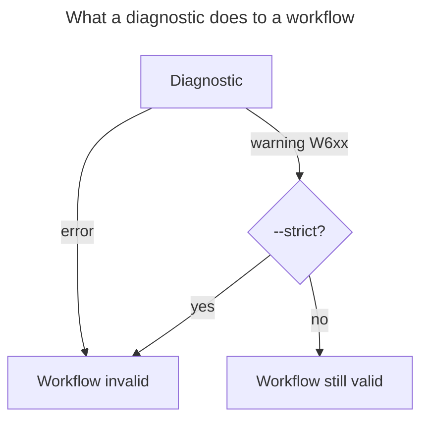
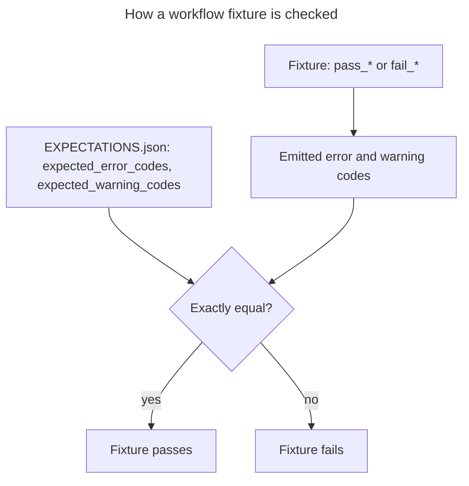

# Conformance

Normative requirements are in [STANDARD-v1.2.0 §10](STANDARD-v1.2.0.md#10-conformance);
this page summarises them.

## Conformance levels
- **L1 Structural Conformance**
  - validates required fields and field types
  - validates capability existence
  - enforces `requires`, `precedes` and `conflicts_with`; warns on unmet
    `soft_requires`
  - checks that `store_as` names are unique
  - resolves effective safety flags; warns on downgrades
  - reports unknown fields and the declared standard version
  - checks catalog manifests and resolves `invoke` targets over the catalog
    set it is given
  - given agent manifests, raises the flags of `delegate` steps and checks
    their targets and tasks in workflows that declare `agents`
  - reports diagnostic locations with their `path`

- **L2 Type Conformance**
  - resolves `$ref` schemas
  - infers binding types, checking each binding's root and path
  - requires typed annotations only when ambiguous
  - validates typed annotations

- **L3 Contract Conformance**
  - validates binding types against consumer input_schema
  - parses and type-checks condition expressions
  - emits coercion hints

- **L4 Patch Conformance**
  - emits patch suggestions JSON
  - emits optional diff patch (`--emit-patch`)
  - uses coercion registry when available

Every diagnostic has a fixed severity: errors make a workflow invalid,
warnings (W6xx) do not, unless the validator runs in strict mode
(`--strict`).

**Reference implementation:** L4 (`tools/validate_workflows.py`, backed by
the Rust core in `core/`).

## Required artifacts
- Capability ontology file
- Workflow catalog file
- Schema bundle + policies
- Validator CLI

## Test suite requirements
- Positive fixtures: valid workflows (`tests/fixtures/pass_*`), and valid
  workflows that must give the warnings their expectation lists
  (`tests/fixtures/warn_*`)
- Negative fixtures: invalid references, type mismatches, ambiguous nodes,
  edge and version violations, and malformed or undeclared extensions
  (`tests/fixtures/fail_*`)
- Patch fixtures: expected patch suggestions and diff output
- Expectations in `tests/fixtures/EXPECTATIONS.json`: `should_pass`,
  `expected_error_codes`, and `expected_warning_codes`. The codes a fixture
  emits must equal the listed set exactly; an absent or empty warning list
  means no warning may be emitted. An expectation may also give `catalogs`
  (further catalogs of the fixture's catalog set, under
  `tests/fixtures/catalogs/`), `agents` (agent manifests, under
  `tests/fixtures/agents/`) and `expected_locations` (each a `code` and the
  `path` it must be reported at, or, for a finding with no `path`, the
  `catalog`, `workflow` and `field` it must carry, §9.8) (§10.3)
- Expression fixtures, language-neutral:
  `tests/conformance/expressions/eval.json` (evaluation results and runtime
  errors) and `tests/conformance/expressions/check.json` (static
  diagnostics). `tools/cel_differential` runs them against cel-go to check
  CEL compatibility.
- Runtime fixtures, language-neutral: `tests/conformance/runtime/*.json`,
  scripted runs (catalog, inputs, the expected actions and the responses to
  them, the expected end and trace), normative for an executor of class EX
  except their `trace_kinds` (§10.3, §10.5; see
  [Executor conformance](#executor-conformance-class-ex)). Run by
  `cargo test --test runtime` (each also replayed through a snapshot and
  restore before every step, and with the trace and records taken out
  before every step) and `tests/test_runner.py`. Fifteen of them
  (`orchestrator_*`) script runs of the workflows an adopter ported to the
  candidate (reduced from production, generic names; revision 1.1e), kept
  as contributed
  (`tests/fixtures/pass_orchestrator_port.workflow_catalog.yaml`). The
  `domain_*` ones run reference domain workflows. Twenty (`gap*`) are an
  adopter's own scripted runs, kept as contributed in
  `tests/conformance/contrib/` and copied by the generator. The
  `approval_*`, `approver_*` and `resume_*` ones pin the approval request
  for a step with no or a partial `approval` field, the digest comparison,
  approver identities, and the resumption of a deferred run (§5.14,
  §5.14.1, §5.17); a script's `resume` entry resumes the run. The
  `cancel_*`, `wake_at_*`, `records_*`, `run_record_*`, `parallel_group_*`,
  `audit_*` and `error_reason_*` ones pin cancellation, the tick boundaries,
  record mode `actions`, run records, parallel groups, `require_record` and
  error reasons (§5.2.3, §5.19, §6.4). The `agents_*`, `delegate_*` and
  `invoke_*` ones added in 1.2 pin delegation targets, `read_only`
  attestation, continuations and catalog sets (§5.1.1, §5.15.2, §5.15.3);
  a fixture's `catalogs` and `agents` are given to the run. The `send_*`,
  `destination_*`, `profile_destinations_*`, `rollback_step_*`,
  `rolled_back_*`, `persist_*` and `recall_scope_absent` ones, with
  `delegate_replaces_new_key` and `delegate_rollback_own_state`, pin
  idempotency keys, destination policies (F504 before approval), what a
  rollback reports and the memory scope echo (§4.4.1, §4.4.2, §4.5,
  §5.15.4).
- Domain selection, agent maxima, model family and inquiry answer vectors,
  normative (§10.3): `tests/conformance/domains/match.json` (the
  implementation a host selects for a step's domain, §5.2.4),
  `tests/conformance/agents/maxima.json` (an agent manifest's maxima,
  read-only maxima and joins, §5.15.1), `tests/conformance/families/derive.json`
  (the model family a host derives from a model identifier, §5.15) and
  `tests/conformance/inquiry/answers.json` (the answers a host may deliver
  for an inquiry, §5.13.1).
- Destination vectors, normative (§10.3):
  `tests/conformance/destinations/match.json`, which patterns are valid and
  which destinations the listed policies allow (§4.4.2), every known
  bypass included; ASCII-only, so the NFC and NFD cases stay distinct.
- Memory vectors, normative for a host that states it implements §4.5:
  `tests/conformance/memory/store.json`, a memory store scripted through
  `persist` and `recall` operations at given times and in given scopes; a
  host passes the cases whose scopes it provides.
- Trigger vectors, normative (§10.3): `tests/conformance/triggers/`
  (`fire_times.json`, `overlap.json`, `attendance.json`, `events.json`), the
  §5.10.2 fire times, overlap decisions (resumed runs included), the
  attendance of a run a trigger starts and which events start runs (a
  redelivered event included). `scripts/gen_trigger_vectors.py` computes
  them with Python's zoneinfo, independently of the core; `fire_times.json`
  names the tzdata release it was computed with, and the vectors are
  normative with it or any release that agrees on their dates.
- Approval digest vectors, normative (§10.3):
  `tests/conformance/approval/digests.json`. Each vector has a `kind`. A
  `step` vector is one approval request of a workflow step (§5.14): the
  step's `approval` field (or null), its resolved `inputs` where it declares
  no `shows`, the values its references resolve against (`bindings`) where
  it does, the value a recheck read (`recheck_read`) for a request asked
  again, and the `shown` values; a `tool_call` vector is the approval
  of a tool call (§5.18.7): the `call` (`{action, capability, args}`, with
  `capability` null for an unbound tool) and `shown`, which is `[call]`. Every
  vector gives the canonical JSON (RFC 8785) of `shown` and the SHA-256
  digest of that text in lowercase hexadecimal. An implementation that
  computes or checks approval digests MUST reproduce each vector's
  `canonical` text and `digest`; an executor MUST show each `step` vector's
  `shown` values, given its `inputs` or `bindings` and `recheck_read`, and a
  safety layer each `tool_call` vector's. The vectors
  cover member order, nesting, number forms (2^53, the largest integer
  magnitude §5.14 allows, and `1e+21`, a binary64 value because it is
  written with an exponent), text outside ASCII, an empty list, a reference
  that resolves to nothing, a step that declares no `shows`, a step asked
  again after a recheck, and the call of a bound and of an unbound tool.
  `scripts/gen_standard_agents_binding.py`
  writes the file from runs of the executor, and CI fails when it is out of
  date. `tests/test_approval_vectors.py` replays each `step` vector on the
  executor from the vector's own fields and recomputes the canonical JSON
  and the digest with a serializer of its own; the TypeScript package
  (`packages/acs-core/`) tests its digest against the file in place.

Running the suite:

| Fixtures | Command |
|----------|---------|
| Workflow fixtures (`tests/fixtures/`) | `python scripts/run_conformance.py` |
| Runtime fixtures | `cargo test --test runtime` (in `core/`), `pytest tests/test_runner.py` |
| Expression fixtures | `cargo test --test expressions` (in `core/`); `tools/cel_differential` against cel-go |
| Approval digest vectors | `pytest tests/test_approval_vectors.py`; `npm test` in `packages/acs-core/` |
| Trigger vectors | `cargo test --test triggers` (in `core/`), `pytest tests/test_triggers.py` |
| Trust vectors | `pytest tests/test_trust.py` |
| Profile vectors | `cargo test --test profiles` (in `core/`), `pytest tests/test_profiles.py`, `npm test` in `packages/acs-core/` (through WebAssembly) |
| Entity id vectors | `pytest tests/test_entities.py` |
| Grounding vectors | `cargo test --test grounding` (in `core/`), `pytest tests/test_grounding.py`, `npm test` in `packages/acs-core/` |
| Destination vectors | `cargo test --lib destination` (in `core/`), `pytest tests/test_destinations.py`, `npm test` in `packages/acs-core/` |
| Memory vectors | `pytest tests/test_memory_store.py`, `npm test` in `examples/standard_agents/` (session scope) |
| Secret redaction vectors (informative) | `pytest tests/test_redaction.py`, `npm test` in `packages/acs-core/` |
| Domain, maxima and family vectors | `cargo test --test delegation_catalogs` (in `core/`; maxima and families), `pytest tests/test_domains.py tests/test_agent_manifest.py tests/test_families.py`, `npm test` in `packages/acs-core/` |
| Inquiry answer vectors | `pytest tests/test_inquiry.py` |

`scripts/run_conformance.py` runs only the workflow fixtures.

## Executor conformance (class EX)

An executor claims class EX (STANDARD-v1.2.0 §10.5) when it starts only
catalogs that validate, implements the extensions it accepts, offers the run
operations of §5.19.2, issues exactly the actions of
`schemas/host_protocol.schema.json`, keeps time, saves, restores, cancels and
records as §5.19.3 to §6.4 say, and passes every runtime fixture whose
extensions it implements.

A fixture (`tests/conformance/runtime/schema/fixture.schema.json`) gives the
catalog, its header's version (`header`, or null), the workflow, its inputs
and attendance and, optionally, the actor, the record mode (`records`) and
the other start members, all passed to start with `run_id` `"run-1"`. Its
`script` is a list of entries:

| Entry | What the harness does |
|-------|-----------------------|
| `{"expect": A, "respond": R, "at": T}` | The pending action must match `A` and hold none of the members `absent` lists (paths joined by `.`); then `R`, when given, is submitted at `T` (`"{{digest}}"` and `"{{digest_upper}}"` stand for the action's digest) |
| `{"tick": T, "changed": C}` | The time `T` is given; when `changed` is there, the tick must change the run exactly when `C` |
| `{"wake_at": W}` | The run's wake-up time must be `W` (null: none) |
| `{"cancel": {"reason": S, "at": T}}` | The run is cancelled |
| `{"resume": {...}}` | The run is saved, restored and resumed (§5.14.1) |

After the script the run's next action must match `end`, and its run record
`run_record` when the fixture gives one. An actual value matches an expected
one when they are equal, when it is an object with every member the expected
one names, each matching, or when both are arrays of the same length whose
elements match in order. Text the executor composes is not compared: a
`message` (except `ended.message`), the `reason` of an action record or a
deferral, and the `ignored`, `note` and `quorum` texts of a quorum's
`violations`. A `Failed` action's `reason` is a token and is compared.

An executor passes a fixture when every expectation matches, both when it
plays the script as it is and when it saves and restores its state before
every entry. The reference harnesses also replay each fixture with the trace
and the settled records taken out before every entry, checking the state's
chain heads against what was taken, and check at every `tick` that it
changed the run exactly when its time reached the run's wake-up time.
`scripts/gen_runtime_fixtures.py` refuses a fixture that pins a member the
Standard does not define (its `NORMATIVE_MEMBERS` table names the section of
each). Another executor runs the fixtures with a harness of its own built
from the fixture schema; its conformance statement names its version, the
Standard version it implements, the extensions it implements, how its
binding names the run operations, and whether it restores states saved by
its earlier versions.

Coverage gaps: no conformance fixture yet exercises V103, S301, S302 or
W612; the reference implementation's unit tests cover them. F505 is
checked under a grounding policy (STANDARD-v1.2.0 §5.20) and covered by the
grounding vectors (`tests/conformance/grounding/check.json`, normative) and
the runtime fixtures whose names start with `grounding_`.

## Safety-layer conformance (class SL)

A safety layer on a tool-calling host (Standard §5.18) is a separate
conformance class, SL ([§10.4](STANDARD-v1.2.0.md#104-safety-layer-conformance)):
a layer validates no catalog, and a validator checks no call. Its tests are
normative for the class:

- **Binding fixtures**, `tests/conformance/bindings/*.json` (36): a set of
  tool binding records, optionally the tools a host offers and the host
  actions tied to them, and the exact diagnostics and effective flags a
  layer computes. Schema: `tests/conformance/bindings/schema/fixture.schema.json`.
  Nine of them check offered tools and host actions (§5.18.2, a SHOULD) and
  need the `offered_tools` feature.
- **Call-sequence fixtures**, `tests/conformance/calls/*.json` (33): one
  layer scope with bindings, optionally a destination policy in force, then
  calls and events (a boundary, an expired
  checkpoint or decision), each call with the outcome a conforming layer
  gives it, `run`, a refusal code, or the code of a refused output (a call
  that ran and `returns` an output that breaks its capability's output
  contract, R402, §5.18.10). Schema:
  `tests/conformance/calls/schema/fixture.schema.json`. A fixture's `needs`
  names a feature a layer may lack: `unbound_calls`, `nested_calls`,
  `recorded_approval`; its `without`, a feature a layer must lack to play
  it (`composite_send_unseen_under_policy` is for a layer that does not see
  nested calls).
- **Conformance statements**, `tests/conformance/calls/statements/*.json`,
  following `tests/conformance/calls/schema/statement.schema.json`: what a
  layer covers and cannot see, its scope and boundaries, the
  operating-system boundary of each shell-like tool whose calls it covers,
  or `"none"` (`shell_tools`; `{}` when it covers none), its checkpoint
  maximum age, how it obtains approval, how it makes a check and its use
  atomic, the features it supports, its host gaps, the covered calls whose
  results carry no capability output (`calls_without_output`), and
  (`not_applied`) any check of §5.18.10, or the rule for shell-like tools
  of §5.18.3, it does not apply; a layer that lists any does not conform
  to the class until it applies them. Both reference layers apply
  the destination policies in force to `send` calls (§4.4.2) and the secret
  checks of `persist` and `audit`, and redact the records and evidence they
  write (§6.7), and check the output contract of each result they receive
  as a capability output (§5.18.10). Neither lists anything there, and both
  claim class SL: the Python adapter receives capability outputs from the
  MCP tools bound to a capability, as the text of the result the session
  reads (a tool `create_grounded_mcp_server` serves checks its own; the
  PostToolUse hook checks another server's and replaces a refused result),
  and its statement names the calls whose results come in other forms
  (Claude Code's own tools) in `calls_without_output`, as §5.18.10 says. A
  call whose output a layer refuses has failed: it takes no checkpoint
  and is no prerequisite that ran (`refused_checkpoint_output_takes_none`).
  The Python runner plays each call fixture twice: with the tools served,
  and as another server's tools checked at PostToolUse.
- **Shell-like tools** (a tool whose call runs a program its arguments, or
  a definition or file it names, supply: a shell, an interpreter, a REPL).
  A layer gives every call of one the tool's worst case unless its
  statement declares an operating-system boundary for the tool and the
  layer has verified by code, for the call, that the boundary holds in the
  effective host configuration (the values the host applies, from every
  source it reads) and that no part of the call runs outside it
  ([§5.18.3](STANDARD-v1.2.0.md#5183-classification),
  [RFC-0011](RFC-0011-shell-like-tools-and-os-boundary.md)). A boundary has
  four properties: no route outside it, writes kept from the layer's
  records, its code and any file that code outside the boundary runs,
  credentials (the user's, the host's and the layer's) out of reach, and a
  network allowlist that refuses other hosts. No fixture tests a boundary;
  the statement states it. The Standard Agents binding covers no
  shell-like tool (`{}`). The Python adapter declares Claude Code's
  sandbox as the boundary of Bash, which `wrap_options()` turns on, and
  `"none"` for Monitor, PowerShell, Skill, Agent and Task: its Bash
  classifier relaxes a call (a read-only command, `git stash create`, a
  restore of a recorded checkpoint, a local file change) only while it has
  verified that sandbox for the call, for the CLI its Agent SDK bundles in
  a version whose settings it checks, and in a permission mode it has
  checked (`default`, `acceptEdits`, `bypassPermissions`), and gives every
  other Bash call the worst case.

Both kinds of fixture are generated by `scripts/gen_call_fixtures.py`
(`--check` fails on drift, and CI runs it); edit them there. A runner reads
a fixture's JSON text without rounding it: an integer literal beyond 2^53
(`vendor_member_beyond_limit_by_one`, `approval_args_beyond_limit_by_one`,
`output_not_i_json`) must reach the layer as written, which `JSON.parse`
does not do (the TypeScript runners read the text with the package's
`parseJsonExact`). The
reference layers run every fixture whose `needs` their statement supports:

| Layer | Statement | Runners |
|-------|-----------|---------|
| Python SDK adapter (`grounded_agency.GroundedAgentAdapter`) | `grounded_agency_adapter.json` | `tests/test_binding_fixtures.py`, `tests/test_call_fixtures.py` |
| Standard Agents binding (`examples/standard_agents/`) | `standard_agents_binding.json` | `packages/acs-core/test/bindings.test.ts`, `examples/standard_agents/test/calls.test.ts` |

To run a new layer against them: load each binding fixture's `records`
(and, with `offered_tools`, check its `offered` tools and `host_actions`) and
compare the diagnostics, as code and tool pairs in any order, and the
effective flags of the records that loaded; play each call fixture's
`sequence` in one scope, recording decisions before a call that has
`approve` or `reject`, and compare each call's outcome. Skip a fixture whose
`needs` your statement lacks, and say so in the statement, and one whose
`without` your statement lists. What no fixture
can test (that a prompt shows what runs, that the layer sees every call it
claims to cover, its host gaps, and that an operating-system boundary it
declares holds) is stated there instead.

The plugin's Claude Code hooks apply the same rules where Claude Code lets
them but do not claim the class ([SECURITY.md §5.5](SECURITY.md#55-hooks-and-the-safety-layer-class)).

## Informative vectors

These files are language-neutral and informative: STANDARD-v1.2.0 §10.3 does
not name them. Each is JSON, describes its own fields, and has one named
entry per case.

- Capability outputs on a text-only channel (§5.18.9):
  `tests/conformance/output/vectors.json`. Each `decode` vector is the text
  a consumer received and whether it is accepted or refused with R402; each
  `encode` vector is the JSON text of a value, which a producer parses and
  encodes, and whether that is accepted (and the text it sends then
  decodes) or refused. The I-JSON limits apply to the text: an integer
  literal beyond ±2^53 is refused, a number in exponent form is a double and
  is not. Cases where the languages' serializers write one value
  differently (JavaScript writes the double 1.8e16 as an integer literal,
  Python in exponent form) are left out of `encode`.
  `tests/test_capability_output.py` and the TypeScript package's
  `test/output.test.ts` read the file in place.

## Normative vectors of Standard 1.2.0 (§10.3)

- Trust: `tests/conformance/trust/decay.json` (the decay factor of §8.1,
  `max(0.5 ** (age / half_life), min_trust)`, a floor above 0.5 included,
  an age below zero counting as zero), `weight.json` (the static weight of
  §8.3: the lower of the class weight and the source weight, with a domain
  profile's `trust_weights`, either direction, the lowest across profiles),
  `score.json` (`weight × confidence × decay`, confidence 1 when none is
  reported) and `resolve.json` (the strategies of §8.2, ties and
  tie-breakers, and the refusal of a conflict with an unweighable
  candidate). Each file states the absolute tolerance of its values; a
  vector with `expect_error` expects a refusal. `tests/test_trust.py` runs
  the reference implementation, `grounded_agency/trust.py`, against them.
- Domain profiles: `tests/conformance/profiles/load.json` (the diagnostics
  of §5.21.2, each with its code, `location.profile` and `location.field`)
  and `effective.json` (the effective flags and the rules of §5.21.3). The
  core runs them (`core/tests/profiles.rs`), and so do the Python package
  (`tests/test_profiles.py`, through `_core`) and the TypeScript package
  (through WebAssembly, whose interface refuses a request that is not
  I-JSON, so `not_i_json` is refused before the loader sees it): one
  loader.
- Entity ids: `tests/conformance/entities/ids.json` (the grammar of §7.1:
  valid ids parsed into class, namespace and local id; invalid ones
  refused), run by `tests/test_entities.py` against
  `grounded_agency/entities.py`.
