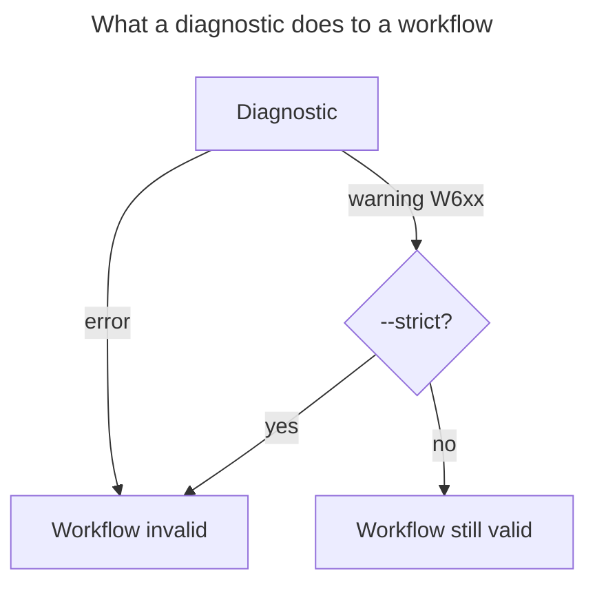
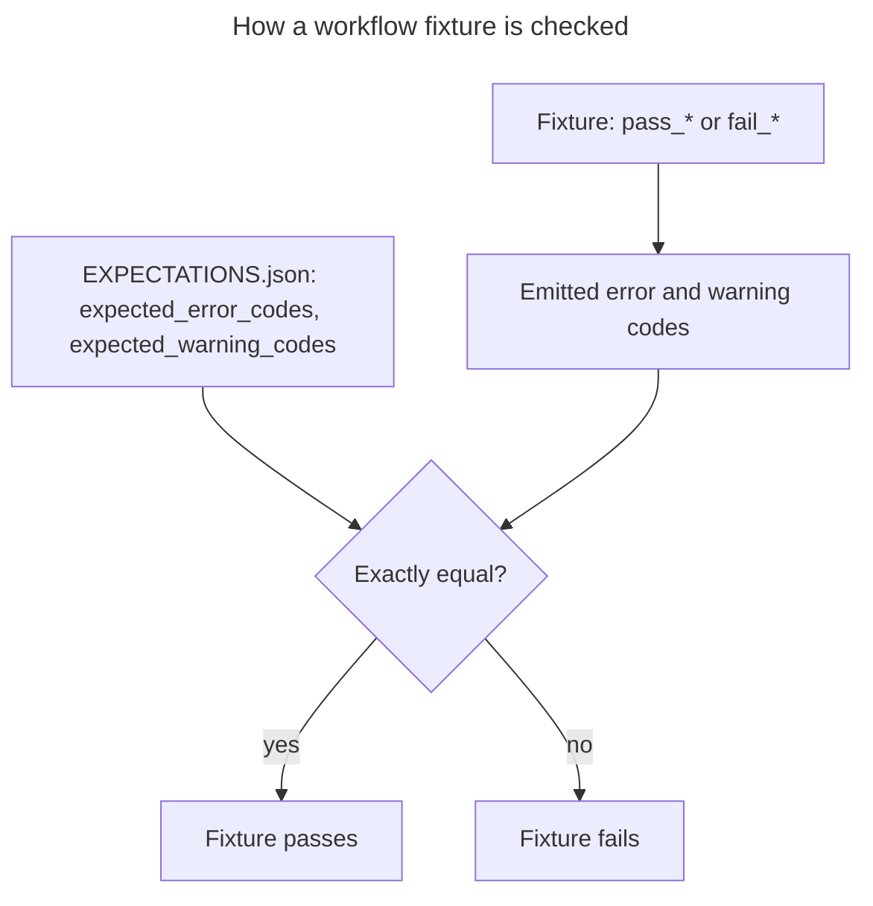

# Conformance

Normative requirements are in [STANDARD-v1.2.0 §10](STANDARD-v1.2.0.md#10-conformance);
this page summarises them.

## Conformance levels
- **L1 Structural Conformance**
  - validates required fields and field types
  - validates capability existence
  - enforces `requires`, `precedes` and `conflicts_with`; warns on unmet
    `soft_requires`
  - resolves effective safety flags; warns on downgrades
  - reports unknown fields and the declared standard version

- **L2 Type Conformance**
  - resolves `$ref` schemas
  - infers binding types, checking each binding's root and path
  - requires typed annotations only when ambiguous
  - validates typed annotations

- **L3 Contract Conformance**
  - validates binding types against consumer input_schema
  - parses and type-checks condition expressions
  - emits coercion hints

- **L4 Patch Conformance**
  - emits patch suggestions JSON
  - emits optional diff patch (`--emit-patch`)
  - uses coercion registry when available

Every diagnostic has a fixed severity: errors make a workflow invalid,
warnings (W6xx) do not, unless the validator runs in strict mode
(`--strict`).

**Reference implementation:** L4 (`tools/validate_workflows.py`, backed by
the Rust core in `core/`).

## Required artifacts
- Capability ontology file
- Workflow catalog file
- Schema bundle + policies
- Validator CLI

## Test suite requirements
- Positive fixtures: valid workflows (`tests/fixtures/pass_*`)
- Negative fixtures: invalid references, type mismatches, ambiguous nodes,
  edge and version violations, and malformed or undeclared extensions
  (`tests/fixtures/fail_*`)
- Patch fixtures: expected patch suggestions and diff output
- Expectations in `tests/fixtures/EXPECTATIONS.json`: `should_pass`,
  `expected_error_codes`, and `expected_warning_codes`. The codes a fixture
  emits must equal the listed set exactly; an absent or empty warning list
  means no warning may be emitted
- Expression fixtures, language-neutral:
  `tests/conformance/expressions/eval.json` (evaluation results and runtime
  errors) and `tests/conformance/expressions/check.json` (static
  diagnostics). `tools/cel_differential` runs them against cel-go to check
  CEL compatibility.
- Runtime fixtures, language-neutral: `tests/conformance/runtime/*.json`,
  scripted runs of the reference executor (catalog, inputs, the expected
  actions and the responses to them, the expected end and trace). Run by
  `cargo test --test runtime` (each also replayed through a snapshot and
  restore before every step) and `tests/test_runner.py`. Fifteen of them
  (`orchestrator_*`) script runs of the workflows an adopter ported to the
  candidate (reduced from production, generic names; revision 1.1e), kept
  as contributed
  (`tests/fixtures/pass_orchestrator_port.workflow_catalog.yaml`). The
  `domain_*` ones run reference domain workflows. Twenty (`gap*`) are an
  adopter's own scripted runs, kept as contributed in
  `tests/conformance/contrib/` and copied by the generator.

Running the suite:

| Fixtures | Command |
|----------|---------|
| Workflow fixtures (`tests/fixtures/`) | `python scripts/run_conformance.py` |
| Runtime fixtures | `cargo test --test runtime` (in `core/`), `pytest tests/test_runner.py` |
| Expression fixtures | `cargo test --test expressions` (in `core/`); `tools/cel_differential` against cel-go |
| Approval digest vectors | `pytest tests/test_approval_vectors.py`; `npm test` in `examples/standard_agents/` |
| Trust vectors | `pytest tests/test_trust.py` |
| Profile vectors | `cargo test --test profiles` (in `core/`), `pytest tests/test_profiles.py`, `npm test` in `packages/acs-core/` (through WebAssembly) |
| Entity id vectors | `pytest tests/test_entities.py` |

`scripts/run_conformance.py` runs only the workflow fixtures.

Coverage gaps: no conformance fixture yet exercises V103, S301, S302, W607
or W612; the reference implementation's unit tests cover them. F505 is
reserved and not checked by the reference implementation, so nothing
tests it.

## Safety-layer conformance (class SL)

A safety layer on a tool-calling host (Standard §5.18) is a separate
conformance class, SL ([§10.4](STANDARD-v1.2.0.md#104-safety-layer-conformance)):
a layer validates no catalog, and a validator checks no call. Its tests are
normative for the class:

- **Binding fixtures**, `tests/conformance/bindings/*.json` (33): a set of
  tool binding records, optionally the tools a host offers and the host
  actions tied to them, and the exact diagnostics and effective flags a
  layer computes. Schema: `tests/conformance/bindings/schema/fixture.schema.json`.
  Nine of them check offered tools and host actions (§5.18.2, a SHOULD) and
  need the `offered_tools` feature.
- **Call-sequence fixtures**, `tests/conformance/calls/*.json` (23): one
  layer scope with bindings, then calls and events (a boundary, an expired
  checkpoint or decision), each call with the outcome a conforming layer
  gives it, `run` or a refusal code. Schema:
  `tests/conformance/calls/schema/fixture.schema.json`. A fixture's `needs`
  names a feature a layer may lack: `unbound_calls`, `nested_calls`,
  `recorded_approval`.
- **Conformance statements**, `tests/conformance/calls/statements/*.json`,
  following `tests/conformance/calls/schema/statement.schema.json`: what a
  layer covers and cannot see, its scope and boundaries, its checkpoint
  maximum age, how it obtains approval, how it makes a check and its use
  atomic, the features it supports, its host gaps, and (`not_applied`) any
  check of §5.18.10 it does not apply yet; a layer that lists any does not
  conform to the class until it applies them. The two reference layers list
  there the secret checks of `persist` and `audit` and the redaction of the
  records and evidence they write and of a `transform` output (§6.7), and
  the destination policy of `send` (§4.4.2); the Python adapter also lists
  the output contract of a tool's result (§5.18.9). They meet §10.4 except
  those rows, and claim class SL once they apply them.

Both kinds of fixture are generated by `scripts/gen_call_fixtures.py`
(`--check` fails on drift, and CI runs it); edit them there. A runner reads
a fixture's JSON text without rounding it: an integer literal beyond 2^53
(`vendor_member_beyond_limit_by_one`, `approval_args_beyond_limit_by_one`)
must reach the layer as written, which `JSON.parse` does not do (the
TypeScript runners read the text with the package's `parseJsonExact`). The
reference layers run every fixture whose `needs` their statement supports:

| Layer | Statement | Runners |
|-------|-----------|---------|
| Python SDK adapter (`grounded_agency.GroundedAgentAdapter`) | `grounded_agency_adapter.json` | `tests/test_binding_fixtures.py`, `tests/test_call_fixtures.py` |
| Standard Agents binding (`examples/standard_agents/`) | `standard_agents_binding.json` | `packages/acs-core/test/bindings.test.ts`, `examples/standard_agents/test/calls.test.ts` |

To run a new layer against them: load each binding fixture's `records`
(and, with `offered_tools`, check its `offered` tools and `host_actions`) and
compare the diagnostics, as code and tool pairs in any order, and the
effective flags of the records that loaded; play each call fixture's
`sequence` in one scope, recording decisions before a call that has
`approve` or `reject`, and compare each call's outcome. Skip a fixture whose
`needs` your statement lacks, and say so in the statement. What no fixture
can test (that a prompt shows what runs, that the layer sees every call it
claims to cover, and its host gaps) is stated there instead.

The plugin's Claude Code hooks apply the same rules where Claude Code lets
them but do not claim the class ([SECURITY.md §5.5](SECURITY.md#55-hooks-and-the-safety-layer-class)).

## Informative vectors

These files are language-neutral and informative: STANDARD-v1.1.0 §10.3 does
not name them. Each is JSON, describes its own fields, and has one named
entry per case.

- Approval digests: `tests/conformance/approval/digests.json`. Each vector
  is one approval request of the reference executor (§5.14): the shown
  values, their canonical JSON (RFC 8785) and the SHA-256 digest of that
  text in lowercase hexadecimal. The vectors cover member order, nesting,
  number forms, text outside ASCII, an empty list, a step that declares no
  `shows`, and a step asked again after a recheck. Three things the vectors
  pin are the reference executor's behaviour and are not stated in the
  Standard: a step with no `shows` shows its resolved inputs wrapped in an
  array, a step asked again shows one more object, whose `recheck` member
  holds the previous and the current value of the source, and the digest is
  written in lowercase hexadecimal. The `numbers` vector holds 2^53
  (9007199254740992), the bound §5.14 writes as "within ±2^53"; RFC 7493
  §2.2 gives the range of integers a receiver can treat as exact as
  ±(2^53 - 1).
  `scripts/gen_standard_agents_binding.py` writes the file from runs of the
  executor, and CI fails when it is out of date.
  `tests/test_approval_vectors.py` replays each vector on the executor and
  recomputes the canonical JSON and the digest with a serializer of its
  own. The TypeScript package (`packages/acs-core`) reads the file in
  place. The `tool_call` vectors pin the approval of a tool call (§5.18.7):
  `shown` is `[{action, capability, args}]`, with `capability` null for an
  unbound tool.
- Capability outputs on a text-only channel (§5.18.9):
  `tests/conformance/output/vectors.json`. Each `decode` vector is the text
  a consumer received and whether it is accepted or refused with R402; each
  `encode` vector is the JSON text of a value, which a producer parses and
  encodes, and whether that is accepted (and the text it sends then
  decodes) or refused. The I-JSON limits apply to the text: an integer
  literal beyond ±2^53 is refused, a number in exponent form is a double and
  is not. Cases where the languages' serializers write one value
  differently (JavaScript writes the double 1.8e16 as an integer literal,
  Python in exponent form) are left out of `encode`.
  `tests/test_capability_output.py` and the TypeScript package's
  `test/output.test.ts` read the file in place.

## Normative vectors of Standard 1.2.0 (§10.3)

- Trust: `tests/conformance/trust/decay.json` (the decay factor of §8.1,
  `max(0.5 ** (age / half_life), min_trust)`, a floor above 0.5 included,
  an age below zero counting as zero), `weight.json` (the static weight of
  §8.3: the lower of the class weight and the source weight, with a domain
  profile's `trust_weights`, either direction, the lowest across profiles),
  `score.json` (`weight × confidence × decay`, confidence 1 when none is
  reported) and `resolve.json` (the strategies of §8.2, ties and
  tie-breakers, and the refusal of a conflict with an unweighable
  candidate). Each file states the absolute tolerance of its values; a
  vector with `expect_error` expects a refusal. `tests/test_trust.py` runs
  the reference implementation, `grounded_agency/trust.py`, against them.
- Domain profiles: `tests/conformance/profiles/load.json` (the diagnostics
  of §5.21.2, each with its code, `location.profile` and `location.field`)
  and `effective.json` (the effective flags and the rules of §5.21.3). The
  core runs them (`core/tests/profiles.rs`), and so do the Python package
  (`tests/test_profiles.py`, through `_core`) and the TypeScript package
  (through WebAssembly, whose interface refuses a request that is not
  I-JSON, so `not_i_json` is refused before the loader sees it): one
  loader.
- Entity ids: `tests/conformance/entities/ids.json` (the grammar of §7.1:
  valid ids parsed into class, namespace and local id; invalid ones
  refused), run by `tests/test_entities.py` against
  `grounded_agency/entities.py`.

Among the runtime fixtures, `checkpoint_per_mutation` pins what the
reference executor asks for a step that needs approval and has no `approval`
field: approver `{kind: human}`, mode `in_session`, the step's resolved
inputs wrapped in an array, and no expiry. §5.14 does not state this
request. A fixture's expectation matches by subset, so
`tests/test_approval_vectors.py` also checks that the approver has no other
member.
