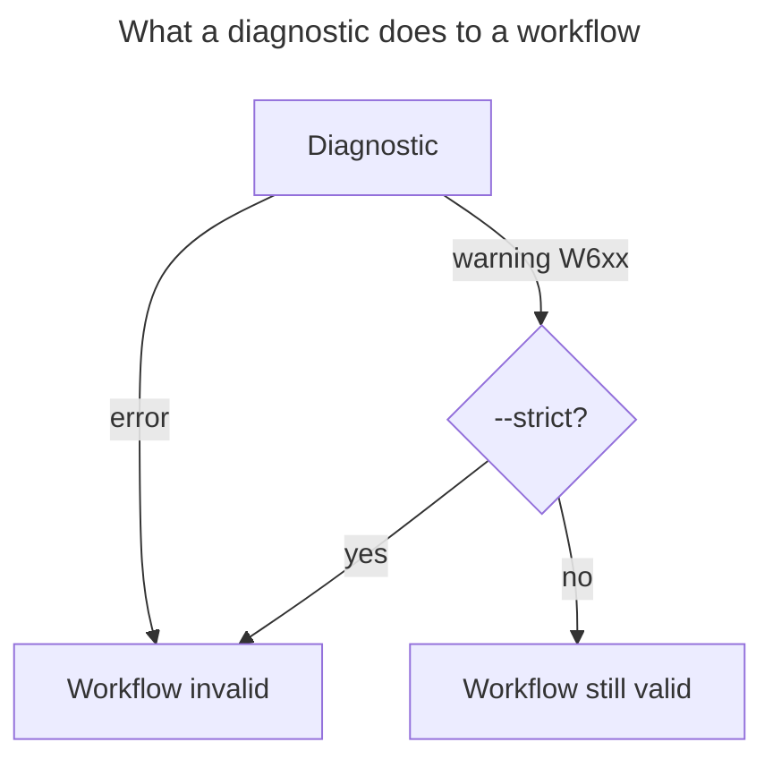
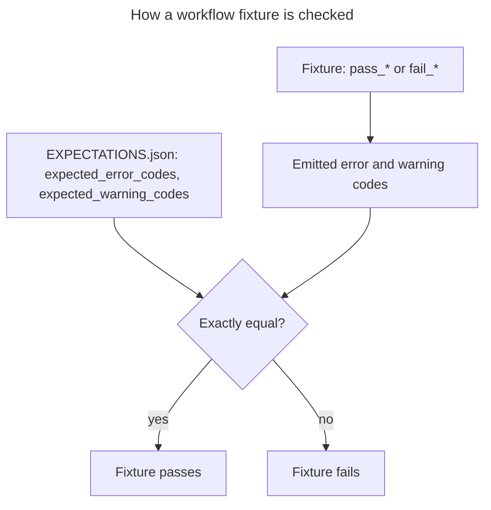

# Conformance

Normative requirements are in [STANDARD-v1.2.0 §10](STANDARD-v1.2.0.md#10-conformance);
this page summarises them.

## Conformance levels
- **L1 Structural Conformance**
  - validates required fields and field types
  - validates capability existence
  - enforces `requires`, `precedes` and `conflicts_with`; warns on unmet
    `soft_requires`
  - resolves effective safety flags; warns on downgrades
  - reports unknown fields and the declared standard version

- **L2 Type Conformance**
  - resolves `$ref` schemas
  - infers binding types, checking each binding's root and path
  - requires typed annotations only when ambiguous
  - validates typed annotations

- **L3 Contract Conformance**
  - validates binding types against consumer input_schema
  - parses and type-checks condition expressions
  - emits coercion hints

- **L4 Patch Conformance**
  - emits patch suggestions JSON
  - emits optional diff patch (`--emit-patch`)
  - uses coercion registry when available

Every diagnostic has a fixed severity: errors make a workflow invalid,
warnings (W6xx) do not, unless the validator runs in strict mode
(`--strict`).

**Reference implementation:** L4 (`tools/validate_workflows.py`, backed by
the Rust core in `core/`).

## Required artifacts
- Capability ontology file
- Workflow catalog file
- Schema bundle + policies
- Validator CLI

## Test suite requirements
- Positive fixtures: valid workflows (`tests/fixtures/pass_*`)
- Negative fixtures: invalid references, type mismatches, ambiguous nodes,
  edge and version violations, and malformed or undeclared extensions
  (`tests/fixtures/fail_*`)
- Patch fixtures: expected patch suggestions and diff output
- Expectations in `tests/fixtures/EXPECTATIONS.json`: `should_pass`,
  `expected_error_codes`, and `expected_warning_codes`. The codes a fixture
  emits must equal the listed set exactly; an absent or empty warning list
  means no warning may be emitted
- Expression fixtures, language-neutral:
  `tests/conformance/expressions/eval.json` (evaluation results and runtime
  errors) and `tests/conformance/expressions/check.json` (static
  diagnostics). `tools/cel_differential` runs them against cel-go to check
  CEL compatibility.
- Runtime fixtures, language-neutral: `tests/conformance/runtime/*.json`,
  scripted runs of the reference executor (catalog, inputs, the expected
  actions and the responses to them, the expected end and trace). Run by
  `cargo test --test runtime` (each also replayed through a snapshot and
  restore before every step) and `tests/test_runner.py`. Fifteen of them
  (`orchestrator_*`) script runs of the workflows an adopter ported to the
  candidate (reduced from production, generic names; revision 1.1e), kept
  as contributed
  (`tests/fixtures/pass_orchestrator_port.workflow_catalog.yaml`). The
  `domain_*` ones run reference domain workflows. Twenty (`gap*`) are an
  adopter's own scripted runs, kept as contributed in
  `tests/conformance/contrib/` and copied by the generator. The
  `approval_*`, `approver_*` and `resume_*` ones pin the approval request
  for a step with no or a partial `approval` field, the digest comparison,
  approver identities, and the resumption of a deferred run (§5.14,
  §5.14.1, §5.17); a script's `resume` entry resumes the run.
- Approval digest vectors, normative (§10.3):
  `tests/conformance/approval/digests.json`. Each vector has a `kind`. A
  `step` vector is one approval request of a workflow step (§5.14): the
  step's `approval` field (or null), its resolved `inputs` where it declares
  no `shows`, the values its references resolve against (`bindings`) where
  it does, the value a recheck read (`recheck_read`) for a request asked
  again, and the `shown` values; a `tool_call` vector is the approval
  of a tool call (§5.18.7): the `call` and `shown`, which is `[call]`. Every
  vector gives the canonical JSON (RFC 8785) of `shown` and the SHA-256
  digest of that text in lowercase hexadecimal. An implementation that
  computes or checks approval digests MUST reproduce each vector's
  `canonical` text and `digest`; an executor MUST show each `step` vector's
  `shown` values, given its `inputs` or `bindings` and `recheck_read`, and a
  safety layer each `tool_call` vector's. The vectors
  cover member order, nesting, number forms (2^53, the largest integer
  magnitude §5.14 allows, and `1e+21`, a binary64 value because it is
  written with an exponent), text outside ASCII, an empty list, a reference
  that resolves to nothing, a step that declares no `shows`, and a step
  asked again after a recheck. `scripts/gen_standard_agents_binding.py`
  writes the file from runs of the executor, and CI fails when it is out of
  date. `tests/test_approval_vectors.py` replays each `step` vector on the
  executor from the vector's own fields and recomputes the canonical JSON
  and the digest with a serializer of its own; the TypeScript package
  (`packages/acs-core/`) tests its digest against the file in place.

Running the suite:

| Fixtures | Command |
|----------|---------|
| Workflow fixtures (`tests/fixtures/`) | `python scripts/run_conformance.py` |
| Runtime fixtures | `cargo test --test runtime` (in `core/`), `pytest tests/test_runner.py` |
| Expression fixtures | `cargo test --test expressions` (in `core/`); `tools/cel_differential` against cel-go |
| Approval digest vectors | `pytest tests/test_approval_vectors.py`; `npm test` in `packages/acs-core/` |
| Trust vectors | `pytest tests/test_trust.py` |

`scripts/run_conformance.py` runs only the workflow fixtures.

Coverage gaps: no conformance fixture yet exercises V103, S301, S302, W607
or W612; the reference implementation's unit tests cover them. F505 is
reserved and not checked by the reference implementation, so nothing
tests it.

## Informative vectors

These files are language-neutral and informative: STANDARD-v1.2.0 §10.3 does
not name them. Each is JSON, describes its own fields, and has one named
entry per case.

- Trust: `tests/conformance/trust/decay.json` (the decay factor of §8.1:
  0.5 at one half-life, which §8.1 requires, `0.5 ** (age / half_life)` at
  other ages, which it recommends, and not below `decay_model.min_trust`),
  `tests/conformance/trust/weight.json` (the static weight of §8.3: the lower
  of the class weight and the source weight, with a domain profile's
  `trust_weights` overrides) and `tests/conformance/trust/score.json` (the
  product that `conflict_resolution_function.formula` in
  `schemas/authority_trust_model.yaml` names). Each file states the absolute
  tolerance its expected values are given to. §8.3 states the profile
  override of a class weight only; the vectors in which a profile key
  replaces or adds a source weight rest on a comment in the schema and say
  so. Each file lists under `not_covered` the cases whose result the
  Standard does not state, such as a `min_trust` above 0.5, where §8.1
  requires 0.5 at one half-life and also floors the factor at `min_trust`;
  no vector covers them, and each entry says what the reference
  implementation does. `tests/test_trust.py` runs the reference
  implementation, `grounded_agency/trust.py`, against the vectors.
