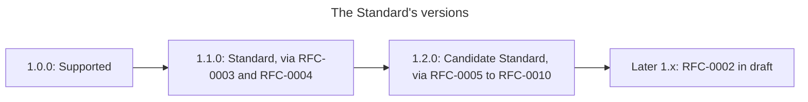
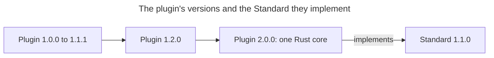

# Roadmap

The Standard and the plugin have separate version numbers. The Standard is the
specification. The plugin is the reference implementation: the validator, the
executor, the skills, the hooks and the Python package. Plugin 2.0.0 implements
Standard 1.1.0. The unreleased work on `main` implements the Standard 1.2.0
Candidate.

For the full list of changes, see the [specification changelog](CHANGELOG.md)
and the [project changelog](../CHANGELOG.md).

## Versions

Five version numbers are in use. Each is declared in one file, and
`tests/test_version_lines.py` compares this table with those files.

| Version line | Current | Declared in |
|--------------|---------|-------------|
| Standard | 1.2.0 | The `**Version:**` line of [STANDARD-v1.2.0.md](STANDARD-v1.2.0.md) |
| Capability ontology | 2.2.0 | `meta.version` in [capability_ontology.yaml](../schemas/capability_ontology.yaml) |
| Plugin | 2.0.0 | `version` in [plugin.json](../.claude-plugin/plugin.json) |
| Python package `grounded-agency` | 0.1.0 | `version` under `[project]` in [pyproject.toml](../pyproject.toml); `grounded_agency.__version__` repeats it |
| TypeScript package `@synaptiai/acs-core` | 0.1.0 | `version` in [package.json](../packages/acs-core/package.json) |

## Standard

The statuses and the meaning of the date are defined under
[Standard versions](GOVERNANCE.md#standard-versions) in GOVERNANCE. The date
is the one in the version's header: for a Candidate Standard, the date its
RFCs were accepted; for a released version, its release date.

| Version | Date | Status |
|---------|------|--------|
| [1.2.0](STANDARD-v1.2.0.md) | 2026-11-15 | Candidate Standard (unreleased) |
| [1.1.0](STANDARD-v1.1.0.md) | 2026-10-28 | Standard (released with plugin 2.0.0) |
| [1.0.0](STANDARD-v1.0.0.md) | 2026-01-24 | Supported (released with plugin 1.0.0) |

Standard 1.2.0 is accepted by
[RFC-0005](RFC-0005-tool-calling-hosts.md),
[RFC-0006](RFC-0006-host-protocol-approval-and-runs.md),
[RFC-0007](RFC-0007-delegation-catalogs-and-diagnostics.md),
[RFC-0008](RFC-0008-evidence-grounding-and-secrets.md),
[RFC-0009](RFC-0009-checkpoint-rollback-send-memory.md) and
[RFC-0010](RFC-0010-profiles-trust-versioning-and-dialect.md). It adds:

- rules for a safety layer over the tool calls a model chooses, with a
  host-neutral tool binding record and a conformance class for safety layers;
- the approval request and digest stated in full, attested approvers, and the
  resumption of a deferred run;
- the host protocol between an executor and its host, the run operations,
  audit records and a conformance class for executors;
- agent manifests and delegation targets, catalog manifests with qualified
  names, and the keys of a diagnostic's location;
- one evidence anchor, grounding policies, evidence stores, and secrets kept
  out of records;
- what a checkpoint holds and a rollback restores, transmissions and
  destination policies, and memory scopes;
- domain profiles applied by executors, safety layers and validators, the
  trust arithmetic, ontology versions and the schema dialect of capability
  contracts.

[Appendix D](STANDARD-v1.2.0.md#appendix-d-changes-from-110) of the 1.2.0 text
lists every change from 1.1.0.

Standard 1.1.0 was accepted by [RFC-0003](RFC-0003-orchestration-extensions.md)
and [RFC-0004](RFC-0004-agent-identity.md). It adds:

- a condition expression language for conditions, gates and failure-mode
  triggers;
- defined semantics for ontology edges and step safety flags;
- a diagnostic model with severities and warning codes;
- orchestration extensions that a workflow opts into: triggers, handler steps,
  recovery and escalation, waits, approval, delegation, quorum and sender
  identity.

[Appendix C](STANDARD-v1.1.0.md#appendix-c-changes-from-100) of the 1.1.0 text
lists every change from 1.0.0.

[RFC-0002](RFC-0002-agent-reliability-profile.md), which adds cross-session
behavioural reliability for agents, stays a Draft. It is not part of 1.2.0
and targets a later 1.x version.

## Plugin and tools

| Version | Date | Main changes |
|---------|------|--------------|
| 2.0.0 | 2026-10-29 | Implements Standard 1.1.0. The validator and the executor are one Rust core, used by `tools/validate_workflows.py` and by the Python package. |
| 1.2.0 | 2026-02-04 | Workflow execution engine; multi-agent coordination runtime (delegate, synchronize, invoke); OASF mapping and extension mechanism; vision, audio and multimodal profiles; EU AI Act, NIST AI RMF and ISO 42001 documents. |
| 1.0.0 to 1.1.1 | 2026-01-24 to 2026-01-27 | Early releases, listed in the [project changelog](../CHANGELOG.md). |

## Next

Planned work is tracked in three
[GitHub milestones](https://github.com/synaptiai/agent-capability-standard/milestones).
The open items are listed below.

### Hardening and developer experience

- [Standalone description-to-contract CLI tool](https://github.com/synaptiai/agent-capability-standard/issues/103)

### Runtime and ecosystem

- [Streaming events for real-time evidence collection](https://github.com/synaptiai/agent-capability-standard/issues/77):
  delivered in the Standard 1.2.0 Candidate as the optional
  `acs.evidence_recorded` notification (STANDARD-v1.2.0 §6.6), which the
  Python evidence stores and the Standard Agents binding send
- [Trust calibration tooling](https://github.com/synaptiai/agent-capability-standard/issues/78)
- [Domain profile marketplace](https://github.com/synaptiai/agent-capability-standard/issues/79):
  catalog manifests, catalog sets and qualified workflow ids landed in the
  Standard 1.2.0 Candidate (STANDARD-v1.2.0 §5.1.1); dependency declarations
  between catalogs remain open (RFC-0007, open question 1)
- [Automated compliance reporting](https://github.com/synaptiai/agent-capability-standard/issues/80)
- [Plugin SDK for third-party extensions](https://github.com/synaptiai/agent-capability-standard/issues/81)

### Standards and scale

- [Industry standard adoption (ISO/IEC candidate)](https://github.com/synaptiai/agent-capability-standard/issues/82)
- [Multi-language SDKs (TypeScript, Rust, Go, Java)](https://github.com/synaptiai/agent-capability-standard/issues/83): TypeScript delivered as [`@synaptiai/acs-core`](../packages/acs-core/README.md), the ontology table, flags and digests in TypeScript and the Rust core through WebAssembly; Go and Java open
- [Certification program for AI agents](https://github.com/synaptiai/agent-capability-standard/issues/84)
- [Federated trust networks](https://github.com/synaptiai/agent-capability-standard/issues/85)
- [Formal verification of workflow compositions](https://github.com/synaptiai/agent-capability-standard/issues/86)
- [Pluggable safety backends](https://github.com/synaptiai/agent-capability-standard/issues/88)

## Under consideration

These ideas are not scheduled and have no issue yet.

- Visual workflow builder
- Cloud-hosted validation API
- Runtime adapters for other agent frameworks, such as LangChain, CrewAI
  and AutoGPT
- A formal specification of the multi-agent coordination protocol
- Runtime telemetry and observability hooks
- More coercion mappings in the transform coercion registry
