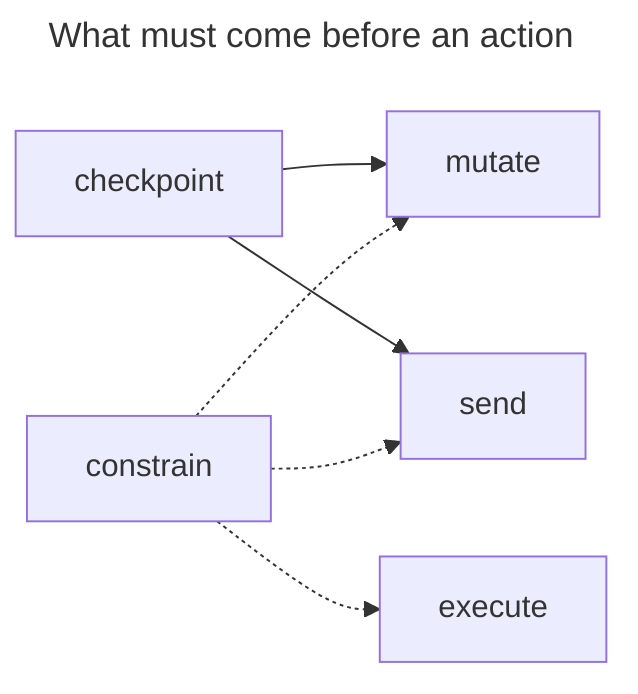
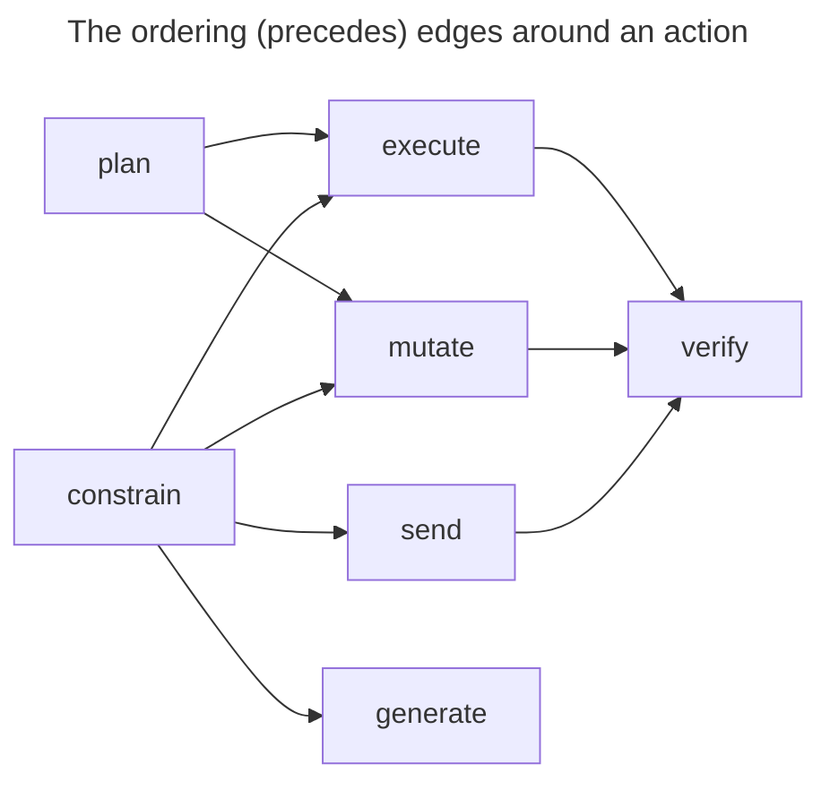
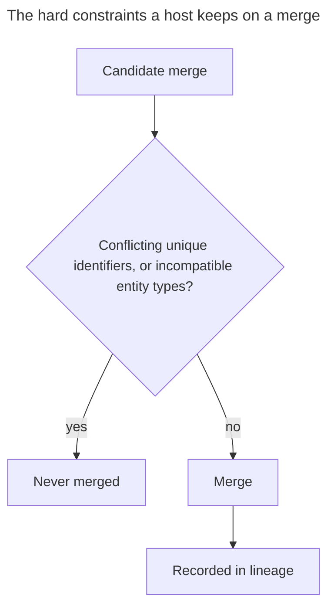
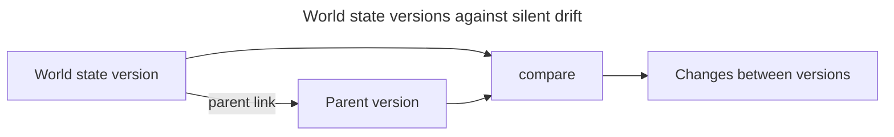
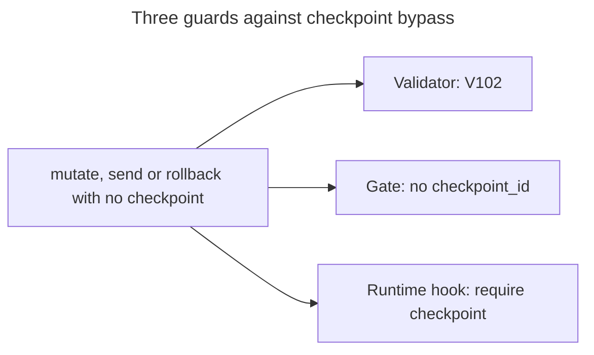
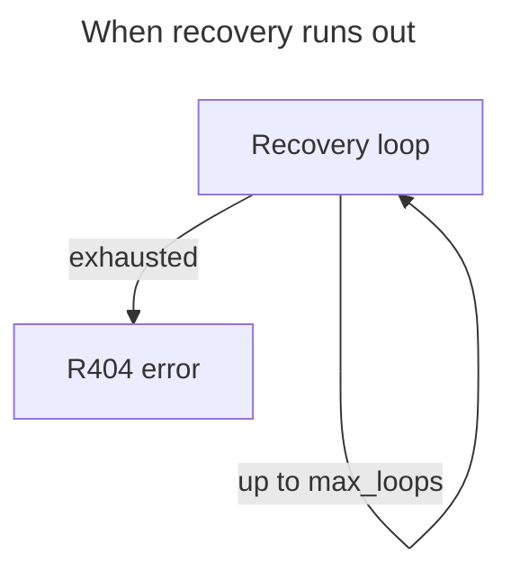
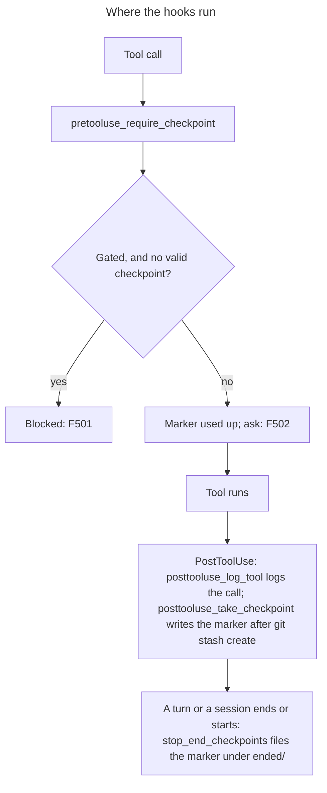

# Security Model

This document describes the security posture of the Agent Capability Standard, including threat model, mitigations, and responsible disclosure.

---

## 1. Core Safety Invariants

The standard is designed so **unsafe actions are hard by construction**.

### 1.1 Mutation Requires Checkpoint

Any `mutate`, `send` or `rollback` step MUST be preceded by a `checkpoint` step. The requirement follows the ontology's `requires_checkpoint` flag (`mutate`, `send`) and its `requires` edges from `checkpoint` (`mutate`, `send`, `rollback`), not the `mutation` flag: `checkpoint`, `audit` and `persist` are `mutation: true` but need no checkpoint. A step cannot weaken these flags; a weaker declaration is ignored (W602). This ensures:
- State can be restored if the mutation fails
- Partial execution can be recovered
- An audit trail can cover every change: a run started with `records:
  actions` records every step that ran ([STANDARD v1.2 §6.4](STANDARD-v1.2.0.md#64-audit-records)),
  every host keeps every run's run record ([§5.19.8](STANDARD-v1.2.0.md#5198-the-runs-record)),
  and the plugin's hook logs every tool call it can, reporting any it cannot

A checkpoint restores state, not effects ([STANDARD v1.2 §4.4.1](STANDARD-v1.2.0.md#441-checkpoints-and-rollback)): a rollback returns what its checkpoint captured, and cannot recall a transmission (reported `transmitted`) or reach a delegate's change elsewhere (`delegated`). A checkpoint never captures the host's audit log, its checkpoint state or its idempotency keys, so a rollback can neither erase the record nor bring back a used checkpoint nor let a send go twice.

### 1.2 Actions Are Ordered

The action capabilities (`execute`, `mutate`, `send`) are constrained by ontology edges:
- `checkpoint` (hard requirement, `requires`): State must be saved before `mutate` or `send`
- `constrain` (soft requirement, `soft_requires`, and ordering, `precedes`): A policy check should run before `execute`, `mutate` and `send`; without one the validator warns (W601), and when a workflow has one, it must come before them and before `generate` (V102)
- `plan` (ordering, `precedes`): When a workflow has a plan, it must come before `execute` and `mutate`
- `verify` (ordering, `precedes`): A verification must come after the action it checks





### 1.3 Claims Must Be Grounded

Every output carries evidence anchors to evidence its producer had, or is
marked inferred with `inference_method` and `confidence` (STANDARD v1.2
§3.1). An anchor is `{ref, kind}`, with an optional `digest` of what was
read (§6.5); an output that reports an action cites the record of that
action. A grounding policy makes an executor or a safety layer check it:
an output that is neither grounded nor marked inferred, cites evidence its
producer did not have, or cites a workflow value outside what its step
binds, fails with F505 (§5.20).

### 1.4 Identity Merges Are Constrained

This invariant is a requirement on hosts, not one the reference layers
enforce. Standard 1.2.0 §7.3 requires a host that merges or splits entity
records to keep three constraints:
- Never merge entities with conflicting unique identifiers
- Never merge across incompatible entity types
- Always record merge/split operations in lineage

No reference layer merges or splits entities, so none checks these
constraints at run time. [RFC-0012](RFC-0012-identity-merge-and-split.md), a Draft for Standard 1.3.0, defines them
as checks with vectors (`tests/conformance/entities/merge.json`). The
Python package implements those checks as `check_merge` and `check_split`
in `grounded_agency.entities`, for a host to call before it merges or
splits.



### 1.5 Secrets Stay Out of Records

A secret (a password, an API key or token, a session cookie, a private key,
a credential in a URL or a header, or anything the host classifies as
secret) never enters an evidence anchor or record, a notification, a
canonical event, an audit record or a safety layer's record of a call, a
diagnostic or an `Error` a host returns, an executor's trace, or the data
`persist` stores (STANDARD v1.2 §6.7). Where one would be written it is
redacted: replaced by `[REDACTED]`, a transform with documented loss. A
`persist` of a secret is refused, not redacted, since memory is read back
as fact. Workflows carry no secrets: a host adds credentials where they are
used.

The reference implementations enforce this by code:

- The Python SDK's `Redactor` (registered values and default patterns) is
  applied by every evidence store, by the coordination audit log to every
  value an event keeps (its `details`, `intent`, `evidence_refs`, event type
  and agent ids), by a trust model's manual override to its record, by the
  runner to the `message` and `reason` of every `Error` it submits (the one
  it builds when the run refuses a host's response included, whose account
  repeats the value refused), to the evidence anchors of every `Output`
  it submits (with `evidence_seen` rewritten to match, so an anchor the
  host did not list never passes as seen) and of every `Event` (which the
  core copies into a `receive` or `wait` step's output), given as a list
  or a tuple, to the `not_covered` items of a `RolledBack`, to a
  `Decision`'s `decision_id`, `decision`, `approvers` and
  `approver_identities` (the trace's `approval_decided`, the record's
  `approval`, an F502's reason) and an `Event`'s `principal` and
  `identity` (the received item's `sender` and `sender_identity`), and to a
  cancel's reason (the R408 message, which the core writes into the trace
  and the records), and by the adapter to its records and refusals; the
  evidence collector keeps no `digest` of a tool response that holds a
  recognised secret. A `CheckpointTracker`'s checkpoints are the records of
  the calls that took them: it redacts every string it records (a
  checkpoint's `reason`, its `scope` items and its `metadata`, and the
  words that end or use one), in memory, in its state file and in its
  archive, with the adapter's redactor in the adapter (a bound checkpoint
  tool's `reason` and `scope` are the model's words), and captures the
  files the scope names as given. The host's `IdempotencyLog` is a record
  of what the host did: it keeps a `send`'s output as the runner submits
  it, its anchors and `evidence_seen` redacted and every other secret
  replaced, and the destination redacted; the runner gives the log, the
  host's checkpoint tracker (a `checkpoint` step's scope is its input),
  the host's memory store and its own the secrets its redactor
  recognises. The runner refuses a checkpoint the host names by an id that
  holds a secret (F501, or R402 for a `checkpoint` step's output): the
  trace and the records of the steps that use it name it, and the run
  gives it back to roll back to, so a redacted id would name a checkpoint
  the host cannot restore. The orchestrator records an `inquire` step's
  ambiguous input whole, as it records a task's goal: the evidence store
  and the coordination audit log redact it, and a cut made before them
  could keep the part of a token or a key their patterns no longer match.
- The core's diagnostics repeat no text of a host's output: a grounding
  refusal (F505) names an anchor by its index and kind, never by the `ref`
  it cites (a presigned or signed URL is a natural one), a confidence that
  is not a number from 0 to 1 is named by its type unless it is a number, a
  boolean or null, an inference method outside the vocabulary is not
  repeated, and an approval refusal names neither the decision's value
  nor its id (its trace event, `approval_decided`, keeps both, so a host
  that drives the core itself redacts a `Decision` first, as the runner
  does). The TypeScript package's
  `checkGrounding` and the binding's minimum-confidence check say the
  same, and its `decodeCapabilityOutput` names at most the position where
  a text stops being JSON, never the JSON parser's message, which quotes
  part of the text (a window that cuts a secret leaves a piece no
  redaction matches); Python's decoder quotes none either. A diagnostic
  reaches the trace, the run's records and its snapshots, where no
  redactor reads it.
- An evidence anchor that held a secret keeps no digest of what it cites:
  the Python evidence stores and the TypeScript binding's trace drop its
  `digest` and `metadata.hash` and say `digest_omitted: secret` in its
  metadata (`Redactor.redact_anchor`, `redactAnchor`). The cited content
  holds the secret too, and the redacted excerpt still shows the text around
  it, so a digest of it could confirm a guess (§6.7).
- The TypeScript binding redacts every trace entry it writes, the id of
  each checkpoint it records (what the `checkpoint` call returned) and
  every `acs.evidence_recorded` notification, whether or not the tool
  registers secrets; values `configureLayer({ secrets })` registers reach
  every entry, the audit hook's for plain tools included. An entry's
  `action`, the tool's name, is redacted too, and so are the audit
  record's `tool` and `intent` exported from it and the list of entries
  waiting for their call id: the name is the one the model called, or one
  a composite's code invoked from its arguments, and a prompt injection
  can make it a secret. The audit hook matches a call to its entry by the
  redacted name, and a refusal of a nested call, the diagnostic the
  composite's code receives (and a queued call's thrown error), names the
  redacted tool. Every result a grounded call or a composite's state
  returns that is not a success is redacted before it reaches the runtime,
  the thread's messages and the model, as its trace entry is (security
  round 5): a refusal, an R407 that quotes a store's error or a secrets
  function's, an R402 that names an output member, the tool's own error,
  a nested plain tool's error, a control tool's own error result or the
  error its code throws, which it returns as an error result (security
  round 6); an F502's `shown` arguments have their
  secrets replaced (the `digest` stays that of the values decided on). The
  Python adapter redacts the tool's name and the message in its call
  records, their audit records and its diagnostics likewise, and the reason
  of each PreToolUse decision it returns, an ask's F502 included (security
  round 5).
- The adapter and the binding refuse a `persist` or `audit` call whose data
  holds a credential-shaped value, or a value in a member named for a
  credential (`password`, `Authorization`, ...) that redaction would replace
  and that is not a placeholder (F504, §5.18.10). A header given as a
  name/value pair (`{"name": "Authorization", "value": ...}`, a HAR) or a
  `[name, value]` tuple is read as such a member, in data and in text.
- The redactors, the refusal rule and the plugin's scan read a credential
  in the forms text carries it in: quotes escaped as JSON text inside a
  JSON string or a shell's double quotes escapes them
  (`{\"password\": \"...\"}`), a URL's userinfo whose user's name is
  empty (`redis://:<secret>@`), a command's user option (`curl -u
  user:<secret>`, `--user`), an option named for a credential with its
  value after blanks (`--password <secret>`), and `secret_key` and
  `passphrase` among the credential names. Redaction reads a quoted value
  to its closing quote on its line, whitespace and all (`"passphrase":
  "correct horse battery staple"`, a `Cookie` pair's later cookies), not
  to its first blank; the refusal rule still reads text's quoted values
  with no whitespace only, so prose passes. A registered value is replaced
  and refused as it is, JSON-escaped (once or twice) and percent-encoded
  (`encoded_forms`, `encodedForms`), and in JSON data a number whose JSON
  text holds one (a PIN or a card number given as a number) is replaced
  whole and refused. An `Authorization` or `Proxy-Authorization` header's
  credential is read after any scheme, not only `Bearer`, `Basic`,
  `Token`, `Digest` and `Negotiate`: after another first word (`ApiKey`,
  `SSWS`, `Bot`, `Splunk`, `GenieKey`, `Key`, or a credential with no
  scheme) that word and the next on its line are replaced, a quoted value
  or a header line quoted whole (`-H "Authorization: ..."`) is replaced to
  its closing quote, and the refusal rule and the shell scan read a value
  after any scheme and spaces as after one of the five, in a header line, a
  pair or a tuple. PEM `PRIVATE KEY` and OpenPGP `PRIVATE KEY BLOCK` blocks
  are read alike, and after a header with no end line (an excerpt, `head
  -n 2 key.pem`, a truncated log line) the rest of the text is replaced, so
  no part of the key is kept. Not read: a password attached to a short
  option with no name (`mysql -p<secret>`), and a secret in base64 or
  another encoding unless the host registers that form too.
- Session cookies, other encoders' escapes, service tokens and the layer's
  own keys (security round 5). A `Cookie` or `Set-Cookie` header's value
  in text is redacted whole: a header line to the end of its line (`Cookie:
  a=1; sid=...`; a Set-Cookie line's attributes go with it), a header line
  quoted whole (`-H 'Cookie: ...'`, a command's list of arguments) or a
  quoted member (`{"Cookie": "..."}`, a headers dictionary's repr) to its
  closing quote; so is curl's cookie option's value when it holds a cookie
  (`-b 'sid=...'`, `--cookie sid=...`: a name and `=` within its first 64
  characters, so a cookie file's name and another program's `-b` stay).
  The refusal rule and the shell scan refuse such a value's cookie
  (`name=value`, a Set-Cookie attribute aside) whose value is 8 or more
  token characters mixing letters and digits; prose after `Cookie:`
  passes. JSON text other encoders write is read in place by redaction: a
  quote as its JSON escape (`\u0022`, `\u0027`, as .NET writes JSON text
  inside a JSON string), `=` as `\u003d` (Gson), a URL's slashes as `\/`
  (PHP), and a token right after an escaped quote; the refusal rule and the
  shell scan read a text with those escapes decoded, and the escapes of
  `&`, `<`, `>` and `+` too. A registered value is also replaced and refused as Go's
  `encoding/json`, Gson and .NET's `System.Text.Json` escape it to keep JSON
  safe inside HTML (`&`, `<`, `>`, `=`, `'`, `+`, `"` as `\u00XX`, in either
  case). Service tokens are read by their prefix (Stripe's `sk_live_` and
  `rk_live_`, Google's `AIza`, GitLab's `glpat-`, npm's `npm_`, Vault's
  `hvs.`, SendGrid's `SG.`, a Slack webhook's path), and so is a `.netrc`
  entry's password (`machine <host> login <user> password <secret>`); an
  account, signing, encryption, HMAC or master key and `credential` join
  the credential names (`AccountKey=`, `AUDIT_HMAC_KEY=`). The plugin's
  scan also refuses the values the plugin holds itself, as §6.7 asks of a
  host: `AUDIT_HMAC_KEY`'s value wherever the scan runs (a persist tool's
  data, the persist and audit skills' checks, a logged tool's name), and,
  in a persist tool's data, the project's checkpoint key
  (`<git dir>/acs/checkpoints/key`, where git names the project's git
  directory). Not read: a value after `Cookie:` with no `name=` (refused
  only as any value is; redaction replaces it), npm's `_auth=` and a Docker
  configuration's `auth` member, a name ending in `_pass`, other vendors'
  token formats, and a JSON escape of any other character; a host
  registers such a credential it holds.
- Where a token starts, and signed URLs. The Python and TypeScript
  redactors read a prefix-shaped token (an AWS access key id; a GitHub,
  Slack, `sk-`, Stripe, Google, GitLab, npm, Vault or SendGrid token; a
  JWT) where the character before it is not an ASCII letter or digit: after
  `_`, `-`, `.`, `/`, `:` or a quote, and an AWS access key id ends where
  no ASCII letter or digit follows, so `_` may follow it as well
  (`mcp__<key id>__list`). A token in an MCP tool's name
  (`mcp__srv__ghp_...`) is replaced with its prefix kept
  (`mcp__srv__[REDACTED]`), in the adapter's call records, their audit
  records and its diagnostics, and in the binding's trace and the audit
  records exported from it. A token glued after a letter or digit
  (`xghp_...`), or an AWS access key id with a letter or digit after it,
  is not redacted. The Python and TypeScript refusal rule reads the longer
  prefixes anywhere, so such a glued token is still refused, and reads `sk-` only where a token starts, since its two
  letters end common words: `feature/task-12345-update-readme-file` and
  `risk-assessment-for-the-quarter-2026` are not refused. A signed URL's
  signature is redacted and refused: the value, of 16 or more characters,
  of an `X-Amz-Signature` (S3 SigV4), `X-Goog-Signature` (Cloud Storage),
  `sig` (Azure SAS) or `Signature` (S3 SigV2, CloudFront) query parameter,
  read after `?` or `&` as themselves, percent-encoded (`%3F`, `%26`) or as
  their JSON escapes, with a `/` in the value read as itself or as its
  JSON escape `\/`, so prose such as `signature=` is kept; whoever holds
  a signed URL can use it until it expires. The plugin's shell scan
  (`hooks/secret_scan.sh` and its copies) does not take these two rules:
  it reads `sk-` anywhere, so it refuses those two slugs, and it refuses
  no signed URL by its signature.
- The Python evidence store reads metadata nested too deep for it as JSON
  text redacted first, while its structure can still be read, and keeps it
  whole: a cut could keep part of a secret no redactor then recognises.
- The plugin's `persist` and `audit` skills block, in command hooks that
  share one scan (`hooks/secret_scan.sh`), content and audit records that
  hold one (for `persist`, the lines the file holds after the call as well
  as the text it carries, and each with its escapes decoded); the plugin's
  audit log keeps a digest of each tool input, never the input. The scan
  reads a text line by line and again with its line breaks read as blanks,
  as the SDK's and the TypeScript rules read whitespace, so a value on the
  line after its name (`password:` then the value, a YAML value indented
  under its key, `Bearer` then the token) is read whole; where a hook
  joins texts read apart (each string of a persist tool's input, of an
  audit record), it reads each text so on its own (`secret_lines`), as the
  SDK adapter reads each string (security round 5: grep reads a line at a
  time, and a TodoWrite holding such a value was stored with no approval
  while the adapter refused it). The `persist` hook also reads the lines a
  call changes with the six lines that are not blank on each side, before
  and after the call (no rule's match spans more than five runs of
  whitespace), and refuses a value the rules read there more often after
  it (a value put under a name the file holds, a name put over a value, a
  line taken out from between them), and a change to any line of a private
  key block (from its BEGIN line to its END line, or the end of the file),
  whose body lines match no rule of their own. A store
  refuses what the refusal rule recognises whether or not redaction would
  replace part of it (the Python `MemoryStore` once stored a private key's
  opening line, which has no body to replace).
- Every pattern of the redactors and of the refusal rule reads a text in
  time in proportion to its length (no run of characters is read again from
  each of its positions), so a megabyte of model-chosen text is scanned in
  about a second, and a layer's check cannot be held past its time by the
  data it checks. An attempt starts where no earlier attempt's run can
  hold another: a URL's scheme is read from the start of its run, a
  user option's name (`curl -u <name>:<password>`) for at most 256
  characters, since a run such as `.-u.-u.-u...` holds a start at each
  third position, and a cookie option's cookie name for at most 64 (Python,
  TypeScript and the shell scan alike). The blanks after a quoted header
  line's colon are read whole, so a value that may hold blanks is not read
  again from each of them (security round 5: `"Authorization:` and 40 KB
  of blanks with no closing quote took 67 s in Python). The shell
  scan uses `grep -E`: GNU grep decides whether a line matches in linear
  time, but `grep -o`, which prints each match, looks for one from each
  position of a line that matches, so the same rule holds for its patterns
  (a 100 KB todo with a URL's password at its end once took past 30 s;
  timed with grep's output to a pipe, as the hook reads it: with output to
  `/dev/null` grep stops at the first match). The scan reads bytes
  (`LC_ALL=C`, set inside its functions): in a multibyte locale, which the
  skills' hooks run in, GNU grep reads a pattern whose class follows a
  repeated one with a matcher whose time grows with the square of the
  line. A check that still outlived
  its hook's time limit would block the call: the plugin's hooks and the
  adapter's PreToolUse matcher set it to block (`onFailure`,
  `on_failure`).

---

## 2. Threat Model

### 2.1 STRIDE Analysis

| Threat | Description | Mitigations |
|--------|-------------|-------------|
| **Spoofing** | Attacker impersonates a trusted source | Trust model with source verification, provenance tracking |
| **Tampering** | Attacker modifies data in transit or at rest | Schema validation, checkpoint/rollback, immutable observations |
| **Repudiation** | Actor denies actions | Audit trails, provenance, evidence anchors |
| **Information Disclosure** | Sensitive data exposed | Constrain capability for access control; secrets kept out of evidence, records, diagnostics and memory (STANDARD §6.7) |
| **Denial of Service** | System overwhelmed or blocked | Timeouts, retry limits, recovery loops |
| **Elevation of Privilege** | Unauthorized capability execution | Prerequisites, approval requirements, policy constraints |

### 2.2 Attack Scenarios

#### 2.2.1 Prompt Injection

**Scenario**: Content the agent reads (a retrieved page, a search result, a
received message, a recalled memory entry, a tool result, a file in the
repository) holds text written as instructions, and the model acts on it.

**Mitigations** (decided by code, not by a model):
- On a tool-calling host, only a person decides a call's approval: a
  permission prompt answered by anything but a person (the host itself, an automatic
  mode, a classifier) decides nothing, so injected text cannot approve its
  own call ([STANDARD 1.2.0 §5.18.7](STANDARD-v1.2.0.md#5187-approval-for-calls)).
  The approval shows the arguments the call will run with, and decides
  that call alone.
- A destination policy fails a `send` to a destination it does not allow
  with F504, before anyone is asked
  ([STANDARD 1.2.0 §4.4.2](STANDARD-v1.2.0.md#442-transmissions); §2.2.9).
- The always-ask mark: on `receive`, `delegate` and `synchronize`, an item
  whose sender has a trust class listed in `always_ask_trust_classes`, or
  no identity or trust class, marks every step that reads it, and a marked
  step that requires approval is asked of a person even where a standing
  mandate would otherwise decide
  ([STANDARD 1.2.0 §5.17](STANDARD-v1.2.0.md#517-sender-identity)).
- `mutate` and `send` need a checkpoint and an approval, so an injected
  change can be rolled back and an injected send is put to an approver
  first: a person, unless the step names a standing mandate, and even then
  a person for a step marked always-ask or one an applied profile requires
  a person for
  ([STANDARD 1.2.0 §5.14](STANDARD-v1.2.0.md#514-approval)).
- Repository content does not configure the plugin's hooks: they block
  every call while the project's settings files set an environment
  variable that is not one of Claude Code's own (§5.1).
- Typed contracts check the structure of inputs, and the audit trail
  records each call for later analysis.

Workflow authors apply these through the tainted input gate pattern
([WORKFLOW_PATTERNS.md §4.4](../docs/WORKFLOW_PATTERNS.md#44-tainted-input-gate-pattern)):
the destination comes from the person's inputs, never from the content; a
payload derived from the content is checked by a `constrain` step before the
act; and the act still needs a checkpoint and an approval. A `constrain` step is a check a
model makes, and can itself be misled by the content it reads (§5.4).

**Residual Risk**: Within what these checks allow, injected text can still
steer the model: a send to an allowed destination, or a change a person
approves without noticing what it does. Standard 1.2.0 has no rule that
content a step reads never changes a layer's configuration or counts as a
person's decision; the always-ask mark does not cover `retrieve`, `search`,
`observe` or `recall`; and the grounding check
([STANDARD 1.2.0 §5.20](STANDARD-v1.2.0.md#520-grounding)) runs on a
step's output after the host has acted, so it cannot stop an injected send.
These are planned for Standard 1.3.0
([#169](https://github.com/synaptiai/agent-capability-standard/issues/169)).

#### 2.2.2 Incorrect Identity Merges

**Scenario**: Two distinct entities are incorrectly merged, corrupting the world state.

**Mitigations**:
- A host that merges entities keeps the hard constraints of Standard 1.2.0 §7.3 (§1.4); the reference layers perform no merge and do not enforce them
- `grounded_agency.entities` offers the merge and split checks that RFC-0012 proposes, for a host to call before it merges or splits
- A host that scores aliases sets its own thresholds; the policy's weights and thresholds are a heuristic
- World state versioning enables rollback

#### 2.2.3 Trust Manipulation

**Scenario**: Attacker spoofs a high-authority source to inject false information.

**Mitigations**:
- Source ranking is statically configured
- Time decay reduces stale authority
- Conflict resolution can escalate to human
- Provenance tracks source of all claims

#### 2.2.4 Silent Drift

**Scenario**: Gradual state corruption through unbounded updates.

**Mitigations**:
- World state versioning with parent links
- `compare` capability detects changes between world-state versions
- Retention policies bound state growth
- Anomaly detection capabilities



#### 2.2.5 Schema Spoofing

**Scenario**: Attacker provides data that passes schema validation but has malicious semantics.

**Mitigations**:
- Schema validation catches structural issues
- Consumer contract checking catches type mismatches
- Grounding requires evidence anchors
- Verify capability checks semantic correctness

#### 2.2.6 Binding Reference Attacks

**Scenario**: Workflow references non-existent or wrong step outputs.

**Mitigations**:
- Static validation of all binding paths
- Type checking of binding values
- Consumer contract checking
- Ambiguous type detection

#### 2.2.7 Checkpoint Bypass

**Scenario**: Mutation is executed without checkpoint, preventing rollback.

**Mitigations**:
- Validator rejects `mutate`, `send` and `rollback` without an earlier `checkpoint` step (V102)
- Gate can block if `${checkpoint_out.checkpoint_id} == null`
- Hook (pretooluse_require_checkpoint) enforces at runtime



#### 2.2.8 Recovery Loop Exhaustion

**Scenario**: Workflow enters infinite recovery loop.

**Mitigations**:
- max_loops limit on recovery
- Timeout on steps
- R404 error when recovery exhausted



#### 2.2.9 Exfiltration through `send`

**Scenario**: A model, steered by injected content, sends data to a
destination it chose.

**Mitigations** ([STANDARD v1.2 §4.4.2](STANDARD-v1.2.0.md#442-transmissions)):
- A destination policy, from the host or an applied profile's
  `allowed_destinations`, fails a `send` step whose destination it does not
  allow with F504, before anyone is asked and before a checkpoint is used;
  safety layers refuse such calls the same way, and, while a policy is in
  force, every call that may send where they cannot tell: a send whose
  destination they cannot read, a call of an unbound tool, a shell command
  whose classification includes `send` (one the classifier does not
  recognise among them, since its worst case is `send`, §5.18.3), and (a
  layer that does not see nested calls) a composite that invokes a send. Its
  suffix form names host
  or address suffixes only (`https://evil.net/?.example.com` does not end in
  `*.example.com` in its sense), and a prefix that starts an authority must
  finish it (`https://hooks.example.com:*` is invalid), so no pattern lets a
  URL reach another host
- Credentials scoped to the allowed origins (a token only those services
  accept, an egress allow-list) make a send the check misses fail too
- The approval shows the destination (W625 reports a 1.2 `send` whose
  `shows` hides it)
- At most one transmission per approval: every attempt of a pass carries
  one idempotency key, and a host never transmits twice under it. Keys are
  unique only while `run_id`s are: a host keeps them unique

---

## 3. Security-Critical Capabilities

### 3.1 VERIFY Layer

| Capability | Security Function |
|------------|-------------------|
| `checkpoint` | Enables recovery from failures and attacks |
| `rollback` | Restores known-good state |
| `verify` | Confirms outcomes match expectations |
| `audit` | Creates accountability trail |
| `constrain` | Enforces policy and access control |

### 3.2 Prerequisite Enforcement

| Capability | Required Before | Security Rationale |
|------------|-----------------|-------------------|
| `mutate` | `checkpoint` (required); `constrain` (recommended, and before it when present); `plan` (if present) | Recovery possible, no blind execution |
| `send` | `checkpoint` (required); `constrain` (recommended, and before it when present) | Recovery possible for what the sender holds, policy checked before transmitting |
| `rollback` | `checkpoint` (required) | Must have state to restore |
| `execute` | `constrain` (recommended, and before it when present); `plan` (if present) | Policy checked before running |
| `generate` | `constrain` (if present) | Policy checked before content is produced |
| `verify` | `execute`, `mutate`, `send` (if present) | Checks results after the fact |

---

## 4. Implementation Guidance

### 4.1 Validator Security

The validator SHOULD:
- Reject unknown capabilities (V101)
- Reject missing prerequisites (V102)
- Reject invalid bindings (B201, B202)
- Reject type mismatches (B203)
- Reject ambiguous types (B204)
- Warn on unmet soft prerequisites (W601) and on safety flags declared weaker than the ontology (W602), which are ignored

### 4.2 Runtime Security

Implementations SHOULD:
- Enforce timeouts on all steps
- Limit retry attempts
- Create checkpoints before mutations
- Log every tool call and every refusal, with the layer and configuration that decided it (STANDARD 1.2.0 §5.18.8)
- Run a safety layer that fails closed (STANDARD 1.2.0 §5.18.8)
- Validate outputs against schemas
- Redact secrets before writing evidence or records (STANDARD 1.2.0 §6.7)
- Keep memory entries within their scope: a `recall` in another session, for another principal or another project does not find them (STANDARD 1.2.0 §4.5)
- Know the durability of the evidence and audit stores, and export what
  must outlive the session when it is written (STANDARD 1.2.0 §6.3, §6.6)

### 4.3 Configuration Security

Deployments SHOULD:
- Review trust model weights carefully
- Set appropriate time decay half-lives
- Configure approval requirements for high-risk actions
- Enable hooks for checkpoint enforcement
- Monitor audit logs for anomalies

---

## 5. Security Hooks



### 5.1 Pre-Tool Use Hooks

| Hook | Security Function |
|------|-------------------|
| `pretooluse_require_checkpoint.sh` | Classifies the call; one checkpoint per gated call; approval; rollback history |

Claude Code routes every tool call to the hook (matcher `*`), with `onFailure: "block"` and a 30-second `timeout`: where Claude Code supports that setting, a run that fails, cannot start or gives no verdict in time blocks the call. The hook reads Claude Code's JSON payload only: a payload that is not a JSON object with a tool name, or a system without `jq`, is blocked with `R407 SAFETY_CHECK_FAILED:`. So is every call while the project's own settings files (`.claude/settings.json`, `.claude/settings.local.json`) set a variable in their `env` that is not one of Claude Code's own settings (`ANTHROPIC_*`, `OTEL_*`, `MAX_THINKING_TOKENS`, `BASH_DEFAULT_TIMEOUT_MS` and a few more, as written; the list is the SDK adapter's, `grounded_agency/utils/project_settings.py`), or cannot be read: Claude Code applies a project's `env`, which is repository content, to every hook and every command it runs, over the user's settings and the environment it starts in. So the hook cannot tell the person's value of one of the layer's settings from the repository's (a cloned repository could set `ACS_HOOK_APPROVAL=off`, or an `AUDIT_HMAC_KEY` it knows), and any other variable can change what a hook, or a command it lets pass, runs: `BASH_ENV` (bash runs a repository script first, which can end the hook), `SHELLOPTS=noexec` (bash runs nothing), `PATH` and `HOME` (a repository's `jq`, `git` or `openssl`, or a `jq` library that replaces jq's own functions), `LD_PRELOAD`, `GIT_CONFIG_COUNT` with `GIT_CONFIG_KEY_0` and the rest of git's command scope (`GIT_CONFIG_PARAMETERS`, `GIT_CONFIG_GLOBAL`, `XDG_CONFIG_HOME`: a program `git status` runs, where the same key in the local configuration is gated), a proxy, an exported function. Those variables belong in `~/.claude/settings.json`, managed settings or the environment Claude Code starts in. Each hook starts under `bash -p` (a script that `/bin/sh` starts starts itself so), which reads no `BASH_ENV` or `ENV` file, imports no function and ignores `SHELLOPTS` and `BASHOPTS`, keeps on its `PATH` only the absolute directories outside the project (all of them where the project is the user's home directory, or holds it), and runs `jq` with no `HOME`; and it reads the settings files before it runs any program but `jq`. Each git command the hooks run, and each read of a settings file, is stopped after 5 seconds: git reads the files a repository's configuration includes, and a FIFO or a terminal there (`include.path = /dev/ptmx`, in a `.git` a project is delivered with, or in a directory such as `.claude` that a clone ships holding `HEAD`, `objects/` and `refs/`) holds the read until someone writes, past the hook's time limit. A git that did not answer counts as one that cannot say: the call is blocked (`R407 SAFETY_CHECK_FAILED:` where the project's git directory cannot be told, `F501` for the marker's) or gated (a git read, `git stash create` or a restore is `mutate`); a settings file that is not a regular file is unreadable (`R407`), as the SDK adapter reads it. It classifies the call by its effect (STANDARD 1.2.0 §5.18.3). A tool the SDK mapper maps to a capability that needs neither a checkpoint nor approval (`Read`, `Grep`, `Glob`, `WebFetch`, `TodoWrite`, ...; a test keeps the list a subset of the mapper's) needs neither; those the mapper maps to `persist` (`TodoWrite`, `TaskCreate`, `TaskUpdate`) store what they are given, so a call whose input holds a secret the layer recognises is refused with `F504 CONSTRAINT_VIOLATED:` in every permission mode (§5.18.10, §6.7), as the SDK adapter refuses it: the plugin's shared scan (`hooks/secret_scan.sh`) over every string of the input, each read on its own, line by line and with its line breaks read as blanks (a value on the line after its name), and over its JSON text, and the SDK redactor's rule for data (a value under a member named for a credential, or a header given as a name/value pair or a tuple); a test keeps the hook's verdict the adapter's, except on the vectors that pin the two rules the shell scan has not taken (§1.5: `sk-` only where a token starts, and signed-URL signatures), where the test asserts the scan's other answer. `Write`, `Edit`, `MultiEdit` and `NotebookEdit` are `mutate`. So are `Skill`, `Agent` and `Task`: Claude Code runs the shell commands a skill's file embeds (``!`cmd` `` and ```` ```! ```` blocks, with the call's arguments substituted into them) as the skill loads, under its `allowed-tools`, and the hooks and MCP servers a subagent's definition names as the subagent runs, with no `PreToolUse` or `PostToolUse` event, and a project's skill or agent can take any name, a built-in agent's included; the hook cannot see those commands, so the call takes the worst case. A `Bash` command over 4096 bytes is not read: it is `mutate`, decided before anything else is done with it, so no reading runs into the hook's time limit (trimming 50,000 trailing blanks once took 44 seconds). A shorter one is read as one simple command: a command on a read-only list that is a subset of the SDK mapper's needs nothing, unless given an option that writes (`printf` with any option: `printf -v NAME` sets a shell variable) (its first word the listed program exactly, and a two-word entry's subcommand the second word: bash runs a first word holding a blank, such as a quoted `"git status"`, or a slash as the program of that name, which is on no list; where the program bash finds for it on the `PATH` Claude Code gives the hook and the agent's commands may be the repository's own (found under an empty or relative entry, which bash reads from the working directory: `PATH=node_modules/.bin:$PATH`, a leading colon; in a file that lies, links followed, in the project: an activated virtual environment, direnv's `PATH_add`, but not where the project is the home directory, or holds it; or found nowhere), the command is `mutate`, as are `git stash create` and a restore; the entries the Bash tool adds from the user's shell startup files reach no hook and are not seen, nor are the aliases, functions and shell options those files set (with zsh's `EXTENDED_GLOB`, `^`, `#` and `~` are pattern characters too, which the hook and the mapper read as text), and the SDK mapper reads the CLI's `PATH` alike), `git stash create` takes a checkpoint, `git stash list` and `git stash show` only read, `git stash pop <commit>` and `git stash apply <commit>` are `rollback` when `<commit>` is the full id of a commit a checkpoint of the project recorded, the call runs in the project's repository and no scope configures a filter's `smudge` or `process` command (git applies any merge commit as if it were a stash, so any other restore is `mutate`), and anything else, a line of several commands included, is `mutate`. A git command that would only read (one on the read-only list, `git stash list`, `git stash show`) is `mutate` where the call's directory (the payload's `cwd`) is in a partial clone, in a repository with submodules (`modules/` in its git directory, or a gitlink in its index), or git cannot say: there git fetches each object a read lacks from the promisor remote, its own or a submodule's (`--submodule=diff`, `diff.submodule`, `git status`), sending it the object id the command names; `git stash create` reads only what the local state holds, and still takes a checkpoint there. Any `git` command the hook would let pass (a read, `git stash create`, a restore) is `mutate` where the git directory git finds is not one git made for a work tree (a `.git` directory, or a linked worktree's or a submodule's under one): a repository can ship a directory holding `HEAD`, `objects/` and `refs/`, which git takes for a git directory, and whose `config` names programs git runs (`core.fsmonitor` for `git status`, a textconv driver for `git log -p`). So is a git read or restore where the repository's own configuration (the local and worktree scopes, with the files they include) names a program git runs (a `core.fsmonitor` other than `true` or `false`, a diff driver's `textconv` or `command`, `diff.external`, a filter's `clean`, `smudge` or `process`, a merge driver, a signature program, a pager), or its hooks directory holds `post-index-change`, which `git status` runs when it writes the index: a project delivered with its `.git` (an archive, a copied checkout), or one approved `git config core.fsmonitor ./x`, brings them; there `git stash create` is put to a person with no marker asked for (only it makes one), and is blocked with F502 in a mode that asks no one. The user's own configuration (global, system) is not repository content and gates no read and no `git stash create`; but a restore is `mutate` wherever any scope, the user's included, configures a filter's `smudge` or `process` command: git runs it for each file it writes whose attributes, which the repository chooses, name the filter, and git-lfs's, which `git lfs install` writes to the user's configuration, asks the LFS server the repository's `.lfsconfig` or remote names for each object its store lacks, sending the object's id (a restore of a checkpoint holding a pointer did, security round 5). Only the two commands `git lfs install --skip-smudge` writes, as written, which ask no server, count as none. The hooks' own git commands run with `core.fsmonitor` and hooks turned off and no object fetched, the take hook's clean-tree check with the repository's filters turned off, and none while the project's settings set git's command scope or `HOME` (above), so no repository content makes them run a program or reach a host. Every other tool (`Monitor` and `PowerShell`, which run commands, `ExitWorktree`, every MCP tool but the plugin's remote-write tools (bound as `mutate`, §5.18.1), a tool the hook does not know) is unbound: `mutate`, as §5.18.2 requires, and its approval request says so. A refusal or an approval request names the tool as the log hook records it (§5.2: `[REDACTED]` for a name that is not plain or holds a credential, §6.7). A `mutate` call that names the layer's own records is refused with `F504 CONSTRAINT_VIOLATED:`: only the hooks write them. The texts read are a `Write`, `Edit`, `MultiEdit` or `NotebookEdit` call's path, a `Bash` command, a `Skill` call's arguments, and every string and member name of any other tool's input but `Agent`'s and `Task`'s (a `Monitor` or `PowerShell` command, an MCP filesystem server's path, an MCP shell server's command). A text that names `checkpoint.ok`, `.claude/checkpoints`, `acs/checkpoints` or `audit.head` is refused, read as a path is: in any letter case, with a run of slashes and `./` segments as one slash, and, in a text of at most 4096 bytes, each `x/../` resolved. Each path a text of at most 4096 bytes names is then followed through the symbolic links on it, from the call's directory (each target, the directory and git's answers read exactly: a link to a name that ends in a line break leads there): the text whole for a file tool, its words as the shell passes them for a command, both for any other tool; with a `~` the shell expands (`~`, `~+`, `~user`; `~-` and `~N`, which name a directory the hook cannot know, are refused), with each brace group found and expanded as bash finds and expands it (the first `{` a `}` closes, at the first `}` after a comma at its own level: `{a},.claude/check}point.ok` names the marker; `{fixtures/,.git/acs/check}points`, `audit.he{ad,x}`, `.claud{e..e}`) and each `$'...'` decoded as bash decodes it (`$'.git/acs/check\x70oints'`, octal, `\u`, `\c`; `$"..."` read as `"..."`), a path attached to a short option (`-tdir`, `-ofile`; of a long cluster, only the texts whose first component exists in the call's directory, or that are absolute, since another cannot be opened through), and the words of a quoted word a shell may read again (`sh -c '...'`). A path that leads to the records, or to the directory that holds them (the project's `.claude`, its git directory's `acs/`, whose removal takes the marker and the audit log's head with it), is refused, as is a link that cannot be followed, and, rather than hold the hook past its time limit, a call with more than 4096 strings and member names or more than 65536 bytes of strings of at most 4096 bytes, brace expansions that make more than 8192 words or read more than 65536 braces, commas and characters, or more than 262144 bytes of paths to resolve (the slowest reading found within these bounds takes about 4 seconds). Not seen: a path a command builds when it runs, a pattern the shell expands, a link a command reaches without naming it (copying a directory that holds one), and the paths of a text over 4096 bytes. A `mutate` call needs a valid checkpoint marker (`.claude/checkpoint.ok`, F501: a regular file git does not track, since a repository can ship a tracked one, asked of the git directory git finds from `.claude`, which must be one git made for a work tree; whole-second times of at most 12 digits, taken no later than now, valid for at most 30 minutes, and no older than the layer's maximum age, `ACS_CHECKPOINT_MAX_AGE`, whoever wrote it) and uses it up: one rename moves it into `.claude/checkpoints/used/`, so each gated call needs its own. It is then asked for approval (`permissionDecision: "ask"` with an `F502 APPROVAL_REQUIRED:` reason) in the permission modes `default`, `acceptEdits` and `plan`, and blocked with F502 in the others, with the marker left in place; `ACS_HOOK_APPROVAL=off` leaves approval to Claude Code's permission rules. A `rollback` call restores a checkpoint the project recorded, so one was taken, and uses none: the take hook entered its commit in the project's git directory (`<git dir>/acs/checkpoints/commits/`), outside the work tree, so no clone, checkout or applied stash can ship an entry, and the entry holds the HMAC-SHA-256 of the commit under the project's checkpoint key (`<git dir>/acs/checkpoints/key`, 64 hex digits the take hook drew at random, readable by the user alone), so a file a command creates there (through a link the repository ships, say) is no entry. The git directory must be one git made for a work tree: a shipped one could hold a key and entries of its own. A failure of the hook itself blocks the call with R407. The reason always opens with the code and name of the refusal. The §5.3 example keeps exit code 2.

### 5.2 Post-Tool Use Hooks

| Hook | Security Function |
|------|-------------------|
| `posttooluse_log_tool.sh` | Logs every tool call to the audit trail |
| `posttooluse_take_checkpoint.sh` | Writes the checkpoint marker after a successful `git stash create` |
| `stop_end_checkpoints.sh` (Stop, StopFailure, UserPromptSubmit, SessionStart, SessionEnd) | Ends the marker's validity at an execution boundary (a turn or a session ends or starts), filing it under `.claude/checkpoints/ended/` |

The log hook runs after every tool call, whether the call succeeded (`PostToolUse`) or failed (`PostToolUseFailure`), and appends one line to `.claude/audit.log`: the time, the event, the tool name, the skill name on a `Skill` call (each as written when it is plain, 1 to 128 ASCII letters, digits, `.`, `_`, `:` or `-`, and the plugin's secret scan finds no credential in it, else `[REDACTED]`, the whole name, §6.7: the model chooses a skill's name, an MCP skill address being any text after a server's name, and an MCP server its tools'; security round 5), a SHA-256 digest of the tool input, and `recorded_by`, the layer and its configuration (STANDARD 1.2.0 §5.18.8): the plugin's version, `config_sha256` (the SHA-256 of `hooks/hooks.json`) and `settings`, the effective values of the two environment settings that change the hooks' decisions (`approval`: `ask`, or `off` with `ACS_HOOK_APPROVAL=off`; `checkpoint_max_age_s`: `ACS_CHECKPOINT_MAX_AGE`, at most 1800). While the project's settings files set a variable in `env` that is not Claude Code's own, or cannot be read, it writes no line (exit 1 with the reason): a key the repository may know signs nothing. The tool input itself is not written, because a command, a file's content or a skill's arguments can hold a credential; a reader who holds an input can confirm it against the digest. A call that a pre-tool-use hook or a permission rule refused did not run and has no line. Input `jq` cannot parse (nested past its depth limit, or holding a lone surrogate escape, both of which Claude Code passes on as they are) may be a tool call: the hook reports it (exit 1 with the reason) rather than taking it for no call. The lines form an HMAC chain that `tools/verify_audit_log.py` checks as the bytes the hook signed (each line the compact JSON the hook writes, ending in its `hmac`, each member named once, so a line edited to name `status` twice, which most JSON readers read as its last value and a reader that keeps the first reads as another, or one with a blank or an escape inserted, fails): a changed or removed line breaks the link of the line after it, and the hook keeps the chain's end in `.claude/audit.head` (the number of lines and the last one's `hmac`, signed with the same key), and the same head, its anchor, in the project's git directory (`<git dir>/acs/audit.head`), so that a log whose last lines were removed, or that was removed, with its head or not (`git clean -fdx` removes `.claude` whole), fails verification too; the pre-tool-use hook refuses a call that names the head, `.claude` or the git directory's `acs/` (F504), and the log hook keeps a head or an anchor the log no longer matches as the evidence. Outside a git repository there is no anchor. The key is the first line of `~/.config/acs/audit.key` when that file exists, else `AUDIT_HMAC_KEY`; the file wins when both are set, and no key is derived from anything else. The hook refuses a key file that is a symbolic link or not a regular file, that another user owns, that group or others may read or write (it must be mode 600 or 400), that has more than one link (a hard link made where the agent's commands can read gets past a read denial of the key's path), whose directory is a symbolic link or group or others can write it, or whose directory, as the system resolves it, is inside the project directory (which the agent's commands may write); `AUDIT_HMAC_KEY` is not used in place of a refused file. The verifier reads the key by the same rules, except the one about the project directory, which it does not know. The hook computes the HMAC from SHA-256 with the key passed through pipes, so the key is on no command line, where any process of the user could read it. Without a key, or without `openssl`, the hook writes the line unsigned (`hmac` empty), leaves the head and the anchor as they are and says so (exit 1); the verifier reports every unsigned line, and runs no check without a key. Hooks run outside Claude Code's sandbox (as tested with Claude Code on macOS), so they read a key file that user settings deny to the agent. The denial covers writing as well as reading, because a key file the agent can replace signs whatever the agent writes: `permissions.deny` `Read(//<key file>)`, `Edit(//<key file>)` and `Edit(//<key directory>/**)` (which refused reads, writes, links and renames through Bash and the file tools, tested with Claude Code on macOS), a `sandbox.credentials.files` deny entry for the key file, and `sandbox.filesystem.denyWrite` for the key's directory as a literal absolute path (the Linux sandbox runtime skips a glob there); `AUDIT_HMAC_KEY` reaches every command the agent runs unless a `sandbox.credentials.envVars` deny entry removes it. The key file is not among the values the secret scan of the agent's calls refuses: it is kept out of the agent's reach instead. The log hook, which reads the key to sign, counts it as a credential it holds, so a tool name or skill name that holds the key is logged as `[REDACTED]`. [hooks/README.md](../hooks/README.md#the-audit-key) gives the command that creates the file. The head and the anchor show a cut made by a writer that holds neither the key nor an earlier head; they do not show one made through the agent the log records. A head stays valid for as long as its key, and the agent's commands can read the head and the anchor (no read needs a checkpoint or approval) and, wherever the key is in their environment (Claude Code gives every command the `env` of its settings and the environment it starts in: `cat /proc/self/environ`) or in a file they can read, the key; so a command a person approved that names none of the records (§5.5) can cut the log and write back an earlier head, or a head the key signs anew, and the log verifies, and the hook goes on from it. A witness shows such a cut: a copy of the head taken where the agent cannot write it (copied off the machine at a session's end, a CI artifact, a write-once store), given to the verifier with `--witness`, against which a log cut before the witness's entry fails.

The checkpoint hook writes `.claude/checkpoint.ok` after a `git stash create` that succeeded: the call that saves the state takes the checkpoint (§5.18.6). It first enters the printed commit in the project's git directory (`<git dir>/acs/checkpoints/commits/<commit>`), which is what a rollback looks up. The entry holds the HMAC-SHA-256 of the commit under the project's checkpoint key (`<git dir>/acs/checkpoints/key`). The take hook, the pre-tool-use hook and the rollback skill's hook compute it from openssl's SHA-256 with the key passed through pipes, so the key is on no command line. It writes none for a command over 4096 bytes, for a call run in the background, for one the pre-tool-use hook classified the worst case where it ran (the payload's `cwd`: a `git` the shell finds in the repository, or a git directory git did not make for a work tree, such as a shipped `vendor/evil.git` whose `core.worktree` names the project, whose stash is a commit of its own object store; the two hooks hold the same functions), for one run in another repository than the project's (another git directory or work tree), or for a commit it has no git directory to enter in, and empty output (nothing to save) gives `HEAD` as the restore point only when the project's tracked files and index are `HEAD`'s. Its expiry is `ACS_CHECKPOINT_MAX_AGE` seconds, at most 1800 (30 minutes, the Standard's cap); while the project's settings files set a variable in `env` that is not Claude Code's own, or cannot be read, it writes no marker and runs no git command. A newer marker replaces it, and the boundary hook ends its validity when a turn or a session ends or starts; either way it is filed under `.claude/checkpoints/ended/`, and an expired marker the pre-tool-use hook meets is filed there too, with `.claude/checkpoints/used/`, which holds the markers calls used. A checkpoint can be restored valid or not (§5.18.6).

### 5.3 Adding Security Hooks

Custom security hooks can enforce additional policies. Claude Code passes the tool call to a command hook as JSON on stdin. A pre-tool-use hook blocks the call by exiting with code 2, and the reason it wrote to stderr is shown to the model. Any other non-zero exit code is a non-blocking error: the tool call proceeds. A hook that prints a reason and exits with code 1 therefore blocks nothing.

```bash
#!/usr/bin/env bash
# Example: Block writes to sensitive paths
input="$(cat)"
# A call that cannot be read (no jq, input that is not JSON) is blocked
if ! tool_name="$(printf '%s' "$input" | jq -r '.tool_name // empty' 2>/dev/null)" ||
   ! file_path="$(printf '%s' "$input" | jq -r '.tool_input.file_path // empty' 2>/dev/null)"; then
  echo "BLOCKED: cannot read the tool call" >&2
  exit 2
fi
if [[ "$tool_name" == "Write" && "$file_path" == /etc/* ]]; then
  echo "BLOCKED: Cannot write to /etc/" >&2
  exit 2
fi
exit 0
```

### 5.4 Checks Enforced by Code and Checks a Model Judges

The plugin declares hooks at two places. Its own hooks (`hooks/hooks.json`) run in every session that has the plugin enabled. Six skills (`audit`, `checkpoint`, `persist`, `rollback`, `send`, `transform`) declare further hooks in the frontmatter of their `SKILL.md`; Claude Code registers those when the skill is invoked and keeps them for the rest of the session.

A hook is of one of two kinds:

- A **command hook** is a program. It reads the tool call and decides by rule, so the same call always gets the same answer.
- A **prompt hook** sends the tool call and a list of conditions to a model in a single call and takes the model's verdict. Nothing checks the verdict. The model receives the hook's input, which holds the tool call and not the conversation, so a condition about anything else (whether the user approved, whether a checkpoint exists, what an allowlist holds) is judged without the fact.

The Standard states the checks of the capabilities host-neutrally (STANDARD 1.2.0 §5.18.10): a check it requires is decided by code, from the layer's records and the call's arguments; a model's judgement may add a refusal but never satisfies or replaces a required check. The table maps every condition of the six skills' hooks to the Standard's check it implements, or marks it a model-judged addition, which is not required. Each prompt hook opens by saying so.

| Skill, hook | Condition | Standard (1.2.0) | Enforced by |
|-------------|-----------|------------------|-------------|
| `skills/audit/SKILL.md`, command hook on `Bash` | The records file is written in one form only, `printf '%s\n' '<json>' >>` the records file (with `<json>` one JSON object on one line): the record, read as written and with its JSON escapes resolved (each string on its own, line by line and with its line breaks read as blanks), may not give a member name twice (jq keeps the last value, so an earlier one escaped the scan) nor hold a credential-shaped value (the shared scan, `hooks/secret_scan.sh`: key and token formats, PEM and OpenPGP private keys, bearer tokens, a URL's userinfo password that is not a placeholder (the user's name empty or not), an `Authorization` or `Proxy-Authorization` header's value of 8 or more characters mixing letters and digits, with no scheme or after any scheme (`ApiKey`, `SSWS`, ...), the same of a header or credential given as a name/value pair or a two-element tuple and of a command's user option's password (`curl -u user:<password>`), and an assignment to a credential name, or a value given to an option named for one (`--password <value>`), that is quoted with no whitespace and 8 or more characters, or unquoted, 12 or more characters, mixing letters and digits; quotes escaped or not) nor a value under a member named for a credential (the SDK redactor's rule for data, which the plugin's pre-tool-use hook applies to what a persist tool stores; `hooks/secret_member.jq`, copied into both: a number, or a string of 4 or more characters that is not a placeholder, under a member whose name ends in a credential's name or names `Authorization` or `Cookie`, as the value of such a name/value pair or the second of such a `[name, value]` tuple, at any depth: `{"password":"hunter2"}`, `{"token":4111111111111111}`; a record jq cannot read so is refused with R407). Any other command that may name the file or another file of `.claude/audit` (it names `records`, `jsonl`, `audit` or `.claude` in any quoting, quotes, backslashes and line breaks removed so a name a line continuation splits is read whole; holds `$'...'` or `$"..."`, which can spell any name (`$'\x2ecla\x75de'`); runs in a directory under `.claude`; holds a glob or a brace expansion (`.cl{a,}ude`, `{a..a}`, expanded as bash does) that may match the file, a moved-aside one, or a directory on its way (`.claude`, `.claude/audit`: `cd .cl*/au*t`, then the file by its last name) from where it runs, each bracket expression read as bash reads one (`.cl[a-z]ude`, `.cl[!x]ude`, `.cl[[:lower:]]ude`, `.cl[[=a=]]ude`, `.cl[]a]ude`; the shared reader `glob_marks` in `hooks/shell_words.jq`, in time linear in the word: where a `[` that a `]` follows opens a set it cannot read exactly, the run from it to the last `]` may match any run), a glob matching a leading dot only by a dot unless the command may turn on dotglob (it names `shopt`, `GLOBIGNORE`, `BASHOPTS` or `dotglob`, or sources a file or evaluates text: `*l?ude` then matches `.claude`); holds an unquoted extglob opener (`@(`, `!(`, `+(`, `*(`, `?(`), which bash expands as a pattern once the command has run `shopt -s extglob` (`.c@(l)aude/...`) and this reading refuses; or redirects output to a name the shell builds when it runs (`$A$B`, a backtick)) is read word by word, as the shell passes the words (quotes removed, and quotes paired as bash pairs them: a backslash escapes the next character, in double quotes and `$'...'` too, and a line continuation is removed, inside an operator and before a comment as well), and is blocked when it redirects output to a file other than `/dev/null`, `/dev/stdout` or `/dev/stderr`, whatever the name says (a name quoted, globbed or linked may be the records file); when it runs a program other than a few that write no file but by a redirection and run no other code (`cat`, `echo`, `printf`, `jq`, `ls`, `head`, `tail`, `wc`, `grep`, `cut`, `tr`, `base64`, `sha256sum`, `shasum`, `md5sum`, `date`, `hostname`, `sleep`, `test`, `true`, `false`, `pwd`, `cd`, `stat`, `basename`, `dirname`, `mkdir`, `openssl dgst` without `-out`, and `mv` only to move the project's records file aside in its own directory, `<project>/.claude/audit/records.jsonl` to `records.<time>.jsonl` there, both paths resolved from the call's directory with no `..`, `~` or expansion, so no file from elsewhere takes a records name and the records never leave), named by its name, so an interpreter, an in-place editor (`sed -i`), `cp`, `tee` or `dd` is refused whether or not its text names the file; when it sets a variable for one command, or `PATH`, `IFS`, `ENV`, `BASH_ENV`, `CDPATH`, `LD_*`, `DYLD_*` or `OPENSSL_*`; when it runs `printf` with an option, or a first word that may expand to one (`printf -v NAME` sets a variable for the rest of the line); when a word names `PATH`, `IFS`, `ENV`, `BASH_ENV`, `CDPATH`, `BASH_CMDS`, `BASH_ALIASES`, `LD_*`, `DYLD_*` or `OPENSSL_*`, alone, glued to an option (`-vPATH`), with a subscript or with a value (`printf -v 'BASH_CMDS[cat]' %s /usr/bin/tee` made `cat` run `tee`, security round 5); when it substitutes a command or a process or escapes text (`$(`, a backtick, `<(`, `>(`, `\` outside single quotes, `$'...'` or `$"..."`, which bash decodes or translates); when its words cannot be read (an unclosed quote, a here-document, an unquoted brace); and when it is over 16384 bytes. A command that names a `records.jsonl` file and is not the append form is blocked too when it holds `$` (but in `${CLAUDE_PROJECT_DIR:-.}`), a backtick, `\`, `<` or `>`, or a credential-shaped value. In every command, whether or not it names the file, a program that writes the files its input names is blocked, since the file it writes is named in a patch, an archive, a directory, a commit or a list, not in the command: `patch`, `rsync`, a recursive copy (`cp` or `gcp` with `-r`, `-R`, `-a`, `--recursive` or `--archive`: `cp -r src/. .`; `scp`, `rclone`, `sftp`, `lftp`, `unison`), the archive tools (`tar` but to create or list an archive with short options, `bsdtar`, `cpio`, `pax`, `ar`, `unzip` but to list, `7z`, `unar`, `unrar`, `jar`, ...), `busybox`, git's `apply`, `am`, `update-index`, `read-tree`, `checkout-index`, `mktree` and `fast-import`, a git alias (`-c alias.*`, `--config-env`, `git config alias.*`), any git command that is not one of git's own (an alias a configuration file or `GIT_CONFIG_*` defines, or another program), and every git command but its reads and those that write no file of the work tree from a commit, a tree or data (`status`, `log`, `diff`, `show`, `grep` but with `-O`, `add`, `commit`, `fetch`, `push`, `branch`, `tag`, `rm`, `mv`, ...; `reset` only `--soft` or `--mixed`; `stash` only `list`, `show`, `create`, `store`, `drop` or `clear`; `checkout` and `restore` only with no option of git's before them and only of literal paths after `--`, no glob or pathspec magic, that neither are nor hold the records file, as the rollback skill restores them): `checkout FETCH_HEAD -- .`, `switch`, `reset --hard`, `merge`, `pull`, `rebase`, `cherry-pick`, `revert`, `stash apply`, `worktree`, `submodule`, `sparse-checkout`, `clone` and `bisect` write the records file from a commit this check never reads, `gzip`, `gunzip`, `pigz` or `unpigz` with `-N` (or where the command names `GZIP`), which restore the name stored in the file, `curl` but run with `-q` first and without `-J`, `-K`, `--variable` or `--expand-*` (its configuration file may set `remote-header-name` or `output-dir`), and without URLs read from a file (curl 8.13 and later reads them from `--url @file`, `--url=@file` or an operand `@file`, `@-` its input, and names the files it writes after them; a word that starts with `@` passes only as the value of a short option that takes one or of an option that reads data, a header or a form), `wget` but run with `--no-config` as its first word and without `--content-disposition`, `--trust-server-names`, `-r`, `-m`, `-p`, `-x`, `-i` or `-e`, HTTPie, `aria2c`, `dpkg -x` or `-i`, `rpm -i`, `python -m zipfile` or `tarfile`, `find` with `-exec`, `-execdir`, `-ok`, `-okdir` or `-fprint*` running a program other than the readers, and `xargs` running one; each is read where a command runs it (after `!`, `if`, `while` and the other reserved words), and after any program but one this check reads with a rule of its own (a wrapper it lists, `timeout 5 tar xf`, `env -u x patch`, or one it does not, `setpriv patch`, `runcon tar`, a loader), in a here-document's lines too (where a reader takes the body as data, `cat <<'EOF' > notes.md` or a commit message, its lines are read as before, the first word and any word after a listed wrapper; a command whose data body holds a line continuation, or ends at a delimiter other than a plain word, is blocked, since this reading may not find the line bash ends it at), and, where the reader cannot follow the command (a command substitution in double quotes or a backtick, whose own quotes bash pairs apart from the text around them, or an unclosed quote), in the command read again with no quoting at all, which reads more commands than bash runs and every one it runs. Skill hooks stay registered for the rest of the session, so other commands are left alone; a name built only when a command runs (a variable passed as an argument), code inside a word (`sh -c '...'`, an interpreter's code, a script) and a link planted under another name are not read here, and the plugin's pre-tool-use hook gates such a write as a `mutate` a person approves | §5.18.10 `audit` secret row (§6.7, F504) | Code: blocks the call with `F504 CONSTRAINT_VIOLATED:` |
| `skills/audit/SKILL.md`, command hook on `Edit\|Write\|MultiEdit\|NotebookEdit` | An edit or a write of the records file, of another file under `.claude/audit/` (the records moved aside), of a file named `records.jsonl` or `records.<x>.jsonl` (in any case, its `//`, `./` and `..` segments read), of a symbolic link, or of another name of the records file (a hard link): the records file is written only by the Bash append form, whose record is checked | §5.18.10 `audit` secret row (§6.7, F504) | Code: blocks the call with `F504 CONSTRAINT_VIOLATED:` |
| `skills/checkpoint/SKILL.md`, prompt hook on `Bash` | Scope covers every file to be mutated | Model-judged addition, not required | A model judges |
| `skills/checkpoint/SKILL.md`, prompt hook on `Bash` | No sensitive file is captured | Model-judged addition, not required (§6.7 governs records and evidence, not restore content) | A model judges |
| `skills/checkpoint/SKILL.md`, prompt hook on `Bash` | Reason documented; type fits the operation; storage location valid | Model-judged addition, not required | A model judges |
| `skills/persist/SKILL.md`, prompt hook on `Edit\|Write\|MultiEdit\|NotebookEdit` | No credentials, keys or secrets in the content | §5.18.10 `persist` secret row (§6.7, F504): a check the Standard requires of code, which the command hook makes; the prompt is an addition | Code: the command hook (below); a model judges as well |
| `skills/persist/SKILL.md`, prompt hook on `Edit\|Write\|MultiEdit\|NotebookEdit` | No personal data; no malicious code; stable knowledge; not a duplicate; no contradiction | Model-judged addition, not required | A model judges |
| `skills/persist/SKILL.md`, prompt hook on `Edit\|Write\|MultiEdit\|NotebookEdit` | File within project scope | §5.18.10 `persist` target row (§5.18.3: a write outside the memory store is `mutate`) | Code: classification; the command hook's path rules narrow it further |
| `skills/persist/SKILL.md`, command hook on `Edit\|Write\|MultiEdit\|NotebookEdit` | The path as written (a NotebookEdit's `notebook_path`), and the file it reaches with symbolic links followed (a link it cannot follow is refused): a path with `//`, `.` or `..` segments; under `/etc`, `/private/etc`, `/usr`, `/bin`, `/sbin`, `~/.ssh`, `~/.aws`, `~/.config` or `~/.claude`; a name ending in `.env`, `credentials`, `secrets`, `password`, `.pem` or `.key` | §5.18.10 `persist` target row, host-specific narrowing | Code: blocks the call with `F504 CONSTRAINT_VIOLATED:` |
| `skills/persist/SKILL.md`, command hook on `Edit\|Write\|MultiEdit\|NotebookEdit` | What the call stores holds a credential-shaped value (the shared scan, `hooks/secret_scan.sh`, as for `audit`): the text it carries (an Edit's `new_string`, a Write's `content`, each of a MultiEdit's `edits[].new_string`, a NotebookEdit's `new_source`), and the lines of the file as it will be after the call that it does not hold now, so a value whose key or other half is in the unchanged text, or that two edits or calls build, is read whole; each read again with the escapes a reader resolves (`\uXXXX`, `\UXXXXXXXX`, `\xXX`, `\/`, `\"`) decoded. The file it reaches is read as Claude Code's Edit reads it (a file opening with FF FE as UTF-16LE, converted with `iconv`; CRLF line ends as LF), and the edits applied in order as Claude Code applies them (`old_string` as written, else with curly quotes read as straight ones; `replace_all` honoured; an empty `new_string` removing `old_string` with the line break after it when the file holds that). A target that exists and is not a regular file, or is over 8 MB, is not read, and the call is refused; so is a UTF-16 file where `iconv` is missing (R407), and an Edit whose `old_string` an existing file holds in neither form (R407): Claude Code may still find it, as the file's `\uXXXX` escape of a character or the character of an escape in `old_string`, and rewrite `new_string` to match, so the check cannot tell what the file will hold. Each text is read line by line and again with its line breaks read as blanks, so a value on the line after its name is read whole (security round 5). A credential the changed lines build with the lines around them is read too: the lines the call changes (from the first that differs to the last, counted from each end) with the six lines that are not blank on each side, as the file will be and as it is, and a value the scan reads more often after the call is refused (a value put under a name the file holds, a name put over a value, a line taken out from between them); so is a change to any line of a private key block, from its BEGIN line to its END line or to the end of the file (the body put into a template whose BEGIN and END lines the file holds). Lines the call leaves as they were, and a credential they hold that the change does not add to, are not refused, so a file that already holds a credential-shaped example can still be edited. A value split by a YAML escaped line break, or written with an escape no JSON or YAML reader resolves (octal), is not read whole; a file written by another tool is not seen here (the skill allows `Read` and `Edit`, and the plugin's pre-tool-use hook gates every other write as `mutate`) | §5.18.10 `persist` secret row (§6.7, F504): refused, not redacted, since memory is read back as fact | Code: blocks the call with `F504 CONSTRAINT_VIOLATED:` |
| `skills/rollback/SKILL.md`, prompt hook on `Bash` | Checkpoint exists and is valid; not expired | Removed from the prompt: §5.18.10 `rollback` row (F503); an expired or used checkpoint can be restored (§5.2.2) | Code: the safety layer |
| `skills/rollback/SKILL.md`, prompt hook on `Bash` | Current state captured; scope matches; no conflicting operation; integrity verified; no loss beyond scope; uncommitted changes not overwritten | Model-judged addition, not required | A model judges |
| `skills/rollback/SKILL.md`, command hook on `Bash` | A `git stash pop` or `git stash apply` whose one argument is not the full id of a commit a checkpoint of the project recorded (one entered in `<git dir>/acs/checkpoints/commits/`, outside the work tree: one lookup, however many checkpoints were taken), or that runs in another repository than the project's. The command is read as the shell passes its words (the shared word reader, quotes removed), and a restore is allowed only as those four words alone, `git stash apply\|pop <id>`, and beside commands that only read (`git status`, `log`, `diff`, `show` or `rev-parse`, `echo`, `printf` with no option, `cat`, `ls`, `grep`, ...: one that sets or names a variable such as `PATH`, `BASH_CMDS` or `GIT_DIR`, `printf -v`, `alias`, `hash`, a function, `source`, `cd`, a file written or a word the shell expands may make the restore's `git` another program, or run it elsewhere: `printf -v PATH %s D; git stash apply <id>` ran `D/git`, security round 5): any other spelling of a stash restore is blocked, a `git stash branch`, git's options before `stash` (`-C`, `-c`, an alias), a program that runs git (`env`, `xargs`), a restore inside a word (`sh -c '...'`, code piped to a shell, `awk`'s `system`), a word the shell expands or escapes (`$`, a backtick, `\`, a glob, a brace, `$'...'`), and a command whose words cannot be read (an unclosed quote, an extglob pattern, a here-document, over 16384 bytes). Skill hooks stay registered for the rest of the session, so only a command that names `stash` (quotes, backslashes, `$` and line breaks removed, so `sta\<newline>sh` names it), holds `$'...'` or `$"..."` (also after a line continuation), or holds a glob, a brace or an extglob opener is read: a glob counts as `stash`, `pop`, `apply` or `branch` where its pattern may match the name in any letter case, each bracket expression read as bash reads one (`git st?sh apply <id>` once a file named `stash` exists, `git ST?SH`, `git st[[:alpha:]]sh`, `git stash [[:alpha:]]pply`, `git st[]a]sh`; `git add *` is refused, `git add *.py` is not); a name built only when a command runs, or one git's configuration gives, is not, and the plugin's pre-tool-use hook gates it as a `mutate` | §5.18.10 `rollback` row (F503), host-specific form: in this skill a restore must be of a checkpoint taken in the project, valid or not; the plugin's pre-tool-use hook counts the same restore as `rollback` and any other as a gated `mutate` | Code: blocks the call with `F503 ROLLBACK_FAILED:` |
| `skills/send/SKILL.md`, prompt hook on `Bash` | Destination on the allowlist | §5.18.10 `send` destination row (§4.4.2, F504) where a policy is in force; a model-judged addition only where none is | Code (policy), else a model |
| `skills/send/SKILL.md`, prompt hook on `Bash` | No sensitive data in the payload | Model-judged addition, not required | A model judges |
| `skills/send/SKILL.md`, prompt hook on `Bash` | User approved; checkpoint exists; rate limits | Removed from the prompt: §5.18.10 `mutate`, `send` row (F502, F501) and a host policy (F504, §5.18.8) | Code: the safety layer |
| `skills/send/SKILL.md`, command hook on `Bash` | In every command, a word the shell may expand, by a glob (in any letter case, as `shopt -s nocaseglob` matches: `/usr/bin/CU?L`) or a brace, to the name of `curl`, `wget` or `http` (`/usr/bin/c?rl`, `c[u]rl`, `cu{r,r}l`, `wg?t`, `cur[[:alpha:]]`, `cur[]l]`, `w[[=g=]]et`; quotes removed, braces expanded as bash does, each bracket expression read as bash reads one by the shared reader `glob_marks`, and a `]` after a set, which a quote may have put in it, read as part of it), or to a file that sets where a request goes (`~/.cu{r,r}lrc`, `/etc/ho?ts`, `~/.wge{t,t}rc`, `/etc/resolv.c*`, `~/.ipfs/g*`, HTTPie's `config.json`: its last components matched, a leading dot only by a dot unless the command may turn on dotglob: it names `shopt`, `GLOBIGNORE`, `BASHOPTS` or `dotglob`, or sources a file or evaluates text), and any command that holds an unquoted extglob opener (`@(`, `!(`, `+(`, `*(`, `?(`, which bash expands as a pattern once the command has run `shopt -s extglob`: `/usr/bin/c@(u)rl`), is blocked, in the command as written and with its line continuations joined (`c?\<newline>rl`). A command that names `curl`, `wget`, `http` (HTTPie) or `ipfs`, or a file that sets where requests go, in any quoting (quotes, backslashes and line breaks removed, so `cu\<newline>rl` names curl), or that holds `$'...'` or `$"..."` (which can spell any name) or a `/dev/` path the shell expands (`/dev/${t}cp`), is read as the shell passes its words (quotes removed), and each request of `curl`, `wget` or `http` as the tool reads it: options abbreviated or in a cluster, and as a host every word the tool may take as a URL, with or without a scheme (`127.1:18777`, `http:/host`, wget's `host:/path`); a URL any other program in it is given is read as well. Every word after `--` is read as a URL, and so is curl's `--url` value, as the next word or (curl 8.16 and later) `--url=VALUE` (an abbreviation of `--url` read alike); an operand or a `--url` value that starts with `@` is blocked, since curl 8.13 and later reads URLs from that file (`@-` from its input), as `-K` and wget's `-i` are. Each tool also reads settings at run time that this check does not see, so a request runs only where none can apply, wherever the tool runs (as the command's program, after `!`, `if`, `while`, `until` or `coproc`, after a wrapper, and after any program this check does not know): `curl` with `-q` (or `--disable`) as its first word, so it reads no `.curlrc`; `wget` with `--no-config` where wget reads it as an option (not an option's value, `-O --no-config`, nor a word after `--`), so it reads neither `~/.wgetrc` nor `/etc/wgetrc`; HTTPie, which has no such option, only where the configuration file it reads (`$HTTPIE_CONFIG_DIR`, `$XDG_CONFIG_HOME/httpie` or `~/.config/httpie`, and `~/.httpie`) sets no default options (a proxy may be one); and no `ipfs://` or `ipns://` URL, which curl sends to the gateway `IPFS_GATEWAY`, `$IPFS_PATH/gateway` or `~/.ipfs/gateway` names. Blocked: a host that is `localhost`, a name under `.localhost`, `localhost.localdomain`, `ip6-localhost` or `ip6-loopback` (in any case); an IPv4 address in `0/8`, `127/8` (loopback), `10/8`, `172.16/12`, `192.168/16`, `169.254/16` (link-local, cloud metadata) or `100.64/10` (shared address space, where a cloud's metadata service may be), in any form a resolver accepts (`127.1`, `2130706433`, `0x7f000001`, `0177.0.0.1`, `169.254.43518`); an IPv6 literal `[::1]`, `[::]`, `[::ffff:…]`, `[fc00::/7]` or `[fe80::/10]`; a host may end in the root's dot (`localhost.`), and a name that starts with an internal dotted address (`127.0.0.1.nip.io`) counts as it. Also any such command whose destination the check cannot read: an option or setting that redirects the connection, in any spelling (`--resolve`, `--connect-to`, a Unix socket, a proxy, `--proxy1.0`, a DNS server, `--doh-url`, curl's `-K` and `--variable`/`--expand-*`, wget's `-e`/`--exe=` and `-i`, a git setting given with `-c` or `git config` other than `user.*`, `color.*`, `advice.*`, `init.defaultbranch`, `core.quotepath`, `i18n.*`, `column.*` and `log.*` (`http.*`, `url.*`, `alias.*`, `core.pager`, `core.fsmonitor`, `credential.*`, ...), and `--config-env`); a variable set on the line, and a word that names `CURL_HOME`, `WGETRC`, `SYSTEM_WGETRC`, `IPFS_GATEWAY`, `IPFS_PATH`, `HTTPIE_CONFIG_DIR`, a CA bundle, a `*_proxy`, `HOSTALIASES`, the resolver's, git's (`GIT_CONFIG_*`, `GIT_SSH_COMMAND`, ...) or the loader's (`LD_*`, `DYLD_*`) variables, with or without a value, since bash sets a variable with no `=` too (`for http_proxy in`, `read http_proxy`, `printf -v http_proxy`, a nameref), then exports it (`export NAME`, `set -a`), or `HOME`, `PATH`, `ENV`, `IFS` or `XDG_CONFIG_HOME` as a word of its own or `NAME=...`; a word naming `.curlrc`, `.wgetrc`, `/etc/hosts`, `resolv.conf`, `~/.ipfs/`, HTTPie's `config.json` or bash's `/dev/tcp`/`/dev/udp`, in any spelling (`/etc//hosts`, `/etc/./hosts`, and a path with a `..` segment whose last component is such a file's, which the links on its way decide), and, where the command may change the directory a name is read in (`cd`, `pushd`, `popd`, curl's `--output-dir`, wget's `-P` and `--directory-prefix`, a wrapper's `--chdir`, `-C` or `-D`) or runs in `/etc`, `~/.ipfs` or HTTPie's directory, a word or a URL (which `curl -O` and wget name the file they write after) whose last component is such a file's (`hosts`, `resolv.conf`, `gateway`, `config.json`, `curlrc`, `wgetrc`: `cd /etc && ... >> hosts`, `curl --output-dir /etc -o hosts`, `wget -P /etc https://example.com/hosts`); a copy or a link of the tool (`cp`, `ln`, `install`, `cat`, `tee`, ... given `/usr/bin/curl` as a word or a redirection's source), whatever comes before the copier (`! cp`, `if ln`, `prlimit install`); the tool given to a program other than a wrapper that runs the one a later word names (`env`, `sudo`, `timeout 5`, `nice -n 10`, ..., with only options, numbers and the names of wrappers and tools between), which may run it unread or copy it (`prlimit curl`, `setpriv`, a loader, `head -c ... /usr/bin/curl`, `git grep curl`), but to `which`, `whereis`, `type`, `echo` and `printf`, which run nothing, and a package manager given its bare name (`apt-get install -y curl`); after a wrapper, more than 8 words naming a tool, since a wrapper's option may take a tool's name as its value (`env -C http curl`, `sudo -u http curl`: curl runs, not HTTPie), so the words after each such word are read as that tool's request, and the command is blocked when any reading blocks it; `alias`, `hash` and `enable`, which give a program another name (`alias get=curl`, then `get` on the next line, which Claude Code's shell expands; `hash -p /usr/bin/curl x`), and a word naming `BASH_ALIASES` or `BASH_CMDS`; a request whose words `xargs` or `parallel` read from their input; a request inside a command line given as a word, where the command runs a program that runs one (`sh -c`, `echo '...' \| sh`, `trap`, `awk`'s `system`, `sed`'s `e`, `find -exec`, `git rebase -x`, `env -S`, an interpreter's code), the tool named there by its path or as a value (`sh -c '/usr/bin/curl ...'`, `eval 'alias g=curl'`); code a shell or an interpreter reads from a pipe or a redirection (`... \| sh`, `sh < file`, `python3 -`, `/dev/stdin`); a host it cannot read (percent-encoded, non-ASCII, or holding braces or brackets curl expands); text the shell expands or escapes (`$`, a backtick, `\`, `<(`, `>(`, an unquoted brace, a glob character before a URL's path, an unclosed quote, a here-document); and such a command over 16384 bytes. Skill hooks stay registered for the rest of the session, so a command that names none of these is left alone: a request another program makes with no such name in its text (a program named by a variable, a copy of the tool made earlier under another name, an alias or a shell option the user's own shell configuration sets, a script, an interpreter's code), a name that resolves to an internal address, and a redirect a server answers with (`-L`), are not read here (the plugin's pre-tool-use hook gates every such call as a `send` or a `mutate`; the plugin applies no destination policy, so the Standard leaves the destination to the host) | §5.18.10 `send` destination row, host-specific narrowing | Code: blocks the call with `F504 CONSTRAINT_VIOLATED:` |
| `skills/send/SKILL.md`, command hook on `Edit\|Write\|MultiEdit\|NotebookEdit` | An edit or a write of a file that sets where a request goes: curl's and wget's configuration (`.curlrc`, `curlrc`, `.wgetrc`, `wgetrc`), the resolver's (`/etc/hosts`, `resolv.conf`), curl's IPFS gateway (`.ipfs/gateway`) and HTTPie's (`httpie/config.json`, `.httpie/config.json`), by the path as written and the file it reaches (links followed; a link that cannot be followed is refused), in any letter case, its `//` and `./` segments read (each of a run, `/././`), and a path with a `..` segment whose last component is such a file's refused, since the links on its way decide what it reaches (`/etc/nonexistent/../hosts`): the Bash hook refuses a command that names one, and a file tool reached them unseen | §5.18.10 `send` destination row, host-specific narrowing | Code: blocks the call with `F504 CONSTRAINT_VIOLATED:` |
| `skills/transform/SKILL.md`, prompt hook on `Read` (removed after its first successful run) | Source exists, is readable, format understood | Model-judged addition, not required | A model judges |
| `skills/transform/SKILL.md`, prompt hook on `Read` | No sensitive data exposed by the transformation | §5.18.10 `transform` row (a secret is redacted where the output is recorded, §6.7): a check the Standard requires of code; personal data: a model-judged addition | A model judges; code: the plugin records no output (its audit log keeps a digest of the input), and the SDK adapter's `Redactor` and the binding's `redactJson` redact what each records |
| `skills/transform/SKILL.md`, prompt hook on `Read` | The transformation is logged | §5.18.8 records | Code: the layer records every call |

The plugin's own hooks implement these rows for the calls they see:

| Plugin hook | Check | Standard (1.2.0) | Enforced by |
|-------------|-------|------------------|-------------|
| `hooks/pretooluse_require_checkpoint.sh` | Every tool is classified: a tool the SDK mapper maps to a capability needing neither a checkpoint nor approval passes, any other is gated, an unbound one (other MCP tools, `Monitor`, `PowerShell`) as a `mutate` | §5.18.2, §5.18.3 | Code: classifies the call |
| `hooks/pretooluse_require_checkpoint.sh` | The plugin's remote-write tools (`mcp__plugin_agent-capability-standard_remote__*`) are bound as `mutate`: a checkpoint and approval per call, and the approval request names the call's target; a call whose target looks like a credential, which the request could not show, is refused, and so is a gated call that names the server's record (`~/.config/acs/remotes.json`) or its work directories (`~/.config/acs/work/`) | §5.18.1 (F504) | Code: gates the call |
| `hooks/pretooluse_require_checkpoint.sh` | A valid checkpoint marker for this gated call alone (untracked by git, within its expiry and the layer's maximum age), used up by the call | §5.18.6 (F501) | Code: blocks the call |
| `hooks/pretooluse_require_checkpoint.sh` | A gated call that names the layer's records (the marker, `.claude/checkpoints/`, the git directory's `acs/checkpoints/`, the audit log's head `.claude/audit.head`), or the directory that holds them (`.claude`, the git directory's `acs/`), as a path, in its command or in any argument of a tool other than `Agent` and `Task`, in any spelling of the path (letter case, `//`, `./`, `x/../`, a symbolic link, a `~` the shell expands, a path attached to an option, a command a quoted word holds) | Host policy (F504): the records are written by the hooks alone | Code: blocks the call |
| `hooks/pretooluse_require_checkpoint.sh` | No file of the layer's records has a hard link outside them: none under `acs/` for any call, none under the project's records for a gated call (an early refusal; the deny rules are the boundary) | Host policy (F504): the records are written by the hooks alone | Code: blocks the call |
| `hooks/pretooluse_require_checkpoint.sh` | A Bash call is relaxed below a gated `mutate` (a read-only command, a checkpoint, a restore) only when the settings files it can read hold Claude Code's strict sandbox, from user or managed settings, that no project or local file weakens, with the denials of the records, the settings files, the user configuration directory, the hook scripts, the audit key and the remote-write record (`~/.config/acs/`), the project's `.mcp.json` and the user's credentials, and no setting that starts a repository's tool servers with no prompt, and the call does not set `dangerouslyDisableSandbox` | §5.18.3 (RFC-0011; the hook verifies only the settings files it can read, SECURITY §5.5) | Code: classifies the call |
| `hooks/pretooluse_require_checkpoint.sh` | Approval asked in modes that reach a person; blocked in others | §5.18.7 (F502) | Code: asks or blocks |
| `hooks/pretooluse_require_checkpoint.sh` | A rollback restores, in the project's repository, a commit a checkpoint of the project recorded (one lookup in `<git dir>/acs/checkpoints/commits/`, outside the work tree); any other restore is a `mutate` | §5.18.3, §5.18.6 | Code: classifies the call |
| `hooks/pretooluse_require_checkpoint.sh` | A failure of the hook blocks the call; `hooks.json` sets `onFailure: "block"`, so a run that cannot start or times out blocks it too | §5.18.8 (R407) | Code: blocks the call |
| `hooks/posttooluse_take_checkpoint.sh` | The marker is written by a successful `git stash create`, after its commit is entered in `<git dir>/acs/checkpoints/commits/`; a marker it replaces is filed under `.claude/checkpoints/ended/` | §5.18.6 | Code: records |
| `hooks/stop_end_checkpoints.sh` | The marker's validity ends at an execution boundary, when a turn or a session ends or starts (Stop, StopFailure, UserPromptSubmit, SessionStart, SessionEnd): it is filed under `.claude/checkpoints/ended/`, and its commit can still be restored | §5.18.6 (execution boundary) | Code: records |
| `hooks/posttooluse_log_tool.sh` | Every tool call that ran is logged as an action record, with a digest in place of its input and the configuration that decided it; a line it cannot write, and input it cannot parse, is reported (a non-zero exit with the reason), never dropped silently. No skill keeps a log of its own | §5.18.8 records, §6.4 | Code: records, cannot block |

Three consequences follow:

- The checkpoint and approval requirements of §1.1 do not rest on a prompt. For a tool call they are enforced by the plugin's pre-tool-use hook (or a safety layer such as the SDK adapter), and for a workflow by the validator and the executor. No prompt hook asks about approval, a checkpoint or rate limits any more.
- The command hooks read text. The send and audit hooks read a command's words as the shell passes them, quotes removed, and refuse what they cannot read; a private address reached through a host name, or a system directory reached through a relative path or a symbolic link (the persist hook follows the links of the path it is given), is not matched. They narrow what a skill can do; they are not a sandbox.
- A command hook needs `jq` to read the tool call. Without it the four blocking skill hooks (audit, persist, rollback and send) and the plugin's pre-tool-use hook block the call, since they cannot read it, and the plugin's log hook writes nothing and reports that it could not (`jq is not installed`). Those five hooks set `onFailure: "block"` and a 30-second `timeout`, so a run that fails, cannot start or gives no verdict in time blocks the call too, and each reads a command in time that grows with its length alone (the audit hook's reading of its append form once grew with the square of a record with no closing quote: 100 KB took 15 seconds), but for the send, audit and rollback hooks' word reader, which refuses a command over 16384 bytes that it must read (jq's global match costs the text times its matches; the audit hook's append form is read at any length).

These hooks are Claude Code's mechanism, one implementation of the checks the Standard states as requirements of the capabilities (§5.18.10). A host that loads a skill's text as instructions without running its frontmatter hooks applies those checks by other means, or its safety layer does not cover the skill's calls and its conformance statement says so; a host that claims a conforming safety layer runs no covered call without the layer's decision (§5.18.8).

### 5.5 Hooks and the Safety-Layer Class

The plugin's hooks apply the rules of STANDARD 1.2.0 §5.18 where Claude Code lets them, and do not claim the safety-layer class SL (§10.4). Their scope is the project directory: every session in it, and each session's subagents, share one marker, its history and the commits a rollback looks up. Their execution boundaries are the end and the start of a turn and of a session (`Stop`, `StopFailure`, `UserPromptSubmit`, `SessionStart`, `SessionEnd`), of any session in the directory; their maximum age is `ACS_CHECKPOINT_MAX_AGE` (at most 30 minutes). Their host gaps:

- The pre-tool-use hook and the four blocking skill command hooks are registered with `onFailure: "block"`: a run that cannot start, fails or times out blocks the call. A Claude Code version that does not support that setting ignores it and runs the call; the plugin's hooks stop each git command and settings read they make after 5 seconds, so that repository content (a configuration that includes a FIFO or a terminal) cannot hold the pre-tool-use hook past its limit. The rollback skill's hook asks git without that bound; the pre-tool-use hook, which sees every call, decides the same restores in time.
- A call refused at Claude Code's permission prompt has already used the marker, which the pre-tool-use hook took before it asked. A call allowed there runs on that marker even when its maximum age passed, or a boundary of another session came, while the prompt was open: Claude Code runs no hook when a person answers, so the hooks cannot check the marker again then (§5.18.6).
- The layer's records live in files that any process of the user can write. The boundary that keeps the agent from them is Claude Code's permission deny rules, with the sandbox on: an `Edit(...)` rule for each record, and a `Read(...)` rule for `acs/`, which holds the checkpoint key, as literal absolute paths, with `acs/` in the git directory git names for the project and in each other git directory of the repository (the main checkout's, linked worktrees', submodules'), as they exist when the rules are made (`grounded_agency/layer_records.py` gives them; [hooks/README.md](../hooks/README.md#keeping-the-agent-from-the-records) shows them). Under Claude Code 2.1.332 on macOS, `Edit(...)` rules of that kind (relative, with globs) refused the file tools and every route a sandboxed command was seen to take, links and renames included; on Linux only the sandbox runtime (0.0.82) was run, where literal absolute `denyWrite` paths did the same. The generated rules, with the sandbox's `denyWrite` list, were run under Claude Code 2.1.332 on macOS on 2026-11-25 for a fresh project and refused all 11 sandboxed command routes tried; the file tools and the `Read` rules were not run with them, and they have not been run under Claude Code on Linux. A rule protects a path, not a file: on Linux a record with a second hard link made outside the boundary can be read and written through that link, so the pre-tool-use hook refuses every call (F504) while a file under `acs/` has a name outside the records, and every call it does not let pass outright while one of the project's records has; it counts the links of the records that exist, and blocks the call (R407) when it cannot. Without them, the reading below is all that keeps a command from the records. The hooks' reading of a call's text is an advisory early refusal, which still applies where the sandbox does not (hooks, MCP servers, commands the settings run outside it): they refuse a tool call that names the records or the directory that holds them, or leads to them through a symbolic link, trust no marker git tracks and no commit entry in the work tree, and take an entry only with its commit's HMAC under the project's key; but a command that builds the path when it runs, expands a pattern to it, copies a directory over a link, or names it in a text over 4096 bytes is not seen (it is still a `mutate` a person approves), and such a command can read and replace the key (`<git dir>/acs/checkpoints/key`) as well. While a sandboxed command runs, the Linux sandbox runtime puts empty mount-point files in the project, and leaves them when the command is killed; the hooks must ignore them. They ignore an empty `.claude/`, an empty marker and an empty `audit.head` (the anchor in `acs/` still shows a cut log); what the runtime puts at a directory record that does not exist yet has not been run. The hooks write each new marker, head, key, entry and anchor in a directory the rules cover, then rename it onto the record. A command that removes both the git directory's `acs/` and `.claude` without naming either (a pattern) removes the audit log with its head and its anchor, and the hook begins a new log; one that cuts the log and writes back an earlier head (read with an ungated `cat`), or a head signed anew with the key, where its environment (`AUDIT_HMAC_KEY`, with no key file) or a file it can read or write holds it, leaves a log that verifies. Only a witness, a copy of the head kept off the agent's reach and checked with `tools/verify_audit_log.py --witness` (§5.2), shows either.
- The pre-tool-use hook relaxes a Bash call only under Claude Code's strict sandbox, which it verifies from the settings files it reads: the managed files, the user's `settings.json` (in `CLAUDE_CONFIG_DIR` or `~/.claude`), and the project's and the local files, which may only narrow the sandbox ([hooks/README.md](../hooks/README.md#the-strict-sandbox) lists the conditions). Without it every Bash call is a gated `mutate`, `git stash create` included, so no checkpoint can be taken through Bash and every gated call is refused (F501) until the person adds the settings to their user settings file outside the session, by hand or with the setup script's `apply` command run in a terminal, which the refusal names (the hook refuses the agent's own edits to the file). The verification has limits it cannot close: the hook cannot see settings given with `--settings` or sources left out with `--setting-sources` when Claude Code starts, so a person who starts Claude Code with weaker settings that way is not detected; hooks get no environment variable that says the sandbox is on; a settings file Claude Code skipped as invalid, or changed since Claude Code loaded it, reads as the file says; and where a managed source it does not read is present (a managed preferences profile, the server-managed cache, the Windows policy under WSL), the sandbox is not verified. Because it cannot see settings given at start, the hook does not verify the boundary in the effective configuration as §5.18.3 requires ([RFC-0011](RFC-0011-shell-like-tools-and-os-boundary.md), open question 3, #217). The hook checks the denials that keep sandboxed commands from the layer's records, the settings files, the user configuration directory, the hook scripts, the audit key and the remote-write record (`~/.config/acs/`), the project's `.mcp.json` and the user's SSH keys, gh's and git's token files, the keychains and token variables; other credential files (registry and cloud tokens) are the person's to deny. A program that a local settings file outside the project directory puts on `PATH` makes the sandbox unverified, but the hook's own programs are found on that `PATH` before it reads the file.
- The hooks read the layer's settings from their environment, and refuse every call while the project's own settings files set a variable in `env` that is not Claude Code's own; settings Claude Code takes from elsewhere for a project are not read. Claude Code started in the home directory reads `~/.claude/settings.json` as the project's settings too: there the layer's settings, and every other variable, belong in managed settings or the environment Claude Code starts in.
- Repository settings the person accepts reach as far as project hooks, which run the repository's code. Claude Code starts every hook, this plugin's included, with their `env` applied, through `/bin/sh -c`: where `/bin/sh` is bash (macOS, Fedora, Arch, Git Bash), `SHELLOPTS=noexec` or an exported function stops or replaces that shell before any of the plugin's code runs, and on every system a `PATH` whose entries name a repository directory ahead of bash's, or `LD_PRELOAD` and `DYLD_INSERT_LIBRARIES`, put the repository's code in the hook's place; the hook then gives no verdict, and the call runs. A `PATH` of the user's own that names a repository directory (an empty or relative entry, an activated virtual environment) reaches the agent's commands, not the hooks: a command the hook would let pass whose program may be found there is `mutate` (§5.1). The hooks refuse every call while those settings set such a variable, wherever their own code runs; review a repository's `.claude/settings.json` and `.claude/settings.local.json` (and its hooks) before accepting them, and use managed settings to keep a repository's out.
- The commands a skill's file embeds and a subagent's definition names run with no hook event: the hooks gate the `Skill`, `Agent` or `Task` call that loads them (a checkpoint and approval), not each command. A skill or command the person runs from the prompt (`/name`) is no tool call, and its embedded commands run unchecked; Claude Code's `disableSkillShellExecution` setting turns them off.
- The hooks read a command as bash 5 reads it, but Claude Code runs the agent's commands in the user's login shell: zsh by default on macOS, or `/bin/bash` 3.2 where that is the login shell. zsh's own forms that run code (glob qualifiers such as `*(e:...:)`, parameter flags such as `${(e)x}`) are syntax the hooks cannot read, so the call is gated like any other they cannot read; a form zsh or bash 3.2 reads differently from bash 5 and that the hooks do read is read as bash 5 reads it. The hooks' text readers are not the boundary for this reason; an operating-system sandbox under the agent's commands is.

The text readers (the records guard, the Bash classification of the pre-tool-use hook and of the Python adapter, and the send and audit skills' command hooks) are advisory: they refuse early what they recognise, and they let a command they read as read-only skip the checkpoint, but they read text that another program interprets, and no reading of it can be shown to match what that program does. Their parsers take no new cases. STANDARD 1.2.0 §5.18.3 ([RFC-0011](RFC-0011-shell-like-tools-and-os-boundary.md)) allows a layer to give a call of a shell-like tool less than the tool's worst case only when its conformance statement declares an operating-system boundary for the tool and the layer has verified by code, for that call, that the boundary holds in the effective host configuration (the values Claude Code applies, from every source it reads, each counting only where Claude Code honours it) and that no part of the call runs outside it; the rule binds every claim of class SL. The boundary has four properties: no route outside it (no escape argument honoured, no excluded command, no process outside it that a confined one can ask to act), writes kept from the layer's records, its code, the host's settings and any file that code outside the boundary runs (a hook's script, a tool server's code, a repository's git configuration and hooks), credentials (the user's in files, the keychain, SSH keys and the environment, the host's own, and the layer's audit key) out of reach, and a network allowlist that refuses other hosts. A layer without one gives every shell call the worst case. Hooks and a plugin's tool servers run outside Claude Code's sandbox, so they are not confined by it. Where a boundary holds, a command misread as read-only can still change files the boundary lets it write, with no checkpoint.

The Python SDK adapter (`grounded_agency.GroundedAgentAdapter`) and the Standard Agents binding (`examples/standard_agents/`) implement §5.18 and claim class SL (§10.4). The binding covers no shell-like tool. The adapter's statement declares Claude Code's sandbox as the operating-system boundary of Bash and none for Monitor, PowerShell, Skill, Agent or Task. `wrap_options()` turns on a strict sandbox (no unsandboxed or excluded commands, a network allowlist that refuses other hosts, the credential files and token variables out of reach) and deny rules for the layer's records, the repository's git configuration and hooks and the host's configuration, unless the options carry a sandbox of their own; its Bash classifier relaxes a call only while every options it wrapped hold each property, no other settings file the CLI loads may weaken them, no protected file has a second hard link, the CLI is the one its Agent SDK bundles in a version under which its boundary tests ran (Claude Code 2.1.332; a CLI that `cli_path` names, an SDK that bundles none, or another bundled version leaves the boundary unverified), and the call runs in `bypassPermissions` mode, the one mode in which the precedence of settings files was tested (every other mode, and a call that states none, leaves it unverified), and gives every other Bash call the worst case. A Bash call the PreToolUse hook gave the worst case is the worst case when it reports back too: it takes no checkpoint. The sandbox does not confine the adapter's hooks and callback, its own git commands or the tool servers, which run outside it. Both apply the secret checks and redaction of §6.7, the destination policies of §4.4.2, and the output contract to each result they receive as a capability output (§5.18.10); the adapter checks the text of a result, which is what its host delivers, of every MCP tool bound to a capability (a served tool as it returns, another server's at PostToolUse, where a refused result is replaced), and its statement names the calls whose results come in other forms (Claude Code's own tools). A call whose output is refused has failed: it takes no checkpoint and is no prerequisite that ran. The adapter passes the host's `setting_sources` to the SDK unchanged: `[]`, the SDK's isolation mode for a `cwd` that may be untrusted (whose project settings can run hooks and set the environment), stays `[]`, and `None` loads every source. Where the CLI loads the project's settings (`None`, or a list naming `project` or `local`), the adapter refuses every call (R407) while the file it loads from the options' `cwd` sets a variable in `env` that is not Claude Code's own, or cannot be read, as the plugin's hooks do: the CLI applies that env to every command it runs (`BASH_ENV` runs a repository script before `ls`; `GIT_CONFIG_*` makes `git status` run a repository program), so the classifier cannot tell what a command does. The adapter's Bash classifier reads a command of at most 4096 bytes, takes a quoted or escaped operator (`'<'`, `";"`, `\;`) for the word the shell passes and a first word holding a blank or a slash for a program on no list, takes a class narrower than the worst case only from the command's program (its first word as the shell passes it), never from text in an argument (`curl URL -A 'git reset'` is curl), and gives Bash's worst case (`mutate` and `send`, so a destination policy refuses it; with `execute` first for an interpreter found anywhere in the command, and `send` first for a program that sends) to a pager (`less`, `more`), to `sed` (`-i` or not: its `e` command runs one), to `printf` with an option (`printf -v NAME` sets a shell variable the later commands of the line run with), to an allow-listed command with options (`pip`, `git`, `sort`, ...) given a word the shell expands, to a line with a character outside ASCII right before a backslash or another character bash treats specially (`|`, `{`, `}`, `[`, `]`, `;`, `<`, `>`, `?`, `@`, `^`, `~`), quoted or not (in a double-byte locale, GBK, GB18030, BIG5, Shift JIS or JOHAB, bash reads that character as the other's second byte, so an escaped `;` separates commands and a `|` no longer does), to a line with a brace expansion (any word with an unquoted `{`, then `,` or `..`, then `}`: bash closes a group only at a `}` after its first comma, so `sort {a},-o}x` is `sort a}x -ox`), with a `{name}` word right before a redirection (bash assigns the new descriptor's number to the variable, and on a builtin for the rest of the line: `echo x {PATH}>/dev/null; ls` runs the repository's `./10/ls`), or with `>&` before anything but ASCII digits (`>&١` is `&>١`, a file), to a command that asks a host its configuration names (`npm view`, `npm list`, `kubectl get`, `docker ps`, `docker rm`, ...), to `pip`, `pip list` and `pip show` included (pip runs the program its site configuration's `python =` names, `sys.prefix/pip.conf`, read even with `--isolated`, which an in-project virtual environment keeps from the repository, and its interpreter runs the `.pth` files of its site-packages, which an editable install of the project puts there; security round 5), to a line with a simple command that holds a redirection and no words (`ls; <f`: zsh, the Bash tool's shell where it is the user's, runs `$READNULLCMD <f` for it, a pager whose `LESSOPEN` or lesskey preprocessor can run code), to a git read where the call's directory, its hook input's `cwd`, is in a partial clone or a repository with submodules, or where the repository's own configuration or hooks name a program git runs (beside its checkpoint, to `git stash create` there, which a host takes the first checkpoint for with `create_checkpoint`; and to a restore there), to a local git change (`git reset`, `git checkout --`, `git stash ...`) where git may fetch, or run what the configuration names or a hook it runs on a change (`post-index-change`, `reference-transaction`, `post-checkout`), to one that writes the tree (`git reset`, `git checkout --`, `git stash ...`) and to a restore of a recorded checkpoint where any scope, the user's included, configures a filter's `smudge` or `process` command (but the two `git lfs install --skip-smudge` writes: git-lfs's asks the LFS server the repository names for each object its store lacks, sending its id), and to any git command where the git directory git finds there is not one git made for a work tree. A `Skill`, `Agent` or `Task` call is its own capability (`invoke`, `delegate`) and that worst case: the commands the skill's file embeds or the subagent's definition names run with no hook event. The adapter's own git commands run with `core.fsmonitor` and hooks turned off, and its tracker trusts no state file in a git directory a repository may have shipped. The adapter's PreToolUse matcher sets `on_failure="block"` and a 60-second `timeout` (the SDK's default, stated), so a callback that fails or gives no verdict in time, as the CLI sees it, blocks the call (a `claude-agent-sdk` without that field cannot ask for it, and the statement lists that host gap). Its scope is the adapter instance: a checkpoint its tracker reads back from `checkpoint_dir`, taken by an earlier process or by another adapter on that directory, authorises none of its calls, and adapters that share the directory merge its state file under a file lock; a tracker merges no state file git tracks (unless it is the one it wrote last), and reads one it cannot parse, one nested too deeply for the parser included, as no state. A write of the state file that fails never cuts a transition short: the boundary still ends every checkpoint's validity, and a PreToolUse check that fails (R407) releases whatever hold the call made. The tracker opens `checkpoint_dir`, its `archive/` and their files without following a symbolic link (at those directories, at each directory on the way to a relative `checkpoint_dir`, and at the files), appends only to a regular archive file, and reads or writes no archive git tracks: a repository that ships a link there gets nothing written through it, and the tracker keeps its records in memory, logging the prune; the snapshot store refuses to start on a `store_dir` (or its `objects/`, `manifests/`) that is a link. The `can_use_tool` callback decides only on what the PreToolUse hook checked of the call: the hook keeps, by call id, the digest of the input it checked, the call's directory and the time of its ask, until the call reports back or the callback refuses it, whatever boundary passes in between; an input other than the one the hook checked (another hook's `updatedInput`) is changed arguments (§5.18.7: F504, F501, F502), and a call the hook has no record of is refused (R407). A call the hook passed that Claude Code's own rules then allow without the callback (`allowed_tools`, an allow rule, `bypassPermissions`) runs with any other hook's `updatedInput` unchecked; the statement names that host gap. Options the adapter wrapped and wraps again get a safety hook built for them (their permission prompt tool and mode). It re-checks a held checkpoint, and applies a binding's `approval.expires`, in its `can_use_tool` callback, when a call is allowed; a decision there counts against the call's binding as it is when the decision arrives (§5.18.7): the hook keeps the mapping it checked the call under, the callback classifies the call again before it asks the host and after the host allows, and a call whose binding changed in between (registered again, a composite reloaded because a binding it invokes changed) is checked again under the new one and, where it requires approval, refused with F502, since the decision was asked under the other; the new policy's `min_approvers` above 1 or `role` is F502 too, and its `approval.expires` counts from the ask (security round 5); with a permission prompt tool, which it never sees allow a call, it refuses a call that requires a checkpoint (R407), one whose binding sets `approval.expires` (F502), and one that requires approval of a tool `create_grounded_mcp_server` serves (R407). Such a tool runs a call only on the adapter's decision, granted when the call is allowed, never when it is asked about, and withdrawn by every refusal the adapter makes. A composite loads only when each tool it invokes is bound (V107 otherwise), and is loaded again whenever one of them is, so its flags are those its tools have now. Its call asks for the strictest approval of its own and each binding it reaches (the most approvers, the shortest expiry, a role one of them sets), since its approval covers their nested calls (§5.18.4): the adapter, which never sees a nested call, refuses one it cannot obtain (F502); the binding also covers a nested call only by decisions valid for the nested binding's own approval, and only by those the composite's call counted (under a person requirement, a person's: an approval an agent gave that call, which it did not count, covers no nested call, nor renews a person's that expired before the nested call ran; security round 5), and checks it on its own otherwise; the profiles given to a composite and to the composites enclosing it raise a nested call's flags and person requirement, for what it performs and what its own nested calls perform, whether or not the call takes the token, so a raised approval is covered only by the composite's decisions that still meet it when the call runs, and a nested composite that takes no token asks that approval and uses that checkpoint itself (security round 6). The binding covers a nested call only as far as the composite's call held approval and a checkpoint, since the runtime runs whatever tool it knows under a listed name, and only while the composite runs (an invocation through its state afterwards is refused, F504); it refuses, under any destination policy, every call of a `send` tool defined without the `destination` option, whose destination it cannot tell; it checks and records the nested calls a composite makes to a tool defined with plain `defineTool` and a binding record as a grounded tool checks its own call (the secret check of a `persist` or `audit` call's data, a `send`'s destination against every policy in force, the composite's decisions against its approval, its prerequisites, and, once it has run, its output against the contract, the grounding policies and the profiles' minimum confidence of the composite and of every composite enclosing it, so a refused output is no prerequisite that ran; a check it cannot complete, such as a read of its records that fails or arguments with no canonical JSON, refuses the call with R407 and records the refusal with the call that covered it, as it does a nested grounded call whose arguments it cannot digest), checks the output of a nested call of a grounded tool against the same rules of the composites enclosing it, after the tool's own (§5.21.3: a profile given to a composite reaches the outputs of the calls it covers, not only their flags and destinations), and applies those rules and their destination policies to every call of a tool a composite has a pending invocation of, whether or not the call takes the invocation's token (security round 5: a runtime that validates the arguments, a zod default or a stripped key, changes their digest; a listed tool may state another name; a composite running outside an execution, in an endpoint or an effect, issues tokens that cover nothing, so the call asks its own approval and checkpoint but is held to those rules), and runs a plain one only under a name `registerTools` registered as that very tool, since the runtime runs whatever tool it registers under the name and the binding cannot read its registry (an invocation of a name registered as another tool than the one listed is refused too, and, while a destination policy is in force, one of any name not registered, F504: the layer's policies, those of the profiles given to the composite or to a composite enclosing it, and those of the profiles given to the listed tool or to a tool it invokes, transitively, since the tool the runtime runs under an unregistered name may send anywhere, unchecked); a composite's state queues (`queueTool`) only a listed grounded or control tool, which checks itself when its queued call runs after the composite's, and a grounded tool declares its `invokes` as `uses` (none for a tool with no `invokes`), so a runtime that enforces `uses` refuses both routes; it refuses to define a composite that lists a tool with no binding it loads (V107), and applies the domain profiles `configureLayer({ profiles })` names to every grounded tool, its memory tools included (a tool defined before they changed refuses its calls, R407); its lint (`lintAgentBindings`, `lintPromptTools`) checks a tool defined with `groundedTool` with the flags its calls are checked with, those the applied profiles raise included (F506 for a stop or session action tied to it, V102 for a checkpoint they require that no offered tool takes; security round 5), and the adapter's `check_offered` checks the mappings it is given, which `map_tool` gives with the profiles' flags. Their conformance statements are `tests/conformance/calls/statements/grounded_agency_adapter.json` and `tests/conformance/calls/statements/standard_agents_binding.json`, and they pass the binding and call-sequence fixtures their statements' features cover ([CONFORMANCE.md](CONFORMANCE.md#safety-layer-conformance-class-sl)).

---

## 6. Incident Response

### 6.1 Detection

Signs of security issues:
- Unexpected F5xx (safety) errors in logs
- High rate of rollback operations
- Audit entries without corresponding checkpoints
- World state versions without parent links

### 6.2 Response

1. **Contain**: Stop affected workflows
2. **Assess**: Review audit logs and world state history
3. **Rollback**: Restore to last known-good checkpoint
4. **Investigate**: Trace provenance to identify root cause
5. **Remediate**: Update policies, trust weights, or constraints

### 6.3 Recovery

- Use `rollback` capability to restore checkpointed state
- Use world state versioning to identify last-good version
- Use audit logs to reconstruct what happened

---

## 7. Responsible Disclosure

### 7.1 Reporting Vulnerabilities

Please report security vulnerabilities privately:

**Email**: security@synapti.ai

**PGP Key**: Available upon request

### 7.2 What to Include

- Description of the vulnerability
- Steps to reproduce
- Impact assessment
- Suggested remediation (if any)

### 7.3 Response Timeline

| Phase | Target |
|-------|--------|
| Acknowledgment | 48 hours |
| Initial assessment | 7 days |
| Remediation plan | 14 days |
| Fix release | 30 days (90 days for complex issues) |
| Public disclosure | After fix release |

### 7.4 Credit

We will credit reporters in:
- Release notes
- Security advisories
- CHANGELOG

Unless anonymity is requested.

---

## 8. Security Checklist

### 8.1 For Workflow Authors

- [ ] All mutations have preceding checkpoints
- [ ] Recovery loops have max_loops limits
- [ ] Steps have appropriate timeouts
- [ ] Gates block unsafe conditions
- [ ] Failure modes have recovery paths
- [ ] Bindings are typed when ambiguous

### 8.2 For Implementers

- [ ] Validator enforces all V1xx and B2xx errors
- [ ] Runtime enforces timeouts and retry limits
- [ ] Audit logging is enabled
- [ ] Checkpoint storage is reliable
- [ ] Trust model weights are reviewed
- [ ] Secrets are registered with the redactor; the evidence store's durability is known

### 8.3 For Operators

- [ ] Security hooks are enabled
- [ ] Audit logs are monitored
- [ ] Incident response plan exists
- [ ] Trust model is configured appropriately
- [ ] Approval workflows are defined for high-risk actions

Encryption at rest of the audit log and the other records is the
operator's storage choice. Audit and evidence records hold no secret the
layer recognises
([STANDARD 1.2.0 §6.7](STANDARD-v1.2.0.md#67-secrets-in-records)), and
the plugin's log keeps a SHA-256 digest of each tool input in place of the
input (§5.2). Checkpoints copy the files in their scope, so where those
files hold confidential data, the operator keeps the checkpoint store on
storage they protect. Who may read the audit files is tracked in
[#173](https://github.com/synaptiai/agent-capability-standard/issues/173).

---

## 9. Future Security Considerations

### 9.1 Planned Enhancements

Shipped in part:

- **Keyed checkpoint records.** The plugin enters each checkpoint's commit
  with the HMAC-SHA-256 of the commit under a per-project key, and a
  rollback accepts only such an entry (§5.1). The SDK's snapshot store
  keeps a SHA-256 digest of each checkpoint's files in its manifest;
  neither the manifest nor the checkpoint tracker's state is keyed, and
  the tracker's state holds no digest. An executor's saved run is refused when its MAC under the key the
  host gives does not verify (HMAC-SHA-256 in the reference executor,
  [STANDARD 1.2.0 §5.19.4](STANDARD-v1.2.0.md#5194-saving-and-continuing-a-run)).
  Not provided: a signature that a party without the key can verify.
- **Multi-party approval.** An approval step's `approver.min_approvers`
  ([STANDARD 1.1.0 §5.14](STANDARD-v1.1.0.md#514-approval)) and a tool
  binding's `approval.min_approvers` and `role`
  ([STANDARD 1.2.0 §5.18.7](STANDARD-v1.2.0.md#5187-approval-for-calls)).
  The reference executor and the Standard Agents binding count distinct
  approvers, and the binding lets only a caller with the named role
  decide. The SDK adapter decides through the host's permission prompt,
  one person per call, and refuses with F502 a binding that needs more
  than one approver or names a `role`. The plugin's hooks read no approval
  policy and ask Claude Code's permission prompt for each gated call.

Planned:

- **Signatures a party without the key can verify**, for checkpoint
  entries and the audit log's head, so that a verifier does not need the
  key the agent's environment may hold.
- **Allowed capabilities per deployment**
  ([#168](https://github.com/synaptiai/agent-capability-standard/issues/168)).
  Today an approval's `role` restricts who decides, and an agent manifest
  lists the capabilities an agent may exercise and bounds a delegation's
  safety flags
  ([STANDARD 1.2.0 §5.15.1](STANDARD-v1.2.0.md#5151-agent-manifests)); no
  layer refuses a call because its capability is outside a deployment's
  allowed set.
- **Anomaly detection over the audit records**: a monitor of the log's
  invariants
  ([#172](https://github.com/synaptiai/agent-capability-standard/issues/172))
  and the anomaly rules and review procedure
  ([#165](https://github.com/synaptiai/agent-capability-standard/issues/165)).

### 9.2 Open Research Questions

- How to detect semantic-level prompt injection?
- How to verify AI-generated claims without external validation?
- How to balance automation with human oversight?

---

## References

- [OWASP Top 10](https://owasp.org/www-project-top-ten/)
- [STRIDE Threat Model](https://docs.microsoft.com/en-us/azure/security/develop/threat-modeling-tool-threats)
- [NIST Cybersecurity Framework](https://www.nist.gov/cyberframework)
- [Claude Code hooks reference](https://code.claude.com/docs/en/hooks)
