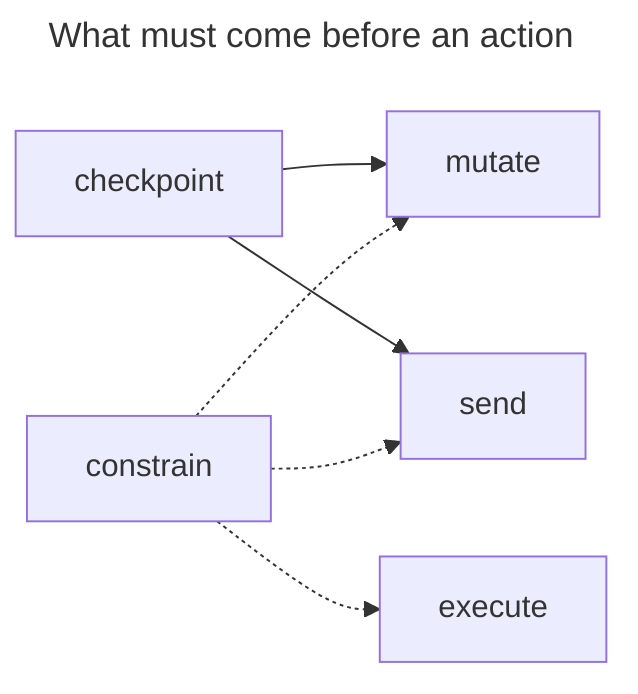
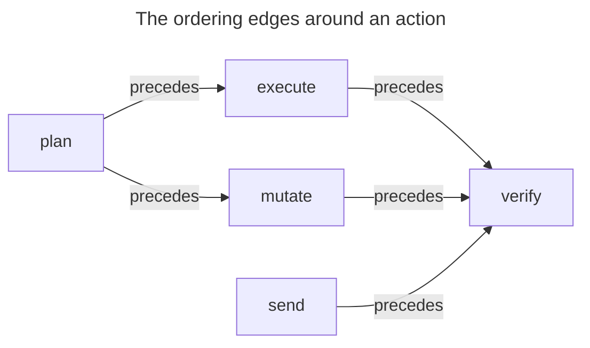
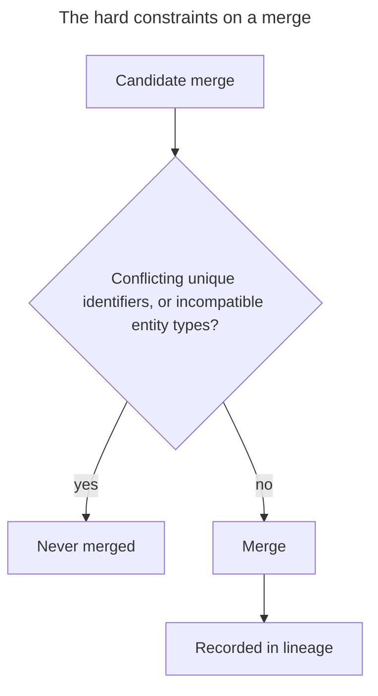
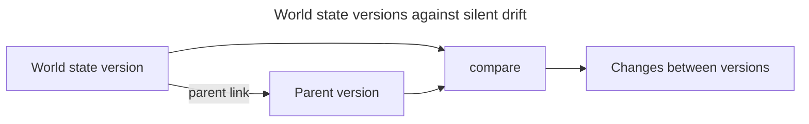
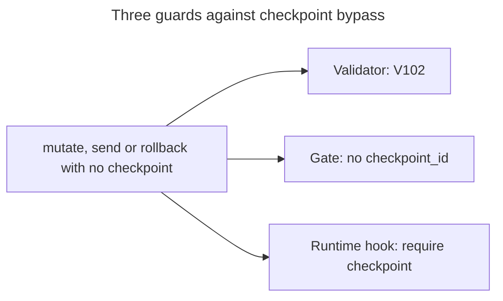
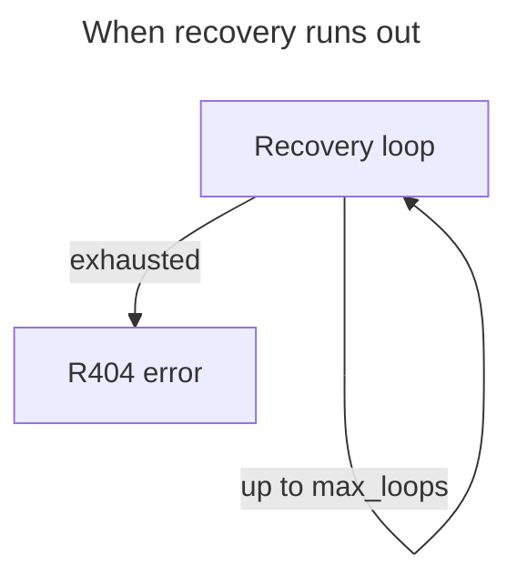
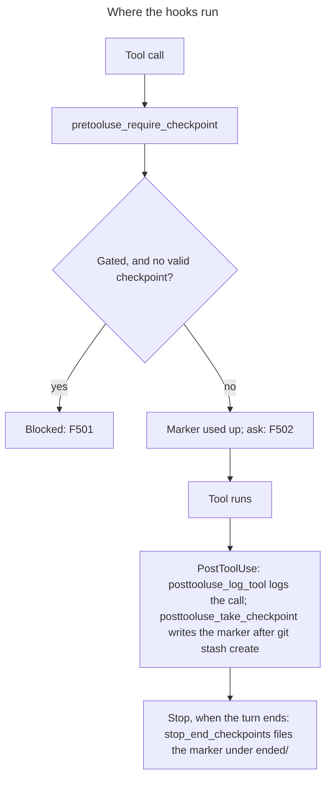

# Security Model

This document describes the security posture of the Agent Capability Standard, including threat model, mitigations, and responsible disclosure.

---

## 1. Core Safety Invariants

The standard is designed so **unsafe actions are hard by construction**.

### 1.1 Mutation Requires Checkpoint

Any `mutate`, `send` or `rollback` step MUST be preceded by a `checkpoint` step. The requirement follows the ontology's `requires_checkpoint` flag (`mutate`, `send`) and its `requires` edges from `checkpoint` (`mutate`, `send`, `rollback`), not the `mutation` flag: `checkpoint`, `audit` and `persist` are `mutation: true` but need no checkpoint. A step cannot weaken these flags; a weaker declaration is ignored (W602). This ensures:
- State can be restored if the mutation fails
- Partial execution can be recovered
- An audit trail can cover every change: a run started with `records:
  actions` records every step that ran ([STANDARD v1.2 §6.4](STANDARD-v1.2.0.md#64-audit-records)),
  every host keeps every run's run record ([§5.19.8](STANDARD-v1.2.0.md#5198-the-runs-record)),
  and the plugin's hook logs every tool call it can, reporting any it cannot

A checkpoint restores state, not effects ([STANDARD v1.2 §4.4.1](STANDARD-v1.2.0.md#441-checkpoints-and-rollback)): a rollback returns what its checkpoint captured, and cannot recall a transmission (reported `transmitted`) or reach a delegate's change elsewhere (`delegated`). A checkpoint never captures the host's audit log, its checkpoint state or its idempotency keys, so a rollback can neither erase the record nor bring back a used checkpoint nor let a send go twice.

### 1.2 Actions Are Ordered

The action capabilities (`execute`, `mutate`, `send`) are constrained by ontology edges:
- `checkpoint` (hard requirement, `requires`): State must be saved before `mutate` or `send`
- `constrain` (soft requirement, `soft_requires`): A policy check should run first; without one the validator warns (W601)
- `plan` (ordering, `precedes`): When a workflow has a plan, it must come before `execute` and `mutate`
- `verify` (ordering, `precedes`): A verification must come after the action it checks





### 1.3 Claims Must Be Grounded

Every output carries evidence anchors to evidence its producer had, or is
marked inferred with `inference_method` and `confidence` (STANDARD v1.2
§3.1). An anchor is `{ref, kind}`, with an optional `digest` of what was
read (§6.5); an output that reports an action cites the record of that
action. A grounding policy makes an executor or a safety layer check it:
an output that is neither grounded nor marked inferred, cites evidence its
producer did not have, or cites a workflow value outside what its step
binds, fails with F505 (§5.20).

### 1.4 Identity Merges Are Constrained

Hard constraints prevent catastrophic entity conflation:
- Never merge entities with conflicting unique identifiers
- Never merge across incompatible entity types
- Always record merge/split operations in lineage



### 1.5 Secrets Stay Out of Records

A secret (a password, an API key or token, a session cookie, a private key,
a credential in a URL or a header, or anything the host classifies as
secret) never enters an evidence anchor or record, a notification, a
canonical event, an audit record or a safety layer's record of a call, a
diagnostic or an `Error` a host returns, an executor's trace, or the data
`persist` stores (STANDARD v1.2 §6.7). Where one would be written it is
redacted: replaced by `[REDACTED]`, a transform with documented loss. A
`persist` of a secret is refused, not redacted, since memory is read back
as fact. Workflows carry no secrets: a host adds credentials where they are
used.

The reference implementations enforce this by code:

- The Python SDK's `Redactor` (registered values and default patterns) is
  applied by every evidence store, by the coordination audit log, by the
  runner to the `Error` messages it submits, and by the adapter to its
  records and refusals; the evidence collector keeps no `digest` of a tool
  response that holds a recognised secret.
- The TypeScript binding redacts every trace entry it writes and every
  `acs.evidence_recorded` notification, whether or not the tool registers
  secrets.
- The adapter and the binding refuse a `persist` or `audit` call whose data
  holds a credential-shaped value (F504, §5.18.10).
- The plugin's `persist` and `audit` skills block, in command hooks that
  share one scan (`hooks/secret_scan.sh`), content and audit records that
  hold one; the plugin's audit log keeps a digest of each tool input, never
  the input.

---

## 2. Threat Model

### 2.1 STRIDE Analysis

| Threat | Description | Mitigations |
|--------|-------------|-------------|
| **Spoofing** | Attacker impersonates a trusted source | Trust model with source verification, provenance tracking |
| **Tampering** | Attacker modifies data in transit or at rest | Schema validation, checkpoint/rollback, immutable observations |
| **Repudiation** | Actor denies actions | Audit trails, provenance, evidence anchors |
| **Information Disclosure** | Sensitive data exposed | Constrain capability for access control; secrets kept out of evidence, records, diagnostics and memory (STANDARD §6.7) |
| **Denial of Service** | System overwhelmed or blocked | Timeouts, retry limits, recovery loops |
| **Elevation of Privilege** | Unauthorized capability execution | Prerequisites, approval requirements, policy constraints |

### 2.2 Attack Scenarios

#### 2.2.1 Prompt Injection

**Scenario**: Malicious input tricks the agent into executing unintended actions.

**Mitigations**:
- Typed contracts validate input structure
- Gates can block suspicious patterns
- Audit trails enable forensic analysis
- Checkpoint enables rollback of compromised actions

**Residual Risk**: Prompt injection is primarily a runtime concern. The standard provides structure but not content filtering.

#### 2.2.2 Incorrect Identity Merges

**Scenario**: Two distinct entities are incorrectly merged, corrupting the world state.

**Mitigations**:
- Hard constraints prevent incompatible merges
- Alias confidence scoring requires threshold
- Merge operations are recorded in lineage
- World state versioning enables rollback

#### 2.2.3 Trust Manipulation

**Scenario**: Attacker spoofs a high-authority source to inject false information.

**Mitigations**:
- Source ranking is statically configured
- Time decay reduces stale authority
- Conflict resolution can escalate to human
- Provenance tracks source of all claims

#### 2.2.4 Silent Drift

**Scenario**: Gradual state corruption through unbounded updates.

**Mitigations**:
- World state versioning with parent links
- `compare` capability detects changes between world-state versions
- Retention policies bound state growth
- Anomaly detection capabilities



#### 2.2.5 Schema Spoofing

**Scenario**: Attacker provides data that passes schema validation but has malicious semantics.

**Mitigations**:
- Schema validation catches structural issues
- Consumer contract checking catches type mismatches
- Grounding requires evidence anchors
- Verify capability checks semantic correctness

#### 2.2.6 Binding Reference Attacks

**Scenario**: Workflow references non-existent or wrong step outputs.

**Mitigations**:
- Static validation of all binding paths
- Type checking of binding values
- Consumer contract checking
- Ambiguous type detection

#### 2.2.7 Checkpoint Bypass

**Scenario**: Mutation is executed without checkpoint, preventing rollback.

**Mitigations**:
- Validator rejects `mutate`, `send` and `rollback` without an earlier `checkpoint` step (V102)
- Gate can block if `${checkpoint_out.checkpoint_id} == null`
- Hook (pretooluse_require_checkpoint) enforces at runtime



#### 2.2.8 Recovery Loop Exhaustion

**Scenario**: Workflow enters infinite recovery loop.

**Mitigations**:
- max_loops limit on recovery
- Timeout on steps
- R404 error when recovery exhausted



#### 2.2.9 Exfiltration through `send`

**Scenario**: A model, steered by injected content, sends data to a
destination it chose.

**Mitigations** ([STANDARD v1.2 §4.4.2](STANDARD-v1.2.0.md#442-transmissions)):
- A destination policy, from the host or an applied profile's
  `allowed_destinations`, fails a `send` step whose destination it does not
  allow with F504, before anyone is asked and before a checkpoint is used;
  safety layers refuse such calls the same way, and, while a policy is in
  force, every call that may send where they cannot tell: a send whose
  destination they cannot read, a call of an unbound tool, and (a layer
  that does not see nested calls) a composite that invokes a send. Its
  suffix form names host
  or address suffixes only (`https://evil.net/?.example.com` does not end in
  `*.example.com` in its sense), and a prefix that starts an authority must
  finish it (`https://hooks.example.com:*` is invalid), so no pattern lets a
  URL reach another host
- Credentials scoped to the allowed origins (a token only those services
  accept, an egress allow-list) make a send the check misses fail too
- The approval shows the destination (W625 reports a 1.2 `send` whose
  `shows` hides it)
- At most one transmission per approval: every attempt of a pass carries
  one idempotency key, and a host never transmits twice under it. Keys are
  unique only while `run_id`s are: a host keeps them unique

---

## 3. Security-Critical Capabilities

### 3.1 VERIFY Layer

| Capability | Security Function |
|------------|-------------------|
| `checkpoint` | Enables recovery from failures and attacks |
| `rollback` | Restores known-good state |
| `verify` | Confirms outcomes match expectations |
| `audit` | Creates accountability trail |
| `constrain` | Enforces policy and access control |

### 3.2 Prerequisite Enforcement

| Capability | Required Before | Security Rationale |
|------------|-----------------|-------------------|
| `mutate`, `send` | `checkpoint` (required); `constrain` (recommended); `plan` (if present) | Recovery possible, no blind execution |
| `rollback` | `checkpoint` (required) | Must have state to restore |
| `execute` | `constrain` (recommended); `plan` (if present) | Policy checked before running |
| `verify` | `execute`, `mutate`, `send` (if present) | Checks results after the fact |

---

## 4. Implementation Guidance

### 4.1 Validator Security

The validator SHOULD:
- Reject unknown capabilities (V101)
- Reject missing prerequisites (V102)
- Reject invalid bindings (B201, B202)
- Reject type mismatches (B203)
- Reject ambiguous types (B204)
- Warn on unmet soft prerequisites (W601) and on safety flags declared weaker than the ontology (W602), which are ignored

### 4.2 Runtime Security

Implementations SHOULD:
- Enforce timeouts on all steps
- Limit retry attempts
- Create checkpoints before mutations
- Log every tool call and every refusal, with the layer and configuration that decided it (STANDARD 1.2.0 §5.18.8)
- Run a safety layer that fails closed (STANDARD 1.2.0 §5.18.8)
- Validate outputs against schemas
- Redact secrets before writing evidence or records (STANDARD 1.2.0 §6.7)
- Keep memory entries within their scope: a `recall` in another session, for another principal or another project does not find them (STANDARD 1.2.0 §4.5)
- Know the durability of the evidence and audit stores, and export what
  must outlive the session when it is written (STANDARD 1.2.0 §6.3, §6.6)

### 4.3 Configuration Security

Deployments SHOULD:
- Review trust model weights carefully
- Set appropriate time decay half-lives
- Configure approval requirements for high-risk actions
- Enable hooks for checkpoint enforcement
- Monitor audit logs for anomalies

---

## 5. Security Hooks



### 5.1 Pre-Tool Use Hooks

| Hook | Security Function |
|------|-------------------|
| `pretooluse_require_checkpoint.sh` | Classifies the call; one checkpoint per gated call; approval; rollback history |

The hook reads Claude Code's JSON payload only: a payload that is not a JSON object with a tool name, or a system without `jq`, is blocked with `R407 SAFETY_CHECK_FAILED:`. It classifies the call by its effect (STANDARD 1.2.0 §5.18.3): `Write`, `Edit`, `MultiEdit` and `NotebookEdit` are `mutate`; a `Bash` command is read as one simple command, and a command on a read-only list that is a subset of the SDK mapper's needs nothing, `git stash create` takes a checkpoint, `git stash list` and `git stash show` only read, `git stash pop <commit>` and `git stash apply <commit>` are `rollback` when `<commit>` is the full id of a commit a checkpoint marker recorded (git applies any merge commit as if it were a stash, so any other restore is `mutate`), and anything else, a line of several commands included, is `mutate`. A `mutate` call needs a valid checkpoint marker (`.claude/checkpoint.ok`, F501: whole-second times of at most 12 digits, taken no later than now and valid for at most 30 minutes) and uses it up: one rename moves it into `.claude/checkpoints/used/`, so each gated call needs its own. It is then asked for approval (`permissionDecision: "ask"` with an `F502 APPROVAL_REQUIRED:` reason) in the permission modes `default`, `acceptEdits` and `plan`, and blocked with F502 in the others, with the marker left in place; `ACS_HOOK_APPROVAL=off` leaves approval to Claude Code's permission rules. A `rollback` call restores a checkpoint the project recorded (the marker, or one filed under `.claude/checkpoints/used/` or `ended/`), so one was taken, and uses none. A failure of the hook itself blocks the call with R407. The reason always opens with the code and name of the refusal. The §5.3 example keeps exit code 2.

### 5.2 Post-Tool Use Hooks

| Hook | Security Function |
|------|-------------------|
| `posttooluse_log_tool.sh` | Logs every tool call to the audit trail |
| `posttooluse_take_checkpoint.sh` | Writes the checkpoint marker after a successful `git stash create` |
| `stop_end_checkpoints.sh` (Stop) | Ends the marker's validity when a turn ends (an execution boundary), filing it under `.claude/checkpoints/ended/` |

The log hook runs after every tool call, whether the call succeeded (`PostToolUse`) or failed (`PostToolUseFailure`), and appends one line to `.claude/audit.log`: the time, the event, the tool name, the skill name on a `Skill` call, a SHA-256 digest of the tool input, and `recorded_by`, the layer and its configuration (STANDARD 1.2.0 §5.18.8): the plugin's version, `config_sha256` (the SHA-256 of `hooks/hooks.json`) and `settings`, the effective values of the two environment settings that change the hooks' decisions (`approval`: `ask`, or `off` with `ACS_HOOK_APPROVAL=off`; `checkpoint_max_age_s`: `ACS_CHECKPOINT_MAX_AGE`, at most 1800). The tool input itself is not written, because a command, a file's content or a skill's arguments can hold a credential; a reader who holds an input can confirm it against the digest. A call that a pre-tool-use hook or a permission rule refused did not run and has no line. The lines form an HMAC chain that `tools/verify_audit_log.py` checks.

The checkpoint hook writes `.claude/checkpoint.ok` after a `git stash create` that succeeded: the call that saves the state takes the checkpoint (§5.18.6). Its expiry is `ACS_CHECKPOINT_MAX_AGE` seconds, at most 1800 (30 minutes, the Standard's cap). A newer marker replaces it, and the Stop hook ends its validity when a turn ends; either way it is filed under `.claude/checkpoints/ended/`, and an expired marker the pre-tool-use hook meets is filed there too. With `.claude/checkpoints/used/`, which holds the markers calls used, that is the history a rollback reads: a checkpoint can be restored valid or not (§5.18.6).

### 5.3 Adding Security Hooks

Custom security hooks can enforce additional policies. Claude Code passes the tool call to a command hook as JSON on stdin. A pre-tool-use hook blocks the call by exiting with code 2, and the reason it wrote to stderr is shown to the model. Any other non-zero exit code is a non-blocking error: the tool call proceeds. A hook that prints a reason and exits with code 1 therefore blocks nothing.

```bash
#!/usr/bin/env bash
# Example: Block writes to sensitive paths
input="$(cat)"
# A call that cannot be read (no jq, input that is not JSON) is blocked
if ! tool_name="$(printf '%s' "$input" | jq -r '.tool_name // empty' 2>/dev/null)" ||
   ! file_path="$(printf '%s' "$input" | jq -r '.tool_input.file_path // empty' 2>/dev/null)"; then
  echo "BLOCKED: cannot read the tool call" >&2
  exit 2
fi
if [[ "$tool_name" == "Write" && "$file_path" == /etc/* ]]; then
  echo "BLOCKED: Cannot write to /etc/" >&2
  exit 2
fi
exit 0
```

### 5.4 Checks Enforced by Code and Checks a Model Judges

The plugin declares hooks at two places. Its own hooks (`hooks/hooks.json`) run in every session that has the plugin enabled. Six skills (`audit`, `checkpoint`, `persist`, `rollback`, `send`, `transform`) declare further hooks in the frontmatter of their `SKILL.md`; Claude Code registers those when the skill is invoked and keeps them for the rest of the session.

A hook is of one of two kinds:

- A **command hook** is a program. It reads the tool call and decides by rule, so the same call always gets the same answer.
- A **prompt hook** sends the tool call and a list of conditions to a model in a single call and takes the model's verdict. Nothing checks the verdict. The model receives the hook's input, which holds the tool call and not the conversation, so a condition about anything else (whether the user approved, whether a checkpoint exists, what an allowlist holds) is judged without the fact.

The Standard states the checks of the capabilities host-neutrally (STANDARD 1.2.0 §5.18.10): a check it requires is decided by code, from the layer's records and the call's arguments; a model's judgement may add a refusal but never satisfies or replaces a required check. The table maps every condition of the six skills' hooks to the Standard's check it implements, or marks it a model-judged addition, which is not required. Each prompt hook opens by saying so.

| Skill, hook | Condition | Standard (1.2.0) | Enforced by |
|-------------|-----------|------------------|-------------|
| `skills/audit/SKILL.md`, command hook on `Bash` | A command that appends to `.claude/audit/records.jsonl` holds a credential-shaped value (the shared scan, `hooks/secret_scan.sh`: key and token formats, PEM keys, bearer tokens, a URL's userinfo password that is not a placeholder, an `Authorization` or `Proxy-Authorization` header's value of 8 or more characters mixing letters and digits, and an assignment to a credential name whose value is quoted with no whitespace and 8 or more characters, or unquoted, 12 or more characters, mixing letters and digits) | §5.18.10 `audit` secret row (§6.7, F504) | Code: blocks the call with `F504 CONSTRAINT_VIOLATED:` |
| `skills/audit/SKILL.md`, PostToolUse command hooks on `Read`, `Grep` | Log the call with a digest of its input | §5.18.8 records (logging, not a check) | Code: records |
| `skills/checkpoint/SKILL.md`, prompt hook on `Bash` | Scope covers every file to be mutated | Model-judged addition, not required | A model judges |
| `skills/checkpoint/SKILL.md`, prompt hook on `Bash` | No sensitive file is captured | Model-judged addition, not required (§6.7 governs records and evidence, not restore content) | A model judges |
| `skills/checkpoint/SKILL.md`, prompt hook on `Bash` | Reason documented; type fits the operation; storage location valid | Model-judged addition, not required | A model judges |
| `skills/checkpoint/SKILL.md`, PostToolUse command hooks on `Bash`, `Edit` | Log the call | §5.18.8 records | Code: records |
| `skills/persist/SKILL.md`, prompt hook on `Edit` | No credentials, keys or secrets in the content | §5.18.10 `persist` secret row (§6.7, F504): a check the Standard requires of code, which the command hook makes; the prompt is an addition | Code: the command hook (below); a model judges as well |
| `skills/persist/SKILL.md`, prompt hook on `Edit` | No personal data; no malicious code; stable knowledge; not a duplicate; no contradiction | Model-judged addition, not required | A model judges |
| `skills/persist/SKILL.md`, prompt hook on `Edit` | File within project scope | §5.18.10 `persist` target row (§5.18.3: a write outside the memory store is `mutate`) | Code: classification; the command hook's path rules narrow it further |
| `skills/persist/SKILL.md`, command hook on `Edit` | Path with `//`, `.` or `..` segments; under `/etc`, `/usr`, `/bin`, `/sbin`, `~/.ssh`, `~/.aws` or `~/.config`; a name ending in `.env`, `credentials`, `secrets`, `password`, `.pem` or `.key` | §5.18.10 `persist` target row, host-specific narrowing | Code: blocks the call with `F504 CONSTRAINT_VIOLATED:` |
| `skills/persist/SKILL.md`, command hook on `Edit` | The content written (`new_string` or `content`) holds a credential-shaped value (the shared scan, `hooks/secret_scan.sh`, as for `audit`) | §5.18.10 `persist` secret row (§6.7, F504): refused, not redacted, since memory is read back as fact | Code: blocks the call with `F504 CONSTRAINT_VIOLATED:` |
| `skills/persist/SKILL.md`, PostToolUse command hook on `Edit` | Log the call | §5.18.8 records | Code: records |
| `skills/rollback/SKILL.md`, prompt hook on `Bash` | Checkpoint exists and is valid; not expired | Removed from the prompt: §5.18.10 `rollback` row (F503); an expired or used checkpoint can be restored (§5.2.2) | Code: the safety layer |
| `skills/rollback/SKILL.md`, prompt hook on `Bash` | Current state captured; scope matches; no conflicting operation; integrity verified; no loss beyond scope; uncommitted changes not overwritten | Model-judged addition, not required | A model judges |
| `skills/rollback/SKILL.md`, command hook on `Bash` | A `git stash pop` or `git stash apply` whose one argument is not the full id of a commit a checkpoint marker of the project recorded (the marker, or one under `.claude/checkpoints/used/` or `ended/`) | §5.18.10 `rollback` row (F503), host-specific form: in this skill a restore must be of a checkpoint taken in the project, valid or not; the plugin's pre-tool-use hook counts the same restore as `rollback` and any other as a gated `mutate` | Code: blocks the call with `F503 ROLLBACK_FAILED:` |
| `skills/rollback/SKILL.md`, PostToolUse command hook on `Bash` | Log the call | §5.18.8 records | Code: records |
| `skills/send/SKILL.md`, prompt hook on `Bash` | Destination on the allowlist | §5.18.10 `send` destination row (§4.4.2, F504) where a policy is in force; a model-judged addition only where none is | Code (policy), else a model |
| `skills/send/SKILL.md`, prompt hook on `Bash` | No sensitive data in the payload | Model-judged addition, not required | A model judges |
| `skills/send/SKILL.md`, prompt hook on `Bash` | User approved; checkpoint exists; rate limits | Removed from the prompt: §5.18.10 `mutate`, `send` row (F502, F501) and a host policy (F504, §5.18.8) | Code: the safety layer |
| `skills/send/SKILL.md`, command hook on `Bash` | A `curl`, `wget` or `http` command names as a host `localhost` (in any case), `127.0.0.1` or a private IPv4 address (`10.x.x.x`, `172.16.x.x` to `172.31.x.x`, `192.168.x.x`) | §5.18.10 `send` destination row, host-specific narrowing | Code: blocks the call with `F504 CONSTRAINT_VIOLATED:` |
| `skills/send/SKILL.md`, PostToolUse command hook on `Bash` | Log the call | §5.18.8 records | Code: records |
| `skills/transform/SKILL.md`, prompt hook on `Read` (removed after its first successful run) | Source exists, is readable, format understood | Model-judged addition, not required | A model judges |
| `skills/transform/SKILL.md`, prompt hook on `Read` | No sensitive data exposed by the transformation | §5.18.10 `transform` row (a secret is redacted where the output is recorded, §6.7): a check the Standard requires of code; personal data: a model-judged addition | A model judges; code: the plugin records no output (its audit log keeps a digest of the input), and the SDK adapter's `Redactor` and the binding's `redactJson` redact what each records |
| `skills/transform/SKILL.md`, prompt hook on `Read` | The transformation is logged | §5.18.8 records | Code: the layer records every call |
| `skills/transform/SKILL.md`, PostToolUse command hook on `Read` | Log the call | §5.18.8 records | Code: records |

The plugin's own hooks implement these rows for the calls they see:

| Plugin hook | Check | Standard (1.2.0) | Enforced by |
|-------------|-------|------------------|-------------|
| `hooks/pretooluse_require_checkpoint.sh` | A valid checkpoint marker for this gated call alone, used up by the call | §5.18.6 (F501) | Code: blocks the call |
| `hooks/pretooluse_require_checkpoint.sh` | Approval asked in modes that reach a person; blocked in others | §5.18.7 (F502) | Code: asks or blocks |
| `hooks/pretooluse_require_checkpoint.sh` | A rollback restores a checkpoint a marker of the project recorded; any other restore is a `mutate` | §5.18.3, §5.18.6 | Code: classifies the call |
| `hooks/pretooluse_require_checkpoint.sh` | A failure of the hook blocks the call | §5.18.8 (R407) | Code: blocks the call |
| `hooks/posttooluse_take_checkpoint.sh` | The marker is written by a successful `git stash create`; a marker it replaces is filed under `.claude/checkpoints/ended/` | §5.18.6 | Code: records |
| `hooks/stop_end_checkpoints.sh` | The marker's validity ends when a turn ends: it is filed under `.claude/checkpoints/ended/`, where a rollback can still restore its commit | §5.18.6 (execution boundary) | Code: records |
| `hooks/posttooluse_log_tool.sh` | Every tool call that ran is logged, with a digest in place of its input and the configuration that decided it | §5.18.8 records | Code: records, cannot block |

Three consequences follow:

- The checkpoint and approval requirements of §1.1 do not rest on a prompt. For a tool call they are enforced by the plugin's pre-tool-use hook (or a safety layer such as the SDK adapter), and for a workflow by the validator and the executor. No prompt hook asks about approval, a checkpoint or rate limits any more.
- The command hooks match text. A private address reached through a host name, or a system directory reached through a relative path or a symbolic link, is not matched. They narrow what a skill can do; they are not a sandbox.
- A command hook needs `jq` to read the tool call. Without it the three blocking skill hooks and the plugin's pre-tool-use hook block the call, since they cannot read it, the audit hook writes nothing, and the skills' logging hooks write their line with `unavailable` in place of the digest.

These hooks are Claude Code's mechanism, one implementation of the checks the Standard states as requirements of the capabilities (§5.18.10). A host that loads a skill's text as instructions without running its frontmatter hooks applies those checks by other means, or its safety layer does not cover the skill's calls and its conformance statement says so; a host that claims a conforming safety layer runs no covered call without the layer's decision (§5.18.8).

### 5.5 Hooks and the Safety-Layer Class

The plugin's hooks apply the rules of STANDARD 1.2.0 §5.18 where Claude Code lets them, and do not claim the safety-layer class SL (§10.4). Their host gaps:

- A command hook that cannot start, or that times out, lets Claude Code run the call: there is no fail-closed hook mode.
- A call refused at Claude Code's permission prompt has already used the marker, which the pre-tool-use hook took before it asked.
- Only five tools are routed to the pre-tool-use hook (`Write`, `Edit`, `MultiEdit`, `NotebookEdit`, `Bash`); every other tool, MCP tools included, is not checked.
- The main agent and its subagents share one marker.

The Python SDK adapter (`grounded_agency.GroundedAgentAdapter`) and the Standard Agents binding (`examples/standard_agents/`) implement §5.18. The binding claims class SL; the adapter meets §10.4 except the §5.18.10 row its conformance statement lists as not applied (the output contract of a tool's result), and claims class SL once it is applied. Both apply the secret checks and redaction of §6.7 and the destination policies of §4.4.2. Their conformance statements are `tests/conformance/calls/statements/grounded_agency_adapter.json` and `tests/conformance/calls/statements/standard_agents_binding.json`, and they pass the binding and call-sequence fixtures their statements' features cover ([CONFORMANCE.md](CONFORMANCE.md#safety-layer-conformance-class-sl)).

---

## 6. Incident Response

### 6.1 Detection

Signs of security issues:
- Unexpected F5xx (safety) errors in logs
- High rate of rollback operations
- Audit entries without corresponding checkpoints
- World state versions without parent links

### 6.2 Response

1. **Contain**: Stop affected workflows
2. **Assess**: Review audit logs and world state history
3. **Rollback**: Restore to last known-good checkpoint
4. **Investigate**: Trace provenance to identify root cause
5. **Remediate**: Update policies, trust weights, or constraints

### 6.3 Recovery

- Use `rollback` capability to restore checkpointed state
- Use world state versioning to identify last-good version
- Use audit logs to reconstruct what happened

---

## 7. Responsible Disclosure

### 7.1 Reporting Vulnerabilities

Please report security vulnerabilities privately:

**Email**: security@synapti.ai

**PGP Key**: Available upon request

### 7.2 What to Include

- Description of the vulnerability
- Steps to reproduce
- Impact assessment
- Suggested remediation (if any)

### 7.3 Response Timeline

| Phase | Target |
|-------|--------|
| Acknowledgment | 48 hours |
| Initial assessment | 7 days |
| Remediation plan | 14 days |
| Fix release | 30 days (90 days for complex issues) |
| Public disclosure | After fix release |

### 7.4 Credit

We will credit reporters in:
- Release notes
- Security advisories
- CHANGELOG

Unless anonymity is requested.

---

## 8. Security Checklist

### 8.1 For Workflow Authors

- [ ] All mutations have preceding checkpoints
- [ ] Recovery loops have max_loops limits
- [ ] Steps have appropriate timeouts
- [ ] Gates block unsafe conditions
- [ ] Failure modes have recovery paths
- [ ] Bindings are typed when ambiguous

### 8.2 For Implementers

- [ ] Validator enforces all V1xx and B2xx errors
- [ ] Runtime enforces timeouts and retry limits
- [ ] Audit logging is enabled
- [ ] Checkpoint storage is reliable
- [ ] Trust model weights are reviewed
- [ ] Secrets are registered with the redactor; the evidence store's durability is known

### 8.3 For Operators

- [ ] Security hooks are enabled
- [ ] Audit logs are monitored
- [ ] Incident response plan exists
- [ ] Trust model is configured appropriately
- [ ] Approval workflows are defined for high-risk actions

---

## 9. Future Security Considerations

### 9.1 Planned Enhancements

- Cryptographic signing of checkpoints
- Role-based capability authorization
- Encrypted audit log storage
- Automated anomaly detection
- Multi-party approval workflows

### 9.2 Open Research Questions

- How to detect semantic-level prompt injection?
- How to verify AI-generated claims without external validation?
- How to balance automation with human oversight?

---

## References

- [OWASP Top 10](https://owasp.org/www-project-top-ten/)
- [STRIDE Threat Model](https://docs.microsoft.com/en-us/azure/security/develop/threat-modeling-tool-threats)
- [NIST Cybersecurity Framework](https://www.nist.gov/cyberframework)
- [Claude Code hooks reference](https://code.claude.com/docs/en/hooks)
