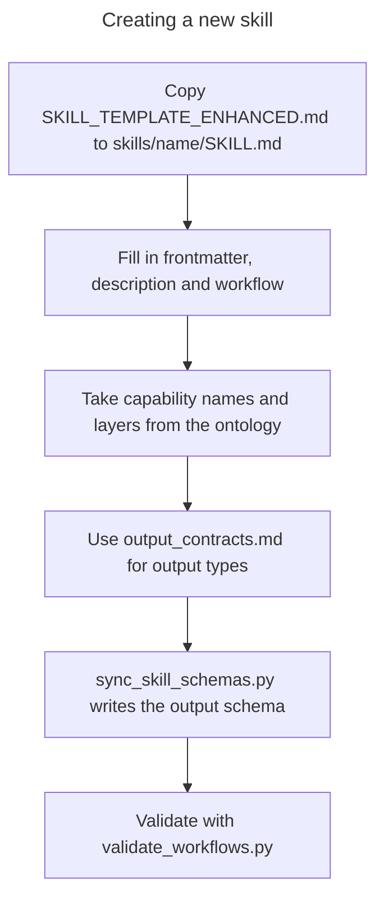

# Templates

This directory contains templates and shared patterns for skill development.

## Available Templates

| Template | Purpose |
|----------|---------|
| `SKILL_TEMPLATE_ENHANCED.md` | Complete skill template with all sections |
| `output_contracts.md` | Quick reference for output contract types |
| `composition_patterns.md` | Patterns for composing skills into workflows |
| `verification_patterns.md` | Patterns for skill verification and testing |

## Creating a New Skill

1. Copy `SKILL_TEMPLATE_ENHANCED.md` to your skill directory:
   ```bash
   cp templates/SKILL_TEMPLATE_ENHANCED.md skills/<skill-name>/SKILL.md
   ```

2. Fill in required sections:
   - **Frontmatter**: name, layer, capabilities, inputs, outputs
   - **Description**: What the skill does
   - **Workflow**: Steps and bindings

3. Take valid capability names and their layers from
   `schemas/capability_ontology.yaml`

4. Use `output_contracts.md` for output type definitions. Each capability's
   full output schema is in the ontology, and `python tools/sync_skill_schemas.py`
   writes it to `skills/<name>/schemas/output_schema.yaml`



## Composition Patterns

See `composition_patterns.md` for:
- Sequential composition
- Parallel execution
- Conditional branching
- Recovery loops
- Gate patterns

## Validation

After creating a skill, validate it:
```bash
python tools/validate_workflows.py
```
